Administration keeps a MISP instance usable, recoverable and appropriate for its community.
Start with account and organisation boundaries, then establish a routine for service health,
background jobs, updates and backups. A successful page load is only one part of that routine.

::: {.callout-note}
This chapter follows MISP **3.0.0**, `3.0_wip` commit
[`99ebee729`](https://github.com/MISP/MISP/commit/99ebee729702c560528f9788953719bda68aa1c1),
in light mode. This is a development branch; choose an approved release and
tested deployment procedure for a production upgrade. Select a figure to enlarge it.
:::

<!-- Sources, fixture checks and capture hashes: ../assets/administration-screenshots.json -->

<a id="managing-correlation-exclusions"></a>
<a id="the-schdlr-worker-is-not-starting"></a>
<a id="get-list-of-workers"></a>

## Plan administrative access {#admin-access}

A **site administrator** manages the instance, its settings and all organisations. An
**organisation administrator** manages users within their own organisation, subject to the
role and account restrictions. Organisation administration does not grant server settings,
workflow administration or access to another organisation's user accounts.

Use separate accounts for daily analysis, instance administration and integrations. Record who
owns each service account, what it may access and how its key is rotated. Review effective role
flags as well as the role's name: roles can be changed locally and names are not a permission contract.


<a id="listing-all-users"></a>

## Manage users {#users}

Open **Administration → Users**. The 3.0 list exposes organisation, role, TOTP/PGP status and
account status, with filtering and row actions. Use it to review inactive accounts, unexpected
administrative roles and accounts that still need their authentication setup.

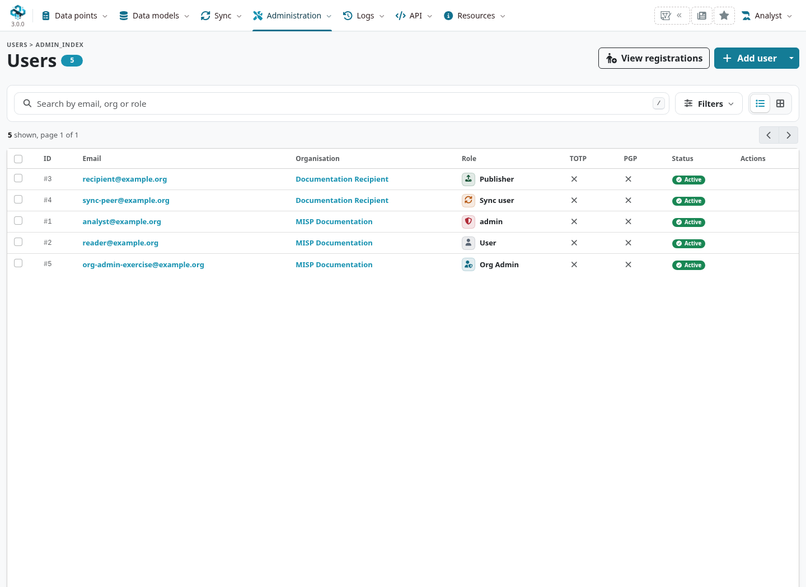

<a id="adding-a-new-user"></a>
<a id="contacting-a-user"></a>
<a id="setting-a-publish-alert-filter"></a>

### Add or change an account {#admin-add-user}

Choose **Add user**, then set:

- **Email**: the login identity and notification address.
- **Organisation**: the user's local organisation. Check it before assigning permissions.
- **Role**: the required data access and feature permissions, not an administrator role by default.
- **Password and delivery**: decide whether to set a temporary password and whether MISP should
  email credentials. Verify the mail configuration before relying on delivery.
- **Options**: publication/contact notifications and disabled status, as appropriate.
- **PGP key / NIDS SID**: the user's mail-encryption key and IDS export rule-ID offset where used.

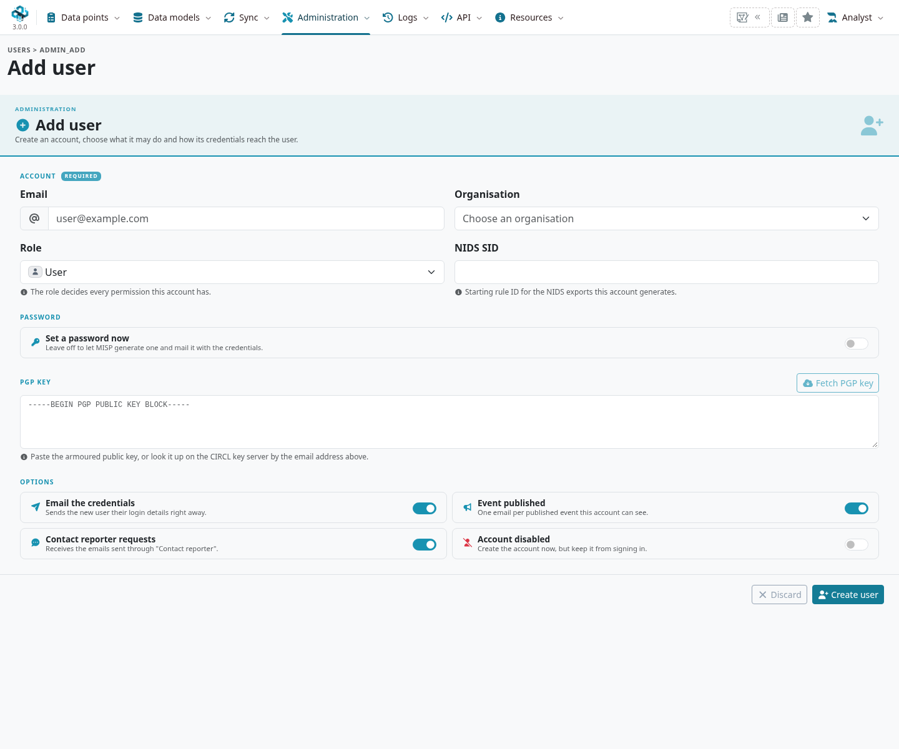

Use the account's edit and password-reset actions for changes; check whether the next login
will require a password change. A password reset can send mail or change credentials, so it is
an operational action rather than a way to inspect an account. Follow the instance's password
policy and deliver credentials through the agreed channel.

Prefer **disabling** a departing user's account to deleting its identity and history. Disabled
accounts cannot authenticate with their keys. Review/revoke their integration keys and transfer
ongoing responsibilities deliberately. A user's public reporting identity is not an invitation
to reuse their personal key in a service.

The **Contact users** feature can send notices, registration messages or password resets.
Review recipients, encryption and the selected action before submitting it. Event publication
alerts and contact-reporter subscriptions are separate notification choices.

### Publication alert filters {#various-administration-tips-tricks}

Use the per-user `publish_alert_filter` setting to narrow publication-alert mail by supported
tag, creator-organisation or threat-level conditions. It accepts a JSON condition tree, including
AND/OR/NOT; review the filter and notification subscription together. Filtering mail does not
change the user's event visibility or the event's distribution. For example, this filter excludes
alerts whose event or attribute tags match `tlp:clear`:

```json
{
  "NOT": {
    "Tag.name": ["tlp:clear"]
  }
}
```

Check the active per-user filter in user settings, using the authorised self/organisation-admin
scope, and test the intended matches before relying on notification delivery.

<a id="advanced-authentication-keys"></a>
<a id="administration-of-totphotp"></a>
<a id="mandating-totphotp-usage"></a>
<a id="transitioning-from-e-mail-otp-to-totphotp"></a>
<a id="how-to-use-totphotp"></a>

### Authentication keys and MFA {#admin-authentication}

Manage individual keys under **Account → My Profile → Auth keys**, or the authorised user's
profile. Use comments, expiry, source-IP restrictions and read-only keys where suitable.
The raw key is shown once when generated. See [Automation & API](../automation/index.qmd#api-authentication)
for request authentication, rotation and read-only POST searches.

In **Server Settings & Maintenance → Users & access**, review password, session, brute-force
and OTP settings together. The TOTP column in the user list reports enrollment; it does not
prove every authentication path uses the same policy.

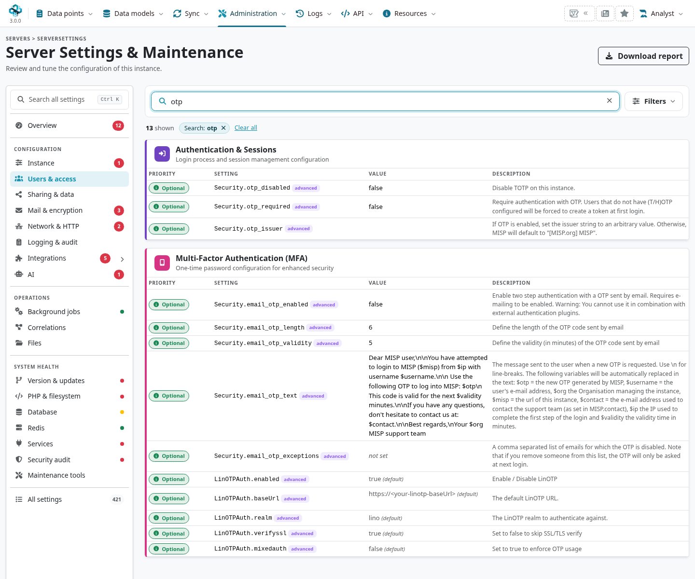

For built-in TOTP/HOTP:

1. Check PHP dependency health, authenticator compatibility and server time synchronization.
2. Have users enroll from their own profile and verify a code. Do not collect or screenshot
   their enrollment secret, QR code or recovery material.
3. Establish identity verification and an administrator recovery procedure before enforcing OTP.
4. Set `Security.otp_required` only after the rollout is ready. Users without a token are then
   required to enroll, except accounts with an applicable **Skip OTP Reqs** role exemption.

A site/organisation administrator can remove a user's token within the permitted scope, using
the user profile's TOTP action. This removes enrollment; it does not disable the instance-wide
requirement. The user must enroll again if required. Keep service-account exemptions narrow.
Built-in email OTP and TOTP can coexist during a transition; external identity-provider/LinOTP
policies need their own configuration. See [Using MISP](../using-the-system/index.qmd).

<a id="adding-a-new-organisation"></a>
<a id="listing-all-organisations"></a>
<a id="merge-organisations"></a>
<a id="cerebrate"></a>
<a id="adding-organisation-logos"></a>

## Maintain organisation identities {#organisations}

Open **Administration → Organisations**. Local organisations can have accounts on this
instance; remote organisations represent known peers/identities without granting local logins.
Keep the **UUID** consistent for the same organisation across instances. Local numeric IDs
are not portable, and a matching name alone does not establish identity.

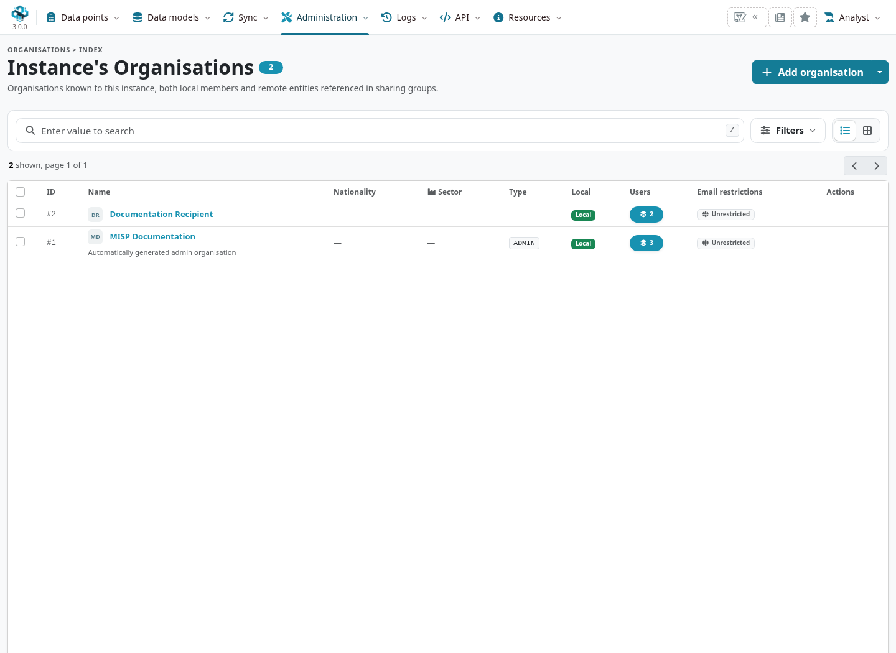

When adding an organisation, review its name, UUID, local flag, description, country/sector,
contacts and any email-domain restrictions. Add logos through **Server Settings & Maintenance
→ Files**, following the accepted filename/type rules; do not give the web application broad
filesystem write access to upload a logo.

Editing a name is different from merging identities. **Merge organisations** transfers users
and data toward the selected target and can remove the source organisation. Confirm the
source/target UUIDs, data ownership and sharing-group consequences, and take a recoverable
backup before proceeding. The current delete actions reject organisations still holding users
or events; deleting one is not an alternative to an ownership review.

Use [Cerebrate](../sharing/index.qmd#cerebrate) or
[sharing-group blueprints](../sharing/index.qmd#sharing-group-blueprints) where appropriate for
community identity management. A directory entry does not itself authorize event access.

<a id="adding-a-new-role"></a>
<a id="listing-roles"></a>
<a id="benchmarking"></a>

## Design roles and resource limits {#roles}

Open **Administration → Roles**. A role combines one base data-access level with individual
feature flags and resource limits. The default role is marked in the list; review it whenever
changing onboarding policy. Changes to a shared role affect every account assigned to it.

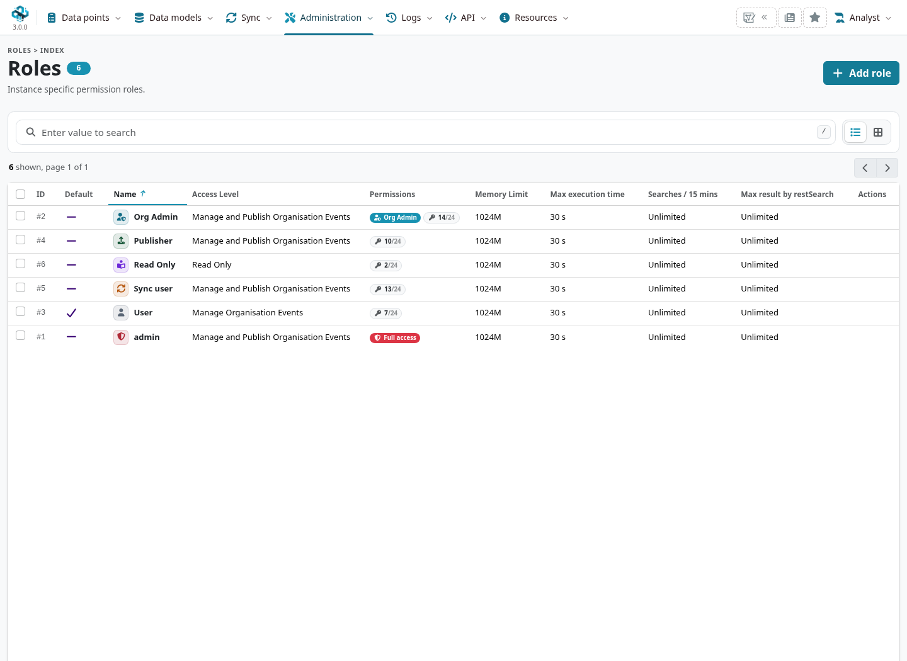

::: {.table-responsive}

| Base level | Data operations |
|---|---|
| Read Only | Browse data visible to the account. |
| Manage Own Events | Create and maintain the user's own events without publishing them. |
| Manage Organisation Events | Maintain events owned by the user's organisation, without publishing. |
| Manage and Publish Organisation Events | Also publish the organisation's events. |

:::

Additional flags include site/organisation administration, API access, tagging/tag editing,
sharing-group editing, sightings, object/galaxy/warninglist/decay-model editing and Analyst Data
creation. Sync flags, ZeroMQ/Kafka publishing and server signing grant specialised capabilities;
review them against the [sharing](../sharing/index.qmd) and [integration](../connectors/index.qmd)
design rather than adding them to every analyst role.

The 3.0 **AI tools** permission is separate from ordinary event editing. It permits supported
assisted-analysis actions on events the user may edit when the AI service is enabled. Granting
it does not configure the service or approve sending data to a provider. See [Modules](../modules/index.qmd#modules-ai).

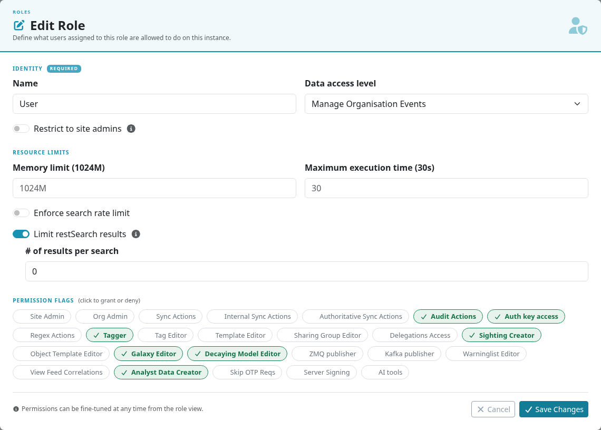

Set memory/time limits, search rate limits and maximum `restSearch` results for the workload.
A result cap is not a substitute for client pagination; an integration should handle both limits
and empty/error responses. Reassign users before deleting a role. Test a representative regular
account after a permission change, including an operation that should be refused.

<a id="tools"></a>

## Use grouped settings and health checks {#server-settings-and-maintenance}

Open **Administration → Server Settings & Maintenance**. MISP 3.0 replaces the old tab strip
with grouped navigation, searchable settings and separate health pages. The underlying names
such as `MISP.*`, `Security.*` and `Plugin.*` remain useful for API/CLI configuration.

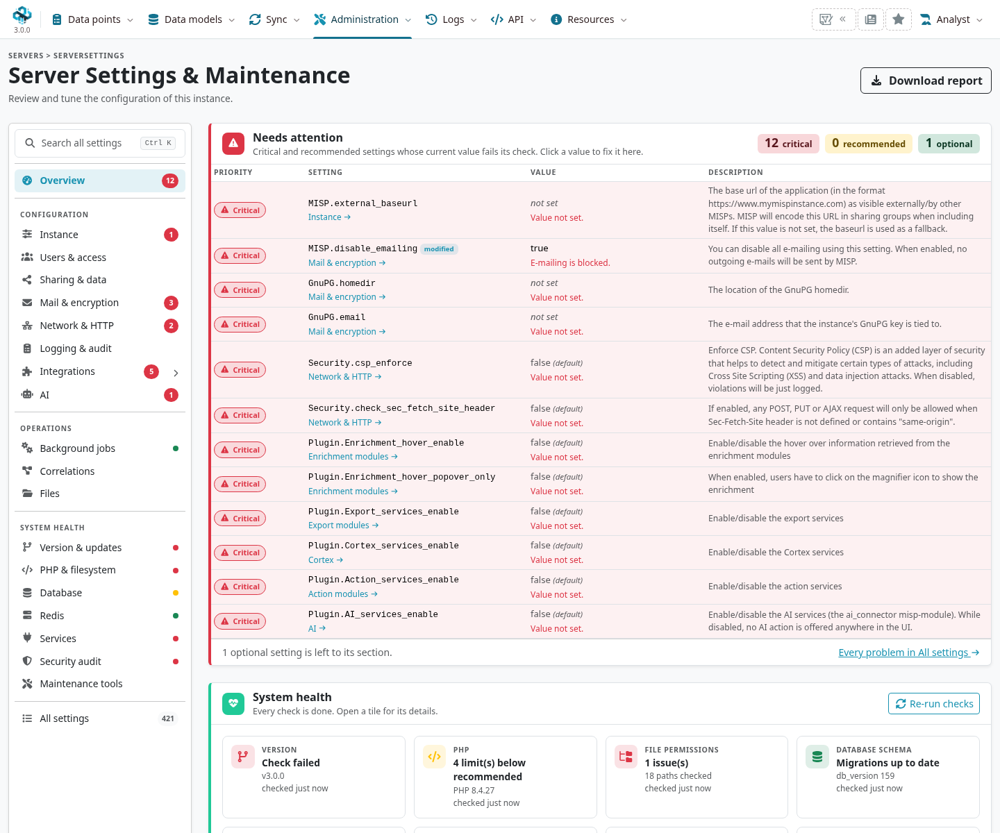

::: {.table-responsive}

| Area | Start here |
|---|---|
| Configuration | Instance; Users & access; Sharing & data; Mail & encryption; Network & HTTP; Logging & audit; Integrations; AI. |
| Operations | Background jobs; Correlations; Files. |
| System health | Version & updates; PHP & filesystem; Database; Redis; Services; Security audit; Maintenance tools. |
| All settings | Search across settings when you know a setting name but not its new group. |

:::

Inspect the priority, current value, validation message and description before changing a
setting. **Advanced**, **CLI only**, **File only** and redaction labels constrain where/how a
value can be managed. A red finding can also describe a deliberately disabled optional service;
read the condition rather than enabling every integration to clear a counter.

Keep production debugging off. Treat a downloaded settings report as potentially sensitive;
review it before attaching it to a support issue. Configuration managed by a deployment tool,
container environment or mounted file must be changed at that source so it survives recreation.

<a id="other-2.5-administration-features"></a>
<a id="dashboards"></a>
<a id="default-sharing-level"></a>
<a id="how-to-redirect-http-to-https"></a>
<a id="increase-max-size-of-samples-other-files"></a>
<a id="more-information-in-the-notification-emails-about-new-events"></a>
<a id="various-administration-tips--tricks"></a>
<a id="increase-max-size-of-samples--other-files"></a>

### Defaults, mail and network configuration {#admin-configuration-baseline}

- Review default distributions for events, attributes, objects, event reports and Analyst Data.
  Defaults affect new data; they do not reclassify existing records. Unpublished does not mean
  private: use distribution and sharing groups for the intended audience.
- Configure the external/base URL, HTTPS termination and trusted proxy handling together.
  Use the current deployment's web-server configuration and certificate trust; do not copy an
  old Apache configuration or disable peer verification to make a connection work.
- Configure notification sender/support addresses, signing and user encryption preferences.
  Subjects and routing metadata may remain visible even when the message body is encrypted.
  Review `MISP.extended_alert_subject` before including event details in mail subjects.
- Coordinate reverse-proxy upload limits, PHP `upload_max_filesize`/`post_max_size`, execution
  time, memory and any attachment backend limits. Use the web PHP runtime's configuration;
  changing CLI PHP alone does not change uploads.

<a id="errors-about-fields-or-tables"></a>

### Check the database and MISP 3.0 migrations {#admin-database}

The **Database** health page separates schema/migration state, table space usage and engine
configuration recommendations. A cache clear does not repair a missing migration, an
interrupted value conversion or lost data.

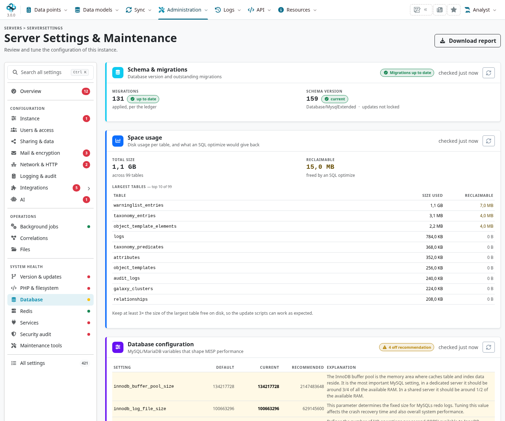

MISP 3.0 introduces a migration ledger and a shared attribute-value dictionary. Check both
legacy numeric updates and migration status when upgrading. On a source installation:

```bash
sudo -u www-data /var/www/MISP/app/Console/cake Admin migrationStatus
sudo -u www-data /var/www/MISP/app/Console/cake Admin schemaDiagnostics
```

`Admin migrationStatus --json` produces a structured report. `Admin migrationApply --dry-run`
prints planned migration SQL without applying it; on an up-to-date instance it reports that
nothing is pending. These checks do not establish that a large upgrade will fit the available
disk space or complete within the maintenance window.

Use the selected release's upgrade procedure and the [dependency chapter](../updating-python/index.qmd).
The current **`Admin runUpgrade`** coordinates an offline upgrade: numeric updates, migrations
and the attribute-value conversion where due, plus worker stop/restart requests. A failed run
can leave the instance offline and partially converted; inspect its output and rerun the
supported procedure rather than marking migrations applied by hand.

Before it runs, stop external writers and scheduled ingestion, take a consistent backup, check
space and rehearse on a restored copy. Check that workers really stopped; the command can
report a Supervisor failure. PostgreSQL upgrades also have engine-specific prerequisites,
including `pg_trgm` for the relevant value migration. Use a persistent terminal/session for a
long conversion. Restart the web PHP runtime after an upgrade, as directed by the command.

<a id="managing-correlations"></a>
<a id="correlation-exclusions"></a>
<a id="correlation-rules"></a>
<a id="over-correlating-values"></a>
<a id="top-correlations"></a>
<a id="correlation-engine"></a>
<a id="decaying-models"></a>

### Values, correlations and retention {#admin-correlations}

A MISP 3.0 **value address** is not an attribute occurrence. Values can be referenced by Analyst
Data and collections; correlation suppression, detection eligibility and source visibility
remain separate decisions. Do not manually truncate value tables to reduce correlation noise.

::: {.table-responsive}

| Control | What it changes |
|---|---|
| Correlation exclusions | Suppress matching values from correlation. Leading/trailing `%`{.text-wrap .text-break} support substring patterns. Use the cleaner to remove existing matches where appropriate. |
| Correlation rules | Exclude event sets from correlating, using creator/owner organisation, event ID or event-info selectors. Inspect the matching set before executing a cleanup. |
| Over-correlating values / Top correlations | Find high-volume matches. `MISP.correlation_limit`{.text-wrap .text-break} limits correlations for a value; increasing it may increase cost and noise. |
| Correlation engine | Select the supported engine for the database and audience. `NoAcl`{.text-wrap .text-break} is not a general replacement for the default ACL-aware engine; `OnDemand`{.text-wrap .text-break} is MySQL/MariaDB-only in this branch. |
| Value dictionary statistics | Maintain counts used by the values index. `Admin valueDictionaryStats`{.text-wrap .text-break} refreshes statistics; it is not a read-only report or a value-deletion command. |

:::

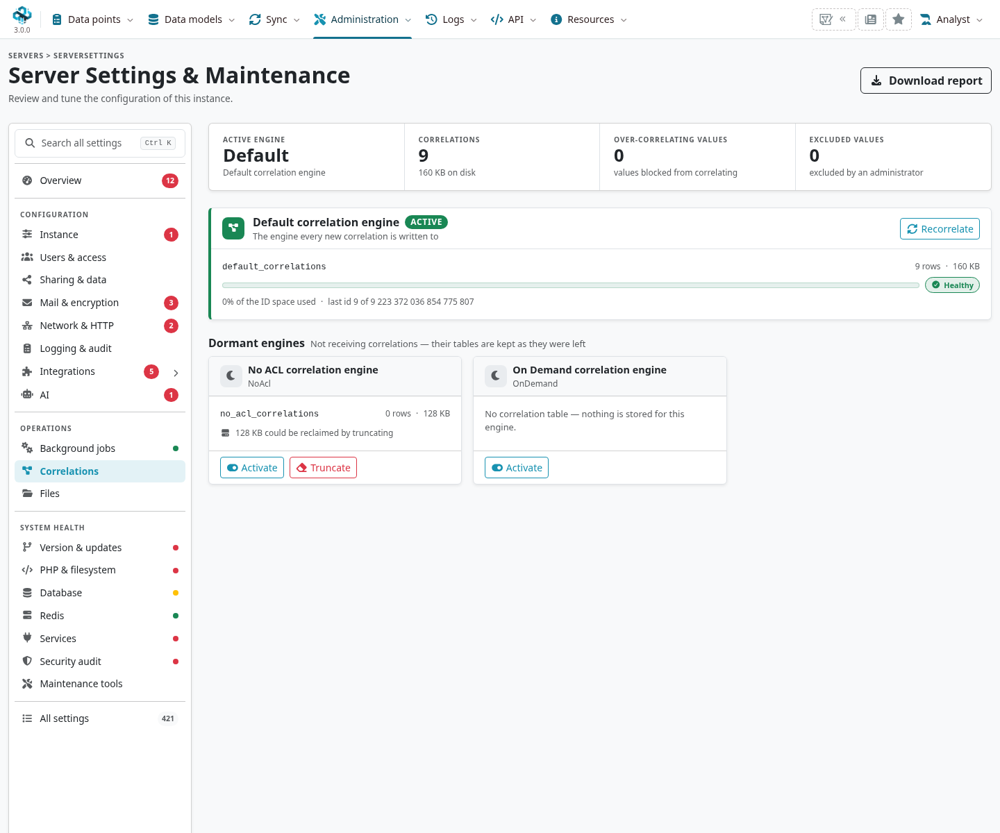

Changing correlation does not mark a value benign, delete an observation or withdraw a
previous downstream detection. Use the relevant data lifecycle and connector controls as well.
Coordinate retention of logs, attachments, jobs and research data with backup and sharing needs;
removing a reference does not necessarily remove its source occurrence.

<a id="blocklists-and-block-rules"></a>
<a id="event-blocklist"></a>
<a id="blocklisting-an-event"></a>
<a id="viewing-event-blocklist-entries"></a>
<a id="event-block-rules"></a>
<a id="organisation-blocklist"></a>
<a id="blocklisting-an-organisation"></a>
<a id="viewing-organisation-blocklist-entries"></a>
<a id="analyst-data-blocklist"></a>
<a id="import-regexp"></a>
<a id="the-purpose-of-import-regexp-entries"></a>
<a id="adding-and-modifying-entries"></a>
<a id="managing-the-signature-allowedlist"></a>
<a id="allowlisting-an-address"></a>
<a id="managing-the-list"></a>

## Control incoming data {#admin-ingestion-controls}

Use the control that matches the problem; these lists are not interchangeable:

::: {.table-responsive}

| Control | Scope |
|---|---|
| Event blocklist | Event UUIDs rejected on creation/import/sync when enabled. Blocking an existing event does not delete it. Deletion can add an event to this list when event blocklisting is enabled. |
| Organisation blocklist | Creator-organisation UUIDs rejected for event intake/sync. It is not an account-login ban. |
| Sighting blocklist | Organisations whose sightings should not be stored, when sighting blocklisting is enabled. |
| Galaxy-cluster / Analyst Data blocklists | Specific cluster or research-record UUIDs rejected on capture/sync. These lists have no separate enable switch. |
| Event block rules | A tag-based rule for event intake/synchronization. It does not prevent every later local tagging action. |
| Import Regexp | Type-scoped transformation/rejection of attribute values. A bad replacement can damage data or block imports. |

:::

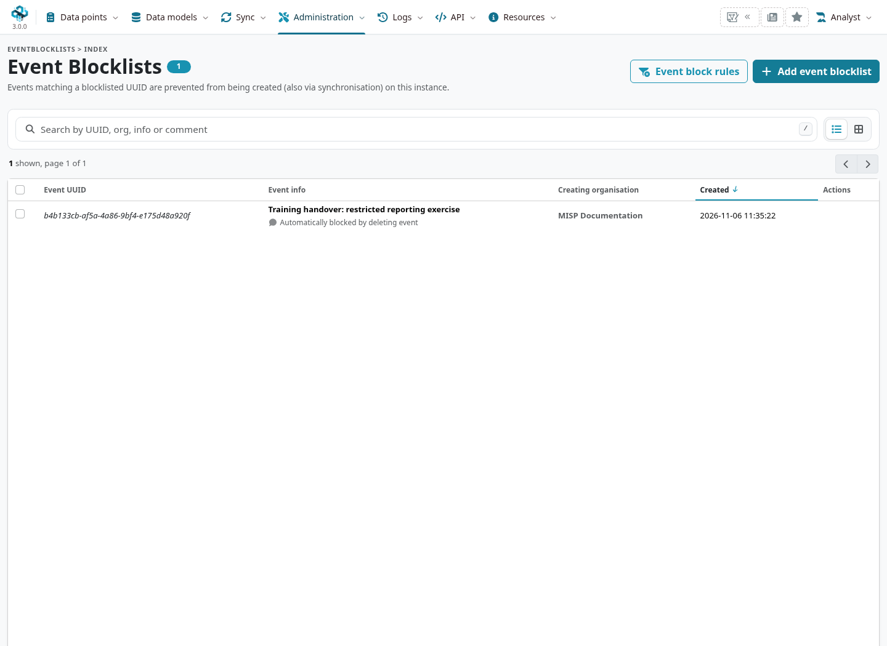

### Sighting blocklist {#sighting-blocklist}

Use the reporting organisation's UUID to exclude unwanted sighting sources. This does not
block that organisation's users from logging in or remove its event/attribute observations.
Review local feedback and incoming synchronization separately when investigating a source.

### Galaxy and research blocklists {#galaxy-cluster-blocklist}

Cluster and Analyst Data entries identify the particular record UUID to reject. They do not
replace event/organisation blocklists or distribution controls. Check existing local data and
peer behaviour before assuming that blocking an identifier also deletes every copy.

The event/org/sighting enable switches remain `MISP.enableEventBlocklisting`,
`MISP.enableOrgBlocklisting` and `MISP.enableSightingBlocklisting`. For event block rules, the
current tag-list form matches any listed tag; do not assume an arbitrary AND/NOT expression.
Test the actual import and sync path with synthetic data before applying a broad rule.

For import regular expressions, preserve the source context, restrict the applicable types and
test both matching and non-matching inputs. Blank replacements can reject matches. Review how
normalization affects stored values, value addresses and correlations before rewriting them.

The historical **Signature allowedlist** page/controller is absent in this 3.0 checkout.
Review detection flags, warninglist-aware export filters and the destination's selection policy
when replacing an old export setup. A correlation exclusion does not provide the same behaviour.

<a id="worker-types"></a>
<a id="background-processing"></a>
<a id="monitoring-the-background-processes"></a>
<a id="jobs"></a>

## Monitor jobs and recurring work {#admin-background-jobs}

MISP uses **SimpleBackgroundJobs**, Redis and Supervisor. CakeResque instructions do not apply.
`MISP.background_jobs` enables background processing; the `SimpleBackgroundJobs.*` Redis and
Supervisor settings must point at the actual services. Generic MISP Redis and job-queue Redis
can use different databases/namespaces; a successful `redis-cli ping` is not enough to prove
that both application paths work.

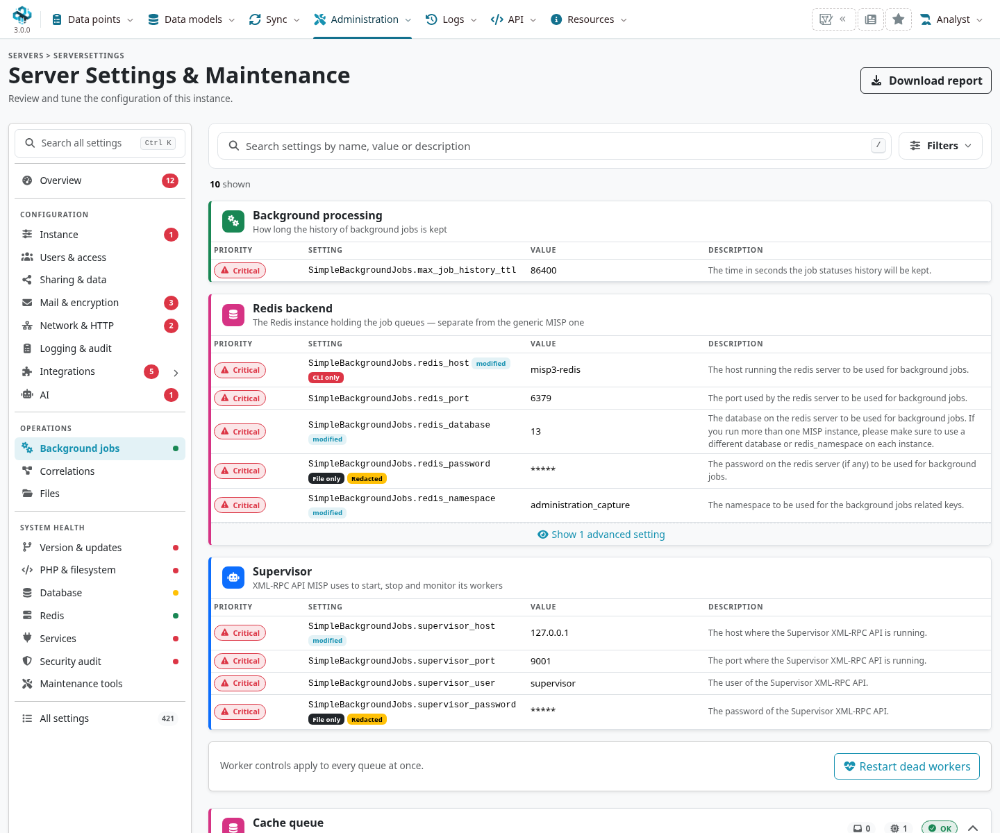

::: {.table-responsive}

| Queue | Typical work |
|---|---|
| `default`{.text-wrap .text-break} | General background processing, including non-blocking workflows. |
| `email`{.text-wrap .text-break} | Notification and alert delivery. |
| `cache`{.text-wrap .text-break} | Feed/export and other cache work. |
| `prio`{.text-wrap .text-break} | Higher-priority work such as user-requested publication. |
| `update`{.text-wrap .text-break} | Database/data-model update jobs; do not start competing update workers. |
| `scheduler`{.text-wrap .text-break} | Discovers due recurring tasks and queues their work. It is not an ordinary indicator-processing queue. |

:::

Use **Administration → Jobs** for job history, status, messages and progress. Distinguish the
SQL job ID from its background process UUID. A successful enqueue is not a completed job, and
a completed process does not prove a remote peer accepted every requested change.

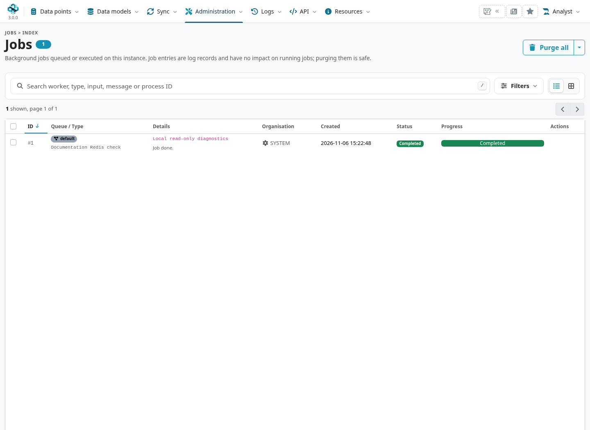

Purging job-history rows does not cancel a running process or empty a Redis queue. Conversely,
`Worker flushQueue` discards waiting work; it is not a routine recovery step. Redis persistence,
job-history expiry and the operation's retry behaviour determine what can be recovered after a
restart. Do not assume that every stopped/interrupted job will resume without loss or duplication.

<a id="restarting-or-starting-the-workers"></a>
<a id="command-line-tools-for-the-background-workers"></a>
<a id="the-scheduler-worker-is-not-starting"></a>
<a id="managing-the-background-workers"></a>
<a id="control-the-worker-processes"></a>
<a id="show-queues"></a>
<a id="flush-a-queue"></a>
<a id="show-job-status"></a>
<a id="list-workers"></a>

### Inspect and restart workers {#admin-worker-commands}

On a source installation, substitute the actual OS account and path:

```bash
sudo -u www-data /var/www/MISP/app/Console/cake Worker status
sudo -u www-data /var/www/MISP/app/Console/cake Worker showQueues
sudo -u www-data /var/www/MISP/app/Console/cake Worker showJobStatus JOB_ID_OR_PROCESS_UUID
```

In this 3.0 branch, **`Worker restart`** restarts all workers or a supplied Supervisor worker
name/PID, and **`Worker restartDead`** starts workers that are not running. The older
`Admin restartWorkers`/related commands now call the current worker tooling too; they are no
longer the no-ops described by old documentation. Use `--help` from the deployed checkout.

With a matching Supervisor installation, `supervisorctl status 'misp-workers:*'` shows its
process group. Use the deployment's service controls in a container installation. Fix Redis,
permissions or dependency errors before repeatedly restarting a worker. Inspect worker output
and Supervisor logs as well as the MISP Jobs page.

<a id="scheduling-recurring-tasks"></a>
<a id="taxii-servers"></a>
<a id="scheduled-tasks"></a>
<a id="scheduling-jobs-and-recurring-jobs"></a>

### Schedule recurring tasks {#admin-scheduled-tasks}

Open **Administration → Scheduled Tasks**. The 3.0 form supports an interval in **seconds,
minutes, hours or days**, a next execution date/time, an enabled flag and a user context.
This is an interval scheduler, not a general cron-expression editor. A blank next execution
can make a task due immediately; configure it deliberately before enabling it.

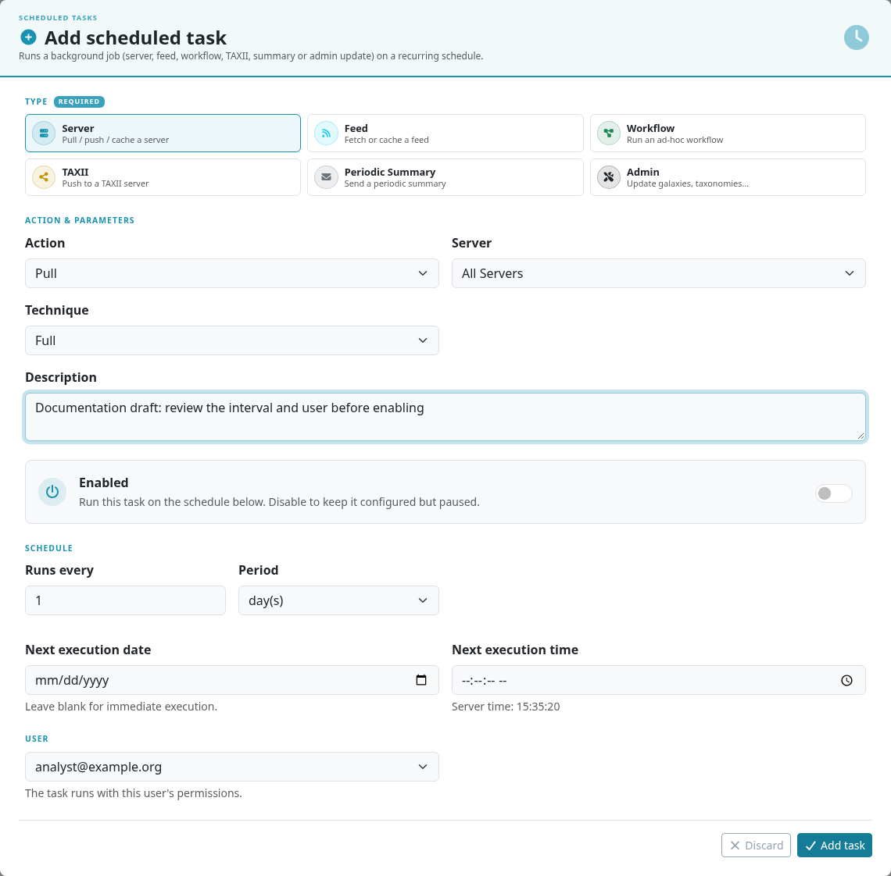

Supported families include server pull/push/cache, feed fetch/cache, ad-hoc workflows, TAXII
push, periodic summaries and supported Admin actions. Admin tasks also include external-user
validity checks and a separate **block invalid users** operation; reporting and disabling
accounts have different consequences.

Verify the selected user's permissions, scheduler health, next execution, last job result and
retry/overlap behaviour. A definition-update task is different from a database upgrade. For a
custom operational task, use a suitable external scheduler and the documented CLI/API rather
than modifying the scheduler's internal tables.

<a id="audit-logs"></a>
<a id="access-logs"></a>
<a id="support-feature-requests"></a>
<a id="get-top-api-users"></a>
<a id="misp-logs"></a>
<a id="logging-of-failed-authentication-attempts"></a>
<a id="clearing-expired-sessions"></a>
<a id="troubleshooting-misp-not-connecting-to-redis-but-redis-cli-working"></a>
<a id="browsing-logs"></a>
<a id="using-misp-logs"></a>
<a id="support--feature-requests"></a>

<a id="logs"></a>

## Use logs for diagnosis {#admin-logs}

The top **Logs** menu separates application, audit, access and search views. Read the layer
that can answer the question:

::: {.table-responsive}

| Layer | Useful evidence |
|---|---|
| Application log | Login/authentication events and operational messages; search by action, account and time. |
| Audit log | Recorded model changes and their field differences, when `MISP.log_new_audit`{.text-wrap .text-break} is enabled. Scope depends on permissions and organisation. |
| Access log | Request timing, route, response code and optional detail when paranoid/API/per-user monitoring is enabled; site-admin access. |
| Runtime/service logs | PHP/web-server errors, worker output, Supervisor, database, Redis and container service failures. |

:::

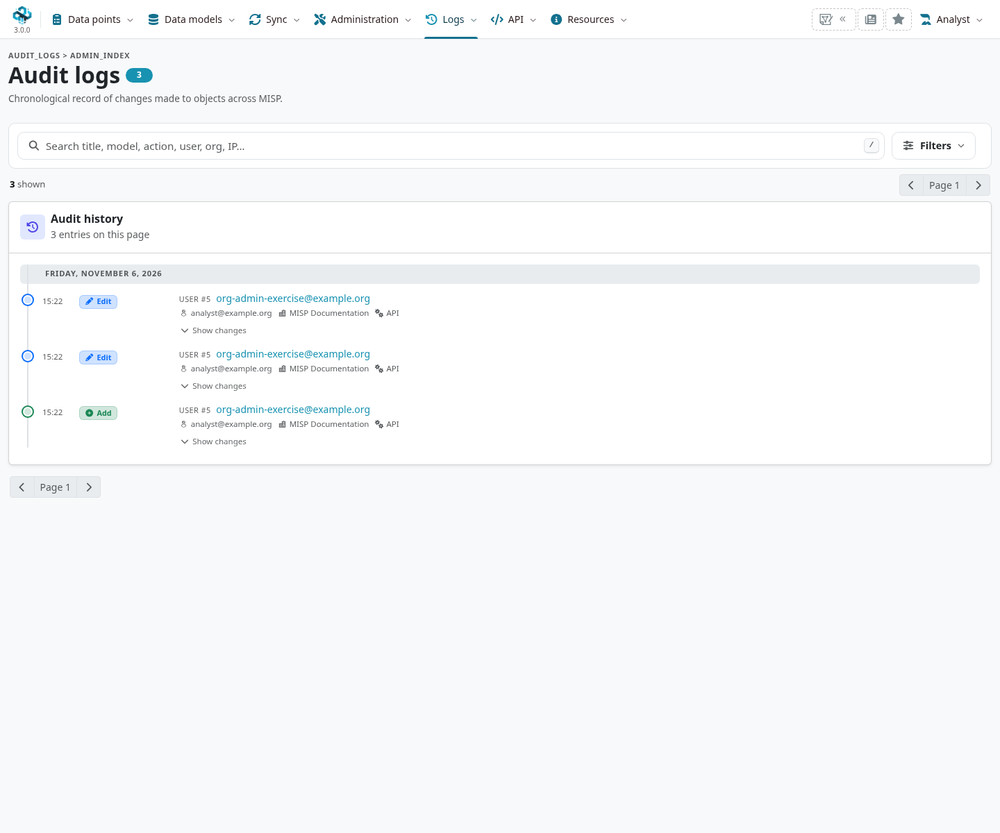

Configure collection under **Server Settings & Maintenance → Logging & audit**. Request-body
and SQL logging can include sensitive data and add substantial storage overhead. Review
redaction, access and retention before enabling verbose logging; do not assume every free-text
field or failed credential is safe to export. Failed web/API authentication commonly uses
`login_fail` / `auth_fail` actions. `MISP.log_auth` and `MISP.log_client_ip` control additional
collection; trusted proxy handling affects the recorded source address.

For an incident, retain a time window, request/job identifier, route and sanitized error.
MISP application logs are normally under `app/tmp/logs/`; worker/web-server/container log
locations depend on deployment. Avoid posting settings reports, authenticated request bodies,
API keys or raw SQL dumps to a public issue. Use the [MISP issue tracker](https://github.com/MISP/MISP/issues)
and [support resources](https://www.misp-project.org/support/) with a reproducible, sanitized report.

For Redis failures, compare the configured host, address family, port, authentication, database
and namespace from the **web and worker contexts**. For missing database fields, compare code,
submodule and migration state first. Clear caches only when the diagnosis calls for it. Purge
expired sessions through the applicable maintenance tool for the configured session backend;
do not remove active sessions or run unrelated SQL cleanup as a first response.

<a id="misp-backup"></a>
<a id="misp-restore"></a>

## Back up and rehearse recovery {#admin-backup-recovery}

A MISP backup must preserve the data and the secrets/configuration needed to interpret and
access it. Document recovery time and acceptable data loss, then keep a coherent set of:

- The database, using the database engine's supported consistent-backup procedure.
- Attachment storage, including an external/S3 backend where configured.
- Configuration and secrets: database connection details, salt/encryption keys, instance mail
  keys and any signing keys/certificates needed by the deployment.
- Uploaded logos/files, custom modules/workflows and other local customizations.
- Tested application/image, submodule and dependency versions, plus deployment/service configuration.
- Required operational Redis state and its recovery procedure. Do not blindly replay restored
  queues or treat regenerable caches as authoritative source data.


The repository includes historical [backup/restore helpers](https://github.com/MISP/MISP/tree/3.0_wip/tools/misp-backup).
Inspect their assumptions before use: they target a conventional MySQL/MariaDB installation
and do not establish complete coverage for containers, PostgreSQL, external attachments or a
3.0 migration rollback. Follow the backup mechanism supported by your actual deployment.

Test restoration on an isolated host with outbound mail, synchronization, scheduled tasks,
workflows and connectors controlled. Verify login/keys, organisations/distribution, events,
attachments, value references, Analyst Data, collections and migration state. A completed tar
archive is not a restoration test. Restore code/configuration and data from compatible points;
reverting a Git checkout alone does not undo a schema or attribute-value conversion.

<a id="workflows"></a>
<a id="command-line-interface-cli-commands"></a>
<a id="administering-misp-via-the-cli"></a>
<a id="get-setting"></a>
<a id="set-setting"></a>
<a id="get-authkey"></a>
<a id="reset-authkey"></a>
<a id="set-baseurl"></a>
<a id="change-password"></a>
<a id="clear-bruteforce-entries"></a>
<a id="run-database-update"></a>
<a id="update-all-json-structures"></a>
<a id="update-galaxy-definitions"></a>
<a id="update-taxonomy-definitions"></a>
<a id="enable-all-tags-of-a-taxonomy"></a>
<a id="update-object-templates"></a>
<a id="update-warninglists"></a>
<a id="update-noticelists"></a>
<a id="update-misp"></a>
<a id="set-default-role"></a>
<a id="get-ips-for-user-id"></a>
<a id="get-user-id-for-user-ip"></a>
<a id="get-set-the-live-state"></a>
<a id="check-redis-connectivity"></a>
<a id="lint-the-configuration"></a>
<a id="run-schema-diagnostics"></a>
<a id="optimise-database-tables"></a>
<a id="run-a-security-audit"></a>
<a id="clean-the-caches"></a>
<a id="re-encrypt-stored-secrets"></a>
<a id="migrate-to-advanced-auth-keys"></a>
<a id="pullall"></a>
<a id="pull"></a>
<a id="push"></a>
<a id="list-feeds"></a>
<a id="cache-feeds-for-quick-lookups"></a>
<a id="fetch-feeds-as-local-data"></a>
<a id="run-enrichment"></a>
<a id="test-server"></a>
<a id="list-servers"></a>

## CLI reference and operating checks {#automating-certain-console-tasks}

Run the CLI as the application's OS user, with the intended configuration and environment.
Paths in this book assume `/var/www/MISP`; containers have their own execution/service wrapper.
Start with the deployed command's help:

```bash
sudo -u www-data /var/www/MISP/app/Console/cake Admin --help
sudo -u www-data /var/www/MISP/app/Console/cake Worker --help
sudo -u www-data /var/www/MISP/app/Console/cake User --help
```

::: {.table-responsive}

| Task | Command family / constraint |
|---|---|
| Read/change a setting | `Admin getSetting SETTING`{.text-wrap .text-break}; `Admin setSetting SETTING VALUE`{.text-wrap .text-break}. A full settings dump may include sensitive information. |
| Maintenance state | `Admin live`{.text-wrap .text-break} reads it; `Admin live 0`{.text-wrap .text-break} / `1`{.text-wrap .text-break} change it. Coordinate writers and service access separately. |
| Database health / migration plan | `Admin schemaDiagnostics`{.text-wrap .text-break}, `Admin migrationStatus`{.text-wrap .text-break}, `Admin migrationApply --dry-run`{.text-wrap .text-break}. |
| Apply a planned 3.0 upgrade | `Admin runUpgrade`{.text-wrap .text-break}, after backup/rehearsal and quiescing writers. Lower-level migration commands are not a generic substitute. |
| Redis health | `Admin redisReady`{.text-wrap .text-break}; check the job backend separately with `Worker status`{.text-wrap .text-break}. |
| Definitions | `Admin updateJSON`{.text-wrap .text-break} or the relevant `updateGalaxies`{.text-wrap .text-break}, `updateTaxonomies`{.text-wrap .text-break}, `updateWarningLists`{.text-wrap .text-break}, `updateNoticeLists`{.text-wrap .text-break}, `updateObjectTemplates`{.text-wrap .text-break}. These modify local definitions. |
| Accounts | `User`{.text-wrap .text-break} help covers password/key changes and block/unblock operations. Prefer scoped advanced keys; protect console output/history. |
| Sync/feed processing | `Server`{.text-wrap .text-break} help covers peer pull/push/cache and feed listing/fetch/cache. IDs, user context and direction must match the intended operation. |
| Enrichment | `Event enrichment`{.text-wrap .text-break} uses the configured modules and account context; it may contact providers or change events. |
| Security/configuration checks | `Admin securityAudit`{.text-wrap .text-break}, `Admin configLint`{.text-wrap .text-break}; TLS probes and reports have their own network/data scope. |
| Cache/storage maintenance | `Admin cleanCaches`{.text-wrap .text-break}, `optimiseTables`{.text-wrap .text-break} and value-maintenance commands have different effects. Diagnose first, then schedule the required work. |
| Secret-key rotation | `Admin reencrypt`{.text-wrap .text-break} is a controlled key migration, not a routine update. Retain a compatible backup and follow the command's current help. |

:::

For automation, use bounded API queries and checkpoints rather than assuming every console
command can safely be retried. See [Automation & API](../automation/index.qmd),
[Workflows & Blueprints](../workflows/index.qmd) and
[Updating Python Dependencies](../updating-python/index.qmd).
