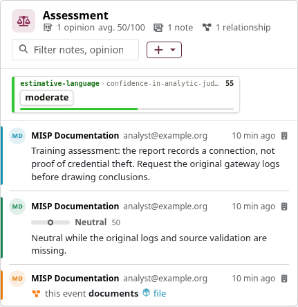
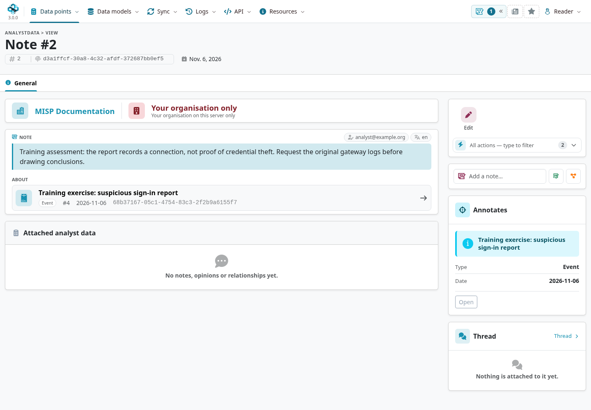

**Analyst Data** is a collaborative annotation layer that lets analysts enrich anything in
MISP — an event, an attribute, an object, an event report, a galaxy cluster and more — *without
modifying the annotated element itself*. Instead of editing another organisation's event (which
you cannot do) or spawning a proposal, you attach your own record alongside it. Each record has
its own identity, its own distribution, and its own author, so it can be shared and synchronised
independently of the thing it describes.

::: {.callout-note}
The examples describe MISP **3.0.0** from the [`3.0_wip`](https://github.com/MISP/MISP/tree/3.0_wip) development branch.
The 3.0 interface surfaces event analysis in **Assessment** and value-level analysis in **Value Intelligence → Collaboration**.
MISP 2.5 supports the core annotation layer with a different interface and target set. Select a screenshot to enlarge it.
:::

<!-- Capture source, fixture and image hashes: ../assets/using-misp-screenshots.json -->

There are three types of analyst data:

- **Note** — free-text commentary, with a language tag.
- **Opinion** — a numeric agreement score from 0 to 100 plus an optional justification.
- **Relationship** — a directed, labelled link from one element to another.

Because each record is identified by its own UUID and carries its creator organisation, analyst
data is inherently **federated**: notes, opinions and relationships propagate between instances
through synchronisation just like events do, letting a whole community build a shared,
attributable body of analysis around the same intelligence.

::: {.callout-note}
Creating or editing analyst data requires a role with the **Analyst Data Creator** permission
(`perm_analyst_data`). Viewing analyst data only requires being logged in (subject to the
record's distribution).
:::

## The three types

### Notes

A **Note** is a piece of free-text commentary attached to a target element. Beyond the note
body itself, a note carries a **language** (an RFC 5646 tag such as `en`, `fr`, `de`) so that
multilingual communities can annotate in their own language and filter accordingly.

Use notes to record analysis, caveats, remediation guidance, or any context that does not fit
neatly into an attribute or tag.

### Opinions

An **Opinion** expresses how much you agree with the element it is attached to, as a score from
**0 to 100**, with an optional free-text **comment** explaining your reasoning. The scale is
read as five bands:

| Score | Meaning |
|------:|---------|
| 0–20   | Strongly disagree |
| 21–40  | Disagree |
| 41–60  | Neutral (50 = neutral midpoint) |
| 61–80  | Agree |
| 81–100 | Strongly agree |

In the interface the score is shown as a coloured gradient bar with the numeric value. Opinions
are the natural way to signal (dis)agreement with a shared indicator or assessment without
altering it — for example, to flag a suspected false positive or to endorse a high-value
indicator.

### Relationships

A **Relationship** is a directed edge from a *source* element to a *related* element, carrying a
free-text **relationship type** label (for example `similar-to`, `derived-from`,
`part-of`). The relationship type is a free-text field with autocomplete — the suggestions
combine relationship types already used in analyst data with MISP's object-reference
vocabulary — so you are not restricted to a fixed list.

A relationship can link any two supported elements, even across events and across instances,
and targets are normally referenced by UUID. In MISP 3.0, either end can instead target an
attribute value using its SHA-256 address (see [Value-level analyst data](#value-level-analyst-data)).
A record cannot relate an element to itself.

::: {.callout-important}
Analyst-data **Relationships** are not the same as two other MISP concepts that also link
things together:

- **MISP object references** link an attribute or object to another object *within the same
  event*; they are part of the event's own data model, not analyst data.
- **Galaxy cluster relationships** link galaxy clusters to one another as part of the galaxy
  data model.

Only analyst-data Relationships are individually authored by an organisation, individually
distributable, blocklistable, and synchronised through the analyst-data pipeline. See
[MISP Objects](../misp-objects/index.qmd) and [Galaxies](../galaxy/index.qmd) for the other
two.
:::

## What can be annotated

Analyst data can be attached to any of the following target types: **Attribute, Event, Event
Report, Galaxy Cluster, Galaxy, Object, Organisation, Sharing Group**, and — because analyst
data can annotate analyst data — **Note, Opinion and Relationship** themselves. Attaching a note
or opinion to another note produces a **thread**, so a discussion can build up around a single
element. The MISP 3.0 development branch also accepts **Collection**, **Workspace**, and
**Attribute Value** (`AttributeValue`) targets. An attribute value identifies the value across
events rather than one attribute occurrence.

In practice, notes, opinions and relationships are surfaced automatically when you view an
**event, attribute, object, event report or galaxy cluster**; the other target types are valid
anchors but are not all rendered inline in their own views. MISP 3.0 surfaces value-level
analysis in **Value Intelligence**; see the workflow below.

## Working with analyst data in the UI

Open an event's **General** tab and inspect its **Assessment** card.
Its add control offers the annotation types permitted for your account; attribute and object
rows have their own analysis controls. Use **Data points → Analyst Data** for the standalone list.
The form identifies the target and asks for distribution plus the type-specific content.



Open an annotation to inspect its own identity, author, target, audience, and available editing
or thread controls. An Opinion score is an assessment in context, not a probability that an
indicator is malicious.



Opening a record shows it together with its **thread** — nested notes and opinions — and its
relationships, split into:

- **Outbound** relationships (edges this element points *out* to), and
- **Inbound** relationships (edges from other elements that point *at* this element).

Inbound relationships are computed automatically, so you can see who has linked to an element
even if the link was created elsewhere.

### Value-level analyst data in MISP 3.0 {#value-level-analyst-data}

In the [`3.0_wip`](https://github.com/MISP/MISP/tree/3.0_wip) development interface, open
**Data points → Value Intelligence**, look up the value, and select **Open intelligence**.
The **Collaboration** tab offers **Add note** and **Add opinion** for the value itself.
Use the attribute occurrence instead when your statement depends on a particular source, event,
or observation window. See [Best Practices](../best-practices/index.qmd#put-analysis-on-the-right-target)
for a worked example and screenshots.

A value has no UUID. Its address is the lowercase hexadecimal **SHA-256 of its stored text**, encoded
as UTF-8. Compute it from the value returned by MISP after normalization, rather than from unprocessed
input. Notes, Opinions, and either end of a Relationship can use this `AttributeValue` target.
The analyst-data record itself still has its own UUID.

Set the annotation's distribution separately from its target. An annotation's own sharing rules
determine who may read it; access to the value's holder event does not restrict text you put in a
more broadly shared Note. The value reference resolves to text only when the reader can see at least
one attribute holding it. The value text does not travel with the reference.
Value-addressed analyst data is withheld from MISP peers older than 3.0 during synchronization.

## Distribution and sharing

Every analyst-data record has its own **distribution** setting, independent of the element it
annotates, using the same levels as events:

| Level | Meaning |
|------:|---------|
| 0 | Your organisation only |
| 1 | This community only |
| 2 | Connected communities |
| 3 | All communities |
| 4 | Sharing group (an explicit list of organisations) |

The default level for new analyst data is controlled by the
`Plugin.default_analyst_data_distribution` server setting (default: *This community only*). When
the level is *Sharing group*, MISP validates that you are allowed to use the chosen sharing
group. Visibility follows the usual rules: you can see a record if your organisation created it,
if it is distributed to your community or wider, or if it is in a sharing group you belong to.

## Collaboration and synchronisation

Analyst data is built for federated collaboration:

- **Identity** — each record has a globally unique UUID that is stable across instances, so the
  same note is recognised everywhere it travels.
- **Authorship** — every record records its *creator organisation*; only the creating
  organisation (or a site admin) can edit or delete it. Other organisations add their own
  parallel notes and opinions rather than changing yours.
- **Synchronisation** — analyst data is pushed and pulled between instances alongside events,
  provided both sides support the feature and the per-server **Push analyst data** / **Pull
  analyst data** toggles are enabled (see [Sharing](../sharing/index.qmd)). Distribution
  and server filters determine what is exchanged. Community-limited distribution can be reduced
  at a synchronization boundary; do not assume that All communities or a sharing group is
  decremented like a numeric hop count. Records received from a remote instance are marked
  as *locked* to protect the source copy from unintended local edits.

## Analyst Data Blocklist

Because analyst data is synchronised, simply deleting an unwanted record locally would not stop
it being pulled back in from a remote instance. To prevent that, MISP keeps an **Analyst Data
Blocklist** keyed on the record UUID. When a record is (hard-)deleted, a blocklist entry is
created automatically — recording the UUID, a short human-readable summary, and the creator
organisation — so the record is ignored if it is offered again during synchronisation.

The blocklist is managed by site administrators under the administration menus and behaves like
the other blocklists in MISP.

## API and permissions

Analyst data is fully accessible over the REST API under the `/analystData/` controller. The
main actions are:

::: {.table-responsive}

| Action | Purpose | Permission |
|--------|---------|------------|
| `add/{type}/{object_address}/{object_type}` | Create a note/opinion/relationship on a target | `perm_add` + `perm_analyst_data` |
| `edit/{type}/{id or uuid}` | Modify a record you own | `perm_add` + `perm_analyst_data` |
| `delete/{type}/{id or uuid}` | Delete a record you own | `perm_add` + `perm_analyst_data` |
| `view/{type}/{id or uuid}` | View a single record | any logged-in user |
| `index/{type}` | List records of a type | any logged-in user |
| `getChildren/{type}/{uuid}` | Fetch a record's thread | any logged-in user |

:::

where `{type}` is `Note`, `Opinion` or `Relationship` (or `all`, letting MISP deduce the type
from the UUID). The synchronisation endpoints used between instances require the
`perm_sync` permission. As with the rest of the API, requests and responses use the standard
MISP JSON envelope — see the [Automation & API](../automation/index.qmd) chapter.

### Value targets through the 3.0 API

For a value target, use its SHA-256 address as `{object_address}` and `AttributeValue` as
`{object_type}`. These endpoints use the same analyst-data permissions and distribution checks
as UUID targets:

::: {.table-responsive}

| Endpoint | Purpose |
|---|---|
| `POST /analystData/add/Note/{sha256}/AttributeValue` | Add a Note to the value. |
| `POST /analystData/add/Opinion/{sha256}/AttributeValue` | Add an Opinion to the value. |
| `POST /analystData/add/Relationship/{sha256}/AttributeValue` | Create a Relationship whose source is the value. |
| `GET /analystData/viewForObject/AttributeValue/{sha256}` | Retrieve visible Notes, Opinions, and Relationships for the value. |

:::

For example, the Note endpoint accepts:

```json
{
  "Note": {
    "note": "Reserved documentation value; do not use for operational detection.",
    "language": "en",
    "distribution": 0
  }
}
```

For a Relationship pointing **to** a value, set `related_object_type` to `AttributeValue` and
supply `related_object_sha256` instead of `related_object_uuid`. The source and destination
can independently use a value address or a UUID target.
