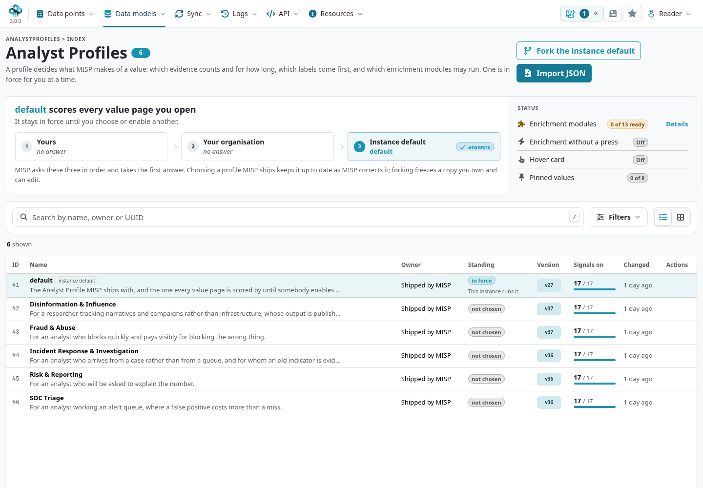
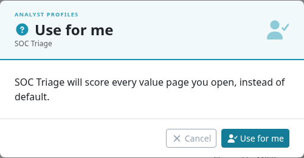
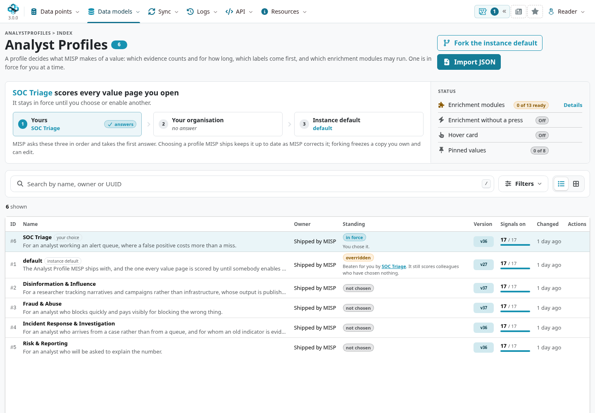
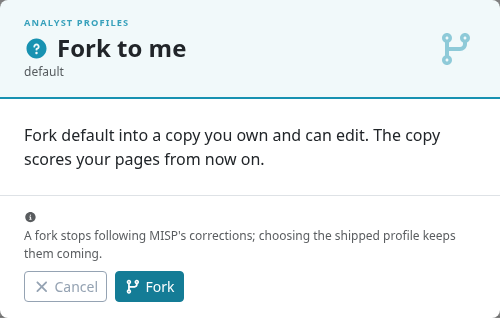
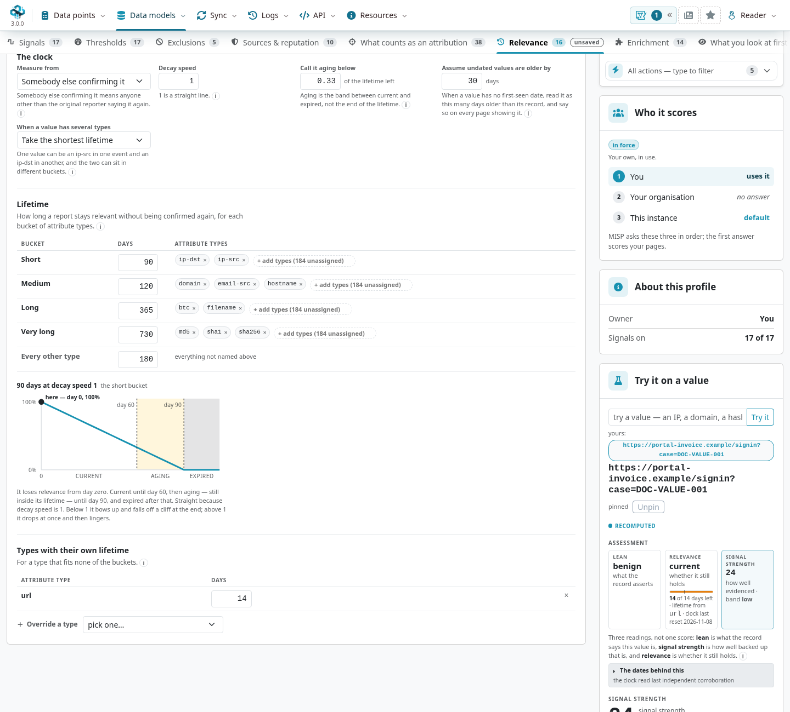
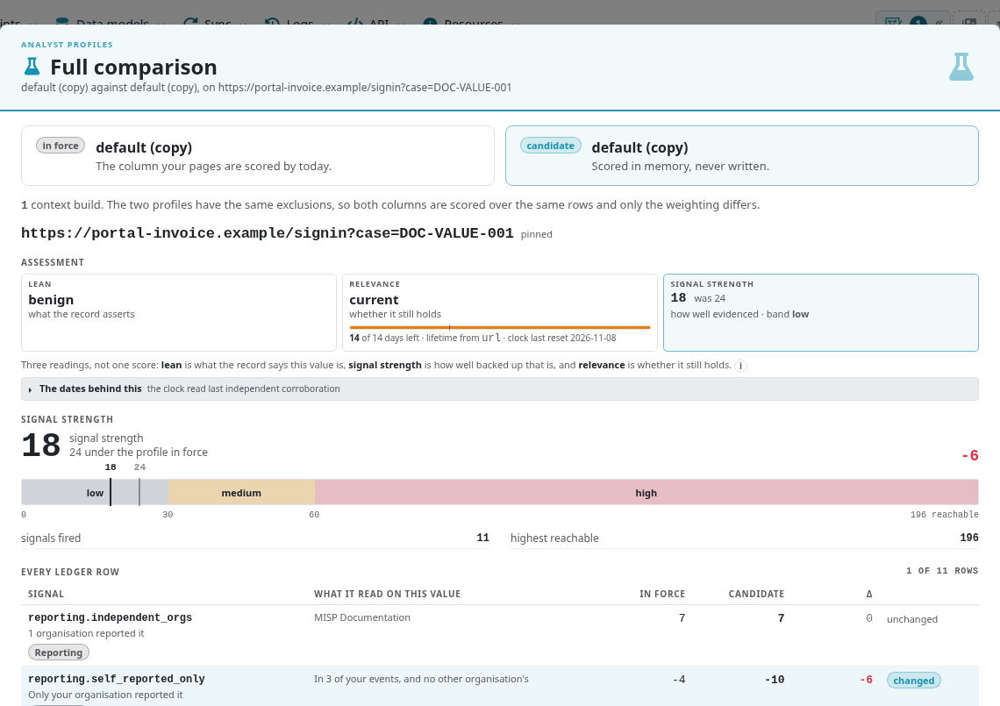
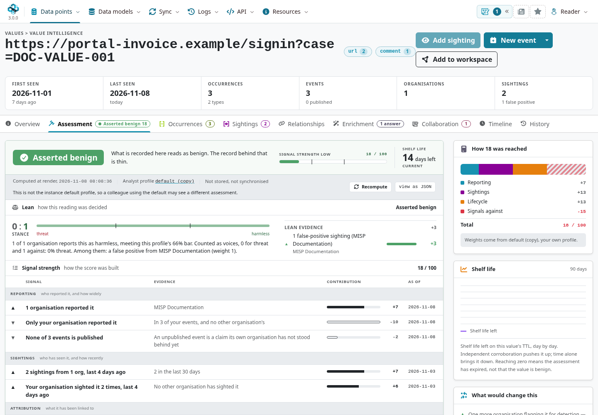
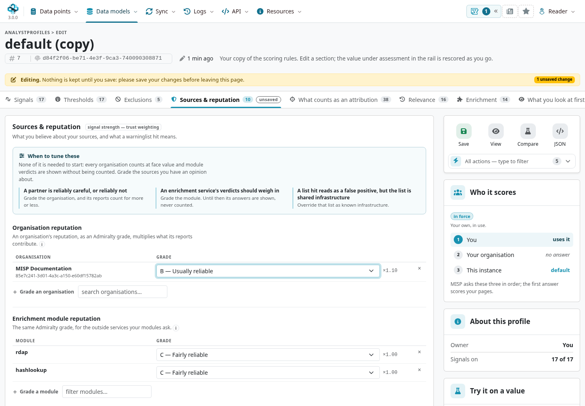
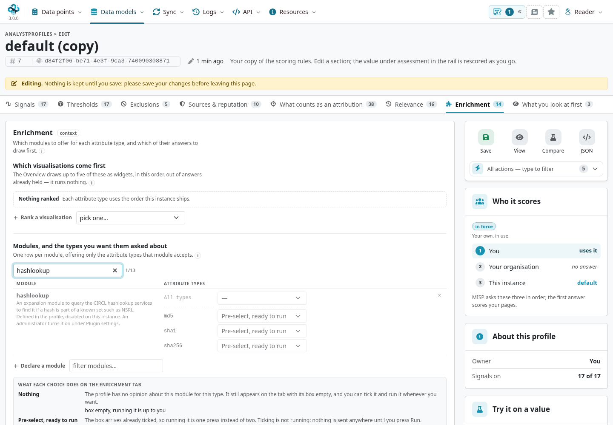
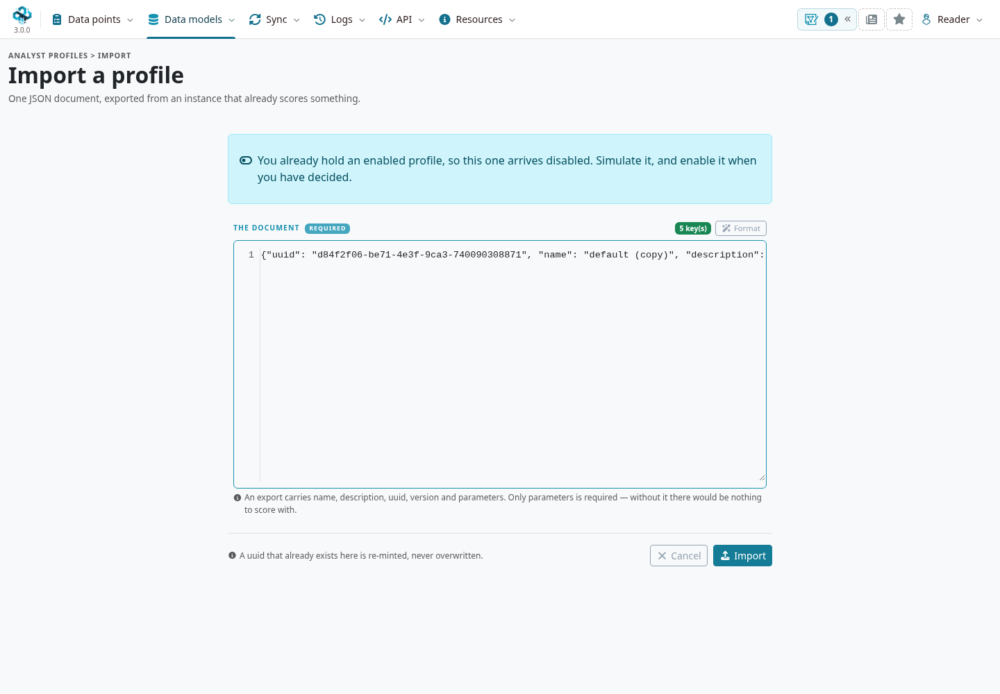

An analyst profile defines how MISP interprets the evidence behind a value: which signals matter, how strongly sources contribute, how long an assessment remains relevant, and which context and enrichment to offer first.
Use a shipped profile as a starting point, then test any changes against examples from your own work.
A profile is separate from your login account, role, and [decaying models](../decaying-models/index.qmd).

::: {.callout-note}
This chapter follows MISP **3.0.0**, [`3.0_wip` commit `99ebee729`](https://github.com/MISP/MISP/commit/99ebee729702c560528f9788953719bda68aa1c1).
Screenshots show the real interface with constructed, organization-only, unpublished intelligence and IDS disabled on the exercise attributes.
The example changes only a personal profile; no external enrichment provider is queried.
Controls depend on ownership, role and instance configuration. Select a figure to enlarge it.
:::

<!-- Source checks, screenshot provenance and cleanup: ../assets/analyst-profile-screenshots.json -->

## Find the profile in force {#profiles-effective}

Open **Data models → Analyst Profiles**.
The banner names the profile that currently scores your pages and explains how MISP selected it:

1. **Yours:** an enabled profile you own, or a profile you selected for yourself.
2. **Your organisation:** its enabled profile or selection, when you have no personal answer.
3. **Instance default:** the instance's selected profile when neither nearer scope answers.

Only one answer applies at a time.
A personal profile can override the organization's choice for you without changing your colleagues' readings.
An unavailable, disabled or no-longer-readable selection can fall through to the next scope; inspect the resolution banner when the effective name changes.
If nothing resolves, scoring can be off. That is different from an assessment with zero signal strength.



The list distinguishes **in force**, **overridden**, **not chosen**, and switched-off profiles.
A profile overridden for you can still score other users.
Use the owner, standing and version fields together: a high version number does not mean a profile fits your task better.

The checked catalogue contains **default**, **SOC Triage**, **Incident Response & Investigation**, **Fraud & Abuse**, **Disinformation & Influence**, and **Risk & Reporting**.
Read each description and its settings before choosing; these are starting points for different workflows, not a ranking of intelligence quality.
Your installed catalogue and versions can change with MISP updates.

## Choose a shipped profile or make a copy {#profiles-choose}

To try a shipped profile, open its row menu and choose **Use for me**.
Read the confirmation: it names the profile and what it will replace for your pages.
Confirm, then inspect the banner to verify the personal selection took effect.





Choosing a shipped profile keeps following that profile's updates as MISP updates its catalogue.
Use **Stop using for me** to clear a personal selection and let the next scope answer.
This does not delete the shipped profile or change the instance default.

Use **Fork to me**, or **Fork the instance default**, when you need different rules.
A fork copies the settings into a profile you own and can edit; it does not inherit later changes to the shipped profile.
The fork is **enabled immediately** and becomes your personal answer, even before you edit its parameters.
When replacing an existing enabled personal copy, read the confirmation: the previous copy is disabled rather than deleted.



::: {.callout-important}
**Forking, selecting and saving parameter edits are separate actions.**
Creating an enabled fork changes which profile is in force immediately.
Inside the editor, unsaved parameter changes are simulated; **Save** makes them part of that profile.
For an owned copy, **Stop using** switches it off so the next scope can answer; keep the copy if you want to revisit it.
:::

### Who can change which scope?

::: {.table-responsive}

| Scope or profile | Expected authority | Effect |
|---|---|---|
| Your own profile or personal selection | Your account, subject to role access | Changes your interpretation. |
| Organization-owned profile or organization selection | Organization administrator; site administrator where authorized | Affects colleagues who have no personal answer. |
| Instance selection and instance-wide sharing | Site administrator | Supplies a fallback or makes a profile available across the instance. |
| Shipped or instance-shared profile | Read/select/fork where available; site administrator for edits | Ordinary analysts edit a fork instead of the shared original. |

:::

An organization administrator's row menu can expose **Use for my organisation** and **Fork to my organisation**.
A site administrator can select the instance profile and manage instance sharing.
These choices affect different readers; use the confirmation's scope and affected-reader information before applying them.
Selecting another profile at a scope can disable the enabled owned profile it displaces, while retaining that copy for later use.

## Understand the editor {#profiles-editor}

Open a profile to inspect its sections; choose **Edit** when you own an editable copy.
The editor keeps **Save**, **View**, **Compare** and **JSON** alongside the profile's scope and a **Try it on a value** area.
Use the help controls beside fields to understand the setting before changing it.

::: {.table-responsive}

| Section | What to review |
|---|---|
| **Signals** | Which evidence contributes and its points or tuning parameters. Read the contribution on an actual value. |
| **Thresholds** | How evidence becomes a stance or strength band, including safeguards for thin records. |
| **Exclusions** | Which evidence or time windows the assessment sets aside. This is separate from deleting records or configuring correlation exclusions. |
| **Sources & reputation** | Organization and module reliability grades, their multipliers, and interpretation of warninglist categories. |
| **What counts as an attribution** | Which galaxy context counts as attribution and how it is prioritized. |
| **Relevance** | The clock, lifetime buckets and type overrides, aging behavior, and handling of undated or multi-type values. |
| **Enrichment** | Module declarations by input type, automatic reuse and the order of supported result visualizations. |
| **What you look at first** | Which taxonomy and galaxy context appears first, including marking/context presentation. This does not attach missing tags or clusters. |

:::

The **JSON** control offers the raw parameter document for reading or replacement.
Prefer the typed controls for a first change. If replacing JSON, preserve unrelated settings and read validation errors before saving.
A valid document still needs testing: it can encode rules inappropriate for your task.

## Practical example: tune a personal review profile {#profiles-example}

Use the fictional URL and three events from the [Value Intelligence exercise](../value-intelligence/index.qmd#value-intelligence-exercise):

```text
https://portal-invoice.example/signin?case=DOC-VALUE-001
```

The URL appears in two URL attributes and one quoted comment, all from one organization.
Two positive sightings and a later false-positive report provide additional context.
In the captured default assessment, **signal strength is 24**, the stance reads benign, and the URL lifetime is **60 days**.
The original records were added on 8 November 2026; the profile has no independent corroboration to reset its clock, so that date anchors this example's lifetime.
Your numbers can differ with visibility, date, configuration and data.

Imagine your team wants a shorter review lifetime for URLs and a stronger penalty when only your own organization reports a value.
These are exercise choices to test; they are not recommended universal settings.

### Preview a shorter lifetime

1. Return to **default** and fork it to yourself. In the screenshots the new profile is named **default (copy)**.
2. In **Try it on a value**, enter the exercise URL and choose **Try it**.
3. Open **Relevance → Types with their own lifetime**. Change the `url` override from **60** to **14** days.
4. Read the unsaved-change indicator and the recomputed assessment. Relevance now uses the proposed 14-day lifetime, while signal strength remains **24**.



The lifetime buckets for other types remain unchanged.
The checked profile uses the shortest applicable lifetime when a value has several types; the comment occurrence does not create independent corroboration.
A displayed lifetime is an assessment clock, not a command to remove an attribute or set its IDS flag.

### Compare a change in signal strength

Keep the unsaved lifetime edit, then open **Signals**.
Find **Only you report it** (`reporting.self_reported_only`) and change its **`only_you`** points from **−4** to **−10**.
Choose **Compare** to open the full comparison.
From the editor, Compare includes the unsaved form values; it does not save them.



For this fixture, the contribution changes by **−6**, so signal strength becomes **18** and remains in the **low** band.
The benign stance remains supported by the same false-positive report.
The proposed lifetime remains 14 days.
This illustrates three distinct readings:

- **Lean/stance:** what the record asserts about the value.
- **Signal strength:** how well the interpretation is backed by the profile's evidence rules.
- **Relevance:** whether the assessment still holds under its clock and lifetime.

A lower signal-strength number does not by itself mean a more benign value.
A shorter lifetime does not establish that an observation stopped occurring.
Read the changed rows and supporting sources, rather than optimizing for a preferred label.

### Save and verify the effect

Close the comparison and choose **Save** in the editor.
Reopen the profile to confirm the stored parameters, then open the URL in **Value Intelligence → Assessment**.
Verify the effective profile's name, the changed contribution, signal strength and shelf life.
The example now shows **18** and **14 days**, with the original occurrences and sightings intact.



Saving rules on an enabled organization profile can change colleagues' displayed assessments too.
For a wider rollout, review representative examples first, document the intended effects, and use the appropriate organization or instance scope after that review.

## Keep a small comparison set {#profiles-comparison-set}

Use **Pin** beside the value under assessment to keep it available on other profile pages.
The checked interface supports up to **eight** pinned values per user; the index reports how many are pinned.
Use **Unpin** when an example is no longer useful.
Pinning changes your comparison set independently of saving profile parameters.

Choose varied examples: a well-supported threat indicator, a documented false positive, a value reported by only one organization, an old observation and a case with missing dates.
Use only data you can access and interpret the underlying provenance.
A small pinned set helps catch unintended changes, but it does not measure performance across all your intelligence.

**Try it on a value** and **Compare** evaluate the candidate against the profile currently in force for you, not necessarily the instance default.
An enabled personal copy can therefore be compared with its own stored parameters while its editor contains unsaved changes.
After saving, the same comparison can show no difference because that candidate is now in force.

## Grade sources in the appropriate profile {#profiles-source-grades}

Open **Sources & reputation** to review organization and enrichment-module grades.
Organization grades describe your judgment of a source's reliability; they do not establish that every indicator from that source is malicious or correct.
The supported Admiralty source grades run from **A — Completely reliable** through **G — Deliberately deceptive**; **F** means reliability cannot be judged, and **unrated** means no opinion recorded.
Read the configured multipliers rather than assuming every profile assigns a letter the same numerical effect.

In an editable personal profile, use **Grade an organisation**, find the intended organization, and choose a grade for review.
Organization overrides are keyed by UUID, so verify identity rather than relying on a similar display name.
Save only a judgment you can explain.



The quick grading controls on supported pages write to a personal profile.
If the effective profile belongs elsewhere, the grading flow can require agreement to create a personal fork first; it does not silently edit your organization's or the shipped profile.
The resulting personal copy can then become the profile in force for you.

Module grades govern whether and how supported returned verdicts contribute; a visible enrichment answer is not automatically a counted verdict.
Warninglist category overrides also change interpretation: **known infrastructure** and **false positive** make different claims.
Inspect the evidence and any disagreement the profile reports; a grade or list category is not a global whitelist.

## Set enrichment behavior without enabling providers {#profiles-enrichment}

The **Enrichment** section declares modules for particular attribute types.
The editor distinguishes **Nothing**, **Pre-select, ready to run**, **Block, running is refused**, and **Auto, run it on its own**.
Pre-selection alone sends no request. Block is enforced when a run is attempted.
Automatic execution also requires the instance's **`Plugin.ValueIntelligence_enrichment_auto_run`{.text-wrap .text-break}** setting, which defaults to off.



A profile can narrow the modules offered by the instance; it cannot enable an unavailable module, supply missing provider credentials or widen an organization restriction.
Read the index's capability status and **Details** when a declaration cannot take effect.
The hover-card capability is also reported separately; selecting a profile does not enable that instance feature.

The reuse setting **`max_age_hours`** bounds automatic reuse of organization-local value answers.
A deliberate manual refresh still asks again.
Visualization priorities arrange supported answers already held; arranging them does not run modules.
Follow the [Value Intelligence enrichment example](../value-intelligence/index.qmd#value-intelligence-enrichment) for a real local-parser run and review before creating event content, and [misp-modules](../modules/index.qmd) for service administration.

## Export, import and maintain profiles {#profiles-exchange}

Use **Export JSON** in a row menu or **Export** in the profile's actions to exchange a profile document.
The export contains its name, description, UUID, version and parameters; it does not carry an assignment to your account or organization.
Review organization/module references and local assumptions with the recipient.

Open **Import JSON**, paste one exported document, and inspect validation before submitting **Import**.
If the UUID already exists locally, MISP gives the imported copy a new UUID instead of overwriting that profile.
An import arrives **disabled when you already have an enabled owned profile**.
When you have no enabled owned profile at that scope, it can become enabled immediately; import is not always a passive preview.
Check the resulting owner and standing, then compare it before adopting it more broadly.



An imported profile does not configure missing modules, vocabularies or instance capabilities.
A site administrator can make an eligible owned profile available through instance sharing; shared profiles are distinct from organization-owned copies and ordinary analysts fork them for local edits.
Withdrawing, disabling or deleting a selected profile can cause readers to fall back to another scope.

Keep a copy of the last reviewed export, the profile identity/version or revision, the test values and the reason for each policy change.
Review forks after important shipped-profile updates: their frozen parameters do not receive those corrections automatically.
For a rollback, reselect the reviewed shipped profile or restore a reviewed copy and verify the resolution banner and example assessments again.
