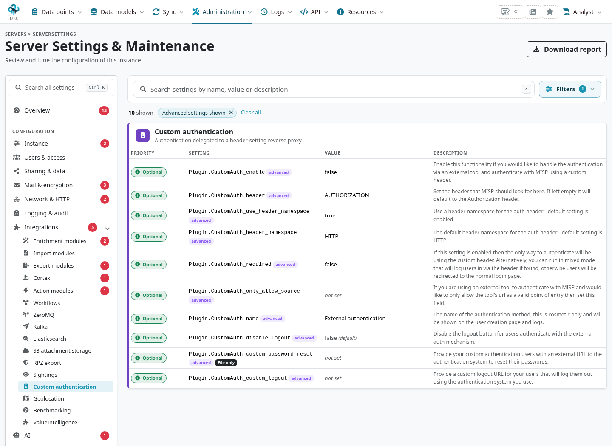
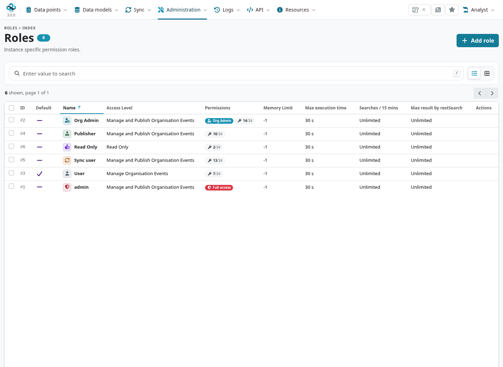
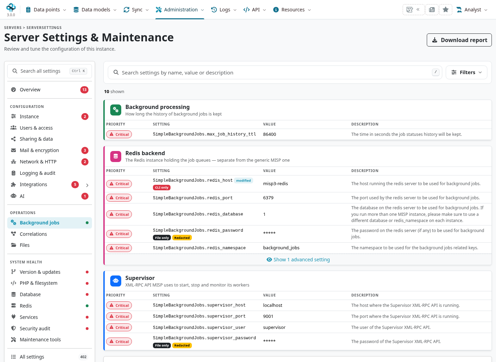
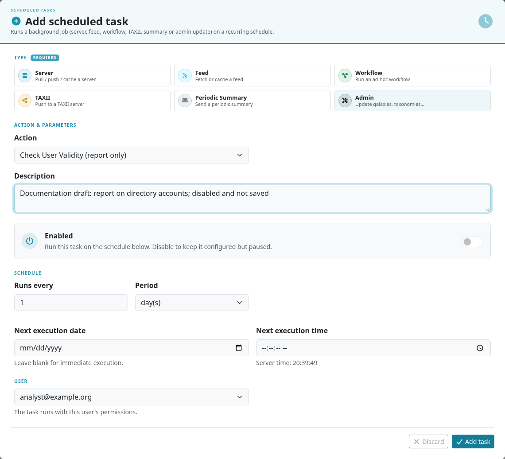

<a id="summary"></a>

These references cover authentication, access-control inspection, companion projects and
background processing. Use the installed branch's settings and implementation together with
the deployment's configuration process; service paths and role IDs are not universal defaults.
The [glossary](../glossary.qmd#glossary-a-c) explains the terminology used throughout the guide.

::: {.callout-note}
Checked against MISP **3.0.0**, `3.0_wip` commit
[`99ebee729`](https://github.com/MISP/MISP/commit/99ebee729702c560528f9788953719bda68aa1c1).
The examples use reserved names and synthetic private data. Authentication mechanisms and
third-party integrations need their own deployment tests; the presence of a plugin is not a
compatibility guarantee.
:::

<!-- Implementation references, ACL checks and UI captures: ../assets/appendices-screenshots.json -->

## External authentication {#appendix-a-external-authentication}

<a id="other-external-authentication-plugins"></a>
<a id="the-external-authentication-mechanism-described"></a>

### Choose the mechanism {#appendix-auth-choice}

Authentication establishes an identity; MISP still needs a user account, organisation, role
and applicable access checks. Distinguish the browser login, a trusted front-end assertion and
a REST API key. Configuring one does not automatically configure or revoke all the others.

::: {.table-responsive}

| Mechanism | Identity source and configuration |
|---|---|
| **CustomAuth** | A configured server/header value matches an existing user's external authentication key. Uses `Plugin.CustomAuth_*`{.text-wrap .text-break}; this is not LDAP auto-provisioning. |
| **LdapAuth** | The plugin searches a directory, validates credentials or a trusted header, and resolves/provisions the MISP account. See [LDAP](#appendix-f-ldap-authentication). |
| **OidcAuth** | An OpenID Connect provider supplies the browser identity and claims. Check the plugin's issuer, callback, dependency, role/organisation mapping and mixed-login configuration. |
| **ShibbAuth / CertAuth** | A correctly configured web server/SP validates SAML or client certificates and supplies verified server variables. The MISP plugin maps that result; it does not replace the front-end protocol validation. |
| **Other shipped plugins** | AadAuth and LinOTPAuth have their own requirements and activation paths. Read the installed implementation and its README before selecting one. |

:::

For CakePHP authentication handlers, inspect **`Security.auth`** and **`Security.auth_enforced`**.
The latter removes the built-in Form authenticator when enabled. A plugin's own `mixedAuth`
setting is separate. Bootstrap/plugin loading and additional dependencies vary by mechanism;
do not assume every plugin is activated by one identical setting.



The branch's plugin references are
[OidcAuth](https://github.com/MISP/MISP/blob/3.0_wip/app/Plugin/OidcAuth/README.md),
[ShibbAuth](https://github.com/MISP/MISP/blob/3.0_wip/app/Plugin/ShibbAuth/README.md),
[CertAuth](https://github.com/MISP/MISP/blob/3.0_wip/app/Plugin/CertAuth/README.md),
[AadAuth](https://github.com/MISP/MISP/blob/3.0_wip/app/Plugin/AadAuth/README.md) and
[LinOTPAuth](https://github.com/MISP/MISP/blob/3.0_wip/app/Plugin/LinOTPAuth/README.md).
Test the actual login, logout, MFA, recovery and API paths before enforcing a new mechanism.

<a id="setting-up-the-external-authentication-mechanism"></a>

### Configure CustomAuth {#appendix-custom-auth}

Open **Administration → Server Settings & Maintenance → Integrations → Custom authentication**
(`/servers/serverSettings/customauth`). The Overmind page groups the supported settings and
provides their current validation/help; use the durable configuration source for managed deployments.



::: {.table-responsive}

| Setting | Meaning in the pinned implementation |
|---|---|
| `Plugin.CustomAuth_enable`{.text-wrap .text-break} | Enables the header mechanism. Keep it off until the front end and account mapping are ready. |
| `Plugin.CustomAuth_header`{.text-wrap .text-break} | Names the server-variable suffix to read; the default is `AUTHORIZATION`{.text-wrap .text-break}. |
| `Plugin.CustomAuth_use_header_namespace`{.text-wrap .text-break}, `Plugin.CustomAuth_header_namespace`{.text-wrap .text-break} | Control the prefix, normally `HTTP_`{.text-wrap .text-break}. Confirm the exact variable PHP receives. |
| `Plugin.CustomAuth_required`{.text-wrap .text-break} | Controls required versus mixed CustomAuth behaviour. It is separate from the CakePHP plugin/Form settings. |
| `Plugin.CustomAuth_only_allow_source`{.text-wrap .text-break} | Compares one exact value with MISP's calculated remote IP. It is not a URL or CIDR allowlist. |
| `Plugin.CustomAuth_name`{.text-wrap .text-break} | The display name used in user controls, messages and logs. |
| `Plugin.CustomAuth_disable_logout`{.text-wrap .text-break} | Controls the normal logout affordance for external-authentication users. |
| `Plugin.CustomAuth_custom_password_reset`{.text-wrap .text-break} | The external password-reset URL offered to users. |
| `Plugin.CustomAuth_custom_logout`{.text-wrap .text-break} | The external logout URL. The historical name `custom_password_logout`{.text-wrap .text-break} is not this setting. |

:::

For example, a front-end HTTP header `X-Remote-User` commonly reaches PHP as
`HTTP_X_REMOTE_USER`: with the default prefix, the CustomAuth header setting would be
`X_REMOTE_USER`. Check the actual server environment rather than copying the HTTP spelling
with hyphens. A dedicated identity header also avoids confusing this value with a REST API key
in the default Authorization header.

Configure the trusted front end to remove client-supplied identity headers and supply its own
verified value. Restrict direct access to the backend. The source check uses MISP's remote-IP
calculation, which can be affected by forwarded-IP configuration; it is not a substitute for
establishing the proxy trust boundary.

<a id="logging"></a>
<a id="user-management"></a>

### Map users and inspect authentication failures {#appendix-auth-users}

When CustomAuth is enabled, the user form exposes the external-authentication flag and key.
The asserted value must match an existing account with `external_auth_required` enabled and the
intended `external_auth_key`. Keep the account's role/organisation, disabled state, recovery
process and API-key lifecycle under administrative control.

`MISP.disableUserSelfManagement` changes which self-service operations users may perform; it is
not a general account-locking or external-authentication switch. Check the relevant operation's
permissions rather than assuming every other account function is unaffected.

Use [authentication and audit logs](../administration/index.qmd#admin-logs) to correlate a failed
request, account and front-end assertion. The branch normally masks external keys in failure
logs; unsafe cleartext-key logging changes that. Review diagnostic output before sharing it.
See [user authentication](../administration/index.qmd#admin-authentication) for keys and MFA.

## ACL descriptors {#appendix-b-acl-descriptors}

<a id="getting-a-list-of-all-accessible-controllers-and-actions-in-misp"></a>
<a id="getting-a-list-of-urls-accessible-to-a-role"></a>
<a id="querying-the-acl-system"></a>

### Query the installed ACL {#appendix-acl-query}

A site administrator can inspect the controller/action ACL through `/servers/queryACL`.
Use an authenticated JSON request. The following are **read-only descriptors**:

::: {.table-responsive}

| Request path | Result |
|---|---|
| `/servers/queryACL/printRoleAccess/ROLE_ID`{.text-wrap .text-break} | Role name and allowed controller/action patterns for one existing local role ID. |
| `/servers/queryACL/printRoleAccess`{.text-wrap .text-break} | Descriptors for all local roles. |
| `/servers/queryACL/printAllFunctionNames`{.text-wrap .text-break} | Controller/function names discovered by the installed source scanner. |
| `/servers/queryACL/findMissingFunctionNames`{.text-wrap .text-break} | Discovered functions without an explicit mapping according to that scanner. |

:::

Find the intended role under **Administration → Roles**; role IDs and permission combinations
belong to the local database. A missing role ID returns an error. The output for a different
release or another installation can differ, so this appendix no longer embeds hundreds of
stale example URLs.



<a id="viewing-a-list-of-yet-unmapped-functions"></a>

### Interpret the descriptor's limits {#appendix-acl-limits}

`printRoleAccess` evaluates the component's controller/action rules with the selected role and
a synthetic user context using the host organisation. Some rules are dynamic. The result is
not a proof that a particular real user can read or modify every record behind a listed path.
Controller/model checks still enforce ownership, distribution, sharing groups and resource-specific
constraints. API-key scope and authentication restrictions are separate again.

A descriptor can contain wildcard patterns or route-name variants. It does not enumerate all
HTTP methods, parameters, entity IDs or deployments behind a reverse proxy. Treat it as input
to a WAF/access review, then test real permitted and denied requests; do not install it as a
complete network policy without those checks.

The missing-function report is a development diagnostic, not a list of routes to open to every
user. Inspect `app/Controller/Component/ACLComponent.php`, the discovered action and its model
checks when adding a feature. See [roles](../administration/index.qmd#roles) and
[developer testing](../dev-faq/index.qmd#developer-testing).

## MISP project resources {#appendix-c-official-misp-developments}

Use the [MISP organisation](https://github.com/MISP) to find project-owned repositories. Match
the application, client, definitions and deployment revisions you actually use. A project-owned
repository has its own releases and dependencies; this list does not certify every combination
with the developing 3.0 branch.

::: {.table-responsive}

| Purpose | Starting points |
|---|---|
| Application and deployment | [MISP core](https://github.com/MISP/MISP), [misp-docker](https://github.com/MISP/misp-docker) and the [development guide](https://github.com/MISP/MISP/blob/3.0_wip/docs/dev/docker-dev-environment.md). |
| Clients and automation | [PyMISP](https://github.com/MISP/PyMISP), [misp-modules](https://github.com/MISP/misp-modules) and [misp-stix](https://github.com/MISP/misp-stix). |
| Structured data and knowledge | [misp-objects](https://github.com/MISP/misp-objects), [misp-taxonomies](https://github.com/MISP/misp-taxonomies) and [misp-galaxy](https://github.com/MISP/misp-galaxy). |
| Contextual lists | [misp-warninglists](https://github.com/MISP/misp-warninglists) and [misp-noticelist](https://github.com/MISP/misp-noticelist). |
| Community and authoring | [Cerebrate](https://github.com/cerebrate-project/cerebrate), [MISP Engineering Bay](https://github.com/MISP/misp-engineering-bay) and [workflow blueprints](https://github.com/MISP/misp-workflow-blueprints). |
| Formats and guidance | [MISP standards](https://www.misp-standard.org/), [MISP formats](https://github.com/MISP/misp-rfc), [this book](https://github.com/MISP/misp-book) and [threat-intelligence best practices](https://www.misp-project.org/best-practices-in-threat-intelligence.html). |

:::

For companion definitions, the files on disk, imported database entries and enabled state are
separate. Follow the relevant [data-model](../categories-and-types/index.qmd#types-reference-source)
and [update](../updating-python/index.qmd#python-deployment) guidance. Normal book rendering does not fetch the
latest content or connect to an instance.

## Third-party integrations {#appendix-d-third-party-development}

Choose an integration for a specific input, output and workflow. The
[MISP tools directory](https://www.misp-project.org/tools/) and the product/provider's current
documentation are better discovery points than an unversioned historical list of connectors.
For deployment, use the maintained release process of the chosen tool and verify its MISP
server/client requirements.

::: {.table-responsive}

| Integration class | Check before enabling it |
|---|---|
| SIEM, IDS and detection tooling | Search/export scope, format support, pagination/checkpoints, update/delete behaviour and downstream interpretation of IDS flags. |
| Case management and response | Ownership, observation/report mapping, relationship direction, retries and which actions change records in either system. |
| Enrichment, sample analysis and lookup | Which data leaves the instance, provider credentials/terms, cached versus live results and provenance of returned claims. |
| Deployment or configuration management | Supported branch/runtime, dependency pins, upgrades, secrets, jobs and a tested restore procedure. |

:::

Run a bounded test with reserved values and a suitably scoped key, then inspect the saved
records and delivery result. A successful HTTP response or a connector's presence in a list is
not an end-to-end validation. Older integration claims such as “tested by the core team” do
not establish current 3.0 compatibility. See
[External Connectors](../connectors/index.qmd#connectors-mechanisms) and
[Automation & API](../automation/index.qmd#api-reference).

## Threat-intelligence resources {#appendix-e-other-threat-intel-ressources}

Use external resources for a defined research question and preserve the source, date and
uncertainty of any result you bring into MISP. Public availability is separate from reliability,
licensing and the authority to redistribute information.

- [MISP threat-intelligence best practices](https://www.misp-project.org/best-practices-in-threat-intelligence.html)
  for collection, analysis and community sharing.
- [MISP taxonomy catalogue](https://www.misp-project.org/taxonomies.html) and
  [galaxy catalogue](https://www.misp-project.org/galaxy.html) for machine-readable vocabularies
  and knowledge collections; verify the versions installed locally.
- [Awesome Malware Analysis](https://github.com/rshipp/awesome-malware-analysis) for discovering
  analysis tools and reading material. Evaluate the current project and handling requirements
  before executing tools or submitting samples.
- [python-iocextract](https://github.com/InQuest/python-iocextract) for extracting candidate
  observables from text. Extraction is not validation of maliciousness, context or detection value.

## LDAP authentication {#appendix-f-ldap-authentication}

<a id="configuration"></a>
<a id="prerequisites"></a>
<a id="tls-ldaps"></a>

### Configure the directory and authenticator {#appendix-ldap-setup}

The shipped [LdapAuth implementation](https://github.com/MISP/MISP/blob/3.0_wip/app/Plugin/LdapAuth/Controller/Component/Auth/LdapAuthenticate.php)
uses the PHP LDAP extension in the **application runtime**. Install it through the deployment's
supported package/image process and verify both web and console runtimes. The plugin's
[README](https://github.com/MISP/MISP/blob/3.0_wip/app/Plugin/LdapAuth/README.md) provides the broader
option reference; use the checked-out implementation to resolve any difference.

Merge the following fragments into the deployment-managed configuration. Supply
`$directoryOrgId` and `$directoryRoleId` from the intended existing MISP organisation and role;
no numeric role ID has a universal privilege meaning. Replace the reader-secret placeholder
through the deployment's secret-management process.

```php
'LdapAuth' => [
    'ldapServer' => 'ldaps://ldap.example.org:636',
    'ldapDn' => 'ou=People,dc=example,dc=org',
    'ldapReaderUser' => 'cn=misp-reader,ou=Services,dc=example,dc=org',
    'ldapReaderPassword' => '<reader-secret-from-your-deployment>',
    'ldapSearchFilter' => '(objectClass=inetOrgPerson)',
    'ldapSearchAttribute' => 'mail',
    'ldapEmailField' => ['mail'],
    'ldapNetworkTimeout' => 10,
    'ldapDefaultOrgId' => $directoryOrgId,
    'ldapDefaultRoleId' => $directoryRoleId,
    'mixedAuth' => false,
    'updateUser' => true,
],
```

Also include the handler in `Security.auth`:

```php
'Security' => [
    // Merge with the deployment's other Security settings.
    'auth' => ['LdapAuth.Ldap'],
    'auth_enforced' => true,
],
```

A `LdapAuth` block alone does not select the handler. **`Security.auth_enforced`** removes the
built-in local Form authenticator; **`LdapAuth.mixedAuth`** controls the LDAP plugin's own local
fallback when a submitted user is absent from the directory. Setting only one does not express
the whole login policy. Verify an out-of-band administrative recovery path and the intended
browser/API/MFA behaviour before enforcing directory-only access.

The organisation default is **`ldapDefaultOrgId`**, not the historical `ldapDefaultOrg` spelling.
Keep certificate verification and a correct CA/hostname in place for LDAPS or configured StartTLS;
changing to plaintext is not a TLS diagnosis.

<a id="key-settings"></a>
<a id="mapping-ldap-groups-to-misp-roles"></a>
<a id="migrating-existing-user-to-ldap"></a>
<a id="migrating-existing-users-to-ldap"></a>

### Resolve identity, organisation and role {#appendix-ldap-mapping}

`ldapSearchAttribute` selects the login identifier. `ldapEmailField` supplies the value used to
find/link the MISP account; fields are tried in order and attribute names are matched without
case sensitivity. `dn` is a special full-DN value, not its first character. Choose a unique,
stable value. Changing it can create a second account while leaving the original account and
its keys in place; there is no immutable LDAP identity link that automatically merges them.

::: {.table-responsive}

| Option | Current resolution rule |
|---|---|
| `ldapOrgField`{.text-wrap .text-break} | Read an organisation ID/name from the entry, resolving it against existing MISP organisations. |
| `ldapOrgGroupMapping`{.text-wrap .text-break} | Map memberships to existing organisations; used after the attribute path when both are configured. Mapping order decides precedence among matching groups. |
| `ldapDefaultOrgId`{.text-wrap .text-break} | Used when neither directory organisation mechanism is configured. A configured mapping that cannot resolve does not silently use this default. |
| `ldapRoleField`{.text-wrap .text-break} | Read a role ID/name from the entry, resolving it against existing MISP roles. |
| `ldapRoleGroupMapping`{.text-wrap .text-break} | Map memberships to roles after the attribute path; mapping order decides precedence. |
| `ldapDefaultRoleId`{.text-wrap .text-break} | Scalar fallback when no role mapping is configured. The legacy array form remains a group map, with directory membership order rather than the new map's precedence. The explicit new map takes priority when both are supplied. |
| `updateUser`{.text-wrap .text-break} | With `true`{.text-wrap .text-break}, refresh an existing account's organisation/role on login. With `false`{.text-wrap .text-break}, an existing account skips that provisioning refresh. |

:::

For example, directory membership can resolve both the organisation and role without assigning
an arbitrary default. The example names must match the intended local records:

```php
'ldapUseMemberOf' => true,
'ldapOrgGroupMapping' => [
    'CN=MISP-Research,OU=Groups,DC=example,DC=org' => 'Example Research',
],
'ldapRoleGroupMapping' => [
    'CN=MISP-Readers,OU=Groups,DC=example,DC=org' => 'Read Only',
],
```

With `ldapUseMemberOf`, mapping keys are full group DNs. Without it, the normal group lookup
returns group CNs. `ldapNestedGroups` uses Active Directory's matching-rule-in-chain OID; it is
AD-specific, not a generic recursive lookup for every LDAP server. Test membership, precedence,
missing attributes and unmapped users before relying on the resulting access scope.

`ldapCheckUserAccountControl` optionally checks the AD ACCOUNTDISABLE bit. Without that option,
a directory entry's presence is not the same as a check of that AD disabled flag. Missing
organisation/role mappings, a disabled directory account and a local MISP disabled account are
different states; inspect the actual refusal and saved account state.

### Use a trusted front-end LDAP assertion {#appendix-ldap-header}

The 3.0 plugin also supports `ldapHeaderAuth`, `ldapHeaderAuthHeader` and
`ldapHeaderAuthTrustedProxies`. This path accepts an identity asserted by a front end such as
an authenticating Apache, then queries the directory and applies the same account-mapping rules.
It does not authenticate an arbitrary header as a standalone MISP API key.

The trusted-proxy list supports exact addresses and IPv4/IPv6 CIDRs. It checks the direct
`REMOTE_ADDR`, not a forwarded client-IP header. An empty list or untrusted peer does not trust
the assertion and leaves the normal login path available. A trusted asserted identity must be
found in LDAP; this path has no `mixedAuth` fallback to a local account. Strip untrusted identity
headers at the edge and prevent direct clients from reaching the trusted backend path.

These controls are **different from CustomAuth's** single calculated-source-IP comparison and
header namespace rules. Follow the mechanism actually enabled on the instance.

<a id="caveats"></a>

### Reconcile accounts outside a login {#appendix-ldap-lifecycle}

MISP 3.0 supports LDAP in **`User check_validity`** as well as OIDC. Start with the console help
and a scoped report-only check before considering updates or disabling accounts:

```bash
sudo -u www-data /var/www/MISP/app/Console/cake User check_validity --help
```

The command's `--update` option can refresh organisation/role when `updateUser` permits it;
`--block_invalid` additionally disables invalid accounts. The LDAP implementation protects site
administrators from automatic disabling/movement, skips already disabled users, and does not
re-enable them as a reconciliation side effect. With `mixedAuth` enabled, an account absent
from LDAP is left alone because it may be a legitimate local account. A failed reader bind
aborts rather than judging every account absent. If both OIDC and LDAP handlers are configured,
the command selects OIDC.

The recurring-task UI exposes separate **report only** and **disable invalid users** actions.
The latter includes update/blocking behaviour; it is an operational change. The scheduler must
be running, and results should be reviewed in the task/job logs. This is not an automatic
revocation guarantee for every existing session, API key or external system. Include those
credentials and retained accounts in the organisation's offboarding process.

<a id="diagnostics"></a>

### Diagnose the relevant layer {#appendix-ldap-diagnostics}

Check, in order: the active handler and login policy; application-runtime DNS/TLS and reader
bind; search base/filter and returned identity fields; organisation/role/group mapping; then
MISP disabled state, MFA and session/API behaviour. Use finite connection timeouts and test
wrong credentials, missing mappings and removed/disabled users as well as successful logins.

The shipped standalone `TestLdapAuth.php` diagnostic **prints configuration including the reader
password**. Keep its output private; it is not a safe file to attach unchanged to an issue.
The branch also includes [LDAP integration tests](https://github.com/MISP/MISP/tree/3.0_wip/tests/ldapauth)
that require a real test directory and MISP instance, can alter configuration and provision
accounts, and describe their fixture cleanup. Run those in an isolated environment, not against
an operational directory as a connectivity probe.

## Background jobs and recurring tasks {#appendix-g-simplebackgroundjobs-migration-guide}

<a id="install-requirements"></a>
<a id="misp-config"></a>

### Use the current backend {#appendix-jobs-backend}

MISP 3.0 uses **SimpleBackgroundJobs**, Redis and Supervisor. Install the release's locked
runtime/dependencies through the deployment process. Adding packages with `composer require`
in an existing application or following a CakeResque migration recipe is not the current
installation procedure. `MISP.background_jobs` controls background execution; there is no
`SimpleBackgroundJobs.enabled` switch in this branch's settings.

Inspect **Administration → Server Settings & Maintenance → Background jobs**. Configure the
job Redis host, database/namespace and authentication separately from other Redis uses. Configure
the Supervisor endpoint and credentials to match the actual process manager. The source supports
HTTP XML-RPC or a Unix socket via `SimpleBackgroundJobs.supervisor_host` such as
`unix:/run/supervisor.sock`, with the required cURL support and socket permissions. Reuse the
deployment's supported endpoint rather than exposing a new unauthenticated management port.



### Distinguish queue workers from the scheduler {#appendix-jobs-workers}

The ordinary queues are **`default`**, **`email`**, **`cache`**, **`prio`** and **`update`**.
Their workers run `cake start_worker QUEUE`. The task scheduler is a different process:
**`cake scheduler_worker`** discovers due recurring tasks and queues their work. Merely launching
`start_worker scheduler` does not substitute for that polling process.

A Supervisor deployment needs the matching programs in the group MISP manages, normally
`misp-workers`. The following shows the two process types, **not a complete worker-pool
configuration**. The other ordinary queues need their own program sections and capacity:

```ini
[group:misp-workers]
programs=default,scheduler

[program:default]
directory=/var/www/MISP
command=/var/www/MISP/app/Console/cake start_worker default
user=www-data
numprocs=1
process_name=%(program_name)s_%(process_num)02d
autostart=true
autorestart=true

[program:scheduler]
directory=/var/www/MISP
command=/var/www/MISP/app/Console/cake scheduler_worker
user=www-data
numprocs=1
process_name=%(program_name)s_%(process_num)02d
autostart=true
autorestart=true
```

Adapt paths, service identity, logging/rotation and concurrency to the deployment. Check the
actual release's installation template and command help; a copied service file can lag the
worker implementation. Run only the intended scheduler/pool, and review pending/in-flight jobs
before replacing older services. Verify the new processes and job outcomes before retiring the
old ones; queue flushing is destructive, not a normal migration step.

<a id="notes"></a>

### Inspect jobs and recurring tasks {#appendix-jobs-checks}

Read-only starting points are:

```bash
sudo -u www-data /var/www/MISP/app/Console/cake Worker status
sudo -u www-data /var/www/MISP/app/Console/cake Worker showQueues
sudo -u www-data /var/www/MISP/app/Console/cake start_worker --help
sudo -u www-data /var/www/MISP/app/Console/cake scheduler_worker --help
```

Use `Worker showJobStatus` with the actual SQL job ID or process UUID. `Worker restart` and
`Worker restartDead` change process state; check their help and scope first. Supervisor's
reported process state, Redis reachability, a waiting queue and a completed job answer different
questions. Inspect each when diagnosing a stalled operation.

**Recurring tasks are supported** in this branch at `/tasks/index`. The UI defines an interval,
next execution, action and execution user. Review that user's permissions and the distinction
between a report-only task and an action that updates, imports, disables users or pushes data.
A saved schedule does not prove the scheduler ran or its queued job succeeded.





See [background jobs](../administration/index.qmd#admin-background-jobs),
[recurring tasks](../administration/index.qmd#admin-scheduled-tasks) and
[workflows](../workflows/index.qmd#workflow-hub) for operational procedures. Workflow triggers,
recurring tasks and an external cron/orchestration system are distinct mechanisms.
