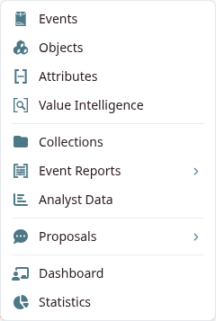
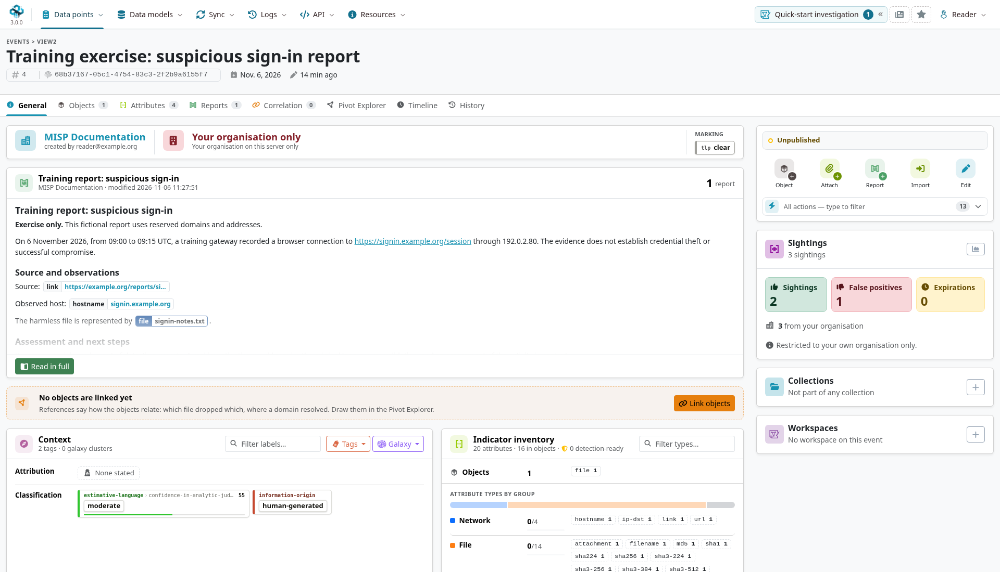
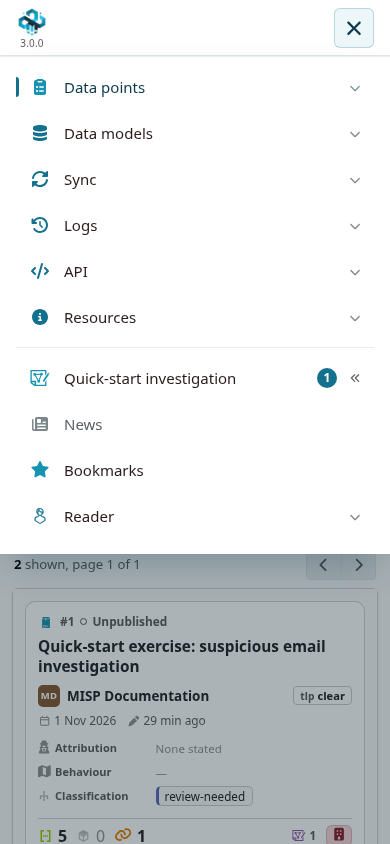

## Paragraph layout

Body paragraphs should align with both margins and start with the same first-line indent, including this first paragraph after a heading.
This sentence continues the same paragraph so its wrapped lines return to the normal left margin.

A second paragraph should have a visible gap above it and the same first-line indent.
Inline **emphasis**, `literal_code` and a [link](https://www.misp-project.org) should preserve the paragraph's alignment.

- A wrapped bullet should keep its hanging indent rather than inherit the body paragraph's first-line indent.
  This continuation stays aligned with the text of the bullet.

  A second paragraph in the bullet should also align with its text.

  - A nested bullet should retain its additional indentation when its text wraps onto another line.

1. A wrapped numbered item should align its continuation with the item text and retain the normal marker position.
2. A second numbered item should keep the same alignment.

The paragraph after the lists should return to justified prose with the same first-line indent and paragraph spacing as the paragraphs above.

## Referenced callouts

See @nte-layout-note and @fig-layout-example and @tbl-layout-example.

::: {#nte-layout-note .callout-note title="A referenced note"}
A referenced note with **important text**, `literal_code` and a [link](https://www.misp-project.org).
:::

::: {#wrn-layout-warning .callout-warning}
A referenced warning. See @nte-layout-note.
:::

{#fig-layout-example width=24mm}

| Example | Value |
|:--|:--|
| JSON with a quoted comma | `{"key":"part,one","tag":"example-tag"}` |
| JSON with escaped quotes | `{"key":"a\"quoted\"value","tag":"test"}` |

: Table cross-reference {#tbl-layout-example}

## Highlighted code

```{.python code-line-numbers="true"}
def example():
    # Preserve indentation and literal strings.
    return {"url": "https://www.misp-project.org", "value": 42}
```

[A chapter-only link to Administration](../../administration/index.qmd).

A final reference to @fig-layout-example, @tbl-layout-example and @wrn-layout-warning.

## Screenshot sizing

Small menus and dialogs should retain readable controls without filling the text
width. Keep captions, figure references and nearby explanations in the normal flow.

{#fig-layout-menu}

{#fig-layout-dialog}

The menu in @fig-layout-menu and the dialog in @fig-layout-dialog should be smaller
than the wide capture below. Neither should be stretched to match its width.

{#fig-layout-wide}

Tall captures must fit within the page while preserving their aspect ratio.

{#fig-layout-tall}

An author's explicit size must still take precedence over the automatic limit.

{#fig-layout-explicit height=30mm}
