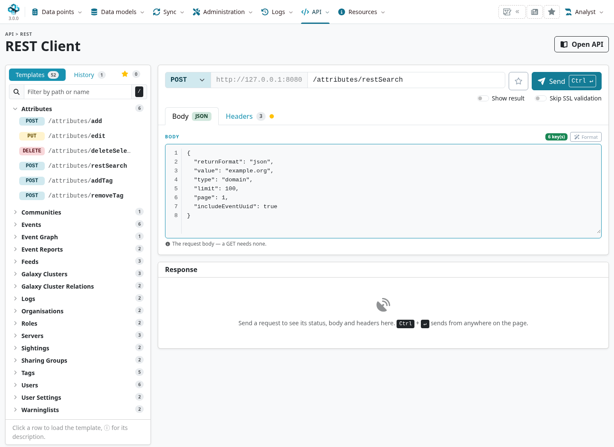
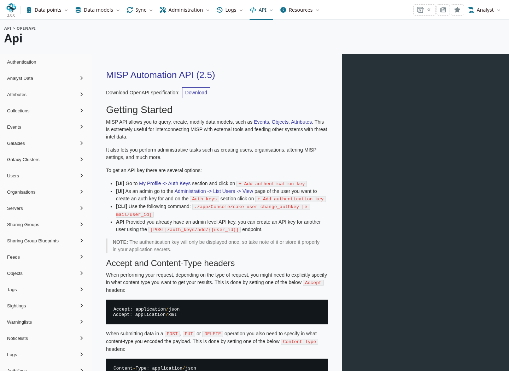
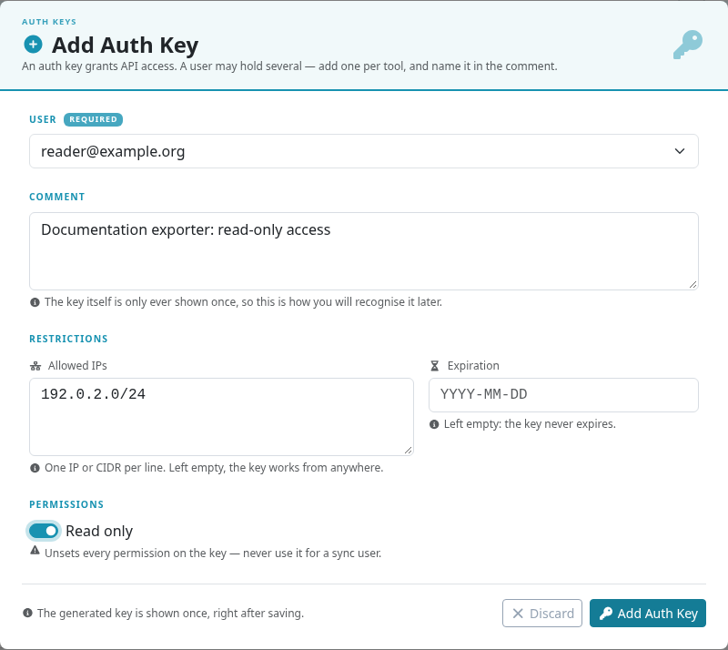

Use the MISP REST API to search intelligence, maintain events, exchange observations and
connect detection or response tools. Start with a small read-only query, check the returned
scope and schema, then add writes or scheduled processing deliberately.

::: {.callout-note}
This chapter follows MISP **3.0.0**, [`3.0_wip`](https://github.com/MISP/MISP/tree/3.0_wip)
commit [`99ebee729`](https://github.com/MISP/MISP/commit/99ebee729702c560528f9788953719bda68aa1c1),
in light mode. Examples use reserved training values. Screenshots can be enlarged.
:::

<!-- Source checks, runtime examples and capture hashes: ../assets/automation-screenshots.json -->

<a id="the-misp-rest-api"></a>
<a id="automation-api"></a>
<a id="post-objectsdeleteobjectidharddelete"></a>
<a id="update-2482"></a>

## Find the API reference {#api-reference}

Open **API → OpenAPI** (`/api/openapi`) for the bundled reference, or download its specification
from `/doc/openapi.yaml`. Use **API → REST client** (`/api/rest`) to load request templates,
edit a request and inspect its response. The templates depend on the logged-in user's role.



The REST client sends an HTTP request with the headers you supply. **An interactive login does
not replace the request's authentication key**: replace `YOUR_API_KEY` in its **Headers** tab.
Keep **Skip SSL validation** off. Check the method, target URL and body before choosing **Send**;
the client can perform writes as well as searches. Its response panel shows status, headers and body.



Use `GET /servers/getVersion` for the running server version and recommended PyMISP version.
The OpenAPI document's own `info.version` is not a substitute for that server-version check.
For new development-branch features, check the relevant controller and its constraints as well
as the reference. Use [PyMISP](../pymisp/index.qmd) for Python integrations where it provides a helper.

<a id="general"></a>
<a id="automation-url"></a>
<a id="automation-key"></a>
<a id="creating-an-automation-key-using-advanced-authkeys"></a>
<a id="pinning-an-allowed-ip-for-an-automation-key-using-advanced-authkeys"></a>
<a id="accept-and-content-type-headers"></a>
<a id="user-management"></a>
<a id="post-adminusersadd"></a>
<a id="post-adminusersedit"></a>
<a id="post-adminusersdelete"></a>
<a id="parameters-1"></a>
<a id="example-18"></a>
<a id="get-adminusers"></a>
<a id="description-12"></a>
<a id="output-8"></a>
<a id="example-19"></a>
<a id="get-adminusersview"></a>
<a id="description-13"></a>
<a id="parameters-2"></a>
<a id="output-9"></a>
<a id="example-20"></a>
<a id="post-adminusersadd-1"></a>

## Configure an automation account {#api-authentication}

Use a dedicated account whose organisation and role match the integration's purpose. An
authentication key inherits that account's permissions and data visibility; it does not grant
site-administrator access by itself. A detection exporter normally needs read access, while an
ingestion service needs the relevant add/modify permissions. Native MISP synchronization uses
its own [sync-account setup](../sharing/index.qmd#concept).

Open **Account → My Profile → Auth keys**. Choose **Add auth key**, enter a useful comment and
set an expiry, allowed source IPs and **Read only** as appropriate. IP restrictions are evaluated
against the source address seen by MISP, including the effects of an authorised reverse proxy.



The new key is displayed once. Store it in the integration's secret store; do not commit it to
source control or paste it into shared request logs. Editing an existing key changes its
restrictions, not the account's role. Rotate by deploying a new key, verifying the integration,
then revoking the old key. See [account management](../user-management/index.qmd).

When IP usage logging is enabled and your role allows it, a key's details can show **Seen IPs**
and a **Pin** action. Pinning restricts the key to that address; confirm it is the stable egress
address of the intended service before applying it.

### Headers and TLS {#api-headers}

Send the **raw key**, without a `Bearer` prefix, in the `Authorization` header:

```http
Authorization: YOUR_API_KEY
Accept: application/json
Content-Type: application/json
```

Use HTTPS and keep certificate verification enabled. For a private certificate authority,
configure the client's CA bundle (`curl --cacert` or Requests' `verify` path) rather than
disabling verification. Keep the key out of URLs. A read-only key may perform supported
read-only POST searches; the HTTP verb alone does not determine whether an operation writes data.

<a id="automation-using-pymisp"></a>
<a id="server-management"></a>
<a id="get-serversgetversion"></a>
<a id="result"></a>
<a id="example-17"></a>

## Make a first request {#api-first-request}

Set `MISP_URL` to your instance's base URL without a trailing slash. Supply `MISP_KEY` through
your secret-management mechanism. In an interactive Bash session, a hidden prompt is another option:

```bash
export MISP_URL='https://misp.example.org'
read -r -s -p 'MISP API key: ' MISP_KEY
export MISP_KEY
```

The following helper keeps the headers consistent. It leaves TLS verification enabled and
reports HTTP errors while retaining their response bodies for diagnosis:

```bash
misp_api() {
  local method="$1" path="$2"
  shift 2
  curl --silent --show-error --fail-with-body \
    --request "$method" \
    --header "Authorization: ${MISP_KEY}" \
    --header 'Accept: application/json' \
    --header 'Content-Type: application/json' \
    "${MISP_URL%/}${path}" "$@"
}

misp_api GET /servers/getVersion
```

Check `version`, `pymisp_recommended_version` and any capabilities relevant to your integration,
such as `collection_sync`. Capability flags and the account's role matter alongside the version.
Do not infer support for every MISP 3.0 target type from the PyMISP package's major version.

<a id="search"></a>

## Search events and attributes {#api-search}

Use **POST `/events/restSearch`** for event containers and **POST `/attributes/restSearch`**
for individual observations. Put filters in a JSON body, not positional URL segments. For example,
save this as `search.json` to find occurrences of a reserved training domain:

```json
{
  "returnFormat": "json",
  "value": "example.org",
  "type": "domain",
  "limit": 100,
  "page": 1,
  "includeEventUuid": true
}
```

```bash
misp_api POST /attributes/restSearch --data @search.json
```

The JSON attribute result is normally under `response.Attribute`. An event search normally
returns a `response` list of `Event` envelopes. Other endpoints and export formats use different
shapes: check them before writing a generic parser. IDs are local to an instance; retain **UUIDs**
for event and attribute identity across systems.

<a id="filtering-event-metadata"></a>

### Choose the filters for the job {#api-search-filters}

::: {.table-responsive}

| Filter | Meaning |
|---|---|
| `value`{.text-wrap .text-break}, `type`{.text-wrap .text-break}, `category`{.text-wrap .text-break} | Select the observation values and types you need. Wildcard and boolean forms are endpoint-specific. |
| `eventid`{.text-wrap .text-break}, `uuid`{.text-wrap .text-break} | Restrict the search to known events or entities. Prefer UUIDs for portable references. |
| `tags`{.text-wrap .text-break} | Select handling, source or workflow tags. Tags do not grant access or replace distribution. |
| `published`{.text-wrap .text-break} | Select published/unpublished events; omit it when both are intended and visible. Unpublished is not a privacy setting. |
| `to_ids`{.text-wrap .text-break} | Use `true`{.text-wrap .text-break} to select detection attributes. Omitting the filter is useful for investigation and context searches. |
| `enforceWarninglist`{.text-wrap .text-break} | Exclude warninglist matches from an export where supported. A missing match is not a guarantee of safety. |
| `timestamp`{.text-wrap .text-break} | Filter modifications in the controller's scope: event changes for event searches, attribute changes for attribute searches. |
| `publish_timestamp`{.text-wrap .text-break} | Filter event publication times. The legacy `last`{.text-wrap .text-break} parameter is an alias; use the explicit name in new clients. |
| `from`{.text-wrap .text-break}, `to`{.text-wrap .text-break} | Filter the event's date, not necessarily the last modification or observation time. |
| `deleted`{.text-wrap .text-break} | On attribute searches, request soft-deleted records where the account may see them; `[0,1]`{.text-wrap .text-break} includes active and deleted records. |
| `limit`{.text-wrap .text-break}, `page`{.text-wrap .text-break} | Bound the result and request subsequent pages, starting at page 1. |
| `withAttachments`{.text-wrap .text-break} | Include binary attachment data where supported; leave it off for ordinary indicator polling. |

:::

For a detection export, combine a deliberate source/audience selection with `published: true`,
`to_ids: true` and suitable warninglist handling. The training data in this book has `to_ids`
disabled and is not intended for detection. Check [best practices](../best-practices/index.qmd)
before enabling an operational export.

### Poll incrementally and recover {#api-incremental-polling}

A reliable connector needs more than a recurring search:

1. Keep a checkpoint of the last **fully processed** time window. Query with an overlap so that
   equal timestamps, retries and delayed changes can be handled again.
2. Use a bounded window and paginate through every result. Apply records by UUID and compare
   their modification time, so a retry does not create duplicate target records.
3. Process relevant deletions, expiry and changes to detection flags. A value that stops matching
   a filter or becomes invisible may disappear without a tombstone in that query.
4. Commit the checkpoint only after the whole batch is safely applied. On failure, retry from
   the previous checkpoint with bounded backoff.
5. Reconcile periodically against the authorised source set. Pagination over a changing data set
   is not an immutable snapshot, and a modification filter alone cannot report every access revocation.



<a id="events-management"></a>
<a id="events"></a>
<a id="accepted-methods"></a>
<a id="description"></a>
<a id="get-events"></a>
<a id="description-1"></a>
<a id="url-arguments"></a>
<a id="output"></a>
<a id="example-1"></a>
<a id="post-events"></a>
<a id="example-2"></a>
<a id="delete-events"></a>
<a id="description-2"></a>
<a id="url-arguments-1"></a>
<a id="output-1"></a>
<a id="example-3"></a>
<a id="get-eventsindex"></a>
<a id="description-3"></a>
<a id="output-2"></a>
<a id="example-4"></a>
<a id="post-eventsaddtag"></a>
<a id="url-arguments-2"></a>
<a id="post-eventsremovetag"></a>
<a id="url-arguments-3"></a>
<a id="get-eventspusheventtozmq"></a>
<a id="description-4"></a>
<a id="url-arguments-4"></a>
<a id="example-5"></a>
<a id="get-eventsnids-nids-rules-export"></a>
<a id="get-eventshids-hash---hids-database-export"></a>
<a id="get-eventsstix-stix-export"></a>
<a id="various-ways-to-narrow-down-the-search-results-of-the-stix-export"></a>

## Create and maintain event data {#api-event-management}

The following bodies illustrate writes to a **private, unpublished** exercise event. Check the
response for the created UUID and use that identifier in later requests. The account needs the
corresponding permissions and ownership; administrator credentials should not be a script default.

### Create an event {#api-create-event}

POST to `/events/add`:

```json
{
  "Event": {
    "info": "Integration exercise: private observations",
    "date": "2026-11-06",
    "distribution": 0,
    "threat_level_id": 4,
    "analysis": 0,
    "published": false
  }
}
```

`threat_level_id` is **1 High, 2 Medium, 3 Low, 4 Undefined**. Do not use a zero-based mapping.
Distribution 0 restricts the event to its owning organisation; an unpublished community event
can still be visible locally under the instance's policy.

<a id="attribute-management"></a>
<a id="post-attributesadd"></a>
<a id="url-arguments-8"></a>
<a id="output-4"></a>
<a id="example-10"></a>
<a id="get-attributes"></a>
<a id="url-arguments-9"></a>
<a id="url-attributes"></a>
<a id="output-5"></a>
<a id="example-11"></a>
<a id="post-attributesdelete"></a>
<a id="description-9"></a>
<a id="url-arguments-10"></a>
<a id="output-6"></a>
<a id="example-12"></a>
<a id="post-attributesaddtag"></a>
<a id="url-arguments-11"></a>
<a id="post-attributesremovetag"></a>
<a id="url-arguments-12"></a>
<a id="get-attributesattributestatistics"></a>
<a id="description-10"></a>
<a id="output-7"></a>
<a id="example-13"></a>
<a id="get-attributesdescribetypes-describe-types-api"></a>
<a id="example-14"></a>
<a id="post-attributesrestsearch"></a>
<a id="parameters"></a>
<a id="example-15"></a>
<a id="objects-management"></a>
<a id="post-objectsdeleteobject_idhard_delete"></a>
<a id="description-11"></a>
<a id="url-arguments-13"></a>
<a id="example-16"></a>

### Add an attribute or object {#api-attribute-management}

POST to `/attributes/add/{event_uuid}` with an `Attribute` envelope:

```json
{
  "Attribute": {
    "type": "ip-dst",
    "category": "Network activity",
    "value": "192.0.2.80",
    "to_ids": false,
    "distribution": 5,
    "comment": "Reserved documentation address; keep out of detection exports."
  }
}
```

Distribution **5** on a child means inherit from its parent. Use
`GET /attributes/describeTypes` to inspect accepted types/categories and
`POST /objects/add/{event_uuid}` for a structured MISP object. Follow the active
[object template](../misp-objects/index.qmd); a collection of similarly named standalone
attributes does not create an object automatically.

<a id="tag-management"></a>
<a id="post-tagsadd"></a>
<a id="description-5"></a>
<a id="url-arguments-5"></a>
<a id="mandatory"></a>
<a id="optional"></a>
<a id="example-6"></a>
<a id="post-tagsattachtagtoobject"></a>
<a id="description-6"></a>
<a id="url-arguments-6"></a>
<a id="response"></a>
<a id="example-7"></a>
<a id="post-tagsremovetagfromobject"></a>
<a id="description-7"></a>
<a id="url-arguments-7"></a>
<a id="response-1"></a>
<a id="example-8"></a>
<a id="get-tagstagstatistics"></a>
<a id="description-8"></a>
<a id="output-3"></a>
<a id="example-9"></a>

### Update, tag and publish deliberately {#api-updates-and-tags}

::: {.table-responsive}

| Operation | Endpoint and body |
|---|---|
| Fetch an event | `GET /events/view/{uuid}`{.text-wrap .text-break} |
| Update event metadata | `POST /events/edit/{uuid}`{.text-wrap .text-break} with an `Event`{.text-wrap .text-break} envelope. |
| Update an attribute | `POST /attributes/edit/{uuid}`{.text-wrap .text-break} with an `Attribute`{.text-wrap .text-break} envelope. |
| Attach an event tag | `POST /events/addTag`{.text-wrap .text-break} with `{"event":"EVENT_UUID","tag":"tlp:clear"}`{.text-wrap .text-break}. |
| Remove an event tag | `POST /events/removeTag`{.text-wrap .text-break} with the event and tag identifiers. |
| Tag an attribute | `POST /attributes/addTag`{.text-wrap .text-break} with `{"attribute":"ATTRIBUTE_UUID","tag":"TAG_NAME"}`{.text-wrap .text-break}. |
| Delete an attribute | `POST /attributes/delete/{uuid}`{.text-wrap .text-break}; review soft/hard-delete behaviour before choosing a variant. |
| Delete an object | `POST /objects/delete/{uuid}`{.text-wrap .text-break}; check the selected deletion mode. |
| Delete an event | `POST /events/delete/{uuid}`{.text-wrap .text-break}; review the consequences for its children and connected systems. |
| Publish a reviewed event | `POST /events/publish/{uuid}`{.text-wrap .text-break}; this can initiate synchronization and configured downstream actions. |

:::

Fetch the response and confirm the saved state. Do not retry an ambiguous create blindly:
after a timeout, query the UUID or reconcile before adding another copy. Publication is a separate
workflow decision; none of the training examples requires publishing an event.

<a id="discussion-api"></a>

## MISP 3.0 values and research data {#api-value-targets}

MISP 3.0 distinguishes an **attribute occurrence** from the **value** it holds. An attribute has
a UUID; a value has a SHA-256 address computed from the stored, normalized UTF-8 text.

Look up an accessible value with:

```bash
misp_api GET /values/view --get --data-urlencode 'value=example.org'
```

The equivalent address lookup is `GET /values/view/sha256:{hex}`. Local numeric value IDs are
not portable identifiers. Read the stored value and address from the response rather than
hashing an unnormalized input. For a composite attribute, each component value has its own address.

Use the address fields appropriate to the target type:

::: {.table-responsive}

| Target | Address in a write |
|---|---|
| Event, attribute, object or another UUID target | `object_uuid`{.text-wrap .text-break} for Analyst Data; `element_uuid`{.text-wrap .text-break} for collection elements. |
| `AttributeValue`{.text-wrap .text-break} | `object_sha256`{.text-wrap .text-break} for Analyst Data; `element_sha256`{.text-wrap .text-break} for collection elements. |
| Relationship's value target | `related_object_type: "AttributeValue"`{.text-wrap .text-break} with `related_object_sha256`{.text-wrap .text-break}. |

:::

For example, POST a note to
`/analystData/add/Note/{sha256}/AttributeValue`{.text-wrap .text-break}:

```json
{
  "Note": {
    "note": "Training value: retain the source context before making an assessment.",
    "language": "en",
    "distribution": 0
  }
}
```

Add a value reference with `POST /collectionElements/add/{collection_id}`:

```json
{
  "CollectionElement": {
    "element_type": "AttributeValue",
    "element_sha256": "SHA256_OF_STORED_VALUE",
    "description": "Reserved training value, not a maliciousness verdict."
  }
}
```

These records have their own distribution. A reference does not give its reader access to the
source event or reveal a value that the reader cannot resolve through a visible attribute.
See [Analyst Data](../analyst-data/index.qmd) and [Collections](../collections/index.qmd) for
visibility and older-peer limitations. Some 3.0 calls are not wrapped by every PyMISP release;
use documented REST requests for those operations rather than inventing a client method.

The old `/threads/` and `/posts/` discussion API is removed in this branch. Use Analyst Data
notes/replies on the relevant target. Event reports use `/eventReports/` endpoints for a narrative;
neither a note nor a report should be treated as an attribute containing a detection indicator.

<a id="sightings"></a>
<a id="post-sightingsadd"></a>

## Sightings API {#sightings-api}

POST to `/sightings/add/{attribute_uuid}` to record an observation of that occurrence:

```json
{
  "type": 0,
  "source": "Documentation exercise",
  "timestamp": 1793956200
}
```

Use **0** for a sighting, **1** for a false positive and **2** for an expiration.
The add request uses **`timestamp`**; a returned record has `date_sighting`. Omitting the
observation time records the current time. Supplying a value instead of one attribute occurrence
can affect multiple matching attributes; choose the scope deliberately.

`POST /sightings/restSearch` provides filtered retrieval. For bulk input, use the endpoint's
documented batch format rather than repeatedly reporting the same observation after an uncertain
response. See [Sightings](../sightings/index.qmd) for interpretation and visibility.

<a id="organisation-management"></a>
<a id="special-cases"></a>
<a id="xml-export"></a>
<a id="json-query-format"></a>
<a id="xml-query-format"></a>
<a id="xml-download-and-url-parameters"></a>
<a id="csv-export"></a>
<a id="update-2.4.82"></a>
<a id="rpz-export"></a>
<a id="text-export"></a>
<a id="restful-searches-with-xml-result-export"></a>
<a id="export-attributes-of-event-with-specified-type-as-xml"></a>
<a id="download-attachment-or-malware-sample"></a>
<a id="download-malware-sample-by-hash"></a>
<a id="upload-malware-samples-using-the-upload-sample-api"></a>
<a id="proposals-api"></a>
<a id="sharing-groups"></a>
<a id="warninglists-api"></a>
<a id="get-warninglistsindex"></a>
<a id="description-14"></a>
<a id="parameters-3"></a>
<a id="output-10"></a>
<a id="example-21"></a>
<a id="get-warninglistsview1"></a>
<a id="description-15"></a>
<a id="parameters-4"></a>
<a id="output-11"></a>
<a id="example-22"></a>
<a id="attribute-statistics-api"></a>
<a id="additional-statistics"></a>

## Exports, attachments and specialised APIs {#api-exports}

Use `returnFormat` in a `restSearch` body for exports. JSON is a useful starting point; CSV, text,
STIX, Suricata/Snort, RPZ and other formats have different controller support and options.
Inspect the live reference for the exact format and filters. Export success does not mean that
every source feature is representable in the target format.
Some formats, including text, default to published, IDS-enabled attributes when those filters
are omitted. Set the intended scope explicitly; JSON and detection-oriented formats do not
necessarily have identical defaults.

::: {.table-responsive}

| Task | Current approach |
|---|---|
| JSON/XML event export | Search `/events/restSearch`{.text-wrap .text-break} with the selected format and bounded filters. |
| CSV or plain values | Search `/attributes/restSearch`{.text-wrap .text-break} with `returnFormat: "csv"`{.text-wrap .text-break} or `"text"`{.text-wrap .text-break}, selecting the required types and fields. |
| IDS, hash/HIDS or DNS RPZ output | Select the supported format, source scope, detection flags and format-specific parameters explicitly. |
| STIX export/import | Use the supported STIX version and installed conversion dependencies; validate the output with the receiving platform. |
| Download an attachment | Use the attribute's attachment-download endpoint, subject to event visibility. Request binary data only when needed. |
| Sample lookup/download | Use the documented sample APIs and retain the expected archive/password handling. Do not treat the response as ordinary indicator JSON. |
| Upload a file/sample | Use an attribute/object attachment workflow or the documented upload API. Its base64 payload, distribution and IDS defaults need review. |
| Proposals | `/shadow_attributes/view`{.text-wrap .text-break}, `/add`{.text-wrap .text-break}, `/edit`{.text-wrap .text-break}, `/accept`{.text-wrap .text-break} and `/discard`{.text-wrap .text-break}, with the required target identifier and `ShadowAttribute`{.text-wrap .text-break} envelope. The owner reviews proposed changes. |
| Sharing groups | `GET /sharing_groups/index`{.text-wrap .text-break} returns groups visible to the authenticated account. Their membership is separate from collections of content. |
| Feed metadata and jobs | `/feeds/`{.text-wrap .text-break} endpoints described below; caching and ingestion are separate. |
| Organisations and users | Use the reference's organisation and admin-user endpoints, with the appropriate administrator role and scope. Numeric IDs differ between instances. |
| Warninglists, statistics and type metadata | Use their documented read endpoints; access and response shape depend on the operation and role. |

:::

The old positional export recipes (`/events/xml/...`, `/events/csv/...`, `/events/text/...`
and similar paths) are legacy interfaces. Prefer a named JSON search body for new clients.
Never copy an old URL recipe that embeds an authentication key.

<a id="enable-disable-and-fetching-feeds-via-the-api"></a>

### Automate feed operations {#api-feed-operations}

Feed administration requires a site administrator. Typical operations are:

::: {.table-responsive}

| Method and endpoint | Effect |
|---|---|
| `POST /feeds/enable/{id}`{.text-wrap .text-break} | Enable ingestion for that feed. |
| `POST /feeds/disable/{id}`{.text-wrap .text-break} | Disable ingestion; caching is controlled separately. |
| `POST /feeds/cacheFeeds/{id}`{.text-wrap .text-break} | Cache that feed when its caching flag is enabled. |
| `POST /feeds/cacheFeeds/all`{.text-wrap .text-break} | Cache all eligible feeds; use `misp`{.text-wrap .text-break} or `freetext`{.text-wrap .text-break} for a format scope. |
| `POST /feeds/fetchFromFeed/{id}`{.text-wrap .text-break} | Import an enabled feed. |
| `POST /feeds/fetchFromAllFeeds`{.text-wrap .text-break} | Bulk ingestion; review the source set before running it. |

:::

With background jobs enabled, acceptance of a request does not prove the job completed.
Inspect the job outcome, cache time or resulting event. See [Managing feeds](../managing-feeds/index.qmd).

<a id="misp-modules"></a>
<a id="description-16"></a>
<a id="get-modules"></a>
<a id="example-23"></a>
<a id="output-12"></a>
<a id="post-modulesqueryenrichment"></a>
<a id="example-24"></a>

### Query an enrichment service {#api-module-queries}

`GET /modules/index` exposes enabled enrichment modules available to the account when the
service is configured and reachable. `POST /modules/queryEnrichment` is the **hover-query**
path: it requires an enabled module supporting hover and input matching that module's schema.
It is not a generic import, expansion or AI endpoint. The request needs a `module` name; MISP
adds configured module credentials before forwarding it to the service.

Use the [Modules](../modules/index.qmd) chapter for service configuration, organisation
restrictions, event import/enrichment and the separate AI family. Review results before saving
them into intelligence or enabling their IDS flags.

<a id="status-codes"></a>
<a id="error-handling"></a>
<a id="wrong-endpoint-chosen"></a>
<a id="example"></a>

## Errors and operational checks {#api-errors}

::: {.table-responsive}

| HTTP result | What to check |
|---|---|
| **200** | Parse the expected envelope and inspect endpoint-level success/error fields. A job may still be pending. |
| **403** | Missing/invalid/expired key, IP restrictions, account role, read-only restriction or insufficient access. |
| **404** | Wrong route, missing entity or an entity not visible to this account. Do not interpret every 404 as a source deletion. |
| **405** | Method, required input or workflow constraint rejected. MISP also uses this status for some validation errors. Read the body. |
| **429** | Respect a rate limit and any retry guidance from the instance or gateway. |
| **5xx / transport failure** | Bound retries, retain the last successful checkpoint and investigate server/job logs. Reconcile an ambiguous write before retrying it. |

:::

Log status, endpoint, timing and stable identifiers rather than entire authenticated requests
or sensitive response bodies. Test with the same account, filters and network path the scheduled
integration will use. Include empty results, pagination, permission failures and source removals
in acceptance checks, not only the first successful search.
