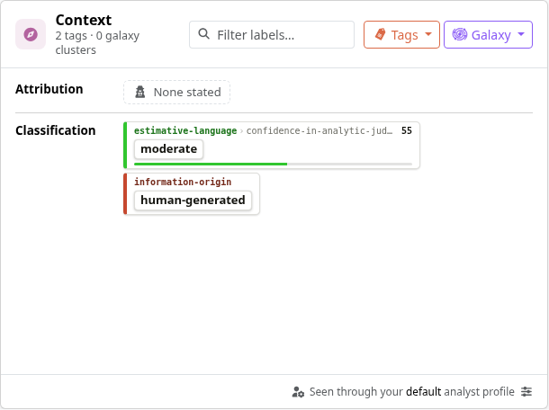
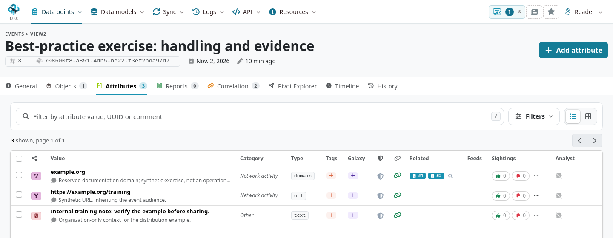
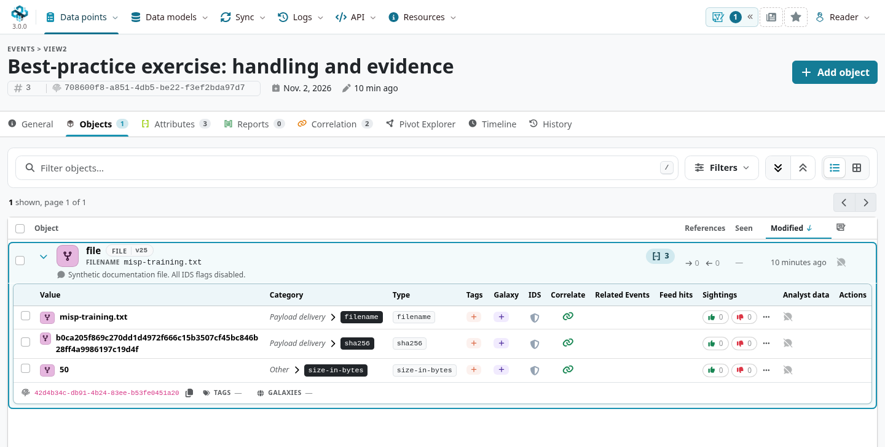
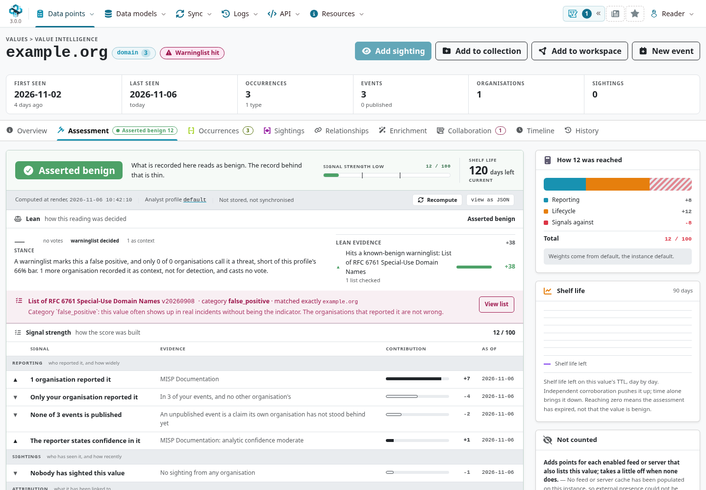
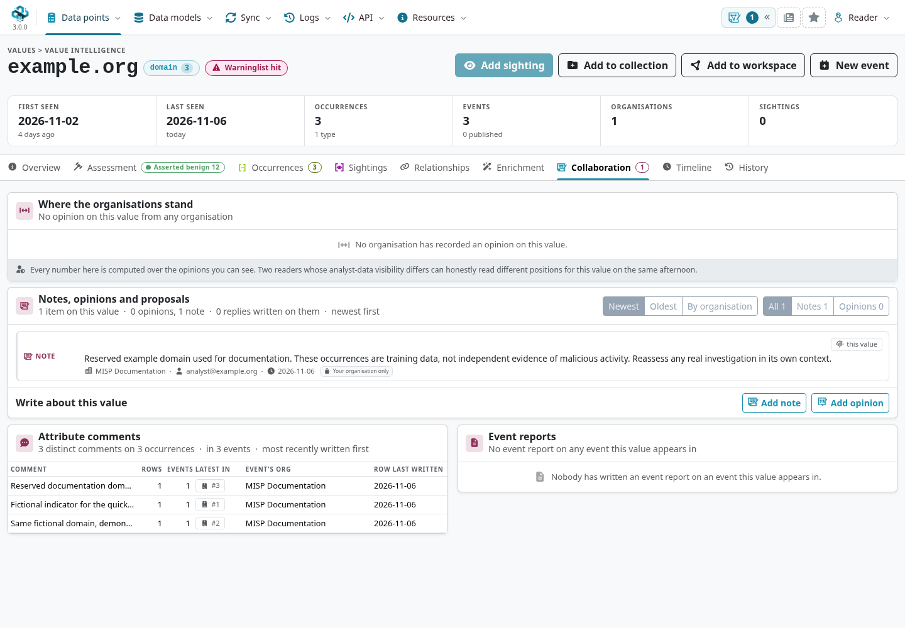
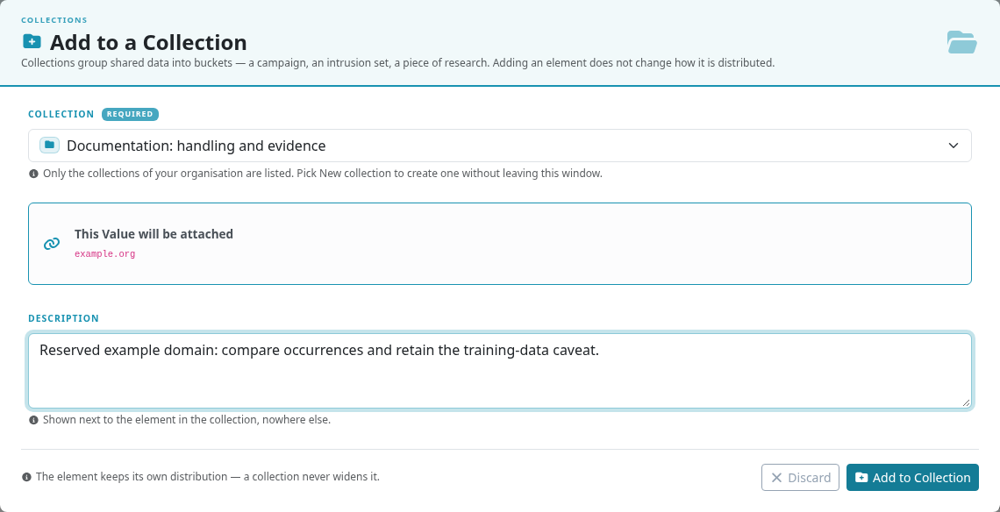

Useful intelligence tells the recipient what was observed, why it matters, how confident you are, and what they may do with it.
Use this chapter as a review guide when creating, assessing, and sharing data in MISP.
For the complete workflow, start with [Using the System](../using-the-system/index.qmd) or work through the [report exercise](../create-event-report/index.qmd); the [Sightings](../sightings/index.qmd) and [Decaying Models](../decaying-models/index.qmd) chapters explain how to keep an assessment current.
For broader guidance, see the [MISP threat intelligence best practices](https://www.misp-project.org/best-practices-in-threat-intelligence.html).

::: {.callout-note}
The examples and screenshots use MISP **3.0.0** from the development branch [`3.0_wip`](https://github.com/MISP/MISP/tree/3.0_wip), with fictional data in the light Overmind interface.
Value Intelligence, analyst profiles, and value-level annotation examples describe that branch; their interface can change before release.
Other practices also apply to MISP 2.5. Available actions depend on your role and the instance's configuration.
Select a screenshot to enlarge it in the website.
:::

<!-- Screenshot source commits, fixture and capture details: screenshots.json -->

## Tagging

### Event and attribute tags {#tagging-at-event-level-versus-tagging-at-attribute-level}

Apply a tag to the event when it describes the whole report or investigation.
Use attribute tags for a statement about a particular indicator, such as a different confidence assessment or handling requirement.
Avoid copying every event tag onto every attribute: duplication adds maintenance work and makes exceptions harder to spot.

Event and attribute tags can coexist. An attribute tag does not automatically replace a conflicting event tag or relax its handling requirements.
Check how your receiving tools combine tags, and resolve contradictory markings before publishing.
[Local tags](../taxonomy/index.qmd) are useful for internal workflow labels; use globally shared tags for context that must travel with the intelligence.

### Choose a useful set of tags {#minimal-subset-of-tags-to-use-for-each-event}

Use the taxonomies agreed with your community. A useful starting point covers handling, confidence, provenance, and permitted actions; do not add a label you cannot justify.

#### Traffic Light Protocol

Use the current [TLP taxonomy](https://github.com/MISP/misp-taxonomies/blob/main/tlp/machinetag.json) and [FIRST TLP 2.0 guidance](https://www.first.org/tlp/): **TLP:CLEAR**, **TLP:GREEN**, **TLP:AMBER**, and **TLP:RED**, with **TLP:AMBER+STRICT** where sharing must remain within the recipient's organization.
Prefer `tlp:clear` for new unrestricted material; older events may still carry the legacy `tlp:white` tag.

TLP communicates sharing boundaries. It does not enforce access in MISP: set [distribution](#setting-distribution) separately, and make sure it matches the marking and your agreement with the source.

#### Confidence

State confidence in the assessment and explain the evidence behind it.
The [estimative-language](https://github.com/MISP/misp-taxonomies/blob/main/estimative-language/machinetag.json) taxonomy expresses confidence in an analytic judgment; [admiralty-scale](https://github.com/MISP/misp-taxonomies/blob/main/admiralty-scale/machinetag.json) separates source reliability from information credibility.
A precise-looking score or several copies of the same report do not establish confidence on their own.

#### Origin

Use [information-origin](https://github.com/MISP/misp-taxonomies/blob/main/information-origin/machinetag.json) to describe how material was produced, such as human-generated or AI-generated content.
Record the original source, collection method, and relevant limitations in comments or an [event report](../event-reports/index.qmd).
Human authorship is not a guarantee of reliability; assess automated and human-produced material against the evidence.
Review enrichment and AI-assisted output before accepting it as intelligence, and check what data an external service receives before invoking it.

#### Permissible Actions Protocol

[PAP](https://github.com/MISP/misp-taxonomies/blob/main/PAP/machinetag.json) describes permitted investigative actions, such as whether a recipient may actively interact with the subject.
It complements TLP: permission to share information does not imply permission to scan, contact, or otherwise interact with the infrastructure it describes.
Agree on PAP handling with your community and reflect it in your operating procedures.

## Setting distribution

Set the event's intended audience first. Leave objects and attributes on **Inherit event** where that audience is appropriate, and use a narrower distribution for exceptions.
For example, a community event can contain indicators available to the community and an internal comment restricted to **Your organisation only**.
An attribute's explicit distribution does not widen access beyond its containing event; object restrictions also matter for attributes inside objects.

A [sharing group](../using-the-system/index.qmd#create-and-manage-sharing-groups) names an audience of organizations and servers.
Check its actual membership and synchronization settings: two sharing groups are not automatically ordered from more to less restrictive.
Use inheritance when an entire event has the same audience, then review any exceptions deliberately.

Before sharing sensitive material, verify visibility with an account from the intended receiving organization.
Check attachments, reports, object attributes, and annotations as well as the event header.
**Your organisation only** includes other authorized users in your organization; it is not a personal privacy setting.

Notes, Opinions, Relationships, collections, and workspaces have their own sharing settings.
Review those settings whenever you copy context into them. Restricting an event does not safely classify text pasted into a more widely shared annotation.

## Model related properties with objects {#use-objects-instead-of-combined-attributes}

Use an [object](../misp-objects/index.qmd) when several properties describe one entity: a file's name, hash, and size belong together in a `file` object.
Choose the template that matches the evidence, use its defined relations, and add references when you can explain how two objects are related.
Do not invent missing values to fill a template.

Composite attributes such as `filename|sha256` and `ip-dst|port` remain useful where a consumer expects them.
Choose the representation that preserves the context and works with your consumers; avoid creating duplicate representations without a reason.
Where known, record `first_seen` and `last_seen` as the observation window, and distinguish observation time from the event date or the time you imported the data.

## Assess values across events in MISP 3.0

Open **Data points → Value Intelligence**, look up a value, and select **Open intelligence** to examine it across the occurrences you can access.
Use the **Occurrences** tab to inspect the underlying events and their provenance, rather than treating the number of matches as independent corroboration.
Three events copied from one source can still represent one observation.

The **Assessment** tab explains the available signals and the effective **analyst profile** used to interpret them.
A user profile takes precedence over an organization profile, which takes precedence over the instance default.
Profiles define weights, thresholds, and other assessment settings, so analysts with different profiles or visibility can reach different displayed results for the same value.
Record the profile and supporting evidence when passing an assessment to another team.

Read the explanation behind a decision label or score.
A [warninglist](../warninglists/index.qmd) match is a reason to check context, and a correlation is evidence of a shared value; neither alone proves whether real activity is malicious.
A familiar CDN, your own infrastructure, or a sinkhole can still be relevant to an investigation.
An analyst-profile decision is also not a guarantee that every export or downstream detection tool will apply that decision.

## Put analysis on the right target

Use [Analyst Data](../analyst-data/index.qmd) to record assessments without rewriting another organization's event.
MISP 3.0 also supports Notes, Opinions, and Relationships on an **attribute value**, allowing analysis to follow the value across its occurrences.
Choose the narrowest target that accurately describes the claim:

| Your statement concerns… | Suitable target |
|---|---|
| One report, investigation, or incident | The event |
| A particular file, account, or other modeled entity | The object |
| One observation, with its source and time window | That attribute occurrence |
| The value across events, such as a documented caveat about a reserved domain | The attribute value in Value Intelligence |

In Value Intelligence, open **Collaboration** and use **Add note** for evidence or caveats, or **Add opinion** for an assessment.
Make a value-level statement only when it applies across contexts: a shared IP address may be malicious during one tenant's activity and legitimate during another's.
Explain the basis of an Opinion in a Note, and use Relationships with a clear meaning and direction.
Co-occurrence alone does not establish causation or attribution.

::: {.callout-important}
Set the annotation's own distribution before saving. Its visibility is independent of the holder event's distribution.
Do not paste restricted source details into a broader Note or Relationship.
A value reference resolves to its text only when the reader can access an attribute holding that value; the reference itself does not grant access.
Value-addressed Analyst Data and collection entries require MISP 3.0 peers and are withheld from older MISP peers during synchronization.
:::

## Suggest corrections with proposals {#use-proposals-when-possible-to-request-author-to-make-changes-to-an-event}

Use a [proposal](../using-the-system/index.qmd#proposing-changes-to-another-organisations-event) to ask the originating organization to correct a factual error, replace an incorrect attribute, or adjust an IDS flag.
Explain the evidence and the suggested correction so the author can accept or reject it.
Use a Note for additional analysis and an Opinion for an assessment; disagreement does not always mean the original observation should be replaced.

## Keep detection content current {#collaboration-and-lifecycle}

- **Choose IDS eligibility deliberately.** Enable `to_ids` for indicators suitable for detection, and leave contextual or unverified values out of detection exports. Publication, distribution, export filters, and the consuming tool's configuration also affect what is delivered.
- **Report observations and false positives.** Record [sightings](../sightings/index.qmd) with the observation time and appropriate type. A sighting means the value was observed; it does not by itself prove malicious activity. In the development interface shown here, the Value Intelligence header's **Add sighting** action is disabled; use the attribute's sighting controls.
- **Apply decay where consumers support it.** [Decaying models](../decaying-models/index.qmd) score indicators using time and configured signals. A score does not automatically clear `to_ids` or filter every export. Configure and test the relevant export or consumer filters, and review exceptions.
- **Control noisy correlations with evidence.** Use per-attribute correlation settings and [correlation exclusions](../administration/index.qmd) when justified by your use case. Document why you excluded a value and revisit the decision; do not classify whole classes of shared infrastructure as harmless.
- **Reassess after new evidence.** Update time windows, confidence, annotations, and detection eligibility when sightings, a correction, or a source update changes the assessment. Keep enough explanation for recipients to understand the change.

## Curate research with collections and workspaces

Use a [collection](../collections/index.qmd) to organize a research dossier or campaign across source events.
In MISP 3.0, collections can reference individual attributes, objects, and attribute values as well as events and galaxy clusters.
From Value Intelligence, choose **Add to collection**, select an existing collection or create one, and explain why the value belongs there.
Membership records research scope; it does not by itself assert that every member is malicious.

A collection's distribution controls the dossier; referenced material keeps its own access rules.
For value references, the value text does not travel with the reference: a receiving instance needs a visible attribute holding that value to resolve it.
Check the recipient's view before relying on a collection as a complete handover.

Use a [workspace](../general-layout/index.qmd#workspaces) to explore an investigation graph and collect working material.
Review its distribution when collaborating. Turn supported conclusions into explicit Relationships, Notes, or an event report so recipients can distinguish the evidence from exploratory connections.

## Before you publish

1. **Explain the investigation.** Give the event a specific title, identify the source, and describe what recipients should do with the intelligence.
2. **Check the audience.** Align TLP, event distribution, sharing-group membership, and any separately shared annotations or collections.
3. **Check the evidence.** Validate types, object relations, observation windows, confidence, and provenance. Review enrichment output and remove accidental duplicates.
4. **Check detection impact.** Review IDS flags, warninglist matches, exclusions, and the filters actually used by downstream tools. Keep training data out of operational detections.
5. **Check the recipient's view.** Confirm that the intended audience can access the necessary context and that internal notes stay within their intended audience. Publish only after that review.
