An attribute records an observation: a value, its type and category, its source context and
how it may be used or shared. Choose those fields for what was observed; a familiar-looking
value is not automatically a detection indicator or an attribution claim.

::: {.callout-note}
This chapter follows MISP **3.0.0**, `3.0_wip` commit
[`99ebee729`](https://github.com/MISP/MISP/commit/99ebee729702c560528f9788953719bda68aa1c1).
The snapshot contains **194 types and 16 categories**. Its names, allowed combinations and
model defaults were checked against the running instance's `GET /attributes/describeTypes`.
Descriptions come from the same checked-out model. Your deployment can differ.
:::

<!-- Public metadata and capture/source provenance: ../assets/data-model-screenshots.json -->

## Attribute categories vs. types {#attribute-categories-vs-types}

A **type** identifies the value's format and role: `domain`, `ip-dst`, `email-src` or `sha256`,
for example. A **category** places that observation in an investigative context, such as
Network activity or Payload delivery. MISP accepts only the category/type combinations listed
by its model; a type's default category is one valid choice, not its only possible choice.

::: {.table-responsive}

| Field | Choose it for |
|---|---|
| Type | What the value represents and which validation/normalization applies. A source IP and destination IP have different roles. |
| Category | The observation's context, using a combination accepted by the model. |
| IDS flag (`to_ids`{.text-wrap .text-break}) | Whether this occurrence is intended for detection/export. A type default is a suggestion, not a verdict. |
| Distribution | Who may access/share the observation, within its parent event/object's limits. |
| Comment, first/last seen, tags and research data | Source, observation time, handling and assessment. Preserve these rather than forcing them into the value. |

:::

Use an [object](../misp-objects/index.qmd#objects-use) when several attributes describe one structured
entity. Use [taxonomy tags](../taxonomy/index.qmd#taxonomy-machine-tags) for classification and
[galaxy clusters](../galaxy/index.qmd#galaxy-concepts) for reusable knowledge context. None replaces the
attribute's own type, identity or distribution.

## MISP 3.0: occurrences and shared values {#types-values}

An **attribute UUID** identifies one occurrence. The same text can appear in different events,
objects or roles without becoming one shared observation. MISP 3.0 also gives stored component
values a **SHA-256 address**, so research can refer to a value across occurrences.

A value address is not a new attribute type, an event UUID or a permission grant. It is derived
from the stored normalized value; use the returned address rather than hashing an unnormalized
input. Composite attributes such as `domain|ip` have separate component values.

For example, a `domain` occurrence in one private event and the domain relation of a `domain-ip`
object can share a value address while keeping distinct UUIDs, timestamps and access context.
A matching value or correlation does not prove that two sources describe the same incident.
See [Analyst Data](../analyst-data/index.qmd) and the
[value APIs](../automation/index.qmd#api-value-targets) for value-targeted research and visibility.

## Select a useful representation {#types-selection}

::: {.table-responsive}

| Observation | Representation and context |
|---|---|
| A destination contacted during an exercise | `ip-dst`{.text-wrap .text-break}, Network activity; retain its source and observation time. |
| A domain and resolved address | A `domain-ip`{.text-wrap .text-break} object when the relationship is part of the observation. |
| A known file's hash | The correct hash type, optionally as a relation in a `file`{.text-wrap .text-break} object; do not label an unknown string `sha256`{.text-wrap .text-break} merely because it is long. |
| A source document or analyst explanation | A link/report/note in the appropriate scope; it is not automatically a detection attribute. |
| A warninglist hit | Context for review, not an instruction to delete the value or declare it benign. |

:::

The book's examples use reserved domains/addresses, private distribution and IDS off. An
importer or object template may set flags explicitly; inspect the saved record. Inheritance
on a child means distribution **5**, not an independent wider audience.

## Use and maintain this reference {#types-reference-source}

The HTML type reference has literal-text search, allowed-category and detection-default
filters, a result count and **Clear filters**. On a narrow screen each row becomes a labelled
card; the table stays in its own scroll region. Keyboard users can tab to that region to browse
it. Filtering changes the view only; it does not change MISP data.

The category entries retain the full allowed-type lists.

::: {.content-visible when-format="html" unless-format="epub"}
Download the complete [CSV](reference/attribute-types.csv) or [JSON](reference/attribute-definitions.json).
:::

::: {.content-hidden when-format="html" unless-format="epub"}
The HTML edition also provides CSV/JSON downloads. The definitions below are complete in this edition.
:::

The defaults shown here are the model's `sane_defaults`, not a recommendation to enable IDS
for every matching type.

Maintainers can regenerate the committed reference with
`python assets/data-model/generate_reference.py` and check it with `--check`. Update the pinned
metadata snapshot and compare it with the intended MISP instance first. Normal book builds use
the committed data and do not need a running MISP server.


