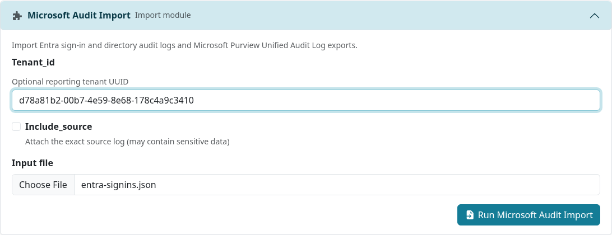
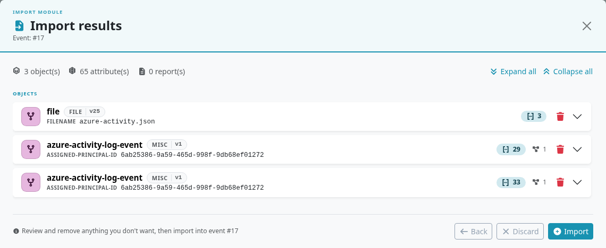
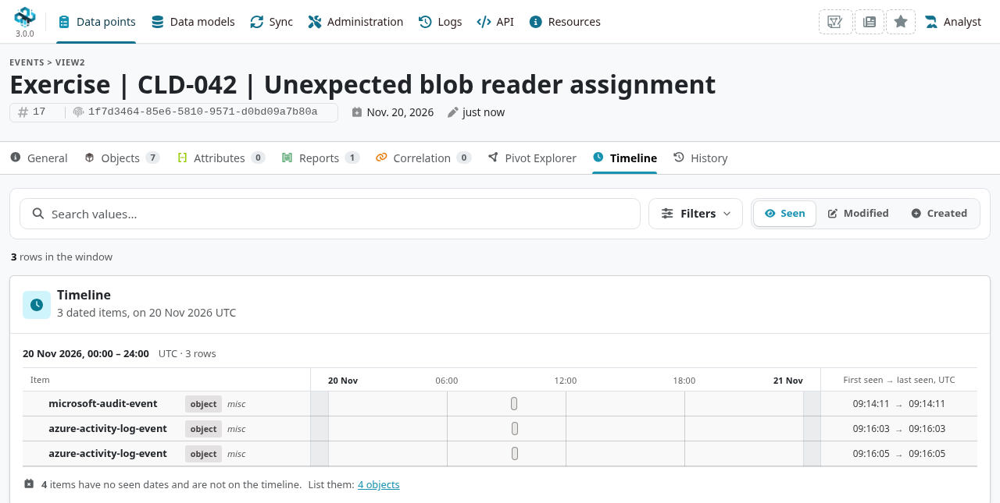
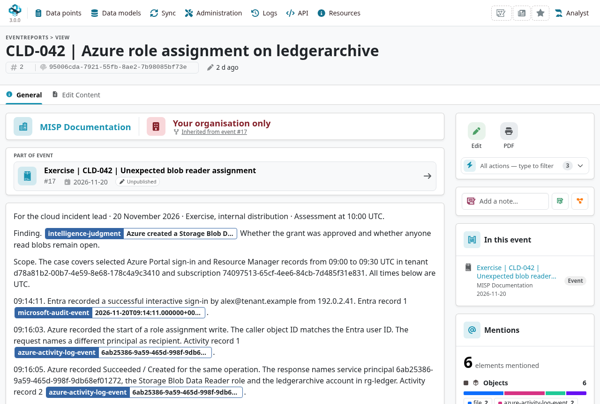
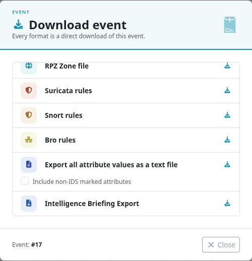

Azure raises an alert when someone grants a service principal read access to the `ledgerarchive` storage account.
The incident lead needs to know **who made the change, what access Azure granted, and whether anyone used it**.
A Microsoft Entra sign-in helps identify the caller. Two Azure Activity Log records show how the request ended. Blob access requires a different source of evidence.

In this exercise you will import both provider exports into one MISP event, reconstruct the change, and deliver a forensic report with citations back to the records.
Case **CLD-042**, its tenant, accounts, and logs are synthetic.
All times are UTC on 20 November 2026.

## Collect the two evidence files

::: {.content-visible when-format="html" unless-format="epub"}
Download [E1 · Entra sign-in JSON](examples/entra-signins.json){download="entra-signins.json"} and [E2 · Azure Activity Log JSON](examples/azure-activity.json){download="azure-activity.json"}.
:::

::: {.content-hidden when-format="html" unless-format="epub"}
The [chapter examples directory](https://github.com/MISP/misp-book/tree/main/cloud-incident/examples) contains the two input files, the worked event, and the exported report.
:::

**E1** is a saved Microsoft Graph `/auditLogs/signIns` response with one selected Azure Portal sign-in.
**E2** is a saved Azure Resource Manager Activity Logs response with two Administrative records under `value`.
The exercise window is 09:00–09:30 in subscription `74097513-65cf-4ee6-84cb-7d485f31e831`.
The reporting tenant, taken from the collection context, is `d78a81b2-00b7-4e59-8e68-178c4a9c3410`.

On a real case, export sign-ins from the affected tenant for the relevant time range and collect Activity Log records from the affected subscription, including the opening and closing stages.
Save each page and follow any continuation link. Record the collector, tenant, subscription, UTC collection time, time range, filters, and missing pages in the case evidence register.
Keep the original bytes in the evidence store. If you select or redact rows for MISP, record the original hash, selection rule, and the new file's hash. [Graph sign-in collection](https://learn.microsoft.com/en-us/graph/api/signin-list?view=graph-rest-1.0) · [Azure role change history](https://learn.microsoft.com/en-us/azure/role-based-access-control/change-history-report)

Run the following in the directory containing the two downloads. Compare the full digests with the source file objects after import.

```bash
sha256sum entra-signins.json azure-activity.json
```

```text
7a1908b3bf28713d753b684e88151ce770a51f31c21df408fcbf63151e4d7208  entra-signins.json
d6ab8e23d24d7dc8c9ec8a3df9b2c2aaaada55d3cad590503ed9cea843c90fd7  azure-activity.json
```

## Import into one investigation event

The screenshots follow CLD-042 on an isolated MISP 3.0.0 instance in light mode, signed in as a site administrator. [MISP `3.0_wip` revision `99ebee7`](https://github.com/MISP/MISP/commit/99ebee729702c560528f9788953719bda68aa1c1)
Both provider imports and the cited Markdown download were tested in this interface with PyMISP 2.5.34.4 and [misp-modules revision `0803618`](https://github.com/MISP/misp-modules/tree/0803618b9a948246631e2755723836e9e9d2d2e3).
The importers read files already collected from the providers. The exercise requires no cloud credentials.

<!-- Capture details and image checksums: screenshots.json -->

1. Have a site administrator check that the module service advertises `microsoft_audit_import`, `azure_activity_log_import`, and `intelligence_briefing_export` at `GET /modules`. Enable import and export services and those modules for the analyst. Update the MISP object templates so `file`, `cloud-account`, `microsoft-audit-event`, `azure-activity-log-event`, and `intelligence-judgment` are available. [Module configuration](../modules/index.qmd#modules-configuration) · [Object definitions used here](https://github.com/MISP/misp-objects/tree/cadfb75dcc92456bb5570e78be786431edc38d84/objects)
2. As an analyst who can add events, objects, and reports, create **CLD-042 | Unexpected blob reader assignment**. Set the event date to 20 November, distribution to **Your organisation only**, and analysis to **Ongoing**. Leave the event unpublished.
3. In the event, open **Import from** (or **Import**) and select **Microsoft Audit Import** (`microsoft_audit_import`). Upload `entra-signins.json`, enter the reporting tenant above in **Optional reporting tenant UUID**, and leave **Attach the exact source log** off. Run the module. In the preview expect one `microsoft-audit-event`, one `cloud-account`, and one `file`. Check the tenant, hash, and sign-in time, then choose **Import** to save all three objects. [Microsoft import formats and settings](https://github.com/MISP/misp-modules/blob/0803618b9a948246631e2755723836e9e9d2d2e3/documentation/import_mod/microsoft_audit_import.md)

   {fig-alt="Microsoft Audit Import with the reporting tenant UUID entered, Include_source unchecked, and entra-signins.json selected."}

4. In the **same event**, select **Azure Activity Log Import** (`azure_activity_log_import`) and upload `azure-activity.json`. Leave **Attach the exact source audit log** off. Expect two `azure-activity-log-event` objects and one more `file`. Choose **Import** to save all three, including the opening record. [Azure Activity Log import formats and settings](https://github.com/MISP/misp-modules/blob/0803618b9a948246631e2755723836e9e9d2d2e3/documentation/import_mod/azure_activity_log_import.md)

   {fig-alt="Import results for event 17 showing the source file azure-activity.json and two azure-activity-log-event objects, with 65 attributes in total."}

**Checkpoint.** The event should now have six objects and three timed observations.
Open the closing Azure observation and follow its `extracted-from` reference. The comment **Azure Activity Log record 2** points to the second member of the file's `value` array (`value[1]`).
Check its source object's SHA-256 against E2.
Both importers leave IDS matching and automatic correlation disabled on their attributes. Use the identifiers below to compare observations.
Enabling a source attachment would copy the entire uploaded file, including fields omitted from the structured projection, to the event.

If the import reports an error, check the export schema before retrying. Both example files have a `value` envelope, but their records belong to different APIs.
The Microsoft importer also accepts Entra directory audit JSON and Purview CSV with a JSON record in each `AuditData` cell. Azure Monitor Activity Log exports with a `records` envelope belong in the Azure Activity Log importer.
A next-page warning calls for collecting the remaining pages. Compare native record IDs and source hashes with the saved objects before repeating an upload.

## Reconstruct the role change

Open **Objects** and compare the three observations in order of `event-time`. On the **Timeline → Seen** view, their first- and last-seen times mark the same three instants.
Azure's later `submissionTimestamp` records when each entry became available for querying. Use the provider's activity time to reconstruct the operation. [MISP forensic timelines](../dfir/index.qmd#dfir-misp-timeline)

::: {.table-responsive}

| UTC | Source | What the record establishes |
|---|---|---|
| 09:14:11 | E1, record 1 | Entra recorded a successful interactive Azure Portal sign-in for `alex@tenant.example` from `192.0.2.41`. The native `status.errorCode` is zero. |
| 09:16:03 | E2, record 1 | `BeginRequest` / `Started`. The caller requested a role assignment for a service principal. The importer identifies `requestbody` as the source of the target fields. |
| 09:16:05 | E2, record 2 | `EndRequest` / `Succeeded`, substatus `Created`. The `responseBody` supplies the assigned principal, role definition, assignment ID, and storage-account scope. |

:::

{fig-alt="The Seen tab lists one Microsoft observation at 09:14:11 UTC and Azure observations at 09:16:03 and 09:16:05 UTC on November 20."}

**Who made the change?** Compare the Entra `actor-id` with Azure's `caller-object-id`. Both are `7ad614f0-90cf-4e61-ad86-1c68e9d46021`.
Check that Entra's reporting tenant matches Azure's `caller-tenant-id`. The username and IP also agree.
Within E2, the two records have distinct native event IDs and share the Azure operation and correlation IDs. Count one role assignment.
The Entra sign-in has its own correlation ID. The records identify the same directory account but leave the individual and the precise token used for the write undetermined.

**Who received what?** In the closing record, `authorization-role` describes the caller's **User Access Administrator** authority.
The grantee appears under `assigned-principal-id` as `6ab25386-9a59-465d-998f-9db68ef01272`, with type `ServicePrincipal`.
The role definition ends in `2a2b9908-6ea1-4ae2-8e65-a410df84e7d1`, Microsoft's **Storage Blob Data Reader** role.
Read `assignment-scope` all the way to `storageAccounts/ledgerarchive` in `rg-ledger`. This grant permits reading and listing blobs at that scope. [Microsoft role definition](https://learn.microsoft.com/en-us/azure/role-based-access-control/built-in-roles/storage#storage-blob-data-reader)

**Did anyone read a blob?** Neither export covers blob reads. Ask the storage team to check diagnostic coverage from 09:16:05 onward.
For example, the following read-only query tests for OAuth-authenticated `GetBlob` requests from this grantee during the rest of the exercise window, if the account sends logs to Log Analytics.

```kusto
StorageBlobLogs
| where TimeGenerated between (datetime(2026-11-20T09:16:05Z) .. datetime(2026-11-20T09:30:00Z))
| where AccountName == "ledgerarchive" and OperationName == "GetBlob"
| where RequesterObjectId =~ "6ab25386-9a59-465d-998f-9db68ef01272"
| project TimeGenerated, ObjectKey, StatusCode, ResponseBodySize, RequesterObjectId
```

Inspect the status and bytes returned for each match. A zero-row result only describes this query, time range, authentication identity, and available logging.
In CLD-042 the storage logs and change ticket are outstanding. Record data access and authorization as open questions. [StorageBlobLogs fields](https://learn.microsoft.com/en-us/azure/azure-monitor/reference/tables/storagebloblogs)

## Write and export the forensic report

1. Add an `intelligence-judgment` object titled **Blob read access was granted**. State that Azure created the Storage Blob Data Reader assignment for the named service principal on `ledgerarchive`. Set `confidence` to **high**. In `confidence-rationale`, cite the successful closing record and its agreement with the request. In `alternative`, record that an approved inventory job could explain the grant and that the change ticket is outstanding.
2. In **Edit relationships**, add `supported-by` from that judgment to **each of the two Azure observations**. The sign-in provides identity context. The closing response supports the grant itself.
3. Under **Reports**, add an Event Report named **CLD-042 | Azure role assignment on ledgerarchive** with **Inherit event** distribution. Write for the incident lead. Give the UTC cutoff, tenant and subscription, the three timeline entries, the grant and its scope, and the limits on attribution and data access. Assign the approval check to cloud IAM and the blob-log check to the storage team. In **Edit Content**, use the object picker to cite the judgment, the three observations, and both source files. Save and open each reference in the preview. [Event Report editing and references](../event-reports/index.qmd)

   {fig-alt="General tab of the CLD-042 Event Report showing the linked judgment, scope, and three timestamped evidence references."}

4. From the event's **All actions → Download as**, choose **Intelligence Briefing Export** (`intelligence_briefing_export`). Open the downloaded Markdown and follow J1 to S2 and S3, then compare S3's UUID with the closing observation in MISP. The supplied export has **one judgment, five cited sources, and zero structural issues**. Its status is **DRAFT** because the example has no reviewer approval. For a file marked **REVIEWED**, follow the [fingerprint and Analyst Opinion procedure](../ic-analytic-standards/index.qmd#ic-standards-export).

   {fig-alt="Download event dialog with the Intelligence Briefing Export action visible at the bottom of the format list."}

5. If the incident lead needs a PDF of the narrative, open the saved **Event Report → Menu → PDF via print** and choose **Save as PDF** in the browser. **GFM simplified** is also available for readers outside MISP. Open the exported file as a recipient would and check that the case, timestamps, finding, evidence references, and open questions are legible. Store the approved copy and its file hash in the case record. Review tenant IDs, names, IPs, and scope before releasing a copy to a wider audience. [Event Report download options](../event-reports/index.qmd#exporting-a-report)

::: {.content-visible when-format="html" unless-format="epub"}
[Read the exported forensic report (Markdown)](examples/forensic-report.md){download="forensic-report.md"} · [Download the completed MISP event (JSON)](examples/investigation.json){download="investigation.json"}
:::

::: {.content-hidden when-format="html" unless-format="epub"}
[Read the exported forensic report](https://github.com/MISP/misp-book/blob/main/cloud-incident/examples/forensic-report.md) · [Get the completed MISP event](https://github.com/MISP/misp-book/blob/main/cloud-incident/examples/investigation.json)
:::

To replay the export independently of the MISP interface, run this in the examples directory against your local misp-modules service.
The completed event contains the two importer results, the analyst's judgment and the Event Report. The command saves the file returned by the exporter.

```bash
jq '{module:"intelligence_briefing_export", data:.}' investigation.json |
  curl --fail --silent --show-error -H 'Content-Type: application/json' \
    --data-binary @- http://127.0.0.1:6666/query > briefing-response.json
jq '{summary, warnings, error}' briefing-response.json
jq -er '.data // error(.error // "No report returned")' briefing-response.json > report.b64 &&
  base64 --decode report.b64 > CLD-042.md
cmp CLD-042.md forensic-report.md
```

With the supplied event and module revision, `cmp` exits successfully without output. A newly authored MISP event has its own identifiers and briefing fingerprint.

## Apply the workflow to AWS and Google Cloud

Keep the same evidence register and report structure. Choose the importer by the native record schema.

- **AWS CloudTrail.** Use `aws_cloudtrail_import` for a native `Records` file, an individual event, or their gzip forms. Extract the native `CloudTrailEvent` JSON before importing an Event History lookup wrapper. Pivot on `eventID`, principal or role ARN, recipient account, and resource. An explicit error marks failure. Except for explicit console-login outcomes, the importer leaves an API call without an error at `unknown`. Verify the state of the resource before reporting a successful change. [AWS CloudTrail import guide](https://github.com/MISP/misp-modules/blob/0803618b9a948246631e2755723836e9e9d2d2e3/documentation/import_mod/aws_cloudtrail_import.md)
- **Google Cloud Audit Logs.** Use `google_cloud_audit_import` with a Cloud Logging `LogEntry`, a `gcloud` JSON array, or an `entries.list` response. For an IAM change, inspect the event's service, method, and overall status, then follow its linked authorization checks and IAM binding changes. A granted permission check concerns one permission and resource. Use the recorded operation result and binding delta to assess what changed. [Google Cloud Audit Logs import guide](https://github.com/MISP/misp-modules/blob/0803618b9a948246631e2755723836e9e9d2d2e3/documentation/import_mod/google_cloud_audit_import.md)
