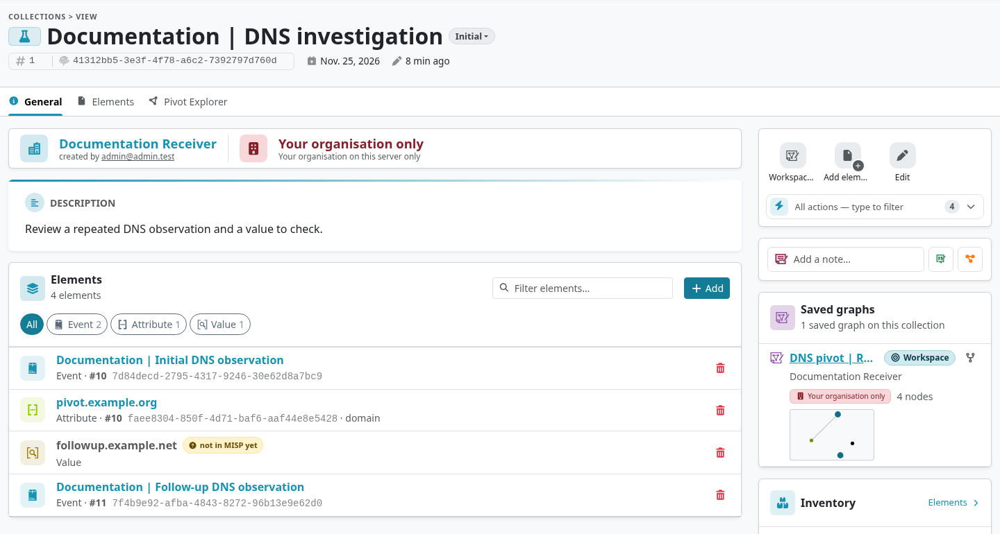
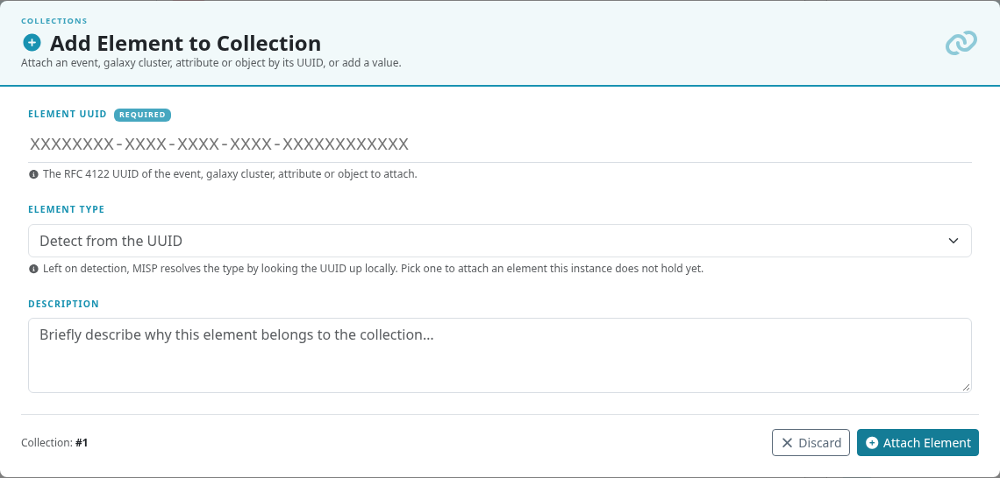
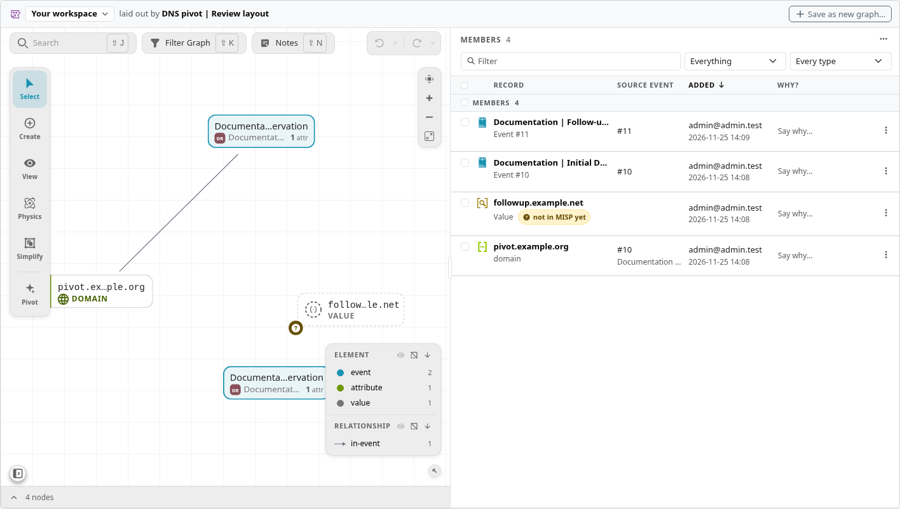
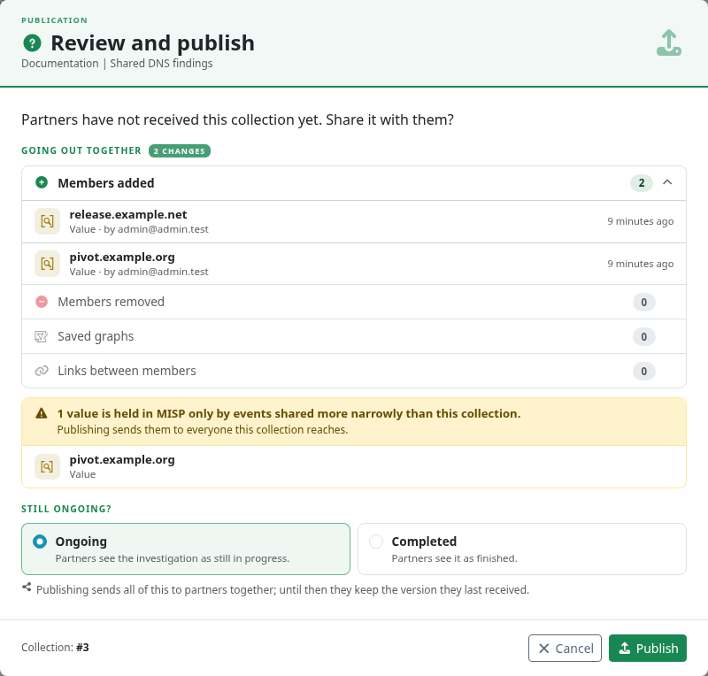

A **collection** groups intelligence for an investigation, campaign, or handover.
The **workspace** is the collection you have selected for current work in Overmind.
A [**saved graph**](../analyst-data/index.qmd#saved-graphs) keeps a view of that work, including node positions and the nodes retained from pivots.

::: {.callout-note}
This chapter follows MISP 3.0.0 in light Overmind, after [MISP #11321](https://github.com/MISP/MISP/pull/11321) merged into `3.0_wip`.
Screenshots use synthetic data at [`200ca2b3`](https://github.com/MISP/MISP/commit/200ca2b3114a7bdc7ae4a21abfdcb088319c800c).
Select a screenshot to enlarge it.
:::

<!-- Capture source, checks and hashes: ../assets/collection-workspace-screenshots.json -->

## What a collection contains

Each collection has a UUID, name, type, description, distribution, and a sharing group when applicable.
Types include **Campaign**, **Intrusion set**, **Named threat**, **Research**, and **Other**.
Members can have an optional reason explaining their relevance.

::: {.table-responsive}

| Member | How MISP identifies it |
|---|---|
| Event, galaxy cluster, attribute, or object | UUID of the existing record. An attribute identifies one occurrence of a value. |
| Value | SHA-256 address of the stored text. A collection can keep the text even when no MISP attribute holds it. |
| Standalone object | UUID of the object stored with the collection. It can come from a module response or be created from a template. |

:::

Existing record references preserve the target's own access controls.
A collection can also hold a value or standalone object marked **Not in MISP yet**.
Such a value has no source attribute, and the values inside a standalone object are available in that object without their own value pages or correlations.
Membership records research scope.
Record conclusions as [Analyst Data](../analyst-data/index.qmd) or in an event report.

[Sharing groups](../sharing/index.qmd#sharing-groups) determine which organizations can access data when selected as its distribution.
Tag collections are presets of tags applied to events.

## Creating and populating a collection

Open **Data points → Collections**, then choose **Add Collection**.
Start with **Your organisation only** while gathering material.
In Overmind, the [workspace control](../general-layout/index.qmd#workspaces) also offers **New collection…**, which defaults to **Research**, organization-only distribution, and **Make it my workspace** selected.
You can make any collection you may edit your workspace from its **Make it my workspace** action.

Use **Add to workspace** on an event, attribute, object, galaxy cluster, or value to add it to the active collection.
The split button's caret offers **Add to another collection…** and **New collection with this…**.
The first option leaves your active workspace selection in place.
Indexes also offer a workspace action for selected rows.
After an addition, the working view can ask **Why?** so you can record the reason.
Use **Say why…** or **Edit why…** in a member's actions to record or revise it later.

{fig-alt="The DNS investigation is an organization-only collection with an event, an attribute, and a value."}

To enter a known record address directly, use **Add element** in the collection's elements card.
Removing a member removes the entry from the collection and leaves the source record available under its existing access rules.

{fig-alt="The manual Add element dialog asks for an element type, address, and optional description."}

### Work with the members and graph {#collection-working-view}

Open **Pivot Explorer** on the collection or open its workspace dock beside another page.
The collection page places the graph beside the list. In the dock, use **Graph**, **Both**, or **List** when those controls are shown.
Use the list filters to find members, material **Not in MISP yet**, items on the graph only, or items hidden on the graph.
Dragging nodes changes the layout.
Use **Save as graph…** to keep a new layout or **Save layout** to update an editable graph already in use.
Membership additions are written to the collection when you add them.

{fig-alt="The collection working view shows the investigation's graph beside its list, including a value marked Not in MISP yet."}

Use **Hide on this graph** to hide a member from a graph while keeping it in the collection.
Select **Hidden on this graph** in the list to find and show it again.
The member actions also offer **New object from a template…** for standalone objects.
Open a standalone object from its row to inspect the captured fields.

### Turn findings into an event {#collection-to-event}

In the working view, select members and open the selection's actions.
Choose **Create an event from the selection…** or **Add the selection to an event…**.
The members menu also offers **Create an event with what is not in MISP yet…**.
Review **What goes in**, **Which event**, and **Review** before saving.
Check the type, category, and **For IDS** flag of each proposed attribute and the destination event's distribution.

Raw values and standalone objects become attributes and objects and are replaced by references to the new records in the collection.
An attribute or object copied from an existing event keeps the source audience as an upper bound.
Clusters become galaxy tags, and source events can become **related-to** links when your role permits the corresponding action.
A new event starts unpublished.
The conversion accepts up to 500 members per operation.

## Distribution and sharing

Collections use the [standard event distribution levels](../sharing/index.qmd#sharing-and-distribution).
Named records such as events keep their own access rules when referenced.
A value member can carry its actual text to people who can read the collection, including when the events holding the value have a narrower audience.
Older hash-only entries can still depend on a readable source attribute to resolve.
A standalone object also carries its own contents.
Review the collection's name, member reasons, and module provenance alongside the values themselves.



A saved graph has its own distribution and starts with the distribution of the record it is saved on.
When you widen a collection's distribution, **Share these too** offers eligible saved graphs and links between its members that currently reach fewer people.
Choose which should follow the change and verify the recipient's view.

### Publish changes to a shared collection {#publish-a-collection}

An organization-only collection has no publish step.
A wider collection requires publication before sync can deliver its current version.
Edits to the collection or its membership put it back in a pending state, as can changes to shareable graphs or links associated with it.
A publisher needs edit access to the collection and publication permission.

1. Select **Publish** to open **Review and publish**.
2. Review member additions and removals, included graphs and links, and any values or module requests associated with narrower source events.
3. Set the investigation status under **Still ongoing?** and confirm.
   Publication makes the version eligible for synchronization and starts delivery attempts to configured push peers.

{fig-alt="Review and publish lists two new values, highlights a narrower-source warning, and offers Ongoing and Completed status choices."}

While a change is pending, peers retain their last synchronized version.
An authorized MISP 3.0 user may still see the unpublished collection in a source listing, depending on `MISP.unpublishedprivate` and distribution.
**Unpublish collection** stops new synchronization of the current version.
Copies already received stay with recipients.

## Synchronising collections between instances

Enable **Push** or **Pull** in the **Collections** row under **Sync → Servers & Feeds → Servers → What to synchronise**.
Both peers must advertise collection sync support and the sync account must have the necessary access.
The switches correspond to `push_collections` and `pull_collections`.
The **Events** switches also control availability of the server's **Push all** and **Pull all** actions.
For publication to initiate a push, enable **Push** in both **Events** and **Collections**.
See [Sharing](../sharing/index.qmd#synchronising-analyst-data-and-collections) for connection setup.

MISP compares UUID and modification times to find eligible updates.
Received collections are marked locked.
An ordinary external sync preserves locally created collections and updates a synchronized copy with a newer eligible version.
Distribution rules still apply at the sync boundary.

Two peers on the current 3.0 branch can exchange all six member types.
The collection carries UUID references for events, galaxy clusters, attributes, and objects, together with any stored value text and standalone object contents.
Referenced records still synchronize under their own distribution and connection settings.
The member's addition time is shared, while the identity of the person who added it stays in the creating organization.
Check both the collection and its source records on the receiving instance.

A receiver older than MISP 3.0 can receive **Event** and **GalaxyCluster** members if it supports collection sync.
Attribute, object, value, and standalone object members are withheld from it.
A 3.0 peer without standalone object capability receives the collection without those objects.
To send or receive saved graphs, also enable the corresponding **Analyst data** direction and check that the peer advertises `analyst_graph`.
See the [collection synchronization reference](https://github.com/MISP/MISP/blob/200ca2b3114a7bdc7ae4a21abfdcb088319c800c/docs/dev/collection_sync.md) for the wire behavior.

## API

These endpoints accept the normal MISP authentication headers.
Write operations require modify access to the collection, with publication permission for publish and unpublish.

::: {.table-responsive}

| Endpoint | Purpose |
|---|---|
| `GET /collections/index`, `GET /collections/view/{id or uuid}` | List and read visible collections. |
| `POST /collections/add`, `POST /collections/edit/{id}`, `POST /collections/delete/{id}` | Create, edit, or delete a collection. |
| `POST /collections/quickAdd` | Create a collection with optional initial members and workspace selection. |
| `GET /collections/active`, `POST /collections/active` | Read or change the active collection and optional layout graph. |
| `GET /collection_elements/index/{collection_id}` | List a collection's members. |
| `POST /collection_elements/add/{collection_id}`, `POST /collection_elements/delete/{element_id}` | Add or remove a single member. |
| `POST /collection_elements/addItems/{collection}` | Add one or more members. |
| `POST /collection_elements/removeItems/{collection}` | Remove selected members. |
| `POST /collections/publish/{id or uuid}`, `POST /collections/unpublish/{id or uuid}` | Publish or unpublish a collection. |

:::

### Element payloads in MISP 3.0

For example, use `POST /collection_elements/addItems/{collection}` to add an existing object and a raw value.

```json
{
  "items": [
    {"type": "Object", "uuid": "42d4b34c-db91-4b24-83ee-b53fe0451a20"},
    {"type": "Value", "value": "followup.example.net"}
  ],
  "description": "Items to check in the DNS investigation."
}
```

The single-element endpoint `POST /collection_elements/add/{collection_id}` also accepts `element_type` and `element_uuid`, or `AttributeValue` with `element_sha256`.
Compute a value address from the UTF-8 text stored by MISP after normalization.
For active-workspace, conversion, and saved-graph payloads, see the [upstream workflow and API reference](https://github.com/MISP/MISP/blob/200ca2b3114a7bdc7ae4a21abfdcb088319c800c/docs/workspace-and-saved-graphs.md).
