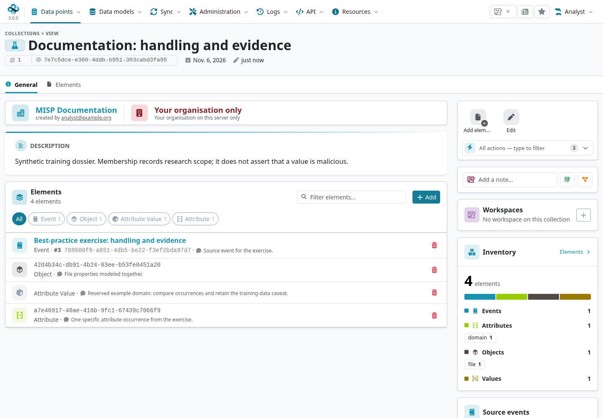
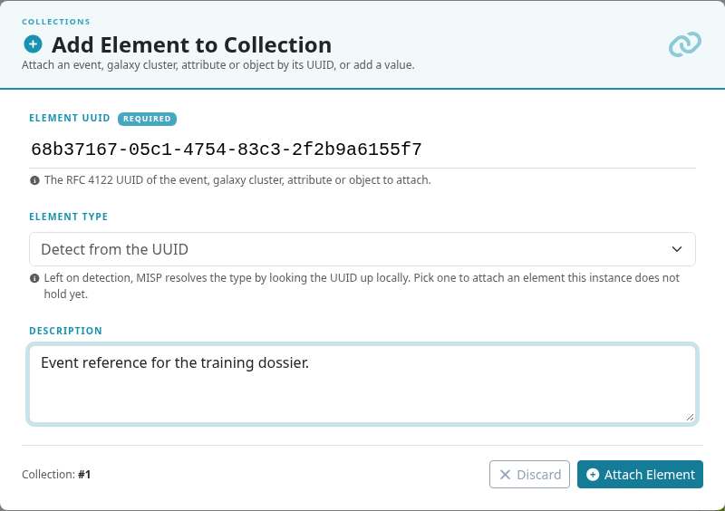

A **Collection** is a named, distributable container that groups references to intelligence
into one shareable unit. In MISP 3.0, elements can refer to events, galaxy clusters, attributes,
objects or attribute values.
Collections let you organise data — whether it is
shared by the community or produced during your own research — into buckets based on a common
theme: a campaign, an intrusion set, a piece of research, and so on. Collections are
first-class citizens in MISP: each has its own UUID and obeys the **same distribution and
sharing rules as events**, so a collection can be shared and synchronised across instances just
like the intelligence it groups.

Open **Data points → Collections** in the Overmind interface. Creating or editing a collection
requires a role with modify permission and the relevant ownership checks.

::: {.callout-note}
Instructions and screenshots use MISP **3.0.0** from the
[`3.0_wip`](https://github.com/MISP/MISP/tree/3.0_wip) development branch, in the light Overmind
interface. MISP 2.5 collections support events and galaxy clusters; its menus differ. Select a
figure to enlarge it.
A collection is distinct from two similarly named features:

- A **Sharing Group** is an access-control list (which organisations may see data), not a
  content bundle — a collection *references* a sharing group when its distribution is set to
  "Sharing group".
- A **Tag Collection** is a preset bundle of *tags* applied together to events, unrelated to
  this feature.
:::

## What a collection contains

<!-- Capture source and hashes: ../assets/sharing-screenshots.json -->

A collection has a small set of metadata plus a list of element references:

| Field | Purpose |
|---|---|
| **Name** | A human-readable label for the collection. |
| **Type** | The kind of grouping: *campaign*, *intrusion set*, *named threat*, *research*, or *other*. |
| **Description** | Free text describing what the collection is for. |
| **Distribution** | How widely the collection may be shared (see below). |
| **Sharing group** | The sharing group to use when distribution is set to "Sharing group". |

Each **element** is a reference, optionally with a short per-element description:

| Element type | Address | Version scope |
|---|---|---|
| `Event`, `GalaxyCluster` | UUID | MISP 2.5 and 3.0 |
| `Attribute`, `Object` | UUID | Supported in the 3.0 development branch described here |
| `AttributeValue` | SHA-256 of the stored value text, encoded as UTF-8 | Supported in the 3.0 development branch described here |

The collection stores the reference, not a copy. Referenced material retains its ownership and
access rules, and removing an element does not delete its target. The same element cannot be
added to the same collection twice. A value target refers to the value across events, while an
attribute target identifies one particular occurrence.

A collection records research scope, not a verdict that every referenced value is malicious.
Keep the evidence and assessment in the source material or appropriately scoped Analyst Data.

## Creating and populating a collection

From the collections list, choose **Add Collection** and fill in its name, type, description and
distribution. Begin with **Your organisation only** while assembling a dossier. Add elements
through these entry points:

- **From the collection** — open the collection and add an element by its supported type and
  address: a UUID for an event, cluster, attribute, or object; a value address for `AttributeValue` in 3.0.
- **From an event or cluster** — while viewing an event or a galaxy cluster, use the "add to
  collection" action to attach it to one of your organisation's existing collections. If you
  have not created a collection yet, MISP prompts you to create one first.
- **From Value Intelligence in 3.0** — open a value and choose **Add to collection**. Select an existing
  collection or **New collection**, add an optional description, and submit. The picker identifies
  the value being attached; see the [worked example](../best-practices/index.qmd#curate-research-with-collections-and-workspaces).

The collection view lists all of its elements and shows the collection's metadata; the index
lists your collections with an element count, type, distribution and timestamps, and lets you
edit or delete each. Deleting a collection removes its element references but leaves the
referenced material untouched.





## Distribution and sharing

Collections use the standard event distribution levels:

| Level | Meaning |
|------:|---------|
| 0 | Your organisation only |
| 1 | This community only |
| 2 | Connected communities |
| 3 | All communities |
| 4 | Sharing group |

When the level is *Sharing group*, MISP checks that you are allowed to use the chosen sharing
group. Visibility follows the same logic as events: you can see a collection if your
organisation owns it, if it is distributed to your community or wider, or if it belongs to a
sharing group you are part of.

Note that a collection's distribution governs visibility of the **collection object itself** —
the list and its metadata. Referenced material retains its own access rules, so being able to
see a collection does not automatically grant access to every element inside it.
For an `AttributeValue` reference in 3.0, the text resolves only when the reader can see an
attribute holding the value. Otherwise the element shows its SHA-256 address. The value text
is not transmitted with the collection reference.



Before sharing a dossier, review the **name, description and per-element descriptions** as well
as the referenced data. Those descriptions are part of the collection and can disclose context
even when a target is restricted. Do not put a private event's contents in a widely shared
element description. Check the result with a recipient account; the author's view alone does
not establish what a recipient can open.

## Synchronising collections between instances

Collections synchronise between MISP instances much like events do, but only when **both**
instances support the feature and the relevant per-server setting is enabled. There are two
dedicated settings (see [Sharing](../sharing/index.qmd#synchronising-analyst-data-and-collections-2.5)):

- **Push collections** — send your eligible collections to the remote instance.
- **Pull collections** — retrieve collections from the remote instance.

At the captured 3.0 commit, the Overmind server form omits these controls. Site administrators
can set `push_collections` and `pull_collections` through `POST /servers/edit/{id}`; the linked
setup example shows the payload. Do not assume enabling event push/pull also enables collections.

During synchronisation MISP negotiates collection support with the peer, exchanges a compact
`{uuid: modified}` index to find what is new or newer, and transfers only the differences.
Distribution and synchronization filters determine what is sent; community-limited levels
can be reduced at a synchronization boundary, while All communities and sharing-group access
follow their own rules. Collections received from a remote instance are marked as *locked* so that a locally created collection is
never silently overwritten by an inbound copy; between two synced copies, the one with the more
recent modification time wins. Editing a collection's elements updates its modification time so
the change propagates on the next sync. There is no separate revision history — the modification
timestamp and the locked flag are what keep copies consistent.

Value-addressed collection entries are withheld from MISP peers older than 3.0 during
synchronization; the collection itself can still be shared. Check the receiving instance's
version and visible source data before relying on a dossier as a complete handover.
Synchronizing a collection does not ensure that every referenced event, object or value
occurrence has also arrived or is visible there.

## API

Collections are available over the REST API under the `/collections/` and `/collectionElements/`
controllers, using the standard MISP JSON envelope:

::: {.table-responsive}

| Endpoint | Purpose |
|---|---|
| `GET /collections/index[.json]` | List collections (the REST view includes their elements). |
| `GET /collections/view/{id or uuid}` | Retrieve a single collection and its elements. |
| `POST /collections/add` | Create a collection (optionally attaching elements in the same call). |
| `POST /collections/edit/{id or uuid}` | Edit a collection. |
| `POST /collections/delete/{id or uuid}` | Delete a collection and its element references. |
| `POST /collectionElements/add/{collection_id}` | Add an element to a collection. |
| `GET /collectionElements/index/{collection_id}` | List a collection's elements. |
| `POST /collectionElements/delete/{element_id}` | Remove an element from a collection. |

:::

Listing and viewing require only a logged-in user (subject to visibility); creating, editing and
deleting require modify permission. The synchronisation endpoints used between instances require
the sync permission. See the [Automation & API](../automation/index.qmd) chapter for
authentication and the request/response envelope.

### Element payloads in MISP 3.0

For UUID targets, `POST /collectionElements/add/{collection_id}` accepts `element_type` and
`element_uuid`, for example:

```json
{
  "CollectionElement": {
    "element_type": "Object",
    "element_uuid": "42d4b34c-db91-4b24-83ee-b53fe0451a20",
    "description": "File properties from the documentation exercise."
  }
}
```

For a value, set `element_type` to `AttributeValue` and use `element_sha256` instead of
`element_uuid`. Compute the hash from the UTF-8 text returned by MISP after normalization.
The same add endpoint also accepts `value` containing that text and stores its SHA-256 reference.

Alternatively, `POST /collectionElements/addElementToCollection/AttributeValue/{sha256}`
accepts `{"collection_id": 1}` to attach the value to an existing collection. These are
value-level references; they do not grant access to the attributes holding the value.
