A connector turns selected MISP intelligence into something another system can use, or brings
observations back into MISP. Choose the data contract before the transport: which records,
which audience, how updates/removals are handled and how processing failures are recovered.

::: {.callout-note}
This chapter follows MISP **3.0.0** (`3.0_wip`, commit `99ebee729`). Third-party connectors have
their own releases and compatibility requirements. Check the maintained
[MISP tools catalogue](https://www.misp-project.org/tools/) and the connector's upstream project
for current setup instructions.
:::

<!-- Verification and diagram provenance: ../assets/automation-screenshots.json -->

<a id="how-misp-connects-to-other-tools"></a>
<a id="notable-integrations"></a>
<a id="external-connectors"></a>

## Choose an integration mechanism {#connectors-mechanisms}

::: {.table-responsive}

| Mechanism | Suitable use | Check first |
|---|---|---|
| [REST API](../automation/index.qmd) / [PyMISP](../pymisp/index.qmd) | Query, ingest, export and orchestrate with an API account. | Account permissions, distribution, filters, pagination and retry/removal handling. |
| [Native MISP synchronization](../sharing/index.qmd) | Exchange eligible intelligence with another MISP instance. | Peer identity, direction, feature support, distribution and sharing groups. |
| STIX / TAXII | Exchange with platforms using those standards. | Exact STIX/TAXII version, conversion coverage and the receiving platform's contract. |
| [Modules](../modules/index.qmd) | Enrichment, import/export conversion or workflow actions. | Enabled family/module, dependencies, provider/data scope and organisation restrictions. |
| [ZeroMQ / Kafka notifications](../misp-zmq/index.qmd) | Trigger trusted processing when MISP activity occurs. | Instance-wide data boundary, framing/topics, recovery and consumer behaviour. |
| [Feeds](../managing-feeds/index.qmd) | Cache or ingest a published source. | Source format, caching versus import, audience and publication policy. |

:::



For a SIEM or EDR export, start with an account and filters appropriate to that destination.
For SOAR/case management, preserve source UUIDs and context when creating cases or reporting
observations. A broad administrator key or instance notification stream is not a substitute for
deciding the destination's permitted audience.

The [TIP access-control guide](../what-misp-can-do/index.qmd#tip-access-controls) connects MISP roles, record visibility, external identity services and an optional misp-guard synchronization boundary.

## Define the data contract {#connectors-contract}

Document these decisions with the connector configuration:

- **Selection**: approved sources, handling tags, distribution/audience, publication state,
  detection flags, supported types and warninglist policy. A tag is a filter, not an ACL.
- **Identity**: map MISP event/attribute UUIDs to target record IDs. Preserve provenance and the
  source timestamp; local numeric IDs are not portable.
- **Lifecycle**: update, expire and remove target records when values are corrected, withdrawn,
  deleted, excluded or no longer visible. A one-time export cannot maintain that state.
- **Delivery**: bound query pages/batches, retries and checkpoints. Apply writes idempotently and
  reconcile after an ambiguous response or downtime.
- **Feedback**: decide whether a target observation is a sighting, false positive, proposal or
  Analyst Data assessment. Those record types have different meanings and permissions.

MISP 3.0 value addresses are useful for context shared across occurrences, but a sink should not
replace an attribute's identity with a value hash without considering its own lifecycle model.
A collection is a set of references, not a guarantee that all referenced data arrived or is visible.

## Worked example: stage a detection export {#connectors-worked-example}

This example writes a local JSON snapshot for validation before building a product-specific
adapter. It does not send data to a SIEM, EDR or other external system. Use an integration key
with the intended read scope and the environment configuration described in
[PyMISP](../pymisp/index.qmd#pymisp-configuration).

```python
import json
import os
from pathlib import Path
import requests

session = requests.Session()
session.headers.update({
    "Authorization": os.environ["MISP_KEY"],
    "Accept": "application/json",
    "Content-Type": "application/json",
})
base = os.environ["MISP_URL"].rstrip("/")
records = {}
page = 1
while True:
    response = session.post(
        base + "/attributes/restSearch",
        json={
            "returnFormat": "json",
            "published": True,
            "to_ids": True,
            "tags": ["tlp:clear"],
            "enforceWarninglist": True,
            "includeEventUuid": True,
            "limit": 100,
            "page": page,
        },
        timeout=30,
        verify=os.environ.get("MISP_CA_BUNDLE") or True,
    )
    response.raise_for_status()
    envelope = response.json()
    container = envelope.get("response")
    if not isinstance(container, dict) or not isinstance(container.get("Attribute"), list):
        raise RuntimeError("Unexpected attribute-search response")
    batch = container["Attribute"]
    if not batch:
        break
    for attribute in batch:
        records[attribute["uuid"]] = attribute
    page += 1

Path("misp-export.json").write_text(
    json.dumps(list(records.values()), indent=2) + "\n", encoding="utf-8"
)
print(f"Staged {len(records)} attributes for review")
```

Replace the example's selection with the destination's approved policy. `tlp:clear` alone is not
a source-quality or detection-value test. The book's private training observations have IDS
flags off, so the expected training result for this detection selection is empty.

Validate types, values, expiry, required context and target limits before implementing the
upload. For a scheduled connector, add a bounded modification window, persistent checkpoints,
backoff and reconciliation as described in the [polling workflow](../automation/index.qmd#api-incremental-polling).
Do not treat this local snapshot script as a complete bidirectional synchronization service.

<a id="worked-example-misp-to-microsoft-graph-security"></a>
<a id="prerequisites"></a>
<a id="getting-started"></a>
<a id="key-configuration-options-config.py"></a>
<a id="reading-and-troubleshooting"></a>
<a id="misp-to-microsoft-graph-security-script"></a>

## Microsoft Sentinel and the historical Graph sample {#connectors-microsoft}

The old Microsoft Graph Security **`tiIndicator`** resource is documented by Microsoft as
[deprecated](https://learn.microsoft.com/en-us/graph/api/resources/tiindicator?view=graph-rest-beta).
The historical `security-api-solutions/Samples/MISP` recipe should not be the starting point for
a new Microsoft Sentinel deployment. Its Graph permissions, target-product settings and
`allow`/`block`/`alert` behaviour must not be assumed to apply to a replacement API.

For a new integration, evaluate Microsoft's current
[Sentinel threat intelligence upload API](https://learn.microsoft.com/en-us/azure/sentinel/connect-threat-intelligence-upload-api)
and supported TAXII/data-connector options. The linked upload API is currently documented as
**Preview** and accepts STIX objects. Follow Microsoft's current requirements for the target
workspace, Entra application, permission, endpoint, object schema and limits.

Keep the MISP extraction/selection stage separate from that adapter. Test a small synthetic
payload in the intended target environment, retain a UUID-to-target mapping and verify update,
expiry and removal behaviour. A STIX conversion or successful HTTP submission does not prove
that the destination will use every indicator as expected.

## Check compatibility and operations {#connectors-operations}

For any third-party integration, record the tested MISP, client, connector and target versions.
Verify an empty result, multi-page result, duplicate delivery, update, removal, access loss,
expired key, rate limit and restart. Monitor source-query freshness and the last successfully
applied batch, not just whether a scheduler process ran.

Use [Cerebrate](../sharing/index.qmd#cerebrate) for directory and sharing-group identities,
[native synchronization](../sharing/index.qmd) for MISP peers, and the relevant provider's
documentation for external platforms. These mechanisms have different trust and data models;
test the actual contract rather than assuming that every integration preserves all MISP 3.0 features.
