Correlation connects observations that share eligible attribute values or satisfy a supported similarity rule.
It helps an analyst discover related events, compare evidence, and decide where to investigate next.
A match is a lead: it does not by itself establish maliciousness, common ownership, causality, or independent confirmation.

::: {.callout-note}
This chapter follows MISP **3.0.0**, [`3.0_wip` commit `99ebee729`](https://github.com/MISP/MISP/commit/99ebee729702c560528f9788953719bda68aa1c1).
Screenshots use an isolated instance with constructed, organization-only, unpublished events and IDS disabled on the exercise attributes.
Temporary configuration, exclusion and rule changes were restored after the demonstrations.
Select a figure to enlarge it.
:::

<!-- Source checks, fixture behavior and screenshot provenance: ../assets/correlation-screenshots.json -->

## What MISP correlates {#correlation-model}

An **attribute occurrence** belongs to one event, either directly or inside an object.
MISP compares eligible values against attributes in **other events**; repeating a value inside one event does not create an inter-event relationship with itself.
The result connects occurrences and events while preserving their separate UUIDs, comments, sources and access settings.
An object's attributes participate in this process too; the object supplies context rather than a separate matching algorithm.

In MISP 3.0, component text is held in shared value storage.
An occurrence UUID, a value's SHA-256 address, and an internal correlation identifier serve different purposes.
Correlation can group stored spellings that the dictionary's comparison considers equal, including case variants; that does not make their exact-text SHA-256 addresses interchangeable.
Inspect the original value, type and extraction method before treating a match as semantic equivalence.
See the [data model overview](../data-model/index.qmd#model-links) for the distinction between computed matches, object references and Analyst Data Relationships.

::: {.table-responsive}

| Matching method | Behavior and limits |
|---|---|
| Shared component value | Eligible attributes can match across types: the exercise's `domain` matches a `hostname`. Review the types and context rather than assuming equal text means equal meaning. |
| Composite attribute | Components can correlate separately. A `domain|ip` can match a domain or an address in another event; a file's name and hash can supply different leads. |
| Address/port composite | For `ip-src|port`, `ip-dst|port` and `hostname|port`, only the primary component correlates. A common port alone is not that relationship. |
| Non-correlating type | Types such as `comment`, `http-method`, `port`, `integer` and `boolean` do not generate native attribute correlations, even if their text equals another attribute. See the [non-correlating type list](https://github.com/MISP/MISP/blob/99ebee729702c560528f9788953719bda68aa1c1/app/Model/MispAttribute.php#L308) for the complete list. |
| Advanced address matching | With advanced correlations enabled, supported IP/CIDR types can match an address to a containing range. The CIDR logic does not treat two overlapping networks as an address-in-range match. |
| Advanced ssdeep matching | Distinct `ssdeep` signatures can match when the extension, candidate index and configured similarity threshold permit it. The checked default threshold is 40; it is not a maliciousness score. |

:::

The **IDS** flag (`to_ids`) controls intended detection use, independently of correlation.
The exercise deliberately keeps IDS off while generating matches.
Warninglist membership, tags, analyst confidence, and distribution are also separate controls; none is a general replacement for correlation policy.

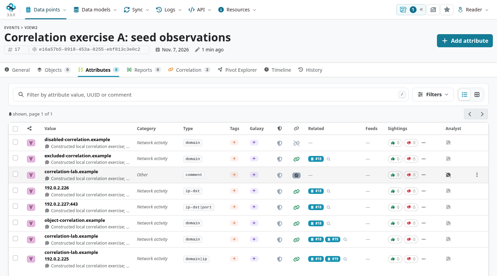

## When correlations are created and removed {#correlation-lifecycle}

The **correlation engine** is implemented inside MISP's PHP models and selected behavior.
It is not a separate service that periodically scans every event.
Redis and background workers support particular operations, but the engine's normal matching and maintenance are part of MISP itself.

For the table-backed **Default** and **NoAcl** engines:

- **Create an eligible attribute:** the normal save path evaluates its values and creates the corresponding cross-event matches.
- **Change relevant data:** a value, type, correlation flag or access-setting change removes/rebuilds affected stored relationships. Adding a tag does not necessarily require rebuilding the matches.
- **Delete an attribute:** normal soft deletion removes its correlations; the hard-delete callback also removes affected rows.
- **Delete an event:** with correlation enabled, the normal event-deletion path removes its active correlation-table entries along with the event's dependent data.
- **Recorrelate explicitly:** MISP purges and rebuilds the requested scope. With background jobs enabled, the work may be queued and is complete only after its job finishes.

An empty event has no attribute payload to match; an event import generates its matches through the attribute/ingest path or its explicit rebuild work.
There is no fixed polling interval to wait for after an ordinary save or deletion.
Normal callbacks run during the write path; bulk/import code can defer or skip work, and explicit maintenance can run in a worker.
With **OnDemand**, relationships are calculated from current eligible data when requested, rather than maintained as a new set of stored correlation rows.
Do not diagnose a stale view by waiting an arbitrary number of minutes.

Direct database writes can bypass these application callbacks.
If an import, interrupted upgrade or out-of-band change leaves stale matches, identify the affected scope and use MISP's supported repair/recorrelation process.
A retained dictionary value is not itself an orphaned correlation or evidence that a deleted attribute remains visible.
For database/value-storage migrations, follow [Administration](../administration/index.qmd#admin-database) rather than deleting value or correlation tables manually.
The checked implementation is in the [attribute save/delete callbacks](https://github.com/MISP/MISP/blob/99ebee729702c560528f9788953719bda68aa1c1/app/Model/MispAttribute.php#L812), [correlation model](https://github.com/MISP/MISP/blob/99ebee729702c560528f9788953719bda68aa1c1/app/Model/Correlation.php), and [event deletion code](https://github.com/MISP/MISP/blob/99ebee729702c560528f9788953719bda68aa1c1/app/Model/Event.php#L2029).


## Investigate the matches {#correlation-investigate}

Open an event's **Correlation** tab.
The MISP 3.0 view combines a graph, a timeline and a correlated-event list.
Attribute rows also expose related-event links, allowing you to begin with a specific observation.

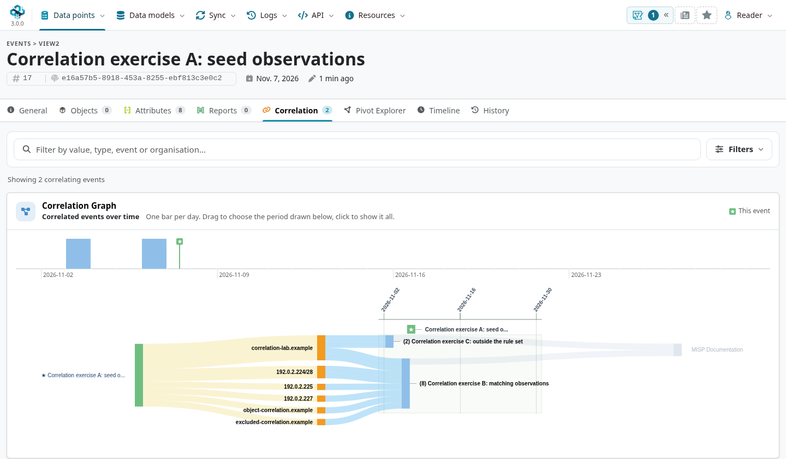

Expand a correlated-event row to inspect its matching values, categories, types, object context and IDS state.
Open the underlying attribute or event before writing an assessment.
A component or graph match label is not necessarily the complete stored composite or CIDR value.
Graph weights, distinct matching attributes and distinct event counts aggregate different things; none is a count of independent sources.

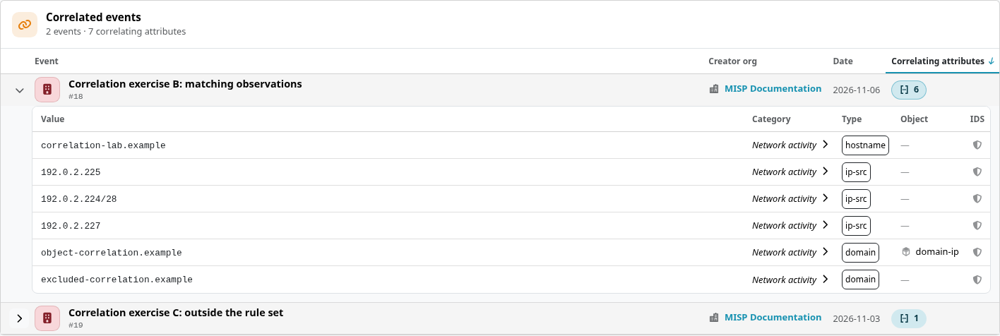

### Narrow the display {#correlation-filters}

Use the search field for a value, type, event or organization, or open **Filters** for more control:

- Select the correlating IOCs, types/object context and events relevant to the question.
- Use the timeline brush to choose the period drawn by the graph, and clear the period selection to restore it.
- Toggle **Use timeline** and **Show publishers**, or set **Most recent events shown** to bound the display.
- Use **Hide warninglist hits** when those enabled-list hits obscure the current investigation.
- Focus on a graph element or exclude it from the graph, then use the filter/period chips or **Reset filters** to return to the broader view.

These are **display filters**: they do not delete attributes, create correlation exclusions, or permanently decorrelate an event.
The event timeline uses event dates; do not substitute it for an attribute's actual first/last-seen observations.

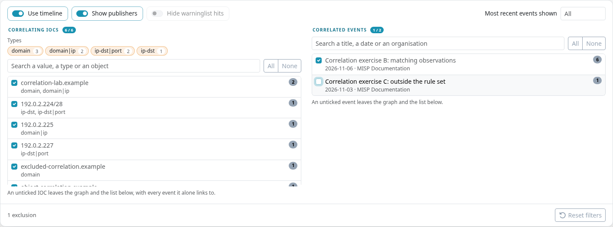

### Compare occurrences without confusing the counts {#correlation-occurrences}

[Value Intelligence](../value-intelligence/index.qmd#value-intelligence-occurrences) shows where a stored value occurs and the context of each occurrence.
Its **Occurrences** tab and the event Correlation tab answer different questions.
In this exercise, `correlation-lab.example` appears in several types, in a composite component, and in a non-correlating comment; multiple records belong to the source event itself.
An occurrence count therefore need not equal a count of correlated attributes or other events.

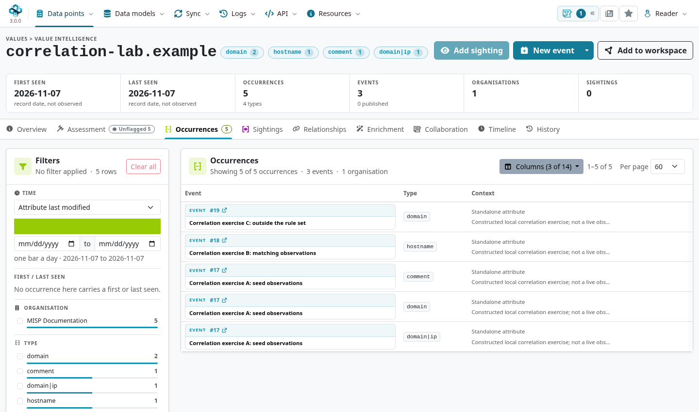

### Cached feed and server hits {#correlation-cached-sources}

Attribute views can also show matches against cached feeds or cached peer data.
These use the source-cache lookup path and can exist without a corresponding event imported into this instance.
Distinguish a cache hit from a native correlation with another locally stored event, and review the source, cache age and available record before using it as evidence.
A cache hit does not grant access to a remote record or prove that it has been imported.
See [Managing Feeds](../managing-feeds/index.qmd) for caching, fetching and the separate import decisions.

For a step-by-step investigation that changes selectors and records uncertainty, continue with the [pivoting use case](../pivoting/index.qmd).
**Pivot Explorer** and [workspaces](../general-layout/index.qmd#workspaces) can assemble an investigative view; adding a computed edge to a canvas does not create an asserted Analyst Data Relationship.

## Advanced correlations {#correlation-advanced}

A site administrator can enable `MISP.enable_advanced_correlations` and review `MISP.ssdeep_correlation_threshold` in the configuration.
Use the settings search to find these names.
Check the selected engine's implementation, installed PHP extensions and indexes before expecting an advanced match, and recorrelate existing data when required.
A stored fuzzy signature does not mean every similarity algorithm is implemented automatically.

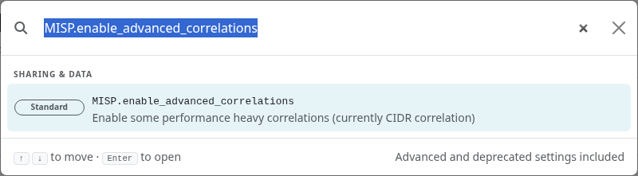

The address example stores `192.0.2.226` in A and `192.0.2.224/28` in B.
The range contains the address; the observed match appeared after enabling advanced correlations and rebuilding the exercise events.
Open B's attribute to confirm the original range.
This is different from claiming that any overlapping pair of CIDRs correlates.

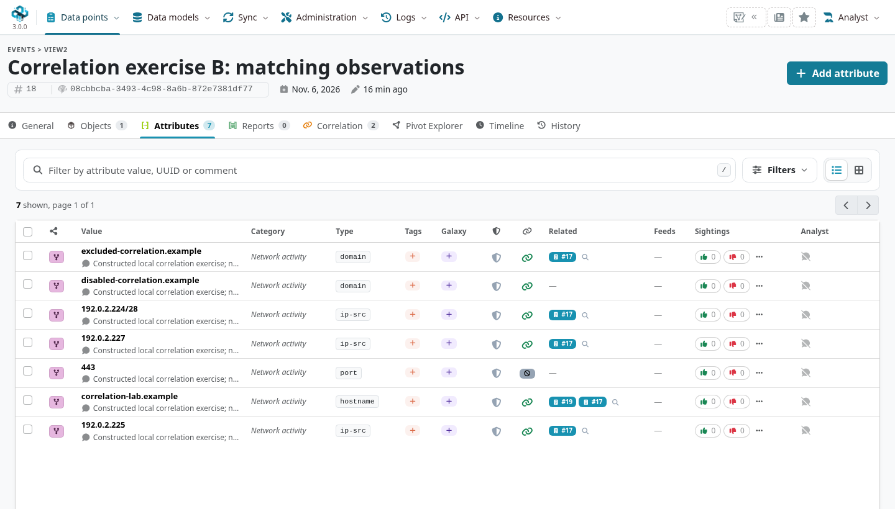

The ssdeep exercise hashes two harmless, locally constructed text documents with a small edit.
Their signatures differ, but the fixture's measured similarity is 99, above its configured threshold of 40.
They generate an advanced match; neither the similarity nor the existence of a link says the documents are malicious.
Exact matching and fuzzy similarity must remain distinguishable in the analyst's explanation.

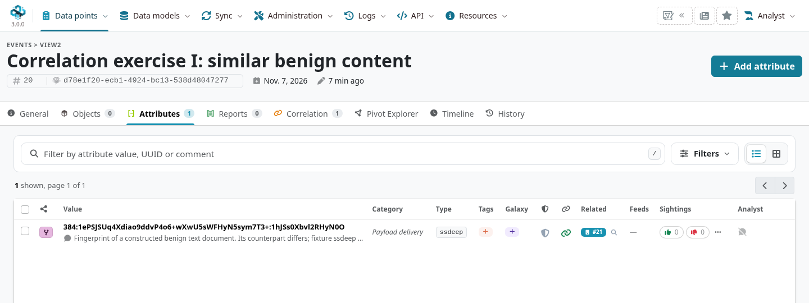

## Choose the right suppression control {#correlation-controls}

Start with the smallest scope that fits the problem:

::: {.table-responsive}

| Control | Scope and effect |
|---|---|
| Attribute correlation flag | Stops this occurrence participating in native correlation. It does not disable detection eligibility or delete the observation. |
| Event correlation flag | Stops the event's attributes participating in native correlation. Other events' source data remain intact. |
| Correlation exclusion | Suppresses matching values across the instance, rather than just one occurrence. |
| Correlation rule | Suppresses relationships **between events in a selected set**. It is not a blanket exclusion of those events from every outside match. |
| Over-correlation limit | Blocks an excessively correlating value/group to bound the matching work and noise. |
| Graph filter | Changes the displayed investigation view, without altering stored correlation policy. |

:::

### Attribute and event flags {#correlation-flags}

An eligible attribute's correlation indicator distinguishes enabled and disabled matching.
A non-correlating type instead shows an unavailable/static indicator.
Where your role and instance configuration allow it, use the indicator's confirmation to change the occurrence's state.
`MISP.allow_disabling_correlation` controls the ordinary event-edit permission path; site administrators have an exception.

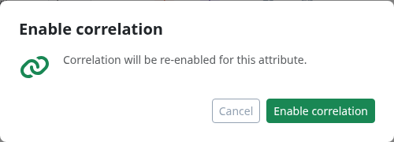

For a whole event, expand **Show all actions**, choose the correlation action, and review its scope before confirming.
Re-enabling correlation rebuilds eligible matches; it does not override an excluded type, value exclusion, rule or other applicable control.
`MISP.completely_disable_correlation` is an instance-wide setting and has a much broader effect than an analyst's display filter.

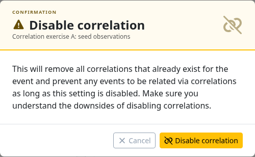

### Exclude a value or pattern {#correlation-exclusions}

Administrators manage **Correlation exclusions** (`/correlation_exclusions/index`).
Use an exact value when a single shared selector causes noise.
The supported pattern forms are `prefix%`, `%suffix` and `%contains%`; leading/trailing `%` have special meaning, rather than providing a general regular-expression language.
Exact exclusions can cover stored comparison-equivalent variants, and pattern matching folds case.
Review the affected spelling/group and pattern scope before applying a broad policy.

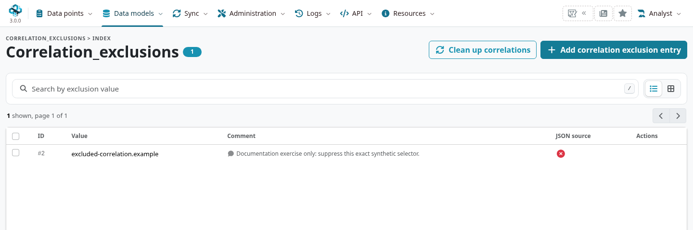

A newly saved exclusion affects matching policy; use **Clean up correlations** when existing stored matches need to be removed too.
Source attributes remain present.
After removing or changing a policy, rebuild the appropriate scope and verify the returned matches; do not assume that deleting a pattern row reconstructs every affected relationship.
The exercise verified both suppression and restoration of its exact selector.

### Suppress matches within an event set {#correlation-rules}

Administrators manage **Correlation rules** (`/correlation_rules/index`).
A rule selects events by creator-organization ID, local-owner organization ID, event ID, or event-info text.
Its selector list describes one set: correlations are suppressed when **both ends** belong to that set.
For example, a rule selecting A and B suppresses A–B, while A can still correlate with the outside event C.
Use an event's correlation flag when the intended policy is to stop that event correlating altogether.

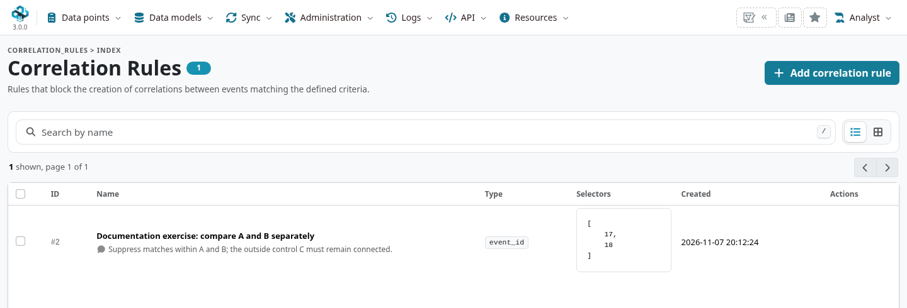

Review the rule's matching set before choosing **Execute rule on instance** to remove existing stored relationships within it.
The confirmation's count is the number of matching events, not the number of edges that will be deleted.
OnDemand applies rules during reads and does not need the same stored-row cleanup.
After deleting a rule, rebuild affected data when needed to restore relationships removed earlier.

## Find and manage high-volume values {#correlation-volume}

**Top correlations** (`/correlations/top`) ranks values by correlation entries.
For stored engines it is a cached administrative view: check its age and use **Regenerate cache** when a fresh ranking is needed.
A high rank is a prompt to investigate specificity, duplicate reporting and collection patterns, not a confidence or maliciousness score.

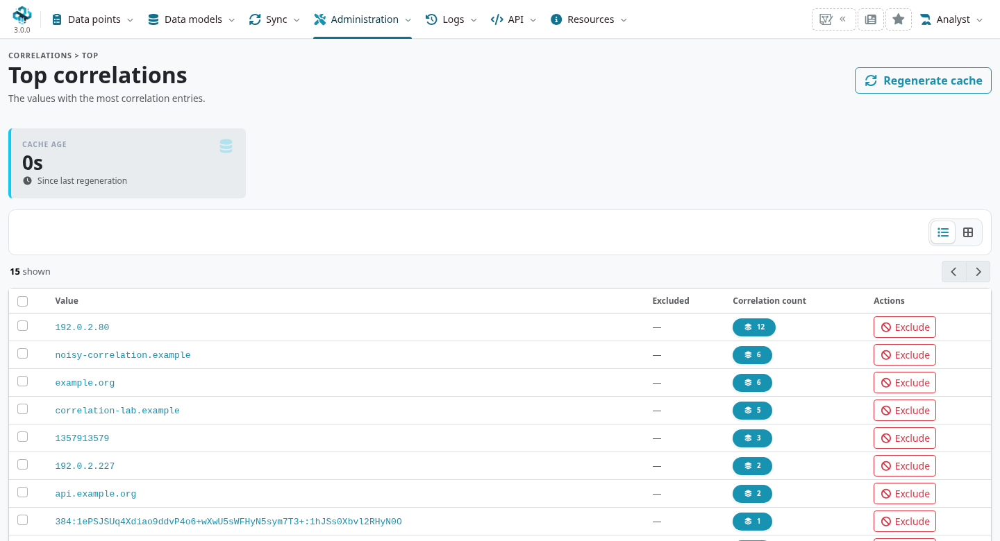

**Over-correlating values** (`/correlations/overCorrelations`) lists blocked values and their occurrence counts.
`MISP.correlation_limit` governs generation cost; the checked default is 20.
It is different from a graph's event-display limit or `MISP.max_correlations_per_event`, the engine's per-event retrieval cap in the relevant paths.
Use **Regenerate occurrence counts** when the administrative counts need refreshing, then review the source and policy before raising a limit or rebuilding matches.
The page separates threshold blocking from **Excluded by exclusion list**; use value search and **Filters** to review its tracked entries.
The **Exclude** action opens a value-exclusion policy, rather than merely dismissing or unblocking a row.
Regenerating occurrence counts does not rebuild the matches, and changing a limit alone is not proof that previously suppressed relationships have been restored.

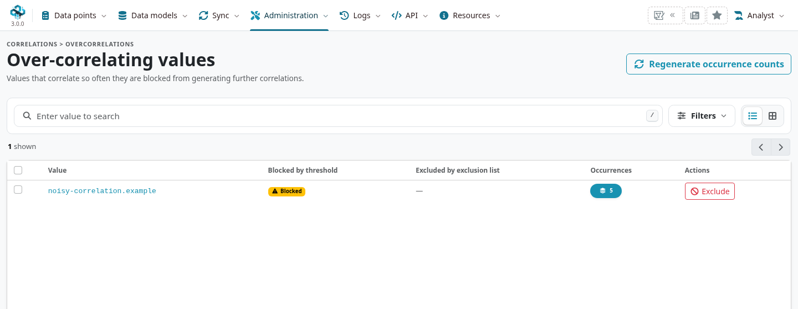

A frequent value might be a public resolver, shared service, widely reused artifact, copied report or collection error.
Use the [false-positive use case](../false-positives/index.qmd) to choose between correlation policy, warninglists, detection/export controls and an explanatory annotation.
Suppressing a link does not prove benignness, and clearing IDS does not suppress a correlation.

## Engines, rebuilding and diagnosis {#correlation-operations}

Under **Administration → Server Settings & Maintenance → Correlations**, inspect the active engine, stored-row metrics, blocked/excluded counts and maintenance controls.

::: {.table-responsive}

| Engine | Operational model |
|---|---|
| **Default** | Stores correlations and applies access checks when returning them. Use the ACL-aware engine for a multi-organization sharing instance. |
| **NoAcl** | Stores a leaner representation with reduced correlation-level access checking. It is intended for appropriate endpoint deployments, not a general performance replacement for a multi-organization hub. |
| **OnDemand** | Computes relationships on reads. Supported on MySQL/MariaDB in this branch; stored-row maintenance and cache behavior differ from the table-backed engines. |

:::

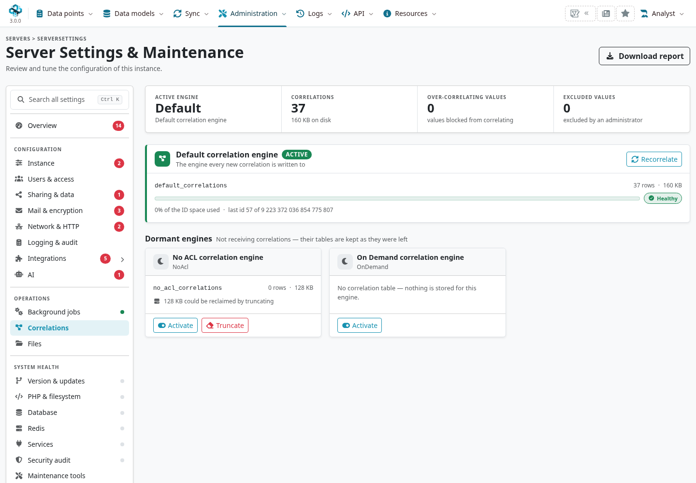

Changing engines does not automatically mean that a dormant table is current.
Plan the required rebuild and verify the intended users' results before considering a switch complete.
**Truncate** removes derived correlation rows; it is not an ordinary way to correct one noisy selector or a guarantee of automatic rebuilding.

Use event-scoped **Recorrelate Event** for a targeted rebuild and the administrator's wider maintenance action only when its scope is justified.
With background processing enabled, check **Jobs**, worker availability, queue status, progress and completion; a successful enqueue is not a completed rebuild.
Consult application/worker error logs for failures and the audit trail for relevant changes.
Normal per-pair creation is not an exhaustive correlation audit log, so absence of a log entry is not evidence that no matching work ran.
See [background-job administration](../administration/index.qmd#admin-background-jobs) for queue and worker diagnosis.

If a match is missing or unexpected, check:

1. The exact stored values, type eligibility, composite components and whether the records belong to different events.
2. Deleted state, attribute/event/global correlation flags, exclusions, event-set rules and over-correlation blocking.
3. The active engine, relevant access/distribution settings, advanced-correlation prerequisites and completed rebuild work.
4. Graph filters, period selections, display/retrieval limits and the age of cached administrative views.
5. Source independence, observation times and semantic meaning before drawing an investigative conclusion.

For an API comparison, `GET /correlations/eventCorrelations/EVENT_ID` returns matches keyed by source attribute ID.
A related entry identifies the other event with `id` and its occurrence with `attribute_id`.
Opt-in parameters such as `include_attributes`, `include_parent_attributes` and `include_warninglist_hits` add context; the latter options can change the response to an envelope containing `correlations` and the requested metadata.
Compare results using the intended account and engine, not only a site-administrator session.
For integrations, follow the [API authentication and response guidance](../automation/index.qmd).
