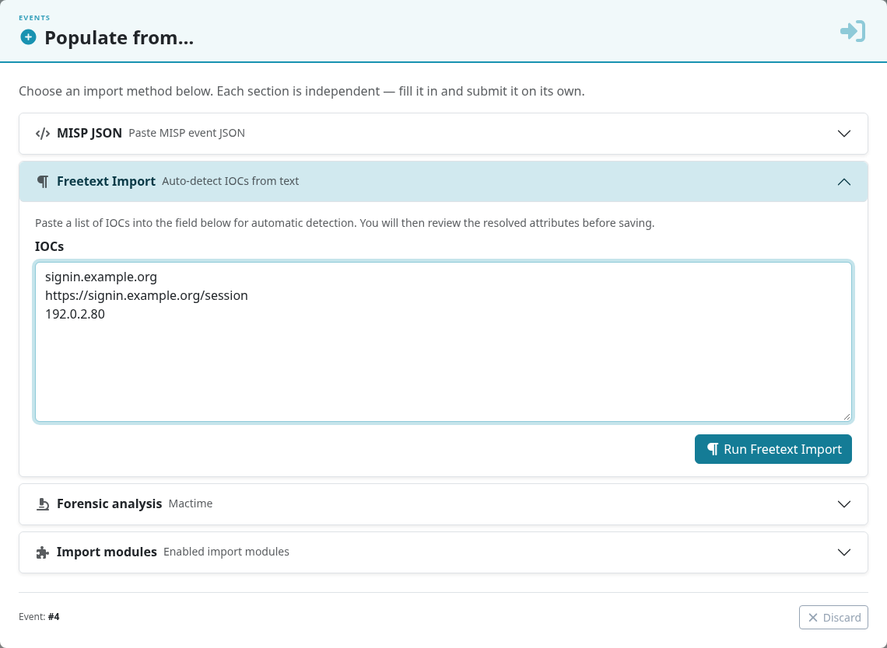
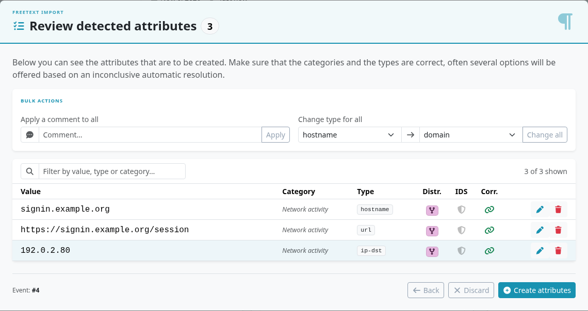
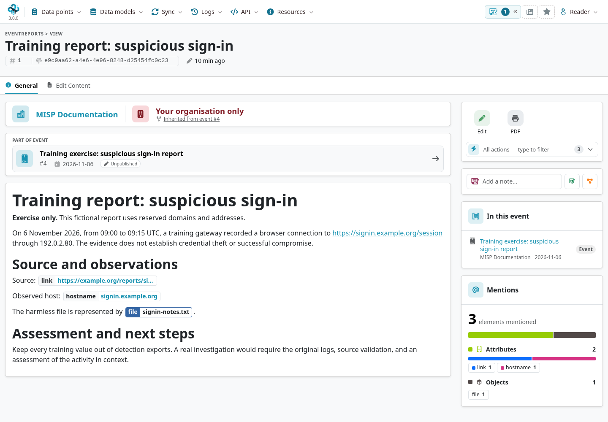

<a id="create-an-event-based-on-a-report"></a>

This exercise turns a short source report into a MISP event with source attribution, reviewed attributes, a file object, and a readable narrative.
It uses fictional data so you can repeat it without distributing live indicators.
You need permission to create events and their contents; publication requires a separate permission.

::: {.callout-note}
The screenshots show MISP **3.0.0**, [`3.0_wip`](https://github.com/MISP/MISP/tree/3.0_wip), in light mode.
Use **Your organisation only** and leave **For IDS** off throughout this exercise.
The domains and addresses are reserved examples; the source URL identifies the fictional report and is not a page you need to fetch.
Select a screenshot to enlarge it.
:::

<!-- Capture source, fixture and image hashes: ../assets/using-misp-screenshots.json -->

## The source report

> **Training report: suspicious sign-in**
>
> On 6 November 2026, from 09:00 to 09:15 UTC, a training gateway recorded a browser connection to `https://signin.example.org/session` through `192.0.2.80`.
> The observed host was `signin.example.org`.
> A harmless text file, `signin-notes.txt`, was retained with the exercise notes.
>
> Source reference: `https://example.org/reports/sign-in-exercise`{.text-wrap .text-break}.
> This evidence records a connection; it does not establish credential theft or successful compromise.

In a real investigation, check the source's provenance, license or sharing agreement, and the original evidence before deciding what to record and share.
A public report does not automatically justify **All communities**, a completed analysis, or an IDS flag on every mentioned value.

## Adding an event

Open **Data points → Events → Add event** and enter:

| Field | Exercise value |
|---|---|
| **Event Info** | `Training exercise: suspicious sign-in report` |
| **Distribution** | **Your organisation only** |
| **Analysis level** | **Initial**: the source still needs assessment. |
| **Threat level** | **Undefined**: the exercise does not establish severity. |
| **Event date** | `2026-11-06` |
| **Extends** | Leave empty. |

Choose **Create Event Entry**.
The [event-creation reference](../using-the-system/index.qmd#creating-an-event) shows the form and explains each field.
Use the event's UUID for durable references; its numeric ID depends on your instance.

## Adding attributes {#adding-attributes}

First record the source so another analyst can trace the observations.
In the event's **Attributes** tab, choose **Add attribute** and set:

- **Category:** External analysis.
- **Type:** `link`.
- **Value:** `https://example.org/reports/sign-in-exercise`{.text-wrap .text-break}.
- **Contextual comment:** identify it as the fictional source for this exercise.
- **Distribution:** Inherit event.
- **For IDS:** off.

Save the attribute. A source link is context, rather than a URL you want a detection tool to alert on.
See the [Add Attribute form](../using-the-system/index.qmd#add-attribute) for the current interface.

For the narrative, use an [Event Report](../event-reports/index.qmd) rather than splitting each paragraph into unrelated text attributes.
Keep the source, observations, interpretation, and next steps distinct.

## Freetext Import Tool

Use **Import → Freetext Import** and paste these three values:

```text
signin.example.org
https://signin.example.org/session
192.0.2.80
```



Choose **Run Freetext Import**. Before creating attributes, check every row:

::: {.table-responsive}

| Value | Interpretation to review |
|---|---|
| `signin.example.org` | A hostname or domain according to the evidence; this capture detects `hostname`. |
| `https://signin.example.org/session` | A `url` in Network activity. |
| `192.0.2.80` | An IP address; the exercise treats it as a destination (`ip-dst`). Detection alone cannot infer direction. |

:::

Keep **Inherit event** and turn **IDS** off for all three rows.
Use a row's edit control to correct its category, type, or context, and remove unwanted rows before saving.
Then choose **Create attributes**.



The parser's suggestion is not an assessment of maliciousness.
If a value is misclassified, select a valid type or add it manually. Do not append a slash or otherwise change the observed value to force recognition.
Record the known observation window, `09:00–09:15 UTC`, in **First seen / Last seen** when reviewing the attributes.

## Keep file properties together

For a harmless file you actually hold, choose **Attach**, turn **Malware sample** off, and select **Generic file** as the non-malware object template.
The uploader can then retain the attachment and its generated file properties together.
The [attachment reference](../using-the-system/index.qmd#add-attachment) shows this 3.0 option.

If reproducing the exact capture fixture, create `signin-notes.txt` containing this line, including the final newline:

```text
MISP documentation training file. No executable content.
```

The file's SHA-256 is:

```text
46f2af8afd103d1a03ecb1c344acb19f0caa14627ca2140cc84297e59ed14f6b
```

For a real report that supplies only a filename and hash, add a `file` object manually with those known properties; do not fabricate or upload a file you do not possess.
Check the resulting object's attributes, audience, and IDS flags. Turn off any generated IDS flags in this training exercise.
Avoid recording the same hash both as an unrelated standalone attribute and in the object unless a consumer requires both.

## Batch Import

Use **Add attribute → Batch import** when every input line has the same category and type.
For example, two filenames containing spaces should remain two complete filename values:

```text
sign-in notes.txt
training gateway log.txt
```

Choose `filename`, use one value per line, and keep IDS off for this exercise.
Freetext import detects mixed values; batch import uses the type you selected. Neither option removes the need to review the results.

## Write and review the narrative

Choose **Report** on the event, name it `Training report: suspicious sign-in`, and leave its distribution on **Inherit event**.
Write the source report above, then add headings for **Source and observations** and **Assessment and next steps**.
Use the editor's attribute and object controls to insert live references to the source link, observed hostname, and file object.



For this exercise, state that the values are training data, the evidence does not establish compromise, and the original logs would be needed for a real assessment.
Add justified handling, confidence, and provenance tags; the capture uses `tlp:clear`, moderate analytic confidence, and human-generated origin.
TLP describes handling and does not change the event's organization-only access setting.

## Modify the event

Return to the event through **Data points → Events** and open its **Edit** action to change metadata.
Edit individual attributes or the object when correcting evidence, and use the report's **Edit Content** tab for narrative changes.
Check history and publication state after editing.

Finish by reviewing audience, sources, time windows, object properties, tags, report content, and IDS flags.
The exercise ends with an organization-only, unpublished event; publication is a separate, deliberate step covered in [Using the System](../using-the-system/index.qmd#publish-an-event).
For work with partners, use [Analyst Data](../analyst-data/index.qmd), [proposals](../using-the-system/index.qmd#proposing-changes-to-another-organisations-event), or an [extension](../extended-events/index.qmd) according to the kind of contribution.
