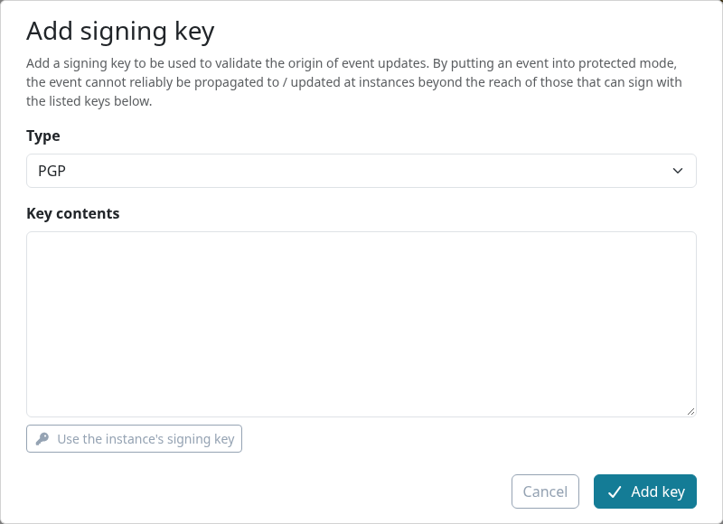
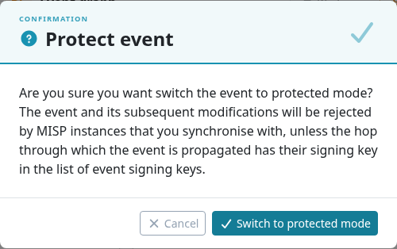

**Protected events** use PGP signatures to restrict which instances may sign event transfers
and updates. Attach the authorised **public keys** to an event, then enable protection. An
instance needs a matching private key to sign an eligible onward transfer.

Signing addresses authenticity within the configured trust path. **Distribution and sharing
groups still control access**. A valid signature does not encrypt the event or establish that
its content is correct or malicious.

::: {.callout-note}
This chapter follows MISP **3.0.0** from the [`3.0_wip`](https://github.com/MISP/MISP/tree/3.0_wip)
development branch in light mode. Protected events also exist in MISP 2.5;
peers must support the feature. Site-administrator and internal-sync trust paths have exceptions
to ordinary signature checks, so this is not an end-to-end guarantee against every privileged
recipient. Select a figure to enlarge it.
:::

<!-- Capture source and hashes: ../assets/sharing-screenshots.json -->

## How it works

For an ordinary external synchronization path:

1. The sender checks that the peer supports protected events and that its own instance key is
   on the event's authorised list.
2. It signs the transfer payload and sends a detached PGP signature with the event.
3. The receiver validates the signature and checks the signer's fingerprint against the event's
   authorised keys before accepting the protected add or update.
4. To relay the event, the receiving instance must sign with **its own authorised instance key**.
   Simply possessing the public keys or being able to read the event is not enough.



The authorised key list travels with the event. Key removals and revocations also need to reach
receiving copies. Verify partner fingerprints through a trusted channel before authorising them;
the initial trust decision cannot be supplied by a signature alone.

### The instance signing key

An administrator configures the instance's GnuPG key, including `GnuPG.email`,
`GnuPG.password` and the GnuPG homedir. MISP can load the public key from `app/webroot/gpg.asc`,
or select it from the homedir when **`MISP.download_gpg_from_homedir`**{.text-wrap .text-break} is enabled.
The public-key download is normally available at the instance's `/gpg.asc` endpoint.

Keep the **private key** and its passphrase on the instance. Exchange only the public key and
verified fingerprint with partners. Check that the application user can read the configured
keyring and sign successfully before enabling protected synchronization.

## Protecting an event

Use a role allowed to modify the event. Adding a signing key in this branch requires
`perm_add` and membership in the **creator organisation**; the add form explicitly checks that
organisation. Deletion also allows a site-administrator path. Do not assume administrator status
alone makes every key-management action available for another creator organisation.

1. On a locally created event, choose **All actions → Protect event** and confirm. This
   **unpublishes** the event. In this MISP 3.0 build, the protection action is offered to the
   creator organisation in the host organisation, for an unlocked event.
2. Open **All actions → Add signing key**, which becomes available once the event is protected.
3. Paste a PGP **public key**, or use the instance-key shortcut when the public-key file is
   available. Add the public keys of the instances that should legitimately sign onward updates.
4. Check the stored fingerprints and intended relays. Open **Details** to review protection and
   publication state.
5. Review the result, then **republish when authorised** to propagate the protected version.





**Unprotect** also unpublishes the event. Review and republish the change when it is ready.
Before changing or revoking an authorised relay key, coordinate with the affected partners and
check the complete route; an intermediate instance without an authorised key can stop delivery.

## Verification on synchronization {#verification-on-synchronisation}

| Operation | Ordinary external-sync behaviour |
|---|---|
| **Push** | The sender signs the payload. Missing signing capability or an unsupported peer prevents the protected transfer. |
| **Receive a push** | The ordinary sync account must supply a valid signature from an authorised key for a protected add/update. |
| **Pull** | The receiving instance validates the remote signature before importing a protected event through a non-internal connection. |
| **Serve a pull** | A protected event is omitted when the serving instance cannot sign it with an authorised instance key. |

Site-administrator and `perm_sync_internal` accounts are exempt from the controller's ordinary
sync-signature gate. An internal server connection also bypasses checks in the pull path.
Use ordinary sync accounts and external connections when relying on these checks; review
privileged access as part of the deployment's trust model.

If an event fails to arrive, inspect the synchronization result and audit/error logs for that
operation. Check peer support, instance-key configuration, approved fingerprints and the
signature, alongside the normal distribution and filter checks. Avoid assuming that a successful
connection test validates event signing.

## Permissions and the server-signing endpoint

`POST /cryptographicKeys/serverSign`{.text-wrap .text-break} signs a request body with the instance key. It requires
the dedicated **Server Signing** role permission, `perm_server_sign`, and returns a base64-encoded
detached signature. Grant that permission only to services that are meant to request instance
signatures; ordinary read or synchronization access does not imply it.

MISP's signing code normalizes whitespace before signing and verification. Custom clients must
follow the deployed implementation's serialization and normalization rules; signing arbitrary
raw JSON bytes independently is not a sufficient interoperability recipe.

## API

::: {.table-responsive}

| Endpoint | Purpose |
|---|---|
| `POST /cryptographicKeys/add/Event/{event_id}`{.text-wrap .text-break} | Attach a PGP public key to an event. |
| `POST /cryptographicKeys/delete/{id}`{.text-wrap .text-break} | Remove a key, subject to ownership/administrator checks. |
| `GET /cryptographicKeys/view/{id}`{.text-wrap .text-break} | View a key when the parent is visible. |
| `POST /cryptographicKeys/serverSign`{.text-wrap .text-break} | Sign a payload (`perm_server_sign`). |
| `POST /events/protect/{id}` | Enable protection and unpublish. |
| `POST /events/unprotect/{id}` | Remove protection and unpublish. |

:::

For example, attach a verified **public** key with this envelope:

```json
{
  "CryptographicKey": {
    "type": "pgp",
    "key_data": "-----BEGIN PGP PUBLIC KEY BLOCK-----\n...\n-----END PGP PUBLIC KEY BLOCK-----"
  }
}
```

During synchronization the signature is carried in the **`x-pgp-signature`** HTTP header.
Use MISP's native synchronization machinery where possible. See [Automation & API](../automation/index.qmd)
for authentication and [Synchronization and Sharing](../sharing/index.qmd) for connection setup.
