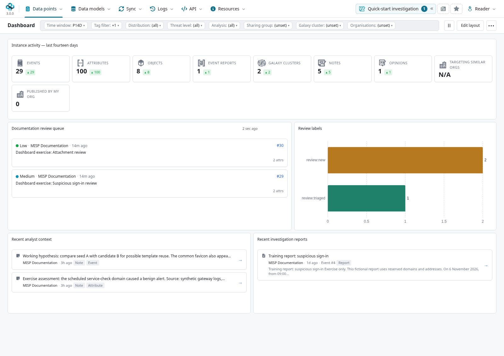
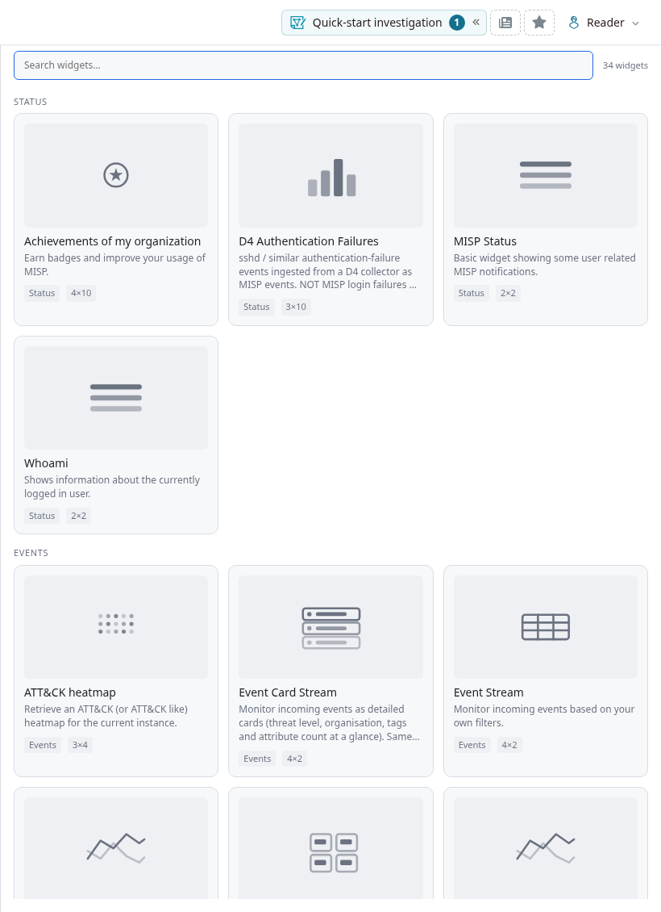
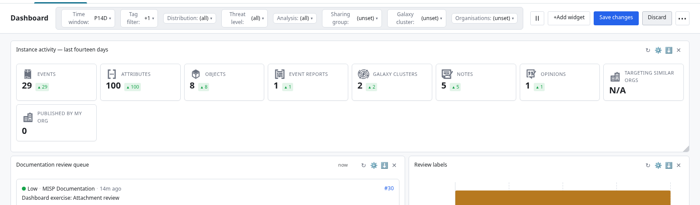
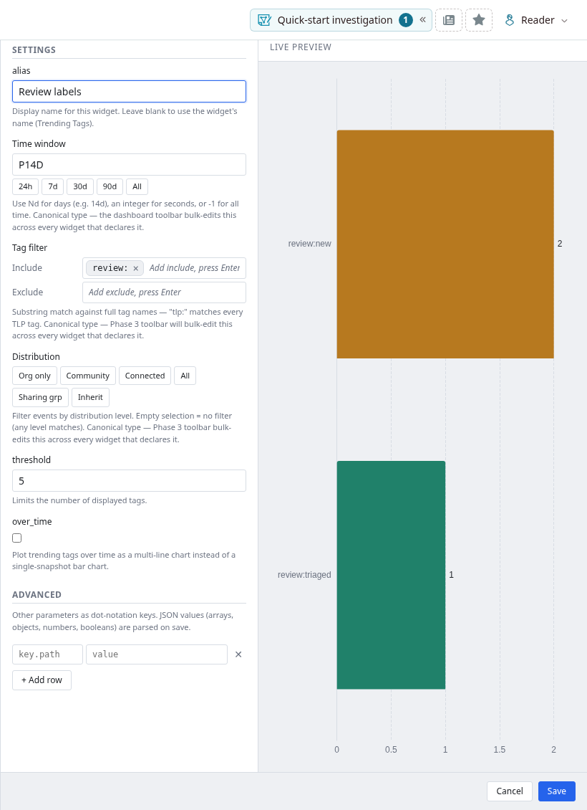
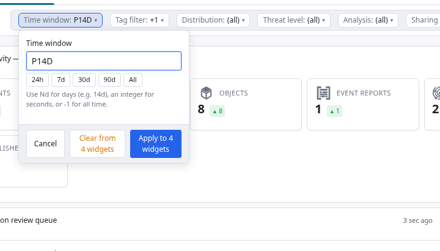
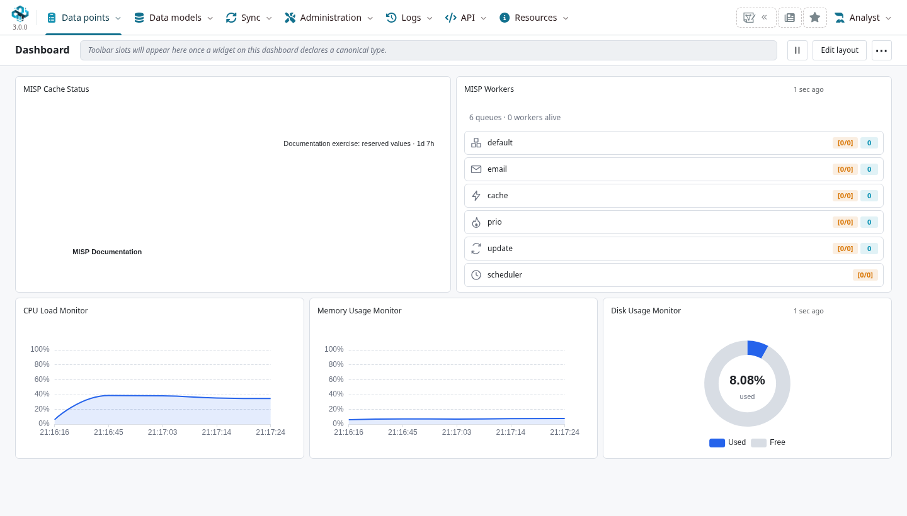
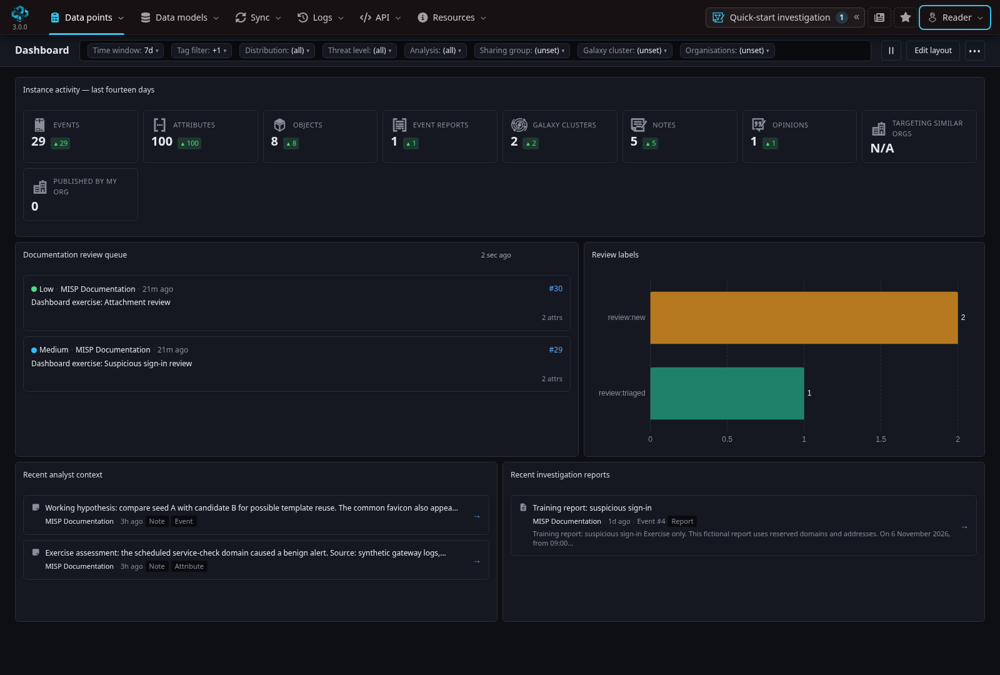
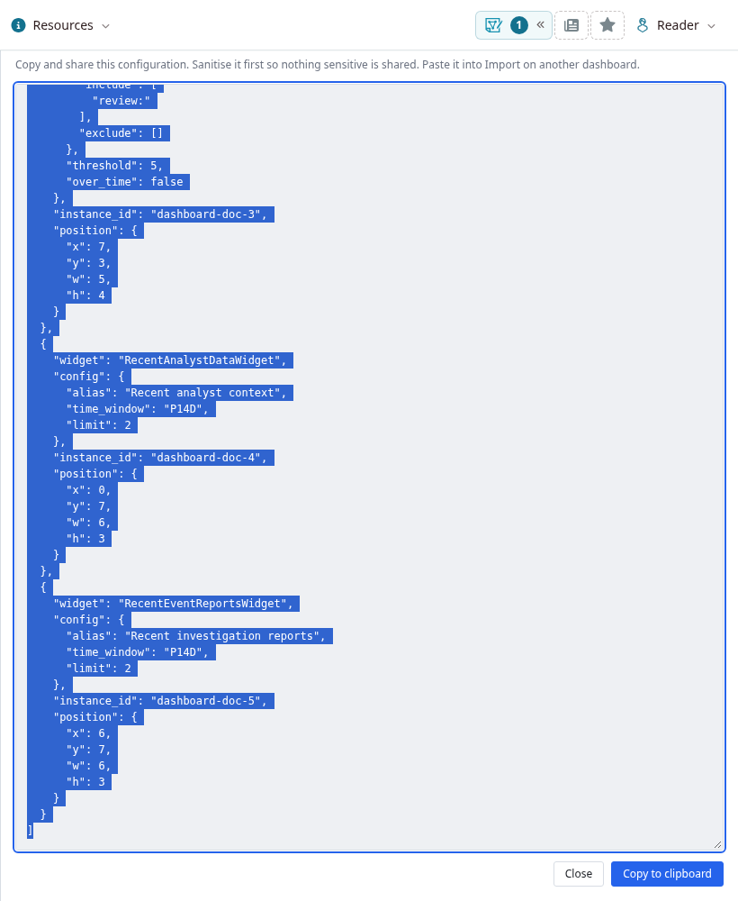
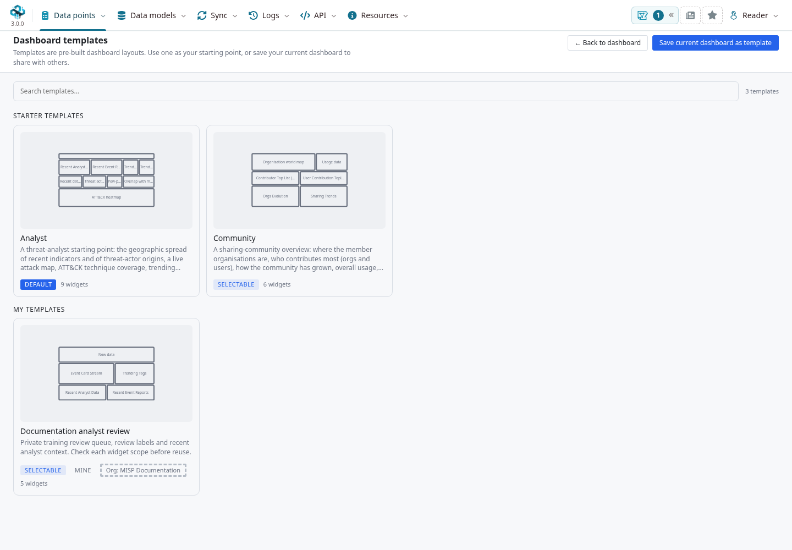

A dashboard brings the information you need for a recurring decision onto one page: which events need review, what colleagues have assessed, which intelligence is gaining attention, or whether the instance needs maintenance.
Choose a few widgets that lead to action, give them clear names, and keep their scope visible.
Open **Data points → Dashboard** to work with MISP's integrated dashboard.

::: {.callout-note}
This chapter follows MISP **3.0.0**, [`3.0_wip` commit `99ebee729`](https://github.com/MISP/MISP/commit/99ebee729702c560528f9788953719bda68aa1c1).
Screenshots show the real interface on an isolated instance with constructed, organization-only, unpublished events.
They contain no live threat intelligence; the exercise attributes have IDS disabled.
Select a figure to enlarge it.
The separate [misp-dashboard application](https://github.com/MISP/misp-dashboard), with its own deployment and live-feed processing, is described in the [integration FAQ](../faq/index.qmd#faq-integrations).
:::

<!-- Capture provenance, source checks and runtime verification: ../assets/dashboard-screenshots.json -->

## Build a useful first dashboard {#dashboard-first-board}

For a daily analyst review, start with these widgets:

| Question | Widget | Suggested next action |
|---|---|---|
| Which events should I inspect? | **Event Card Stream** or **Event Stream** | Open an event and check its evidence, distribution and analysis state. |
| What have colleagues added? | **Recent Analyst Data** and **Recent Event Reports** | Read the note, opinion or report before repeating work. |
| Which labels are prominent? | **Trending Tags** | Check the source events and tagging practices behind a count. |
| How much activity is there? | **New data** | Compare instance activity with your own review queue; their scopes differ. |

1. Open the dashboard. Your saved personal layout takes precedence. If you have none, MISP can supply an accessible default template; otherwise you start with an empty board.
2. Choose **Edit layout → Add widget**. Search the gallery, read the description, and select a widget. Available choices depend on your role and the widgets installed on this instance.
3. Configure the widget, check its preview, and save it. Use a descriptive **alias**, such as *Review queue — new events*, so its purpose remains clear.
4. Move and resize tiles in layout editing. Put the review queue and recent assessments where you can see them together. Use **Save changes** to keep the layout.
5. Follow a result's link into MISP to investigate. A chart summarizes records; the underlying event, attribute, report or assessment supplies the context.



### A reproducible review queue

In this exercise, three private events carry the tag `documentation-dashboard`.
Two also carry `review:new`; the third carries `review:triaged`.
Configure **Event Card Stream** with `tags` set to `review:new`, `published` off and `limit` set to `3`.
The queue shows the two new events that this user can access.
Turning **published** on requests published events only; leaving it off includes both published and unpublished events, subject to access rights.
It is not an “unpublished only” switch.

For **Trending Tags**, use a time window of fourteen days, an include pattern of `review:`, and a threshold of `5`.
Its bars show two occurrences of `review:new` and one of `review:triaged` in the example data.
This **tag filter selects tag names to count**; it does not make every other widget use the same event selection.
The **New data** tile still shows instance-level activity, including other exercise events.
A total of 29 there and two cards in the queue is expected.

Use tags and criteria appropriate to your team's workflow; these exercise labels are not a built-in triage taxonomy.
See [Using MISP](../using-the-system/index.qmd), [Analyst Data](../analyst-data/index.qmd) and [Event Reports](../event-reports/index.qmd) for the work that follows a dashboard result.

## Add, arrange and configure widgets {#dashboard-editing}

The gallery groups widgets by category and supports search.
Its miniature graphics illustrate presentation styles; they are not observations from your instance.
You can add the same widget more than once with different settings, for example a review queue and a published-events stream.
Give each instance an alias that states its purpose or scope.



**Edit layout** exposes tile removal and layout controls.
Move tiles by their headers and resize them using the grid handles.
**Save changes** persists the arrangement; **Discard** returns to the arrangement at the start of the edit session, with confirmation when needed.
Removing a tile removes that dashboard instance, not its source events or assessments.
A deliberately saved empty dashboard stays empty on the next visit; a default template is not silently reapplied.



Use a tile's **Configure** control for its own settings.
Typed fields provide time windows, booleans, numbers and supported selectors; **Advanced** accepts additional widget-specific keys and JSON values.
Follow that widget's help text: a parameter name borrowed from a different widget may have no effect.
Preview changes before saving, particularly with expensive queries or external data sources.



::: {.callout-important}
**Layout saving and widget configuration saving are separate.**
A widget's **Save**, or an applied shared filter, persists settings independently of the staged layout.
**Discard** is not a general undo for settings you already saved.
Save a baseline layout before experimenting, and export its configuration if you want a recoverable copy.
:::

## Use shared filters deliberately {#dashboard-filters}

The toolbar shows shared controls when at least one tile declares support for that filter type.
A chip summarizes the compatible tiles' values; **(mixed)** means they disagree.
Open it and read **Apply to N widgets** before applying a change.
It overwrites that setting on those compatible tiles and saves it; it is not a universal filter over the entire dashboard.
**Clear from N widgets** removes explicit values so each affected widget can fall back to its own default.
Those defaults can differ.



In the example board, **Time window** affects New data, Trending Tags, Recent Analyst Data and Recent Event Reports: four of five tiles.
**Event Card Stream** has no time-window field on this branch, so it stays unchanged.
The **Tag filter** chip targets Trending Tags; the stream's `tags` text setting is a separate interface.
Do not add `time_window` or `tag_filter` in Advanced and assume the stream will consume it.

Other compatible widgets can offer distribution, threat level, analysis, organization, sharing-group and galaxy-cluster selectors.
Organization matching can distinguish the creator organization from sharing-group membership; select the intended match mode.
A selector narrows the widget's supported query; it grants no access to restricted records.
Some widgets apply filters to a bounded set of recent candidates, so a short result list is not proof that no older matches exist.
Use the [event list and search](../using-the-system/index.qmd) when you need a fuller investigation.

## Choose widgets by the decision they support {#dashboard-widget-reference}

The following reference covers the widgets shipped in the checked branch, grouped by purpose.
Names are the gallery titles; custom installations can add more.
Your role may hide operational widgets.
Read each widget's configuration help for its exact fields, time anchor and prerequisites.

### Review and investigate

| Widget | Use and interpretation |
|---|---|
| **Event Stream / Event Card Stream** | Recent accessible events as a table or detailed cards. Apply the widget's own event filters, then open an event. Cards change presentation rather than access rules. |
| **Recent Analyst Data** | Recent notes and opinions visible to you. Read the source assessment and its target before adopting its conclusion. |
| **Recent Event Reports** | Recently created or updated accessible reports, with a link to the narrative. |
| **Recent Sightings** | Inspect recent sightings and false-positive reports, with their source context. This operational widget is site-admin restricted on the checked branch. |
| **Threshold Sightings** | Find attributes whose false-positive sighting score reaches the threshold: type 1 adds one, type 0 subtracts one, and expiration records do not contribute. This site-admin widget is not a count of positive sightings. |
| **Overlap with my organisation** | Find incoming events that overlap your organization's data through correlation. A match is an investigative lead, not confirmation of a threat. |
| **Trending Attribute values** | Find prominent attribute values in the configured scope. Repeated infrastructure or benign shared services can dominate. |
| **Trending** | Rank supported vulnerability, threat-actor or ATT&CK dimensions using event counts and growth between windows. Minimum-count settings help avoid overstating very small samples. |
| **Trending Tags** | Compare counted tag names, or switch to a time-series presentation. Inclusion/exclusion patterns select labels; frequent tags do not measure severity. |
| **Recently Added Galaxy Clusters** | Discover local or forked galaxy clusters; this is not a list of every cluster shipped with the galaxy library. |
| **ATT&CK heatmap** | Review technique coverage from tagged events. Missing techniques can mean missing tagging or visibility, rather than absence of adversary behavior. |

See [Correlation](../correlation/index.qmd), [Sightings](../sightings/index.qmd) and [Galaxies](../galaxy/index.qmd) for the meaning of the underlying relationships and context.

### Understand activity and participation

| Widget | Use and interpretation |
|---|---|
| **New data** | Counts recent events, attributes, objects, reports, local clusters, notes and opinions, with additional organization-context metrics. Several counts are instance-wide aggregates; this is not an ACL-filtered event list or a single count of “intelligence quality.” |
| **MISP Status / Whoami** | User notifications and account/session context. Whoami can display personal information such as email and IP address; review it before sharing a screenshot. |
| **Achievements of my organization** | A summary of the organization's contributions. Use it to recognize activity, alongside qualitative review. |
| **Usage data** | Instance usage statistics for an activity overview. Check the widget's metric definitions before comparing instances. |
| **Contributor Top List (Orgs) / Contributor Top List (Users)** | Compare contribution totals in the configured scope. Volume alone does not establish relevance, independence or accuracy. |
| **Active Contributors in the last 30 days** | Identify recently contributing organizations through their logos. |
| **Orgs using MITRE ATT&CK / Orgs using MISP objects** | Identify adoption of structured context and objects by contributing organizations. |
| **Org Events** | Compare monthly accessible event counts for local creator organizations, using the event date. This is different from a count of publication actions. |
| **Sharing Trends** | Compare an experimental contribution score based on attributes, objects and object references in local organizations' events. It is not a count of synchronization transfers or an intelligence-quality score. |
| **New organisations / New users** | Inspect recently registered organizations or users. Registration is distinct from contribution. |
| **Evolution of published event count (filterable)** | Follow published-event totals over time with supported filters. |
| **Evolution of orgs count (filterable) / Evolution of orgs count / Evolution of user count** | Follow organization or account growth. Historical classifications can use current organization metadata; do not read them as an immutable historical audit. |

### Interpret maps and external sources

| Widget | Use and interpretation |
|---|---|
| **Organisation list / Organisation world map** | See the countries represented by registered organizations. The map's organization-metadata filter consumes supported sector, type and local-status fields; it is not a map of incident origins. |
| **Recent data geolocation map** | Geolocate supported attribute data. Coverage depends on the available data and geolocation resources; hosting location does not identify the operator. |
| **Threat actor origins** | Display country metadata from threat-actor galaxy context. This does not establish where an observed incident originated. |
| **Pew-pew map** | Visualize relationships derived from country and threat-actor galaxy tagging, with map/globe presentation. Treat the animation as a summary of those labels. |
| **D4 Authentication Failures** | Inspect authentication-failure data supplied through the D4-related integration. This is separate from MISP's own login history. |
| **CSSE Covid-19 map / CSSE Covid-19 trends / CSSE Covid-19 data** | Specialized external-data widgets. Verify source availability and relevance before using them; their presence in the gallery does not guarantee a working upstream dataset. |
| **Button Widget** | Add a configurable shortcut. Use a meaningful label and a destination appropriate for the dashboard's audience. |

### Operate the instance

Use an operations board for these widgets, separate from an analyst's daily review.
Many require site-administrator permissions or additional service configuration.
A hidden widget can be a role restriction; an empty tile can instead indicate missing prerequisites or no matching activity.

| Widget | What to check |
|---|---|
| **MISP Health** | Non-green application health checks. Follow up in the [administration diagnostics](../administration/index.qmd#server-settings-and-maintenance) rather than assuming an empty list tests every subsystem. |
| **MISP Workers** | Background-worker and queue status. Confirm that queued work is progressing. |
| **MISP Sync Test** | Connection tests against configured peers. Refreshing can make network requests; it is not simply a historical sync log. |
| **MISP Cache Status** | Age of sync-server and feed caches with caching enabled. Investigate the responsible cache/worker before rebuilding it. |
| **CPU Load Monitor / Memory Usage Monitor / Disk Usage Monitor** | Live resource indicators. CPU and memory samples use a bounded Redis history on this branch; these rolling charts are not a substitute for long-term monitoring. |
| **MISP Resource Usage / MISP System Resource Usage** | Resource summaries available from the instance. Check the runtime and configured measurements when diagnosing pressure. |
| **API Activity / Benchmark top list** | API usage and benchmark information. Availability and usefulness depend on logging/benchmark configuration. |
| **Logins / Logged-in users** | MISP login activity or current sessions. Logged-in users requires the supported Redis-backed PHP-session setup; a login count is not a current-session count. |
| **MISP Mail Log** | Mail-log information where the process can read the expected log. A log entry is not proof of delivery to the recipient. |



## Refresh, caching and appearance {#dashboard-refresh}

Use **Refresh** on a tile to request its data again.
Widgets with automatic refresh can expose a `refresh_delay` setting in seconds: blank uses the widget default, and `0` disables that tile's automatic refresh.
The board's pause/resume control pauses scheduler-driven refresh; it does not stop background jobs, ingestion or other users' dashboards.
CPU and memory monitors use their own polling interval, so do not treat the board control as a universal network pause.
The scheduler also pauses requests while the browser tab is hidden.

**Refresh interval and cache lifetime are different.**
A request can return cached data until the server-side cache expires.
For example, Trending Tags opts into a one-hour per-user payload cache on the checked branch; refreshing the tile does not force that cache to be rebuilt.
New data also caches some metrics internally.
Use the source records to check a time-sensitive observation, and avoid shortening every interval to compensate for a cache.

In the MISP 3.0 interface shown here, use the navbar's **Dark mode** switch: the dashboard follows the interface appearance.
In layouts without that navbar theme system, the dashboard can expose its own light/dark control and save a separate dashboard preference.



## Export, restore and share layouts {#dashboard-templates}

**More actions → Export configuration** provides the saved widget layout and settings as JSON.
Save layout changes first, copy the configuration to a file, and keep it as your baseline.
This export contains configuration, not the current event data in the tiles.
Review aliases, URLs and filters before sharing it, since configuration can still reveal internal details.

To restore it, choose **More actions → Import configuration**, paste the JSON and select **Load configuration**.
Loading replaces your personal dashboard; it does not import events.
Export your current board before replacing it.
The current bare-array format contains each tile's `widget`, `config`, stable `instance_id`, and nested `position` with `x`, `y`, `w`, `h`.
Use the interface's own export rather than manually reconstructing geometry.



A tile's **Export raw data** menu instead offers **Export as JSON** and **Export as CSV** for its handler's results.
JSON preserves the returned structure; CSV flattens it and is not a full round-trip representation of nested records.
Apply the same distribution and handling rules as you would to other exports of that information.

For a reusable team starting point:

1. Save the personal board, then choose **More actions → Save as template**. Give it a purpose-specific name and description.
2. Decide whether it should be selectable by others. A regular user's template is organization-restricted; site administrators can manage additional organization, role, permission and default-template settings.
3. Use **Browse templates** to inspect available templates and apply one. Applying replaces your saved personal layout, so back it up first.
4. After applying, check which widgets are available to your role and whether their filters fit your work. A template supplies configuration; it grants no additional widget or record permissions.

Template owners and site administrators can edit or delete templates they are authorized to manage.
Changing a template does not turn every existing personal board into a continuously synchronized copy.
An administrator's default template supplies a starting point for users without a saved layout, including users who have not explicitly saved an empty board.



## Troubleshoot a surprising result {#dashboard-troubleshooting}

| Symptom | First checks |
|---|---|
| A widget is absent from the gallery | Role permissions, installed custom widgets and the widget's server-side permission check. |
| A tile is empty | Time window, access rights, widget-specific filters, missing integration data and unpublished/published selection. Try its underlying list or search. |
| A shared filter changes only some tiles | Read its affected-widget count and each tile's declared settings. Identically named Advanced keys do not make unsupported filters work. |
| Counts disagree | Compare scope, time anchor, publication status, distinct-event versus occurrence counting, limits and cache age. |
| A refresh still shows older results | Check payload caching separately from the browser refresh interval. |
| Discard did not undo a setting | Discard restores staged layout work; a separately saved widget configuration can survive it. Restore the setting or import your baseline. |
| A copied layout behaves differently | Recipient permissions, local identifiers, available widgets, data, integrations and caches can differ across instances. |

## Develop a dashboard widget {#dashboard-development}

Dashboard widgets are PHP classes that return data to a supported renderer.
They are separate from [misp-modules](../modules/index.qmd), which provide enrichment, import, export and related processing services.
Place a custom widget in `app/Lib/Dashboard/Custom/` (or one immediate subdirectory).
Its filename must end in `Widget.php` and match its class name.
Core widgets live in `app/Lib/Dashboard/` and provide examples of renderer payloads and permission checks.

The following minimal `DocumentationContextWidget.php` demonstrates discovery, typed configuration, refresh and caching without querying intelligence records:

```php
<?php
class DocumentationContextWidget
{
    public $title = 'Documentation context';
    public $description = 'A minimal, per-user dashboard example.';
    public $category = 'status';
    public $render = 'SimpleList';
    public $width = 4;
    public $height = 2;
    public $autoRefreshDelay = 60;
    public $cache_duration = 30;
    public $cache_scope = 'user';

    public $params = array('limit' => 'Example integer from 1 to 25.');
    public $schema = array(
        'limit' => array(
            'type' => 'int',
            'default' => 5,
            'help' => 'Demonstration value, clamped to 1–25 by the handler.'
        )
    );

    public function handler($user, $options = array())
    {
        $limit = isset($options['limit']) ? (int)$options['limit'] : 5;
        $limit = max(1, min(25, $limit));
        return array(
            array('title' => 'Role', 'value' => $user['Role']['name']),
            array('title' => 'Configured limit', 'value' => $limit)
        );
    }
}
```

Reload the gallery, search for **Documentation context**, add it, and change `limit` in Configure.
The SimpleList renderer expects a list of rows with `title` and `value`; this example uses ordinary escaped text, not raw HTML fields.
The limit is only a demonstration value here, not an event-query limit.
Remove the example file when you finish experimenting.

### Configuration, permissions and renderer contracts

- **Describe inputs:** `$title`, `$description` and `$category` make the gallery useful. `$schema` supplies typed fields and defaults; `$params` documents other options. Supported scalar types include `string`, `int`, `bool` and `enum`.
- **Support shared filters intentionally:** declaring a supported canonical type such as `time_window` lets the toolbar find that setting. The adapter translates its stored shape for the handler. The handler must actually consume it with the advertised meaning. Not every schema type has a toolbar control on every branch.
- **Validate on the server:** treat imported configurations and Advanced values as untrusted input. Bound query sizes and durations; do not rely on the form to enforce access or limits.
- **Enforce permissions:** implement `checkPermissions($user)` for restricted widgets. MISP calls it during discovery and loading, including direct render requests. Within `handler`, use user-aware model access methods for record queries; hiding a tile does not replace record-level ACLs.
- **Match the renderer:** return the shape expected by `$render`, or by `getRenderer($options)` when changing chart modes. Use escaped fields and safe internal drilldown links. Read an existing renderer and widget together rather than passing arbitrary HTML.
- **Keep updates bounded:** `$autoRefreshDelay` is a browser request interval. `$cache_duration` opts into server-side caching. Use `$cache_scope = 'user'` for user-dependent results; organization scope is appropriate only when all viewers in that scope may receive exactly the same payload. A configuration-only cache is suitable only for deliberately ACL-independent aggregates.

The example includes the user's role, so a shared configuration-only cache would be incorrect even though it queries no events.
The generic cache excludes display-only alias and refresh-delay settings from the data key; changing a title should not require a new computation.
Do not put secrets into widget configuration, logs or renderer output.

Test discovery and direct rendering as both permitted and restricted users, normal and malformed configuration, empty data, drilldown access, repeated requests within the cache lifetime, and two users with the same configuration.
Also test add/configure/save/reload, layout Discard, raw exports and both dashboard appearances.
For browser automation or custom clients using session cookies, preserve MISP's CSRF handling; the native dashboard sends the page's `X-CSRF-Token` with its POST requests.
Prefer supported authenticated API behavior over treating JSON headers as a CSRF bypass.

### Source and further training

The [MISP dashboard training](https://github.com/MISP/misp-training/tree/main/6.0-misp-dashboard) provides a decision-first workshop on the integrated dashboard.
Its approach informed this chapter; the instructions, screenshots and example here were checked independently against MISP 3.0.
The [training snapshot used](https://github.com/MISP/misp-training/tree/172f26e9af3f4ba1810cc393f2cc1ecb47c81fcb/6.0-misp-dashboard) makes that reference reproducible.

Implementation references for the checked branch:

- [Dashboard controller: layout, configuration, exports and templates](https://github.com/MISP/MISP/blob/99ebee729702c560528f9788953719bda68aa1c1/app/Controller/DashboardsController.php).
- [Dashboard model: discovery, permissions and template access](https://github.com/MISP/MISP/blob/99ebee729702c560528f9788953719bda68aa1c1/app/Model/Dashboard.php).
- [Core widgets, renderer helpers and configuration/cache contracts](https://github.com/MISP/MISP/tree/99ebee729702c560528f9788953719bda68aa1c1/app/Lib/Dashboard).
- [Dashboard client: gallery, configuration, shared filters and refresh scheduling](https://github.com/MISP/MISP/tree/99ebee729702c560528f9788953719bda68aa1c1/app/webroot/js/dashboard).
