Maintenance keeps intelligence useful as an investigation changes: correct several attributes, organize related properties, bring selected material into a working event, or remove a record and recover it when appropriate.
Choose the operation by its effect on the data and its identity, then check the saved result.
A filtered list, an object, a copied record and a deleted record are different states.

::: {.callout-note}
This chapter was checked against MISP **3.0.0**, [`3.0_wip` commit `99ebee729`](https://github.com/MISP/MISP/commit/99ebee729702c560528f9788953719bda68aa1c1).
The screenshots use constructed, organization-only, unpublished events with IDS disabled on every exercise attribute.
Controls depend on your role and permission to modify the event. Select a figure to enlarge it.
The grouping save limitation on this development commit is identified below.
:::

<!-- Native screenshot provenance, source checks and verified mutations: ../assets/data-maintenance-screenshots.json -->

## Choose the maintenance operation {#maintenance-choose}

::: {.table-responsive}

| Your goal | Operation | What to check |
|---|---|---|
| Give several attributes the same comment or flag | **Attributes → select rows → Edit** | Selection count, changed fields and fields left on **Keep current**. |
| Describe one entity with related properties | **Attributes → select rows → Object** | Template relations, preserved context and the change in attribute identity. |
| Copy selected material from another event | **Merge attributes from** on the target event | Source/target direction, review selection, copied identities and audience. |
| Remove an attribute from active use while retaining a deletion marker | **Delete**, with **Delete permanently** off | Correct record, deletion mode and the instance's sanitization policy. |
| Recover a retained, soft-deleted attribute | **Attributes → Filters → Deleted → Restore** | Same UUID, recovered contents and visibility in the normal view. |
| Remove an entire event | **Delete Event** | This is event deletion, not the attribute soft-delete/restore cycle. |

:::

Use the event's own **Attributes** or **Objects** tab when maintaining that event.
In the checked UI, the global Attributes index and a combined extension view do not offer the same event-scoped bulk edit and grouping actions.
If you can only propose changes, follow [Proposing changes](../using-the-system/index.qmd#proposing-changes-to-another-organisations-event); a proposal is not a direct edit of the owner's record.

Before a substantial change, record the event UUID and the affected attribute/object UUIDs, the intended correction and the source supporting it.
Retain an appropriate export or backup when you need recovery of the original state.
The **History** tab helps review changes; it is not a universal undo button or a substitute for [tested backups](../administration/index.qmd#admin-backup-recovery).

## A private practice exercise {#maintenance-exercise}

Create an unpublished **Maintenance guide: Target** event with distribution **Your organisation only** and these standalone attributes.
Leave IDS off and attribute distribution on **Inherit event**.

::: {.table-responsive}

| Type | Value | Purpose |
|---|---|---|
| `url` | `https://portal.maintenance.example/login`{.text-wrap .text-break} | Grouping preview: URL property. |
| `hostname` | `portal.maintenance.example` | Grouping preview: host property of the same URL. |
| `domain` | `review.maintenance.example` | Bulk comment update. |
| `ip-dst` | `192.0.2.230` | Bulk comment update; constructed context, not a DNS answer. |
| `comment` | `Maintenance exercise: duplicate note` | Soft deletion and restoration. |

:::

Optionally attach a custom **`maintenance:grouped`** tag to the URL to inspect its treatment during grouping.
Create a second private, unpublished **Maintenance guide: Source** event containing:

- A standalone `domain` attribute, **`followup.maintenance.example`**.
- A `url` object with `url` **`https://followup.maintenance.example/status`{.text-wrap .text-break}** and `host` **`followup.maintenance.example`**, with IDS off on both properties.
- An event report named **Maintenance guide follow-up**, describing the fictional follow-up context.

The screenshots use target **#43** and source **#44**; your IDs will differ.
No example destination needs to be visited.
The exercise performs the bulk comment update, previews grouping, copies the source object/report, and soft-deletes/restores the note.
It leaves both working events unpublished.

## Bulk edit selected attributes {#maintenance-bulk-edit}

Open the target's **Attributes** tab.
Select only the `review.maintenance.example` domain and `192.0.2.230` address.
The selection toolbar should say **2 selected** before you choose **Edit**.
The table's header checkbox selects the rows loaded in the current tab; do not treat it as a server-side selection of every result on every page.
Changing pages or reloading a filtered list can clear the selection.

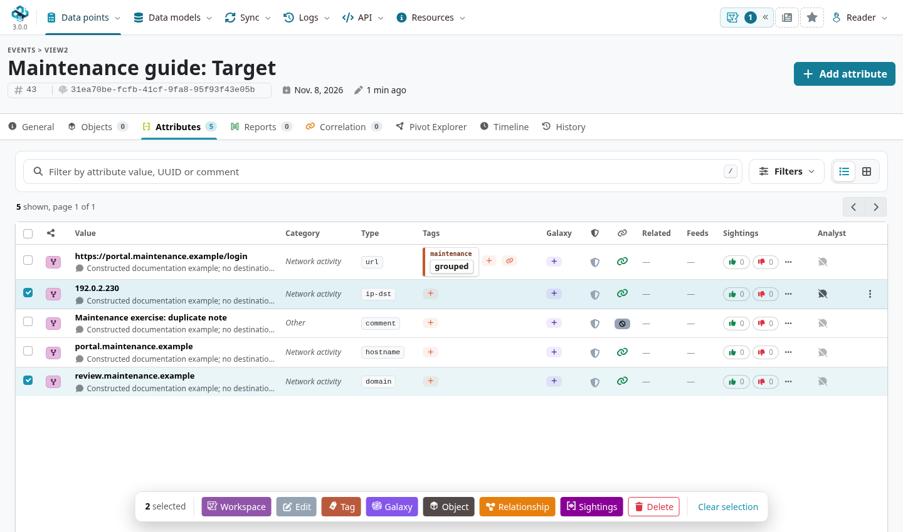

The **Edit selected attributes** form exposes four kinds of change:

- **IDS flag:** keep each existing value, set it, or unset it. IDS eligibility is not a determination of maliciousness.
- **Correlation:** keep each existing value, enable correlation, or disable it. This changes correlation behavior rather than deleting the value.
- **Distribution:** keep each existing restriction, or choose a permitted level/sharing group. Check the parent event's audience as well.
- **Comment:** enter replacement text for every selected attribute.

**Keep current** preserves each attribute's own value; it does not make the selection uniform.
An empty comment in this form means **keep the existing comments**, not clear them.
Use the selection toolbar's separate **Tag** and **Galaxy** actions for those changes; the bulk edit form is not an editor for every attribute field.
For a value/type correction, open the relevant row's editor and review that record individually.

For the exercise, leave the flags and distribution on **Keep current**, and enter:

```text
Reviewed together for maintenance exercise MAINT-GUIDE-001; context only.
```

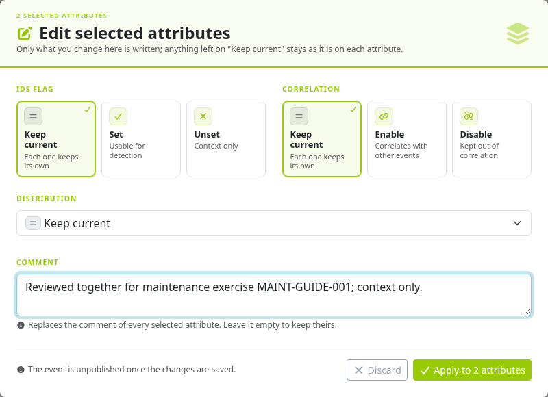

Choose **Apply to 2 attributes**.
Reopen the list and verify both comments, the selection's UUIDs, IDS flags and distribution.
The checked update preserved the two attribute identities, left IDS off and kept distribution inherited; the other three standalone attributes were unchanged.
The form also states that saving unpublishes the event.
Review changes before [publishing again](../using-the-system/index.qmd#publish-an-event) when publication is appropriate.

## Group standalone attributes into an object {#maintenance-group}

An object gives related fields a shared template and meaning.
Group the URL and its hostname because they describe the same entity; a shared tag or presence in one event is not enough to establish that relationship.
See [MISP Objects](../misp-objects/index.qmd#objects-use) for template selection and relationships.

1. In the target's **Attributes** tab, select the URL and hostname. Do not select the review domain, IP address or note.
2. Choose **Object** in the selection toolbar.
3. Filter the template chooser for **url**, then select the compatible **url** template.
4. Inspect the prefilled object form. Confirm the complete URL maps to relation **`url`** and the hostname to **`host`**.
5. Check category, IDS, correlation, distribution, comments and any required observation times; then choose **Review**.

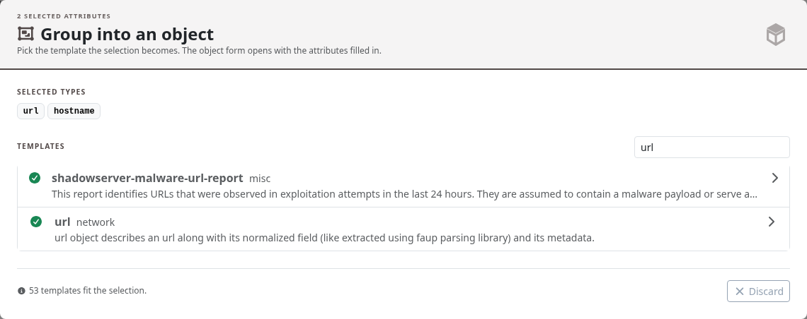

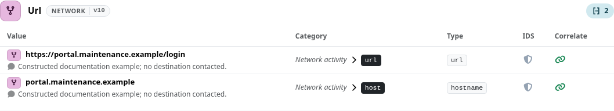

A template can allow only one instance of a relation, require a field, or have no suitable place for a selected type.
Attachments are not carried into this prefilled grouping form.
Review any ignored/skipped items and their original rows rather than assuming everything selected will become an object property.
Automatic type matching also needs semantic review: two fields with the same MISP type can represent different relationships.

### Understand the move before saving

The grouping form explains what happens to an unchanged source value after a successful save:
its matching property is created in the object, tags and sightings are transferred, and the original standalone attribute is deleted.
This creates **new attribute IDs/UUIDs**; it is not an in-place change of `object_id` with every association preserved.
The prefill does not carry every kind of context: check first/last-seen times, analyst data, references and report links separately.
Do not assume UUID-based references to a former standalone attribute now point to its new property.

On an event that has **never been published**, this grouping path permanently removes the absorbed standalone originals.
For a previously published event, the path retains soft-deletion markers instead.
A selected source whose type/value is changed or removed from the composition form stays as a standalone attribute.
Check the save message and both tabs to distinguish moved records from records left out.

::: {.callout-note}
**Checked development-branch limitation:** template selection, prefilling and Review worked, but the grouping save was rejected by form protection on the pinned commit, including a fresh attempt without opening Review.
No object was created and the two originals remained intact.
The screenshots therefore stop at the review; the remaining exercise keeps those attributes standalone.
If your save fails, read back the event before retrying and keep the originals until a verified successful move. Do not delete them to make the list resemble the preview.
:::

When saving succeeds on your instance, confirm the new object under **Objects**, expand its properties, and compare the former standalone rows, tags, sightings and identities with your recorded state.
There is no general “ungroup with all original identities restored” button in this workflow.

## Merge selected content from another event {#maintenance-merge}

Start on the event that should **receive** the content: **Maintenance guide: Target**.
On **General**, open **Show all actions** and choose **Merge attributes from**.
Enter the source event's ID or UUID, verify the source preview, and check the target shown in the dialog.
You need visibility of the source and permission to modify the target.

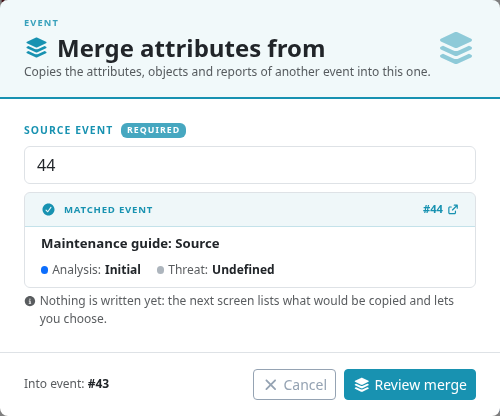

Choose **Review merge**.
The checked UI opens a full review page, currently labelled **Enrichment results** even for this merge action; no enrichment provider is invoked by this workflow.
It lists candidate attributes, objects and reports, with controls to remove candidates and inspect their fields before **Import**.
For this exercise, remove the **standalone domain** from the review, keeping the URL object and report.
Expand the object to inspect its properties, and check the IDS/correlation flags, comments and distribution of each retained element.

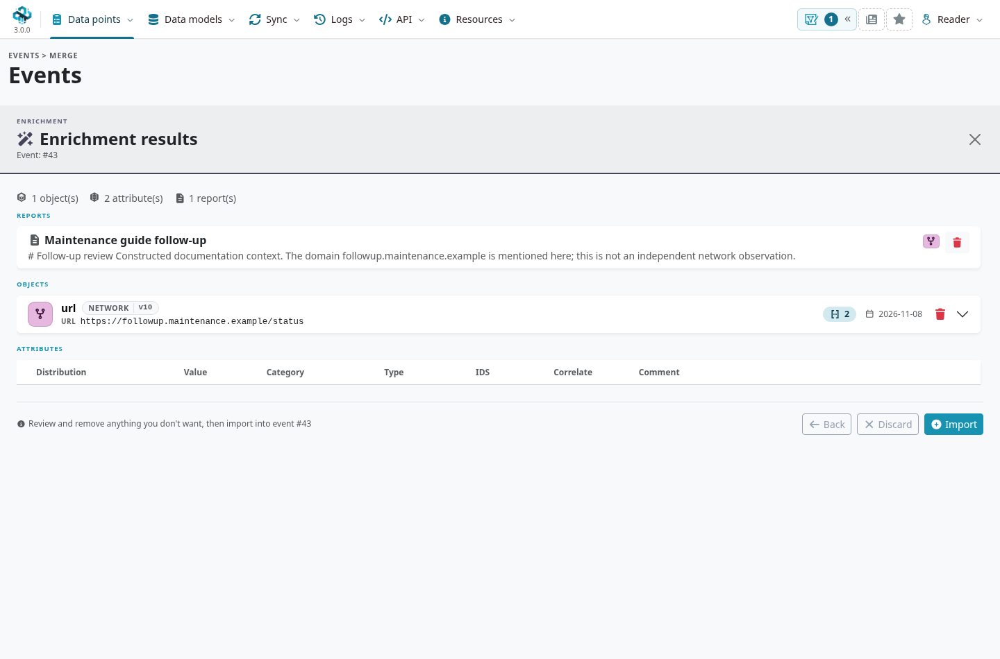

Choose **Import**, then reopen the target and inspect its **Objects** and **Reports** tabs.
In the checked exercise:

- One URL object with two properties and one report were added to the target.
- The excluded standalone domain was not copied.
- The copied object, its attributes and the report received new UUIDs; the target event's UUID stayed the same.
- The source event's authored contents and identities remained unchanged.

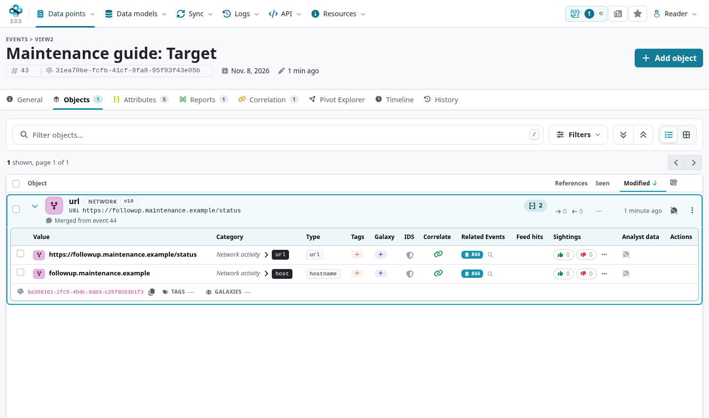

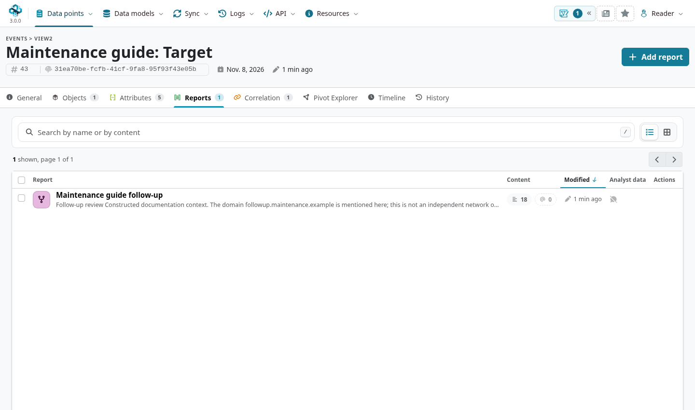

This is a **copy of selected content**, not a union that deletes the source or combines both events' identities and publication history.
The target retains its own container metadata, creator and audience.
A copied property on **Inherit event** follows the target, so copying private source material into a broader target can change who may receive it. Review that audience before importing.
Keep attribution to the original source in the narrative; a copied occurrence is not a new independent observation.
Do not assume event-level tags, proposals, analyst data, sightings or every UUID reference were carried over just because a value is present.
Review report references and object relationships after copying, and check for records already present in the target before repeating an import.

For collaboration that should retain a separate contributing event and its provenance, consider an [Extended Event](../extended-events/index.qmd).
Merging extensions **into a view** changes the displayed combination; this maintenance operation writes copies into the target.
The review's **Remove from import** control only excludes a candidate from the pending import; it does not delete the source record.

## Delete and restore an attribute {#maintenance-delete-restore}

Use deletion when a record should leave active use.
If the intelligence remains useful context but should not drive detection, [false-positive handling](../false-positives/index.qmd) may be the better maintenance action.
Filtering a row out of a view neither deletes it nor changes its IDS flag.

### Soft-delete the exercise note

Open the target's **Attributes** tab, find **Maintenance exercise: duplicate note**, open its row menu and choose **Delete**.
Check that the confirmation concerns that attribute, and leave **Delete permanently** **off**.
The selected-row toolbar can also delete a selection; verify its count and members before confirming a bulk operation.

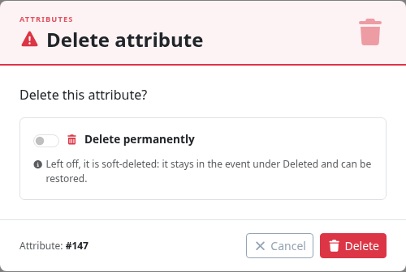

Confirm **Delete** and check that the note has left the normal list.
Open **Filters → Deleted** to show the soft-deleted records.
In the checked event tab, this toggle selects **deleted only**, not a combined live/deleted view; the active chip says so.
Close the filter panel to inspect the row.

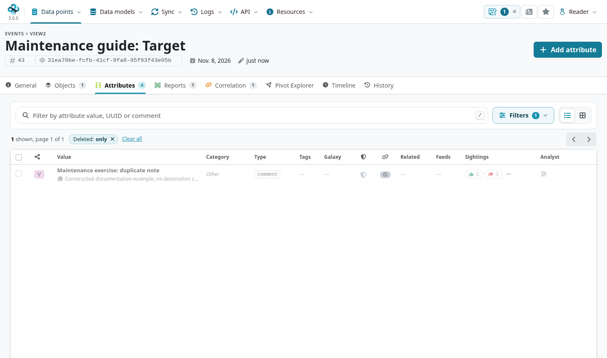

### Restore the retained attribute

Open the note's row menu, choose **Restore**, and confirm.
Turn **Deleted** off, or reload the normal Attributes tab, to find the active row again.

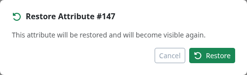

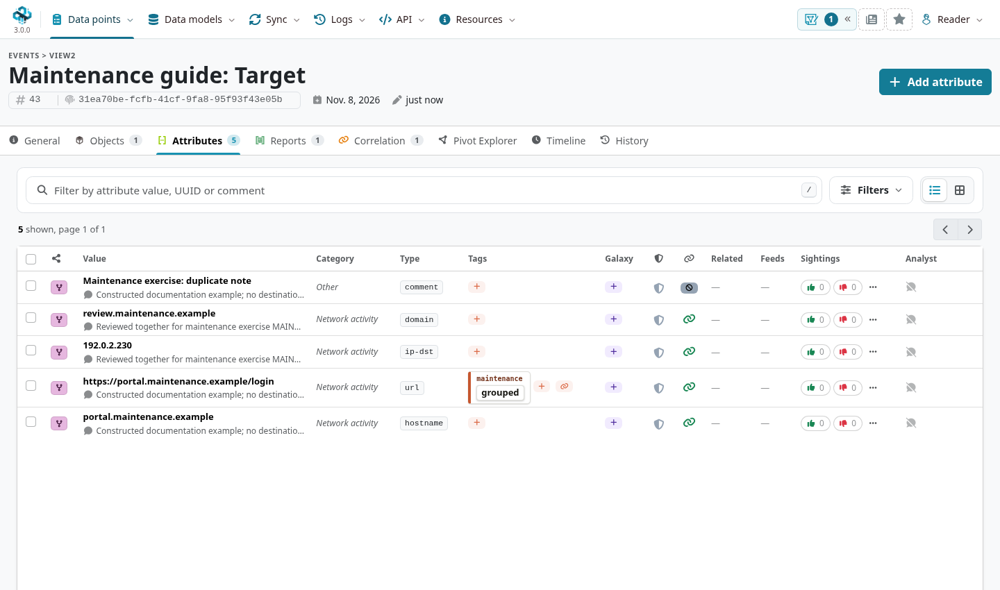

The checked cycle retained the original note's ID, UUID, value, comment, IDS flag and distribution.
Restoration updates timestamps and leaves the event unpublished.
Check the recovered fields, relationships, correlations and intended audience before using or republishing the record.
Restoring an attribute is not a rollback of every related operation: proposals removed during deletion or relationships marked deleted need separate review.

::: {.callout-note}
Recovery depends on what was retained.
With **`Security.sanitise_attribute_on_delete`{.text-wrap .text-break}** enabled, a soft deletion can replace the original value/type/comment with sanitized content.
Restore changes the deletion state; it cannot reconstruct fields that the policy erased.
Ask your administrator about the instance's policy before relying on a deletion marker as a recoverable copy.
:::

### Permanent deletion, objects and whole events

::: {.table-responsive}

| Action | Scope and recovery |
|---|---|
| **Delete attribute**, permanent switch off | Retains a soft-deleted attribute row; the verified **Restore** workflow above applies if its contents and permissions allow it. |
| **Delete attribute**, permanent switch on | Removes the attribute permanently. **Restore** cannot recover a missing row. |
| **Delete object**, permanent switch off | Marks the object and its properties deleted, with related-reference effects. The checked object menu has no equivalent one-click whole-object **Restore** action. |
| **Delete object**, permanent switch on | Removes the object and its properties permanently. |
| **Delete Event** | Removes the event and its contained data. It is not the event-level equivalent of the attribute Deleted/Restore toggle. |

:::

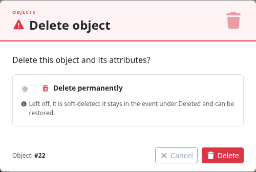

The **Objects → Deleted** view can show objects holding deleted content.
Restoring a single child attribute does not by itself restore a deleted parent object or every reference.
For whole-object recovery on the checked branch, use an administrator-supported recovery procedure and verify the entire entity; do not present the attribute Restore button as an object recovery workflow.

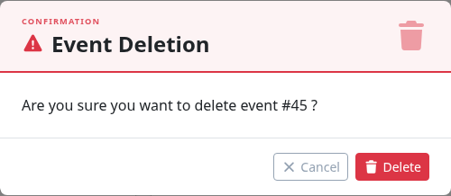

For permanent deletion or a whole event, recovery requires suitable retained exports/backups and a reviewed recovery procedure.
An event JSON export can help recover event content; it is not a complete backup of every instance record or association.
See [backup and recovery](../administration/index.qmd#admin-backup-recovery).
Deleting locally also does not recall exports or copies already held elsewhere.
For previously shared intelligence, review the appropriate [synchronization and sharing behavior](../sharing/index.qmd) and publication policy.

## Verify the maintenance result {#maintenance-verify}

After each operation, reopen the target using its recorded UUID and check what actually persisted:

- Compare the affected values, IDs/UUIDs and counts in the correct tab, with filters cleared as appropriate.
- Check tags, comments, observation times, IDS/correlation flags, distribution and source attribution.
- Inspect reports and references whose targets may have acquired new identities.
- Review **History**, then publish only the intended, reviewed changes when appropriate.

A preview or a success-looking navigation is not enough to establish that all writes succeeded.
If an operation returns an error or only partly matches your intended result, inspect the persisted records before retrying; repeated copies can create additional records.
For scripted maintenance, use the [Automation & API reference](../automation/index.qmd) with explicit UUID-based scope and the same read-back checks.
