MISP brings observations, their context and the reasoning behind them into a shareable record.
An **event** groups a coherent investigation or body of knowledge; **attributes** record typed data points; **objects** group related attributes; and **Event Reports** explain the story.
Tags, galaxy clusters and analyst feedback help a recipient interpret that evidence.
Distribution and sharing settings determine who can receive it.

This overview introduces how those pieces fit together before the detailed chapters on types, taxonomies, galaxies and objects.
It adapts the [MISP / Team CIRCL data-model training overview](https://github.com/MISP/misp-training/tree/b93884a7e2cefbeebdee0521e19638bca6962ed2/a.11.a-misp-data-model-overview), including its TikZ diagrams, to the MISP 3.0 model used in this book.
The diagrams show common relationships, rather than a complete database schema or an import format.

## Read the model in four parts {#model-four-parts}

These areas work together on the same intelligence.
A technically valid attribute still needs a source, an observation time and enough context for someone else to use it.
A classification or assessment does not itself grant access to the underlying record.

## Start with an event and its observations {#model-event}

An event is a contextual envelope for an incident, investigation, campaign, report or another coherent topic.
Its metadata includes its UUID, creating organization, date and analysis state.
The local owning organization and the creating organization can differ after synchronization.
Keep event boundaries meaningful: unrelated observations are usually easier to assess in separate events than in one ever-growing indicator list.

An **attribute** combines a value with a type and category.
For example, `domain` describes what `login.example` represents, while Network activity describes its investigative context.
Comments, first/last-seen times and source information preserve what was observed and when.
The `to_ids` flag expresses intended detection use; confidence, freshness, access and correlation are separate questions.
See [Categories and Types](../categories-and-types/index.qmd).

An **object** groups attributes that describe one meaningful observation, such as a `domain-ip` observation or a file and its hashes.
An **object template** defines its named fields, attribute types and constraints.
For a `domain-ip` object, the relation `ip` names a field whose underlying attribute type is `ip-dst`.
The template UUID and version identify the definition; the object instance and every contained attribute have their own UUIDs.
See [MISP Objects](../misp-objects/index.qmd).

An **Event Report** keeps the narrative in Markdown alongside structured data.
It can reference attributes and objects using MISP report syntax without duplicating their values in prose.
Reports have their own identity and distribution, and references are neither object references nor correlations.
Review sensitive free text as well as structured fields when sharing a report.
See [Event Reports](../event-reports/index.qmd).

### Keep identity separate from value {#model-identity}

::: {.table-responsive}

| Identifier | What it identifies |
|---|---|
| Local numeric ID | A record on one MISP instance; it is not a cross-instance identity. |
| Element UUID | An event, attribute, object or other element across instances. Preserve it when updating that shared record. |
| Template UUID and version | The definition used to describe an object, rather than an observed instance. |
| MISP 3.0 value address | A SHA-256 address for a stored component value, which can be shared by distinct attribute occurrences. |

:::

Two attributes can have different UUIDs while recording the same domain.
They remain separate observations with their own roles, timestamps and visibility context.
MISP 3.0 also supports analysis attached to a shared value address; that address does not replace an occurrence UUID or grant access to private occurrences.
See [occurrences and shared values](../categories-and-types/index.qmd#types-values) and [value-level Analyst Data](../analyst-data/index.qmd#value-level-analyst-data).

## Add context at the right scope {#model-context}

A **free tag** is a label chosen for a local workflow.
A **taxonomy** defines a consistent vocabulary expressed as machine tags, such as `tlp:amber`.
A **galaxy** organizes a domain of knowledge, such as techniques, tools or actors; its **clusters** represent individual concepts with UUIDs, descriptions, metadata and relationships.
Attaching a cluster through its tag connects that knowledge to the observation.
A technique attachment records context or an assessment; it does not establish attribution on its own.

Choose the attachment scope deliberately.
An event tag describes the event, while an attribute tag describes that particular data point.
Event context may be displayed or used by consumers without being copied into every attribute's tag list.
Local attachments and shareable attachments also have different propagation behavior.
A TLP label communicates handling expectations; configure distribution and access separately.
Continue with [Taxonomies](../taxonomy/index.qmd), [Galaxies](../galaxy/index.qmd), [Warninglists](../warninglists/index.qmd) and [Noticelists](../noticelists/index.qmd).

## Preserve reasoning and feedback {#model-feedback}

**Analyst Data** lets you add your own analysis alongside an element without rewriting the original observation.
A **Note** records explanation or caveats, an **Opinion** records an agreement score with reasoning, and a **Relationship** makes a directed, labeled assertion between supported targets.
Each annotation has its own UUID, author and distribution.
In MISP 3.0, supported targets also include attribute values addressed by SHA-256; choose whether your assessment concerns one occurrence or the value across observations.
See [Analyst Data](../analyst-data/index.qmd).

**Sightings** record feedback on attributes, including attributes inside objects: an observation, a false-positive report or an expiration.
Include time and source; observing a value is not a verdict that it is malicious.
A **proposal** suggests an attribute addition, modification or deletion for the event owner to review; submitting it does not immediately change the original.
These mechanisms serve different purposes from annotations.
See [Sightings](../sightings/index.qmd) and [proposals](../using-the-system/index.qmd#proposing-changes-to-another-organisations-event).

## Distinguish assertions from computed matches {#model-links}

An **object reference** starts at an object and targets an object or attribute, recording the target UUID and a relationship type.
Direction matters: an email that `includes` a file makes a different statement from the reverse link.
The example below keeps references inside one event; this is a useful starting point for modeling related observations.
An **object relation**, such as `ip`, instead names a field inside an object.

**Correlation** finds eligible matching attribute values, whether the attributes are standalone or inside objects.
It creates an investigative pivot without requiring an analyst to assert an object reference.
Matching values can reflect shared infrastructure or noise as well as related activity; examine the evidence before drawing conclusions.
Correlation depends on supported types, engine/configuration, exclusions and correlation flags; `to_ids=false` does not by itself disable it.
Advanced matching, such as CIDR or ssdeep, has additional configuration and runtime requirements.

Galaxy-cluster relations connect knowledge entries, while Analyst Data Relationships connect supported analysis targets.
Neither is interchangeable with an object reference or a computed correlation.
Use the mechanism that expresses the statement you actually want to make.

## Keep the audience explicit {#model-sharing}

Event distribution defines the containing audience; a sharing group can identify a specific community.
Object, attribute and report settings can inherit where supported or further restrict access within the parent event's limits.
Analyst Data has separate distribution controls; do not assume every annotation is visible to every reader of its target.
Permissions and synchronization/export settings also affect what a recipient receives.

Publication is a workflow step, not a confidentiality setting: an unpublished event can still be visible to authorized readers.
Check the intended recipient's view and the actual outbound payload, including report prose and annotations.
For complementary investigation context, an [extended event](../extended-events/index.qmd) links to a parent using `extends_uuid` while retaining its own identity, ownership and sharing settings.
See [Sharing and Synchronization](../sharing/index.qmd) for the operational details.

## Put the pieces together {#model-example}

For a synthetic phishing investigation:

1. Create an event for the investigation and choose its audience.
2. Add a `domain-ip` object for `login.example` and the observed address `192.0.2.10`, preserving source and observation times.
3. Add a standalone URL if it has its own investigative role, and explain the evidence in an Event Report.
4. Attach classification and relevant galaxy context at the appropriate scope, and record uncertainty in a Note.
5. Record later observations as sightings, investigate correlations, and review detection flags and the recipient's view before sharing or exporting.

These reserved values illustrate representation rather than an importable payload or a detection recommendation.
Use the detailed chapters that follow to choose valid types, templates and context for your own observations.

## Sources and further training {#model-sources}

Adapted from **MISP / Team CIRCL**, [MISP data model overview](https://github.com/MISP/misp-training/tree/b93884a7e2cefbeebdee0521e19638bca6962ed2/a.11.a-misp-data-model-overview), including the `model-map`, `event-anatomy`, `object-references` and `correlation` TikZ diagrams, under the training repository's AGPL-3.0-or-later / CC-BY-SA-4.0 licensing.
This chapter incorporates the book's MISP **3.0.0** value-addressing guidance, checked against [`3.0_wip` commit `99ebee729`](https://github.com/MISP/MISP/tree/99ebee729702c560528f9788953719bda68aa1c1).
The [MISP standard](https://www.misp-standard.org/) describes interchange formats, and the [full data-model course](https://github.com/MISP/misp-training/tree/main/a.11-misp-data-model) develops the model in more detail.
