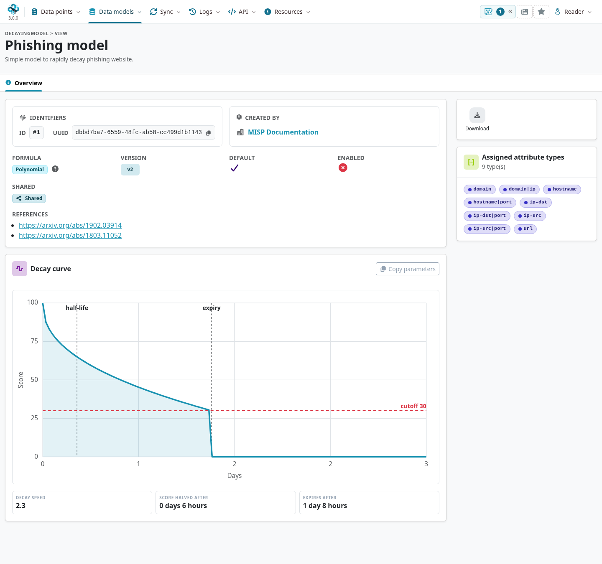

A **decaying model** estimates how an indicator's relevance changes with time and configured evidence.
Use it to inform detection selection and review, rather than treating every indicator as equally useful forever.
A model returns a score and a **decayed** flag; it does not automatically remove the attribute or clear its IDS flag.

::: {.callout-note}
This chapter follows the [`3.0_wip`](https://github.com/MISP/MISP/tree/3.0_wip) development branch.
The model detail page has a new 3.0 layout, while some advanced Decaying Tool and simulation pages still use the classic interface.
Decaying-model scores are distinct from MISP 3.0's **Value Intelligence** assessments and **analyst profiles**.
Select the screenshot to enlarge it.
:::

<!-- Capture source, fixture and image hashes: ../assets/using-misp-screenshots.json -->

Open **Data models → Decaying Models** to browse the models available to your account.
Creating or editing models requires **Decaying Model Editor** permission (`perm_decaying`), with ownership restrictions; site administrators have additional management rights.
The method is described in the [MISP indicator-scoring research](https://arxiv.org/abs/1902.03914).

## How scoring works

For an applicable attribute and model, MISP computes:

- A **base score** from configured numerical taxonomy values, or the model's default base score.
- A **current score** using the selected formula and relevant observation or update time.
- A **decayed** flag when the formula's threshold test is met.

The time-based calculation uses sighting information and can fall back to `last_seen` or the attribute's modification time.
Updates can change that reference point, so record observation windows deliberately and inspect the actual result rather than inferring age from the event date.
Several applicable models can return different scores for the same attribute.

Scores are computed on demand. They are not a synchronized, permanent verdict about whether the value is malicious.
The data visible to a reader and the model they select affect the result.

### The base score

A model's `base_score_config` assigns weights to supported taxonomy values with numerical scores.
The calculation uses matching tags on the event and attribute; attribute-level tags override matching event-tag bases for this calculation.
When no configured taxonomy matches, `default_base_score` is used.
This scoring rule does not mean an attribute tag universally overrides event handling markings in other parts of MISP.

## Model parameters

| Parameter | Meaning |
|---|---|
| **Lifetime** | The time span in days used by the time-based formula. The raw polynomial score reaches zero by its end. |
| **Decay speed** | Shapes the curve. In the shipped Polynomial formula, a larger positive value makes the score fall sooner within the same lifetime. |
| **Threshold** | Scores below this cutoff are marked decayed by the shipped formulas; an indicator can be decayed before the lifetime ends. |
| **Default base score** | Starting score when configured numerical taxonomies do not match. |
| **Base score config** | Weights used to combine matching taxonomy scores. |
| **Formula** | The implementation used to compute the score and decayed state. |
| **Settings** | Additional parameters used by a particular formula. |



## Decay formulas

The branch ships these formulas:

- **Polynomial:** decreases the base score with elapsed time. Within the lifetime, the raw score is `base_score × (1 − (elapsed / lifetime)^(1 / decay_speed))`{.text-wrap .text-break}, clamped at zero.
- **Polynomial Extended:** adds the configured retention-taxonomy rule to the polynomial calculation.
- **Sightings:** derives a score from recorded sighting types and its configured minimum count and offsets, rather than elapsed time alone.

A type-0 sighting is an observation; the formula's terminology does not make it an independently verified true positive.
Inspect the formula and settings when interpreting the score, especially where repeated reports or expiration feedback are present.
Custom formulas can be installed by administrators; their behavior can differ from these defaults.

## Mapping models to attribute types

A model must be applicable to the attribute's type and available to the requesting account.
The model detail page lists **Assigned attribute types**; defaults ship with their associations, while custom models have configurable mappings.
For example, a phishing model can cover hostnames, domains, URLs, and IP addresses.

Check mappings before enabling a filter such as `excludeDecayed`.
A missing score does not mean the indicator is fresh or benign, and an inappropriate mapping can produce misleading selection results.

## Simulating and previewing a model

The 3.0 detail page's **Decay curve** illustrates a nominal polynomial curve and cutoff from the parameters.
It is a preview, not the current score of a particular attribute or a substitute for a non-polynomial formula's actual result.
**Copy parameters** and **Download JSON** help record a configuration for review.

Advanced Decaying Tool pages support type mappings, base-score inspection, and simulation using a REST-search selection or a specific attribute.
Some remain in the classic layout, and the pinned MISP 3.0 detail page does not offer a **Simulate model** action.
Use the tools exposed by your instance, or verify a representative attribute through the search API below.
Query overrides allow comparison without changing the stored model.

## Using decay scores in queries and the event view

Use `/attributes/restSearch` with explicit scoring options:

::: {.table-responsive}

| Filter | Purpose |
|---|---|
| `includeDecayScore` | Attach applicable scores to returned attributes. |
| `includeFullModel` | Include the model definition with the score. |
| `decayingModel` | Select the model or models to use. |
| `excludeDecayed` | Exclude an attribute when all returned applicable scores mark it decayed. This implies scoring. |
| `modelOverrides` | Override supported parameters such as `threshold`, `lifetime`, or `decay_speed` for this query. |
| `score` | Supply the supported threshold override for the query. |

:::

For example, replace the UUID and model ID with ones on your instance:

```json
{
  "returnFormat": "json",
  "uuid": "ATTRIBUTE-UUID",
  "includeDecayScore": true,
  "includeFullModel": true,
  "decayingModel": 1
}
```

Inspect the returned `decay_score`, including its `score`, `base_score`, `decayed`, and model identity.
Test the unfiltered result before adding `excludeDecayed` or combining it with IDS/publication filters.
Confirm how unmapped attributes and multiple models are handled by the query and consuming tool.

The older event interface can expose decay scores through its attribute filters and columns.
Do not assume that every 3.0 tab or export automatically displays or applies them.
Value Intelligence's assessment label, signal strength, and shelf life use the effective **analyst profile** and are a separate assessment path; see [Analyst Profiles](../analyst-profiles/index.qmd).

### Choose decay or a fixed feed export window {#decay-export-policy}

Both decay filtering and the [tag-based two-query strategy](../automation/index.qmd#api-feed-export-policy) can retain historical observations for correlation while limiting detection exports.
The tag strategy expresses a source-specific publication window: include ordinary eligible data plus tagged feed data from recently published events.
Decay instead evaluates attribute relevance using the selected formula, evidence, type mappings and thresholds.
It is an alternative when publication time does not express the intended lifetime, rather than an automatic replacement for the feed policy.

For a decay-based export, select and inspect applicable models, then explicitly request `excludeDecayed` along with the consumer's other filters.
Neither a displayed decay score nor the policy tag automatically changes an export or recalls a previously delivered indicator.
Reconcile the receiving tool's managed detections when attributes stop matching, while keeping source records and correlation enabled where appropriate.

## Ownership, sharing and default models

Models can be owned by your organization, shared across organizations, or supplied as upstream defaults.
Enabled state, sharing, ownership, and type mappings are separate settings.
Default formulas and parameters are maintained upstream and have restricted editing; use a non-default copy for local tuning.
Authorized administrators can manage enabled/shared state.

### Import, export and updating defaults

Export a model as JSON to preserve its settings for review or reuse.
Importing creates a non-default model owned by your organization; review its associations and enabled/shared state before relying on it.
Updating defaults loads the shipped `misp-decaying-models` definitions, reconciling them by UUID and version.

On large exports, scoring adds computation. Test the selected models and filters on a representative sample first.
A [workflow](../workflows/index.qmd) can also attach decay information where configured, but neither a workflow nor a displayed score guarantees that a downstream detector applies the intended filtering.
