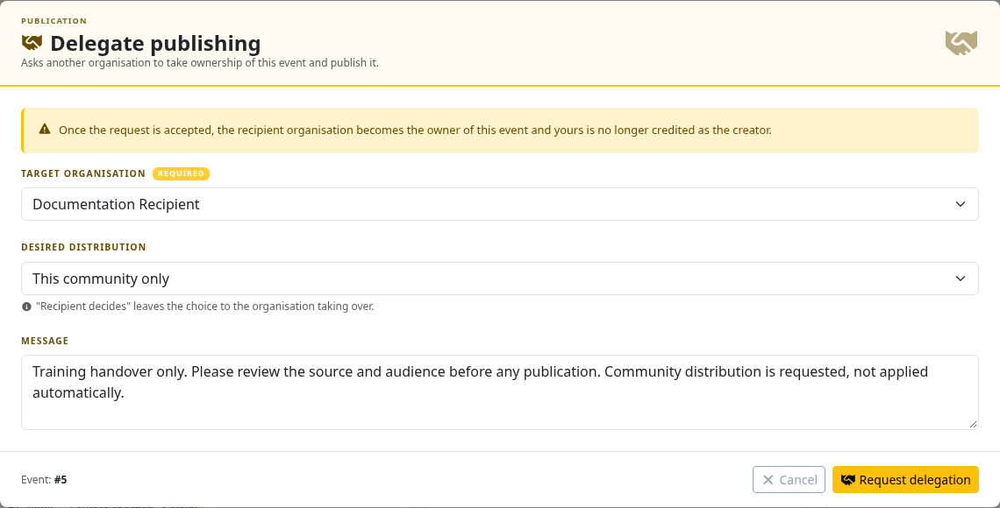
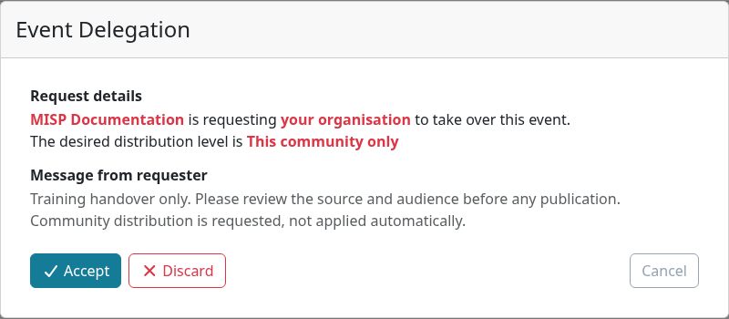
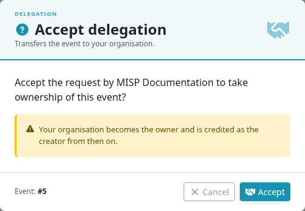

**Delegation** asks another local organization to take ownership of an event and handle its publication.
It is useful when a trusted coordinator or partner should maintain the shared record instead of the original reporting organization.
The recipient must review and accept the request; sending it does not publish the event.

::: {.callout-note}
The screenshots use MISP **3.0.0**, [`3.0_wip`](https://github.com/MISP/MISP/tree/3.0_wip), and two fictional local organizations.
The instance must enable `MISP.delegation`; requesting a handover requires **Delegation access** (`perm_delegate`).
The recipient's controls also depend on its role and event permissions. Select a screenshot to enlarge it.
:::

<!-- Capture source, fixture and image hashes: ../assets/using-misp-screenshots.json -->

Delegation changes the owning and creating organization recorded on the event, but **does not guarantee anonymity**.
Source links, report text, attachments, annotations, UUIDs, and previously shared copies can still identify or connect the original source.
Review those details and agree on attribution with the recipient before requesting a handover.
Use an [extension](../extended-events/index.qmd) when both organizations should retain their own separately owned contribution instead.

## Send a delegation request

1. Review the event and restrict it to **Your organisation only** for the ordinary delegation workflow.
2. Open the event's **All actions** control and choose **Delegate Publishing**.
3. Choose the **Target organisation**. It must be local to the instance; delegation is not a direct transfer to a remote organization on another server.
4. Select a **Desired distribution**, or **Recipient decides**, and explain the requested handling in **Message**.
5. Review the target and content, then submit the request.

Only one delegation request can be pending for an event at a time.
Discard an existing request before changing its recipient or requested distribution.
The source organization and recipient can inspect or discard it through their available controls.

The distribution eligibility rule differs when `MISP.unpublishedprivate` is enabled: the controller permits delegation without the normal organization-only distribution check.
Do not enable that setting merely to bypass a handover restriction; review the instance's unpublished-event visibility policy with its administrator.

A pending request authorizes the target organization to retrieve the event through the supported event API.
Send it only to an organization authorized to inspect the content, including the evidence attached to it.
The request's desired distribution is advisory, rather than an automatic distribution change.

## Answer a delegation request

Open **Delegation Requests** from the **Data points** menu; its page is titled **Delegations**.
You can also follow the pending-request controls where the event view is available.
The list distinguishes requests received from requests issued by your organization.
Review the requesting organization, event, desired audience, and message before choosing an action.

::: {.callout-note}
In the pinned 3.0 development snapshot, the new event page can return **Invalid event** for an organization-only event while delegation is pending, even though the request details and authorized event API are accessible.
Review the content through the event API or with an authorized administrator before accepting; do not widen distribution to work around the page or accept an unreviewed handover.
:::

- **Discard** rejects or withdraws the request without transferring ownership. It does not remove copies of content the recipient has already seen.
- **Accept** transfers ownership to the recipient organization. Check the resulting event before publishing or making any audience changes.

In the pinned branch, accepting a request does **not** automatically apply its desired distribution or publish the event.
The organization-only event in the example remains organization-only and unpublished after acceptance, even though the request proposed community sharing.
The recipient must explicitly review and set distribution and publication afterward.

The transferred event retains its UUID, but its local numeric ID can change.
Use the resulting event link or UUID to find it, and confirm ownership, access, attachments, reports, and annotations after the handover.
The original organization can lose access when it is no longer the owner and the distribution remains organization-only.

## After the handover

Agree who will respond to corrections, sightings, and partner questions.
If the recipient will share more broadly, review source attribution, TLP/PAP, separately scoped annotations, and detection eligibility before publishing.
See [publication](../using-the-system/index.qmd#publish-an-event) and the [pre-publication checklist](../best-practices/index.qmd#before-you-publish).
