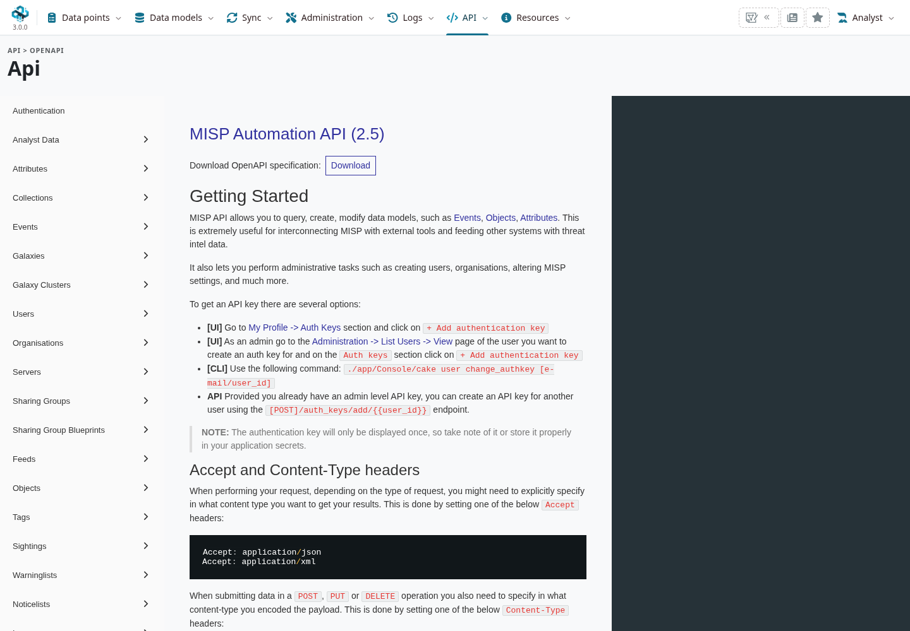

Use this page to find the implementation behind a 3.0 feature and choose a focused way to
contribute. Check the branch and component before copying an older example or running a test.

::: {.callout-note}
This reference follows `3.0_wip` commit
[`99ebee729`](https://github.com/MISP/MISP/commit/99ebee729702c560528f9788953719bda68aa1c1).
The branch is developing; a guide, generated specification or client package can describe a
different revision. Record the commit when reporting behaviour.
:::

<!-- Checked source paths, UI and validation: ../assets/reference-faq-screenshots.json -->

<a id="developer-faq"></a>
<a id="main-developer-resources"></a>

## Where should I start? {#developer-start}

Read the branch's [contribution guide](https://github.com/MISP/MISP/blob/3.0_wip/CONTRIBUTING.md),
[coding guidelines](https://github.com/MISP/MISP/blob/3.0_wip/CODINGSTYLE.md),
[governance](https://github.com/MISP/MISP/blob/3.0_wip/GOVERNANCE.md) and
[code of conduct](https://github.com/MISP/MISP/blob/3.0_wip/code_of_conduct.md).
Use the appropriate repository's issue/PR template. For confidential vulnerability reporting,
follow the [security policy](https://github.com/MISP/MISP/security/policy).

For a local development checkout:

```bash
git clone --branch 3.0_wip --recurse-submodules https://github.com/MISP/MISP.git
cd MISP
git rev-parse HEAD
git submodule status
```

Follow the branch's
[Docker development guide](https://github.com/MISP/MISP/blob/3.0_wip/docs/dev/docker-dev-environment.md)
to run that working copy with the required services. A container's bundled application is not
automatically your checkout: inspect the bind mounts and version. Keep synthetic fixtures in a
separate development database.

<a id="about-the-codebase"></a>

## How is the 3.0 code organized? {#developer-codebase}

::: {.table-responsive}

| Area | Starting point and practical meaning |
|---|---|
| Requests and permissions | `app/Controller/`{.text-wrap .text-break}, `Component/ACLComponent.php`{.text-wrap .text-break} and model-level checks. A visible control and an API route still need correct authorization. |
| Business logic and validation | `app/Model/`{.text-wrap .text-break}. The running `MispAttribute`{.text-wrap .text-break} model defines types/defaults; `GET /attributes/describeTypes`{.text-wrap .text-break} exposes current public metadata. |
| Current interface | `app/View/Themed/Overmind/`{.text-wrap .text-break}, shared elements, and their scripts/styles under `app/webroot/`{.text-wrap .text-break}. Classic views can coexist without being the page Overmind actually renders. |
| Dependencies | The checked-out CakePHP 2 framework and `app/composer.json`{.text-wrap .text-break}. This commit declares PHP `>=8.1.0,<9.0.0`{.text-wrap .text-break}; use a runtime satisfying the complete locked dependency set. |
| Database evolution | `app/Lib/Migration/`{.text-wrap .text-break} and its ordered migrations/ledger. Repository schema snapshots help orientation; they do not establish a running instance's migration state. |
| Shared component values | `MispAttribute`{.text-wrap .text-break}, `Value`{.text-wrap .text-break} and value/attribute-value storage. Occurrence UUIDs and SHA-256 value addresses identify different things. |
| Background execution | `SimpleBackgroundJobs`{.text-wrap .text-break}, Redis and Supervisor; inspect the current worker/job/task implementation. Legacy CakeResque instructions do not describe this branch. |
| Content definitions | Pinned companion repositories under `app/files/`{.text-wrap .text-break}: objects, taxonomies, galaxies, warninglists, noticelists and workflow blueprints. Deploying files and importing their definitions are separate steps. |

:::

See the [data-model reference](../categories-and-types/index.qmd#types-values) and
[administration migration checks](../administration/index.qmd#admin-database) for the corresponding
user/operational concepts. Do not substitute a value hash for an attribute UUID in synchronization
or change an old migration to repair a database that has already applied it.

## Which API description should I use? {#developer-api}

The installed **API → OpenAPI** page (`/api/openapi`) serves the bundled specification from
`app/webroot/doc/openapi.yaml`. Its title at this commit still says **MISP Automation API (2.5)**.
That compatibility label does not mean the instance is running 2.5, nor guarantee every 3.0
endpoint/parameter is fully documented there.



Use the installed specification as a starting point, then inspect the route/controller, ACL,
model validation, response and client version for a new or changed feature. The REST client
and PyMISP also depend on API permissions and key restrictions; a site-admin demonstration is
not a permission test for an ordinary user. See
[Automation & API](../automation/index.qmd#api-reference) and
[PyMISP](../pymisp/index.qmd#pymisp-installation).

## What should I test before opening a PR? {#developer-testing}

Choose checks that exercise the changed behaviour. The repository has PHP tests under
`app/Test/`, live API tests under `tests/`, and focused 3.0 value-oracle tests under
`tests/value_oracle/`. Read each suite's prerequisites and fixture lifecycle before running it;
live suites can create, edit, publish and delete data. Run them against an isolated disposable
instance with the intended branch and companion definitions.

For a UI change, test the actual Overmind view, a permitted and a denied user, empty/error
states, keyboard access and a narrow viewport. For a model/API change, inspect both the saved
record and returned JSON; test updates, visibility and invalid input as well as the happy path.
A formatter or a successful administrator request alone does not establish these behaviours.

For schema changes, follow the migration generator/process and test the upgrade path on a
copy, not just a fresh database. Use the read-only status/schema diagnostics before deciding
whether an upgrade is necessary. Document required dependency/definition revisions and any
client compatibility impact.

Describe the concrete trigger, resulting behaviour, validation and limits in the PR. Include
sanitized examples with reserved addresses/domains. Keep credentials, session cookies and
private event data out of issue reports and screenshots.
