MISP connects forensic observations to threat intelligence and turns reviewed findings into scoped hunting and response inputs.
Use it to preserve the context of selected evidence, compare observations across investigations, document analytical judgments, and exchange useful indicators with responders.
Acquire disk images, memory and endpoint collections with the appropriate forensic tools; retain the authoritative evidence and chain of custody in the case's evidence repository.
MISP holds the selected intelligence and its provenance, rather than replacing that repository or a case-management system.

Worked examples cover selected Windows findings, a Sleuth Kit filesystem timeline and a DNS/HTTP packet capture.
It also covers memory, endpoint, network, email, mobile and cloud investigations, and provides a complete source inventory of candidate **misp-modules** across import, expansion, export and action families.

::: {.callout-note}
The screenshots show the running MISP **3.0.0** interface from [`3.0_wip` commit `99ebee729`](https://github.com/MISP/MISP/commit/99ebee729702c560528f9788953719bda68aa1c1), with the light theme and a site-administrator account in an isolated documentation instance.
The Windows finding is synthetic: it does not demonstrate an intrusion or execution of Hayabusa against real EVTX evidence.
The module contracts and inventory follow [misp-modules commit `d7ec3654`](https://github.com/MISP/misp-modules/tree/d7ec36544576f2523e320ce9200d0f18d12e11c7).
MISP and misp-modules have separate release cycles; check your service's `GET /modules`, dependencies, object templates and organization permissions before using a listed module.
:::

<!-- Capture, fixture and module audit provenance: screenshots.json and reference/inventory.json. -->

## Place MISP in the investigation {#dfir-lifecycle}

Begin with a specific question, such as whether an unusual service logon relates to a known incident.
Record the case identifier, source system, evidence reference, collector/tool versions, relevant time window and the question's scope.
Select a manageable set of findings from the forensic tool rather than uploading an entire case by default.


::: {.table-responsive}

| Investigation stage | MISP contribution | Preserve alongside the observation |
|---|---|---|
| Preparation | Agree on object templates, audience, module services and output consumers. | Evidence retention, authorized collection scope, handling rules and tool versions. |
| Collection and triage | Import selected exported results, artifacts or a bounded capture. | Source export hash, underlying evidence reference, host/device identity and collection method. |
| Analysis and scoping | Inspect occurrences, enrich selectors, compare timelines and record competing explanations. | Source time semantics, provider query time, confidence and the evidence supporting each conclusion. |
| Containment and eradication | Supply reviewed indicators, queries or lists to the chosen responder/tool. | Intended scope, approval, expiry, deployment receipt and rollback/removal procedure. |
| Recovery and improvement | Record sightings and negative results, reassess selectors and update detection content. | Search coverage, execution times, false-positive decisions and remaining gaps. |

:::

An indicator match is a lead.
A rule title, antivirus label, sandbox score or imported `unreviewed` detection is not an analyst-confirmed conclusion.
Use [Analyst Data](../analyst-data/index.qmd) and [Event Reports](../event-reports/index.qmd) to explain what the evidence establishes, alternative explanations and what still needs checking.

## Preserve evidence and time semantics {#dfir-provenance}

Use an organization-only, unpublished event while building the investigation.
Add the case/evidence reference and a concise question to its report, and apply the actual handling markings and distribution required by your organization.
An unpublished event can still be visible to users allowed by its distribution; publication and access control are separate settings.
Tags describe handling and context, while distribution and sharing groups control MISP access.
See [Sharing](../sharing/index.qmd) before changing the audience.

Keep three kinds of information distinct:

1. **Source evidence:** the original image, EVTX, PCAP, collection or export, its integrity hash and evidence-system reference.
2. **Recorded observation:** a row or object with source record identifiers, host/device/sensor context, raw fields and the meaning of its timestamps.
3. **Analytical conclusion:** an assessment supported by identified observations, with confidence and review status.

The hash of `findings.jsonl` identifies that export's bytes; it does not verify the `Security.evtx` path mentioned inside it.
Likewise, a memory-results hash is distinct from the memory-image hash, and an EVE/Zeek log hash is distinct from a capture hash.
Preserve the original export outside MISP when needed, even if a module also attaches it.
Attaching data to MISP subjects those bytes to the event's access and retention arrangements.

Preserve timezone, epoch unit, precision and timestamp meaning.
Use observation times for activity timelines, collection times for collection, and provider lookup times for enrichment.
MISP's modification timestamp, event date and import time do not establish when the underlying activity happened.
Missing or ambiguous times should remain unresolved until a source supplies the missing context.

Several dedicated DFIR importers below deliberately set **IDS off and correlation disabled**, even on hashes and IPs.
This preserves unreviewed evidence without treating every extracted value as a detection selector.
Promote a validated selector deliberately, keeping a reference to its source observation; do not enable correlation or IDS across every imported field.
Other importers have their own defaults, so inspect the preview rather than assuming this behavior is universal.

## Import selected Windows findings in MISP 3.0 {#dfir-windows-example}

The [example JSONL](examples/hayabusa-selected.jsonl) contains one fictional Hayabusa-shaped finding for `workstation.example`.
It reports Windows Event ID **4624**, record **42**, with service logon type **5** at **15 November 2026, 09:20 UTC**.
Successful service logons can be routine; the example's informational severity and test rule status supply context, not a malicious verdict.

### Select and review an import {#dfir-import-review}

An administrator must make the module service reachable, enable import services and enable `evtx_findings_import` for the intended users.
The [Modules chapter](../modules/index.qmd#modules-service) describes service discovery and configuration.
In the event, choose **Import from** (shown as **Import** in the compact action bar), then **Evtx Findings Import**, the displayed name of the `evtx_findings_import` module in this interface.
Upload the selected export and run the import to reach MISP's review screen.

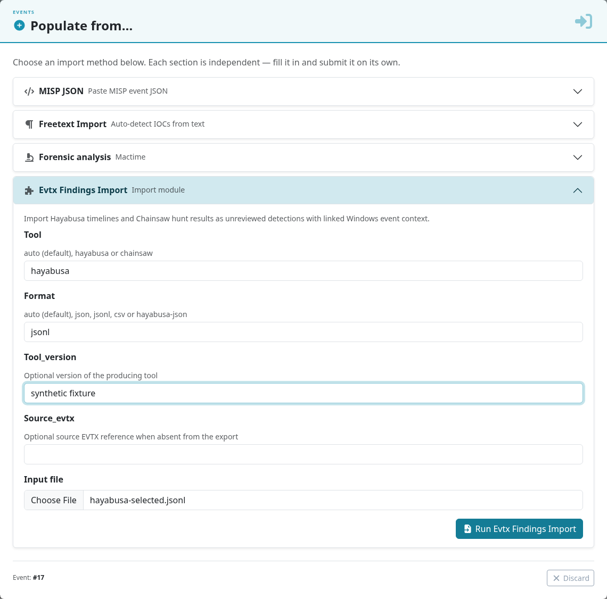

The importer accepts Hayabusa JSON object streams, JSON/JSONL and supported CSV timelines, or Chainsaw hunt JSON/JSONL.
It imports detection output; it neither parses EVTX binaries nor runs the producer.
Keep rule ID, provider, channel, event/record IDs and EVTX reference in the producer's export when available.
For example, Hayabusa's available profiles and command names depend on its version; follow the [importer's version-specific guide](https://github.com/MISP/misp-modules/blob/d7ec36544576f2523e320ce9200d0f18d12e11c7/documentation/import_mod/evtx_findings_import.md).

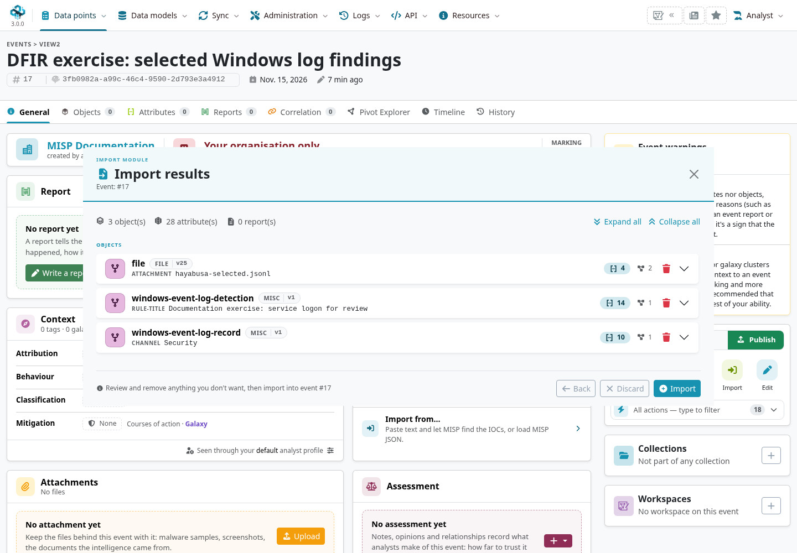

Check the source filename/hash, observation time, host and record identifier, rule metadata, raw fields, references and IDS settings before saving.
The module response also exposes `summary` and `warnings`; the MISP import screen may not display these supplementary fields.
Inspect the service response when checking skipped, unmapped or ambiguous fields, and treat an `error` JSON field as a failed import even if HTTP status is 200.

### Keep the finding connected to its source {#dfir-saved-finding}

Saving this example creates three objects: a source `file`, a `windows-event-log-detection` and a `windows-event-log-record`.
The original JSONL is attached to the source file, whose SHA-256 and size identify the export.
The detection preserves rule metadata and starts as `unreviewed`; the event record preserves the reported Windows event context.
Their references retain the source-to-result associations returned by the module.

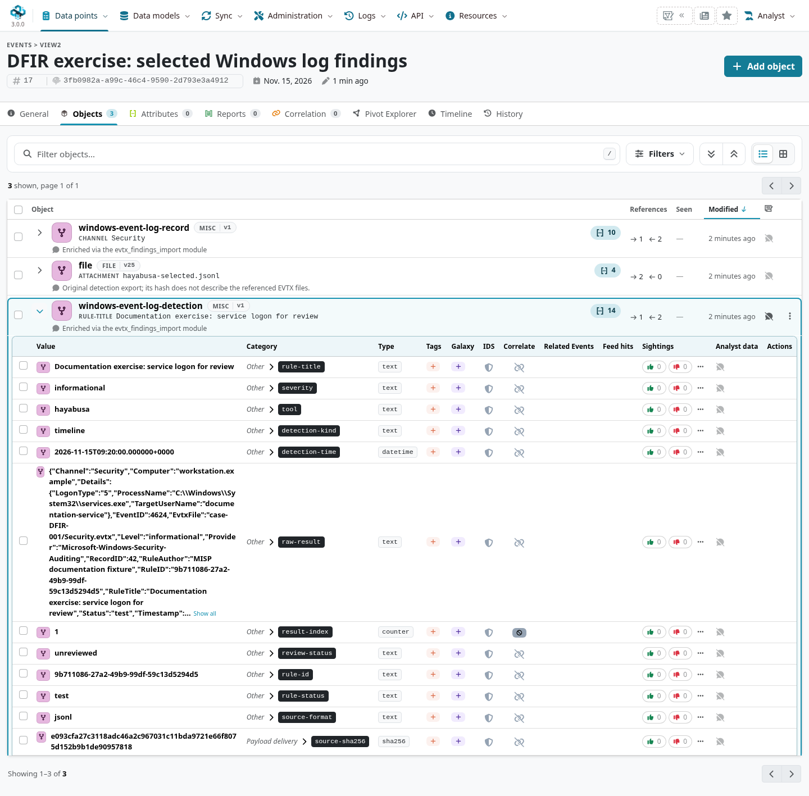

Open the event context and inspect record **42** in the original evidence through the case's forensic tools.
Compare the account, process, service configuration and surrounding logons before deciding whether further collection is justified.
An exported path is a reference, not a file MISP has acquired or authenticated.

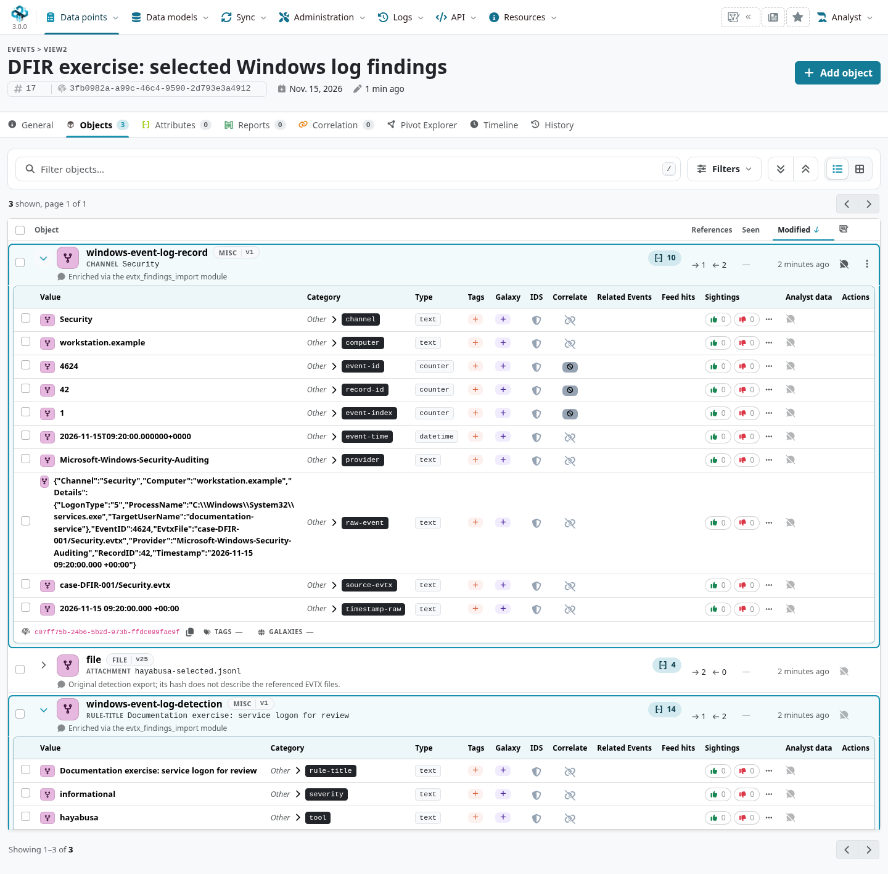

Record the conclusion separately in an Event Report: what was checked, why it matters, what remains uncertain and the next action.
Only selectors supported by that review should become hunting or detection inputs.
The example remains organization-only and unpublished, with every imported attribute non-IDS and non-correlating.

## Choose the right evidence importer {#dfir-importers}

The dedicated importers below consume selected results rather than performing acquisition.
Their detailed input contracts matter: a filename extension alone does not establish that a producer's schema is supported.
The complete module inventory at the end of this chapter links to each handler at the reviewed revision.

::: {.table-responsive}

| Module | Accepted evidence exchange | DFIR use and important boundary |
|---|---|---|
| `evtx_findings_import` | Hayabusa JSON streams, JSON/JSONL or supported CSV; Chainsaw hunt JSON/JSONL. | Preserve rule matches and linked Windows event context. EVTX binaries and Chainsaw search/dump output are outside its detection contract. |
| `volatility3_import` | Native Volatility 3 JSON/JSONL, including nested renderer rows; explicit plugin identity required. | Supported Windows process, command-line, socket, malfind and YARA result mappings. Does not read memory images, execute plugins or cover every Volatility plugin. |
| `velociraptor_import` | Offline JSON/JSONL/CSV result tables with artifact/source identity and collection context. | Map supported process, service, netstat and file artifacts; preserve other rows as source results. Does not run VQL, contact a server or import collection ZIPs. |
| `osquery_import` | Native event/batch differential logs and snapshot JSON/JSONL; explicit context for ad-hoc rows. | Preserve host/query identity, execution time, additions/removals and export source maps. Does not execute SQL or infer a no-match result from silence. |
| `timesketch_import` | Selected Timesketch API/CLI/OpenSearch JSON, JSONL or CSV; selected Plaso `psort -o json_line`. | Preserve source IDs, timestamps, annotations and raw events. Does not read native `.plaso` storage or turn source labels into MISP verdicts. |
| `autopsy_import` | Autopsy selected-row CSV or the explicit `misp-forensic-selected` version 1 JSON interchange. | Browser/download, communication and installed-application artifacts with case/device provenance. The interchange supports adapters for mobile parsers; native UFED, Magnet, XRY or Oxygen report support is not claimed. |
| `zeek_import` | Selected native JSON/JSONL or ASCII/TSV with required Zeek headers. | Preserve network observations, connection context, UIDs and source-provided Community IDs. JSON needs explicit stream context when `_path` is absent. Does not run Zeek. |
| `suricata_import` | Selected EVE JSON/JSONL, optionally filtered by event type and flow ID. | Retain alerts, flow/protocol observations and native identifiers. Does not run a sensor, retrieve rules or equate an alert with compromise. |
| `pcap_import` | Bounded PCAP/PCAPNG, processed locally with TShark 4.0 or newer. | Preserve capture/flow provenance and reconstruct supported HTTP/email content when available. Encrypted or incomplete transfers limit reconstruction; it is a parser, not a traffic collector. |

:::

### Memory and endpoint scoping {#dfir-memory-endpoint}

For Volatility results, supply the producing plugin, framework/plugin versions and image name/hash when known.
The supported mappings include `windows.pslist.PsList`, `windows.psscan.PsScan`, `windows.pstree.PsTree`, `windows.cmdline.CmdLine`, `windows.netscan.NetScan`, `windows.netstat.NetStat`, supported malfind paths, `windows.vadyarascan.VadYaraScan` and `yarascan.YaraScan`.
Keep physical/virtual offsets, raw columns and row hierarchy; a PID alone cannot identify a process across images or runs.
Malfind suspicion and a YARA match both require review.

For Velociraptor, retain deployment/client/flow/hunt identifiers as well as host and artifact name.
An analyst-supplied default for one client or collection must not overwrite the identity of a multi-host export.
For osquery, preserve the exporter-generated `sources` map so a scheduled query can be traced back to its originating MISP event, object and attribute.
The importer cannot recover those references from a hashed query name alone.

### Timeline reconstruction {#dfir-timeline}

Use `timesketch_import` to bring a selected timeline slice and its annotations into the investigation.
Prefilter the source export when appropriate; its default `selection=all` treats the supplied file as the selection.
An API search hit is not the same as an explicit Timesketch selection flag.
Numeric `timestamp` uses microseconds; numeric `datetime` requires a declared unit, and CLI JSON/JSONL produced through pandas commonly needs `datetime_unit=ms`.

Use `timesketch_export` for the return direction.
It emits timestamped observations as JSONL, including supported process/file/network and Windows-event times and explicit first/last-seen endpoints.
It does not substitute MISP metadata dates for activity times, upload to a sketch or transfer attachments and complete raw records.
Its source IDs, tags and distribution fields are descriptive metadata; configure the destination sketch's access separately.
Repeated uploads can create duplicate timeline entries.

::: {.callout-important}
At the screenshot revision, MISP serializes these two saved activity times with the compact offset `+0000`, while the reviewed Timesketch exporter requires the colon form `+00:00`.
A direct export of the saved example therefore returns `No supported timestamped observations selected` with two timestamp warnings.
This incompatibility is fixed by merged [misp-modules PR #1140](https://github.com/MISP/misp-modules/pull/1140); updated services accept these offsets directly.
The [example export helper](examples/export_timeline.py) normalizes only explicit compact offsets on datetime attributes in an export-only copy, leaving the original event/export unchanged and unknown offsets unresolved.
The resulting [two-observation JSONL](examples/windows-observations.jsonl) was produced by the real module service; it has not been uploaded to a Timesketch instance.
:::

For an older service that requires the workaround, save one selected MISP event as standard JSON, review its audience and content, then run the helper against your local or approved module service:

```sh
# Requires Python requests and a service exposing timesketch_export.
python dfir/examples/export_timeline.py selected-event.json observations.jsonl
```

Set `MISP_MODULES_URL` when that service uses a different base URL.
Inspect the helper's summary and warnings, then choose the intended sketch and upload the JSONL through Timesketch's normal import workflow.

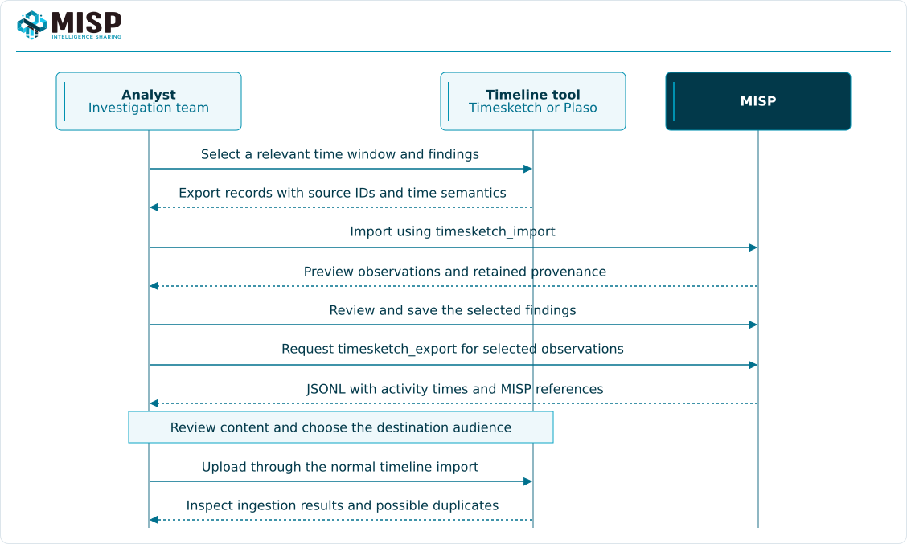

When selection excludes rows, `timesketch_import` and `autopsy_import` omit the full original attachment to avoid including excluded records.
The network importers also document selection-aware attachment handling.
Check each module's response and retain the authoritative full export in the evidence system.

### Filesystem timeline with The Sleuth Kit {#dfir-sleuthkit}

Use a filesystem timeline to ask which recorded file timestamps fall within the investigation window, then keep their meanings distinct when importing them.
This worked example follows `/case/notes.txt` from a synthetic filesystem image through Sleuth Kit output to MISP's native **Forensic analysis → Mactime** review.
This core import path is separate from misp-modules and does not acquire or examine the filesystem image itself.

The [compressed example image](examples/sleuthkit/filesystem.img.gz) contains a 4 MiB ext2 filesystem with one harmless 47-byte text file in `/case`.
The image was authored with e2fsprogs **1.47.2**, and the file's timestamps were explicitly assigned for this exercise.
The [provenance record](examples/sleuthkit/provenance.json) records the image hash, inode, tool versions and output hashes.
All three screenshots below use the same pinned MISP `3.0_wip` revision as the Windows example; the filesystem event is organization-only and unpublished.

#### Produce and inspect the evidence timeline {#dfir-sleuthkit-output}

The following commands run from the book root with **The Sleuth Kit 4.12.1** installed.
They decompress the synthetic image into the working directory, extract filesystem metadata with `fls`, and select one file before running `mactime`.
The image contains a filesystem starting at byte zero, so this example needs no partition offset; a partitioned evidence image requires the appropriate filesystem offset.
The `-m /` option supplies the path prefix for bodyfile output; it does not mount the image.
The [Sleuth Kit `fls`](https://www.sleuthkit.org/sleuthkit/man/fls.html) and [`mactime`](https://www.sleuthkit.org/sleuthkit/man/mactime.html) manuals describe the output and date-range options.

```sh
mkdir -p work/dfir-sleuthkit
gzip -dc dfir/examples/sleuthkit/filesystem.img.gz > work/dfir-sleuthkit/filesystem.img
cd work/dfir-sleuthkit
sha256sum filesystem.img
fls -r -m / -z UTC filesystem.img > filesystem.body
awk -F '|' '$2 == "/case/notes.txt"' filesystem.body > notes.body
LC_ALL=C mactime -b notes.body -z UTC 2026-11-16..2026-11-17 > notes-timeline.txt
```

Compare the image digest with the [recorded SHA-256](examples/sleuthkit/filesystem.img.sha256).
The complete [bodyfile](examples/sleuthkit/filesystem.body) preserves filesystem metadata, while the [selected bodyfile](examples/sleuthkit/notes.body) retains inode **13**, UID/GID **1000**, size **47**, permissions and the file's timestamp fields.
The bodyfile's leading hash field is `0`, meaning no file-content hash was supplied by this `fls` command; it is not an integrity digest for the file.
Reading inode 13 with `icat filesystem.img 13` recovers the same bytes as the [harmless source file](examples/sleuthkit/notes.txt).

The actual [human-readable Mactime output](examples/sleuthkit/notes-timeline.txt) is:

```text
Mon Nov 16 2026 09:20:00       47 m... -/rrw-r----- 1000     1000     13       /case/notes.txt
Mon Nov 16 2026 09:23:00       47 ..c. -/rrw-r----- 1000     1000     13       /case/notes.txt
Mon Nov 16 2026 09:25:00       47 .a.. -/rrw-r----- 1000     1000     13       /case/notes.txt
```

Every displayed time is **UTC** because `mactime` was run with `-z UTC`.
The activity columns use **MACB** order: modification, access, metadata change and birth.

::: {.table-responsive}

| Time on 16 November 2026, UTC | Flag | What the timestamp represents |
|---|---|---|
| 09:20:00 | `m...` | Recorded file-content modification time. |
| 09:23:00 | `..c.` | Recorded inode metadata-change time; `ctime` does not mean file creation. |
| 09:25:00 | `.a..` | Recorded access time, whose interpretation depends on the filesystem and collection context. |

:::

This ext2 fixture supplies no birth time.
Its bodyfile preserves a zero birth-time value, and an unbounded `mactime` run displays an unknown-date placeholder for that field.
The explicit date window excludes that placeholder from the upload rather than turning it into an invented creation time.
A timestamp sequence alone does not establish who acted, execution of the file, or malicious activity; this example's values were assigned deliberately.

For analysis in a spreadsheet or another parser, `mactime -d` produces the [companion CSV](examples/sleuthkit/notes-timeline.csv).
Upload the **human-readable `.txt` output** to the pinned MISP Mactime form: its parser expects the default whitespace layout, not CSV or `fls` bodyfile rows.
Check every previewed path, activity and time, especially when a larger output contains grouped timestamps or filenames with spaces.

#### Review and save the filesystem observations {#dfir-sleuthkit-misp}

Create an organization-only event for the filesystem question.
Choose **Import → Forensic analysis → Mactime**, select `notes-timeline.txt`, and choose **Upload analysis file**.
See [Populate from](../using-the-system/index.qmd#populate-from) for the surrounding import controls.

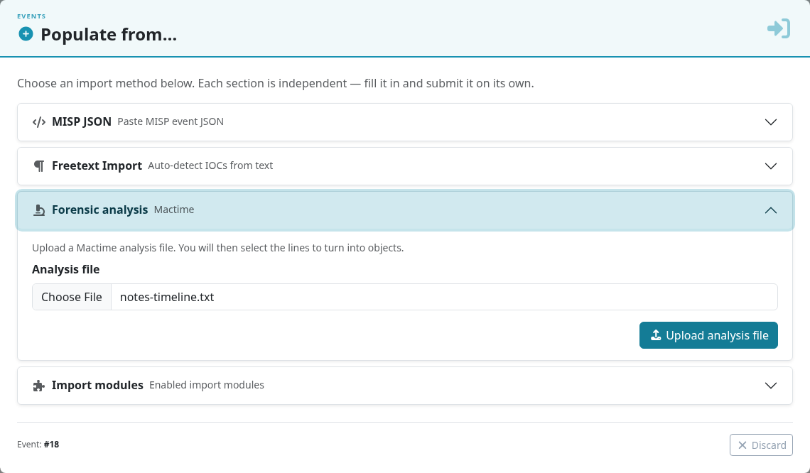

Review the three rows for `/case/notes.txt`, with activity **Modified**, **Changed** and **Accessed**, before selecting them and choosing **Create objects**.
The review's **Time accessed** column is a generic heading in this interface: use the **Activity** value to interpret each timestamp, including the metadata-change row.

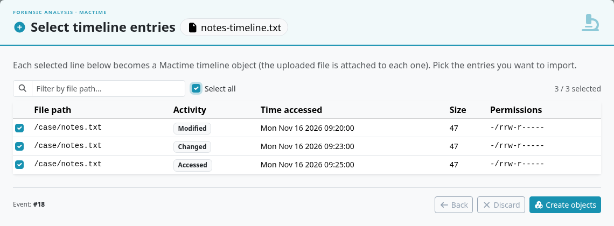

The core importer creates one `mactime-timeline-analysis` object per selected row.
In this example, the three objects contain **18 attributes** in total, with IDS disabled.
Each object retains the path, its activity and datetime, size, permissions, and the **complete uploaded timeline text** as an attachment.
Select the permitted file/time scope before uploading: checking fewer rows in this review does not remove unselected source lines from that attachment.
In the tested browser form, LF line endings became CRLF in the attached text, so the attachment is not byte-identical to the original `mactime` output.
Keep the original export and its hash in the evidence repository rather than substituting the imported attachment for it.
Correlation settings remain separate; this core path does not automatically disable them as some dedicated evidence modules do.

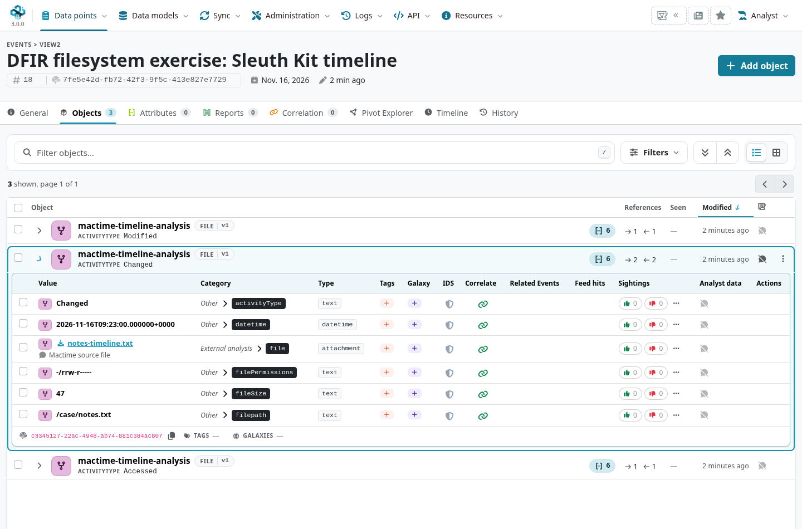

The importer links adjacent selected rows with `preceded-by` and `followed-by` references.
These links reflect the submitted row order, not independently established causal relationships.
Retain the image hash and case reference separately from the timeline attachment's hash, and record the timestamp interpretation in the event's report.

### Network and email investigations {#dfir-network-email}

Start with `zeek_import` or `suricata_import` for a selected sensor export, and use `pcap_import` when supported content reconstruction from a bounded capture answers the question.
Record the sensor, capture/run, producer version and time range.
Zeek UIDs, Suricata flow IDs, TCP/UDP streams and record ordinals have different scopes; matching identifiers alone do not merge records across captures.
Community ID comparison also requires compatible algorithm version, seed, tuple and time scope.

For phishing and business-email investigations, `email_import` extracts message context, attachments and optionally URLs or partial inline forwards.
Its extraction switches have separate semantics; retain the original message and inspect nested/forwarded content before making sender or attachment associations.
`dmarc_import` imports aggregate reports, which describe reported authentication results and counts over an interval, rather than individual authenticated message histories.
Use `email_security_check`, DNS and reputation lookups as additional context, keeping current configuration separate from historical evidence.

Other intake paths cover sandbox results and existing intelligence:

::: {.table-responsive}

| Task | Candidate modules |
|---|---|
| Import local sandbox output | `cuckooimport` (Cuckoo/CAPE JSON or supported archives), `joe_import`, `threatanalyzer_import`, `vmray_import`, `vmray_summary_json_import`. |
| Retrieve a sandbox report by identifier/link | `anyrun_sandbox_import`; `lastline_import` is legacy and carries an upstream deprecation notice. |
| Import text, documents or an IOC list | `csvimport`, `ocr`, `openiocimport`, `mispjson`, `url_import`. Review field mappings, extraction errors and any remote retrieval. |
| Import passive DNS or intelligence exchange | `cof2misp`, `taxii21`, `socradar_taxii_feed`. Preserve source provenance and assess imported intelligence against the case. |
| Mobile, location or financial context | `autopsy_import`, `gpx_import`, `geojson_import`, `nmea_import`, `kml_import`, `goamlimport`; see [geographic data](../geolocation/index.qmd). |
| Validate exposure/remediation hypotheses | `darkmoon_import` imports the producer's penetration-test findings; those findings are not incident evidence by themselves. |

:::

### PCAP case with DNS and HTTP {#dfir-pcap}

Start with a question that the supplied capture can answer: **did `192.0.2.10` request `/case/notice.txt` from `updates.example`, and which file bytes can be recovered?**
The [example PCAP](examples/pcap/download-example.pcap) is authored teaching data, generated without transmitting packets.
It contains **12 Ethernet/IPv4 packets**, two transport streams and one harmless HTTP response, using reserved example addresses and a `.example` domain.
Its timestamps were assigned explicitly, from **16 November 2026, 10:00:00.000000 to 10:00:01.900000 UTC**.
The [generator](examples/pcap/generate_capture.py) reproduces the capture byte-for-byte; [provenance](examples/pcap/provenance.json) records input/output hashes, tool versions and the live import checks.

#### Establish the packet evidence {#dfir-pcap-evidence}

On an analysis workstation with TShark installed, run these commands from the book root.
Use a fresh export directory for each analysis run so previous files do not mix with the recovered content.
The `-n` option disables name resolution, and `-r` reads the supplied capture rather than capturing live traffic.
This example was dissected with **TShark 4.4.19**.

```sh
mkdir -p work/dfir-pcap/http-files
sha256sum dfir/examples/pcap/download-example.pcap
tshark -n -r dfir/examples/pcap/download-example.pcap -q -z conv,udp -z conv,tcp
tshark -n -r dfir/examples/pcap/download-example.pcap \
  --export-objects http,work/dfir-pcap/http-files -q
sha256sum work/dfir-pcap/http-files/notice.txt
```

The capture is **1,185 bytes**, with SHA-256:

```text
8364adeccca609aa1e3d542aa1fc63da2fb9d518490c29518b46d8b2412104a3
```

The actual [packet summary](examples/pcap/packet-summary.txt) and [conversation statistics](examples/pcap/conversations.txt) provide the following evidence.
All times below are UTC on 16 November 2026.

::: {.table-responsive}

| Frame | Time | Observed packet content |
|---|---|---|
| 1 | 10:00:00.000000 | `192.0.2.10:49153` asks resolver `192.0.2.53:53` for an A record for `updates.example`. |
| 2 | 10:00:00.100000 | The DNS response contains A address `198.51.100.20`. |
| 3 | 10:00:01.000000 | The observed TCP handshake begins with a SYN from `192.0.2.10:49152` to `198.51.100.20:80`. |
| 6 | 10:00:01.300000 | The HTTP request is `GET /case/notice.txt`, with Host `updates.example` and User-Agent `MISP-DFIR-Example/1.0`. |
| 7 | 10:00:01.400000 | An HTTP `200 OK` response supplies the complete 49-byte text payload. |
| 12 | 10:00:01.900000 | The final observed TCP ACK follows connection teardown. |

:::

#### Import and review the capture {#dfir-pcap-import}

An administrator must enable `pcap_import` and install its dependencies on the **misp-modules service**, including TShark 4.0 or newer and the PyMISP helpers required by the handler.
See [Modules](../modules/index.qmd#modules-service) and the [PCAP import contract](https://github.com/MISP/misp-modules/blob/d7ec36544576f2523e320ce9200d0f18d12e11c7/documentation/import_mod/pcap_import.md).
The handler processes the supplied capture offline; it does not fetch the HTTP URL or resolve the domain.
Use a bounded capture that fits its 50 MiB input limit and the configured processing timeout.

Create an organization-only event for the packet question, then choose **Import → Pcap Import**, select `download-example.pcap` and choose **Run Pcap Import**.
These screenshots use the same pinned MISP `3.0_wip` revision as the preceding exercises, with a separate PCAP event that remains unpublished.

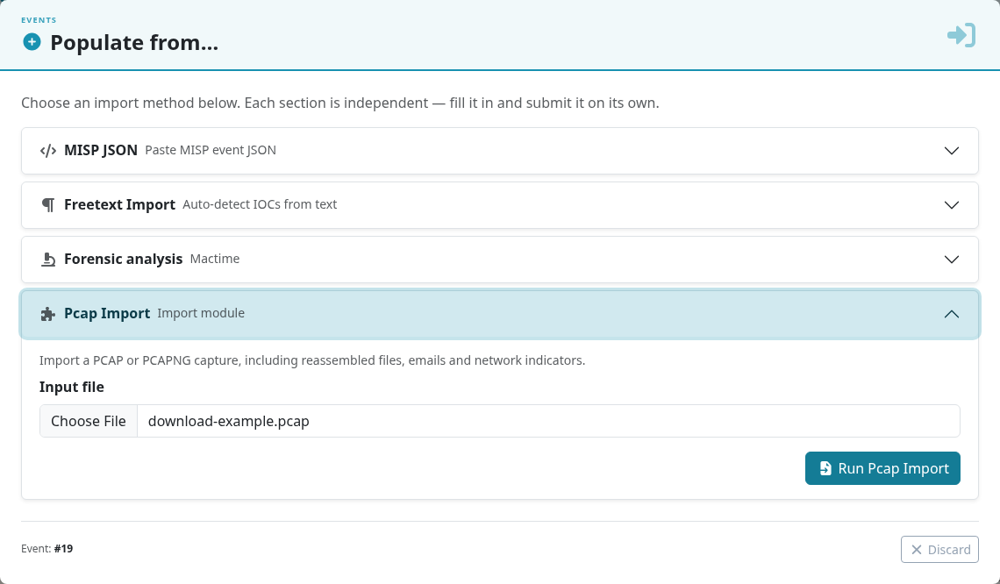

The real result contains **four objects**: one `pcap-metadata`, two `network-connection` objects and one reconstructed `file`.
It also proposes **ten standalone network attributes**; the review's total of **53 attributes** includes 43 inside the objects.
Review the audience, values, observation times, references and IDS flags before saving.
Network observations arrive with IDS off, but the reconstructed file has seven IDS flags enabled by its file template in this runtime.
Clear those flags for this context-only exercise, then choose **Import**; the saved example has IDS off on all 53 attributes.

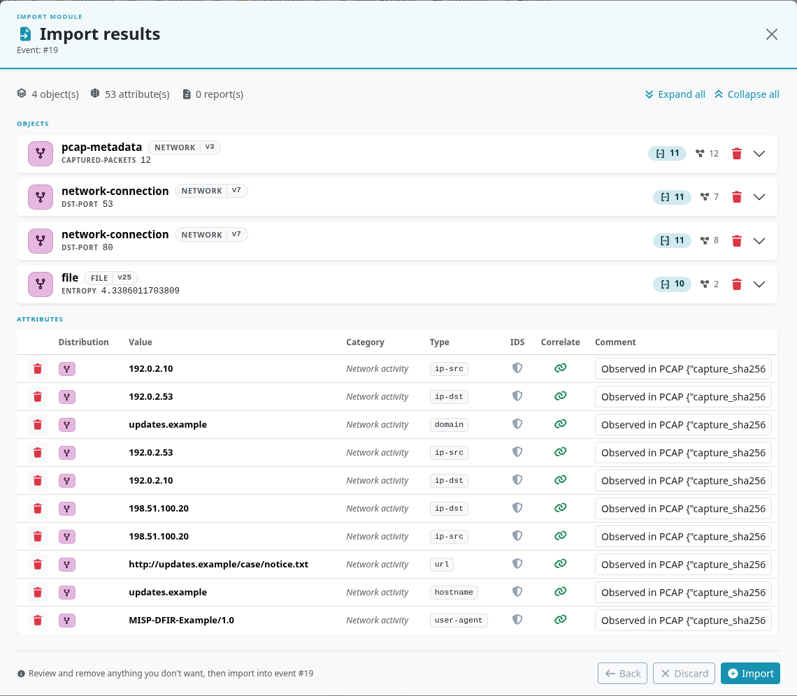

#### Analyze the connections and recovered content {#dfir-pcap-analysis}

First, inspect `pcap-metadata` and compare its SHA-256, 1,185-byte size, 12-packet count and first/last packet times with the original capture.
This object describes the uploaded bytes; the module does **not** attach the original PCAP again.
Retain that file in the evidence repository with the case reference.

Next, inspect the two connection objects.
The DNS flow is `192.0.2.10:49153 → 192.0.2.53:53`, while the HTTP flow is `192.0.2.10:49152 → 198.51.100.20:80`.
The DNS answer address is an observation within the DNS exchange, not the DNS flow's destination endpoint.
Both are stream **0** within their own transport: identify a stream by **capture hash, transport and stream index**, not by the index alone.

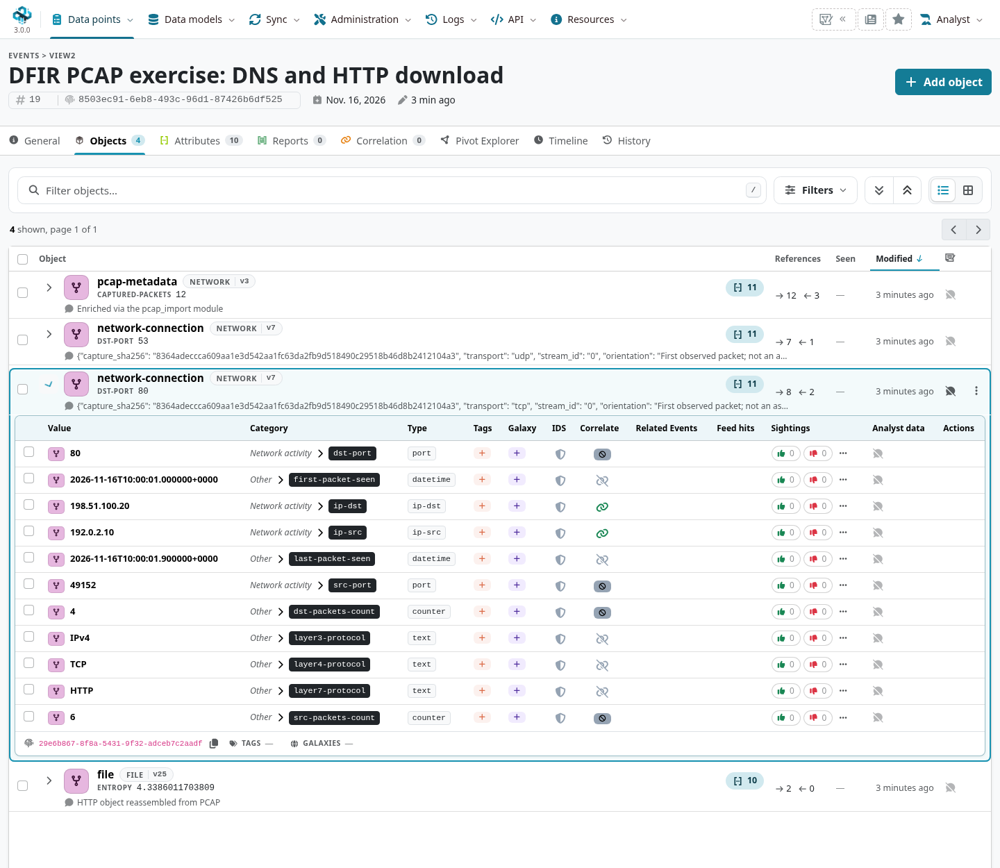

The HTTP connection spans **10:00:01.000000–10:00:01.900000**, with six source-direction and four reverse-direction packets.
The module orients endpoints by the first observed packet; the visible SYN and subsequent HTTP request support the client role in this particular capture.
A capture beginning midstream would need additional evidence before making that inference.
Event-level values are deduplicated, so a value's first/last-seen interval can span several packets or flows; use the connection objects for flow-specific bounds.

Finally, inspect the reconstructed `notice.txt` object.
Its size is **49 bytes**, and its SHA-256 matches the [independently exported payload](examples/pcap/notice.txt):

```text
280b6cfbb18139c732a360926bb99beef5e8fdd5070f591d77972f92aa4f3516
```

The module matches the exact HTTP payload bytes to TCP stream 0 and completion frame **7**.
The file attributes' observation interval is therefore **10:00:01.400000** at both endpoints, rather than the entire connection's duration.
The file object links back to its capture metadata and connection with `derived-from` references.

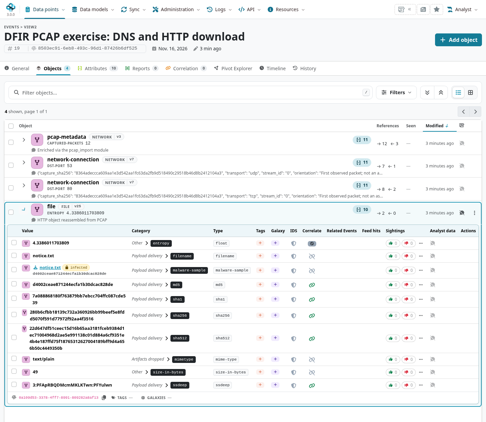

This file object uses MISP's `malware-sample` storage representation even though the payload is harmless teaching text.
The normal sample download is packaged as an encrypted ZIP; compare the hash of the unpacked 49-byte content, rather than the ZIP wrapper, with the recovered payload.
The live check unpacked that download and verified the bytes match `notice.txt` exactly.

At this core revision, the import review preserves reference targets and relationship types but omits the module's reference comments.
The [recorded module API result](examples/pcap/module-response.json), from a separate offline run of the same capture, retains the detailed frame/payload provenance before review.
Its generated UUIDs can differ from those in the saved event; compare capture hashes, transport/stream keys and payload hashes.
Keep that provenance with the original capture when detailed frame-level references are required, rather than assuming every module field survived the UI round trip.

The supported conclusion is that the synthetic client requested this URL and received the recovered bytes within the supplied packet window.
HTTP reassembly does not establish that the client wrote a file to disk.
The capture alone does not establish file execution, persistence, compromise or activity outside that window.
This case uses plaintext HTTP; the handler does not decrypt HTTPS traffic.
Record the assessment and next scoping question in the Event Report before promoting any selector to hunting or response content.

## Enrich a selector without losing its meaning {#dfir-enrichment}

Choose an enrichment module to answer a question about a selected hash, address, domain, URL, certificate or rule.
Record the provider, query time, queried value, returned source reference and relevant historical interval.
Preview results and check whether they support the incident's hypothesis before importing or promoting them.
The [pivoting use case](../pivoting/index.qmd) explains how to evaluate shared infrastructure and weak selectors.

::: {.table-responsive}

| Investigation question | Useful module examples | Interpretation and data flow |
|---|---|---|
| Is a file already known? | `hashlookup`, `hashdd`, `malwarebazaar`, `threatfox`, `virustotal`, `virustotal_public`, `google_threat_intelligence`, `mwdb_query`, `vmray_analyzer`, `reversinglabs_malware_presence`. | Usually a hash lookup to a configured service. Known-file membership, first submission and a vendor verdict have different meanings; a known hash is not a blanket clearance. |
| What does existing analysis say? | `anyrun_lookup`, `assemblyline_query`, `joesandbox_query`, `triage_query`, `hybrid_analysis`, `intezer`, `manalyze`, `reversinglabs_spectra_analyze`, `malpedia`, `eset_report`. | Check the specific handler: some retrieve reports, while others may obtain sample data or start analysis. Preserve analysis IDs and distinguish sandbox behavior from behavior observed on a victim. |
| What infrastructure was observed? | `circl_passivedns`, `farsight_passivedns`, `passivetotal`, `securitytrails`, `dnslytics`, `domaintools_iris_investigate`, `domaintools_iris_pivot`, `validin`, `hyasinsight`, `circl_passivessl`, `passive_ssh`. | Historical provider observations have collection limits and time windows. Shared addresses or certificates do not establish common control. |
| What resolves or is registered now? | `dns`, `dns_query`, `reversedns`, `url_dns`, `whois`, `rdap`, `domaintools`, `domaintools_iris_enrich`, `whoisfreaks`, `tls_certificate_check`, `ssh_fingerprint`. | Current resolution/registration or direct protocol queries can differ from incident-time observations. Direct connections may be visible to the queried infrastructure. |
| What exposure or background activity exists? | `censys_enrich`, `censys_enrichmentapis`, `shodan`, `shodan_internetdb`, `ivre`, `onyphe`, `onyphe_full`, `zoomeye`, `criminal_ip`, `greynoise`, `crowdsec`, `abuseipdb`, `dshield`, `bgpranking`, `team_cymru_scout`. | Reputation, scan and telemetry context helps prioritize leads; it does not establish local compromise or complete asset coverage. |
| Can I extract document or URL context? | `extract_url_components`, `docx_enrich`, `pdf_enrich`, `xlsx_enrich`, `pptx_enrich`, `odt_enrich`, `ods_enrich`, `ocr_enrich`, `qrcode`, `html_to_markdown`, `hygiene`, `bingraph`. | Inspect dependencies and effects. Parsing may be local, while some converters fetch URLs; extracted text and OCR require validation. |
| Does a page resemble known phishing? | `urlscan`, `lookyloo`, `lookyloo_capture`, `phishunt`, `urlhaus`, `google_safe_browsing`, `dnstwist`, `rst_favicon`, `rst_html`, `rst_screenshot`, `rst_ssl`, `webarchive`. | Existing-result lookup, generated variants and a fresh capture are different activities. A new capture may contact infrastructure; dnstwist candidates are hypotheses until observed. |
| Could a vulnerability explain initial access? | `cve`, `cve_advanced`, `vulnerability_lookup`, `vulners`, `vuldb`, `vulndb`, `cpe`, `gcve_cpe`, `first_epss`, `rapid7_attackerkb`, `cisco_psirt`, `qualys_cve`, `greynoise_vuln`. | Match affected products/versions and exposure to local evidence. CVE association, EPSS and exploit reporting do not prove exploitation on a host. |
| Can existing security platforms add context? | `crowdstrike_falcon`, `cortex_xdr_ioc_lookup`, `cortex_xsoar_indicator_lookup`, `n8n_data_table_lookup`, `shuffle_datastore_lookup`, `tines_record_lookup`, `torq_observable_lookup`, `opencti`, `yeti`, `flowintel`. | Read the configured platform's indicator or contextual records; these names do not imply raw EDR telemetry acquisition or automated remediation. |
| Is there ransomware, identity or transaction context? | `ransomlook`, `ransomcoindb`, `btc_scam_check`, `btc_steroids`, `sochain`, `hibp`, `xposedornot`, `osint_industries`, `phone_number_info`, `socialscan`. | Apply only when relevant to the case and permitted data use. Breach, extortion and account-presence reporting requires independent corroboration. |
| Where might infrastructure be located? | `geoip_city`, `geoip_country`, `geoip_asn`, `mmdb_lookup`, `ipinfo`, `ip2locationio`, `ipgeolocation`, `ipasn`, `ripestat`. | Network geolocation and ASN context do not locate a person or prove actor attribution. Check local-database versus remote-provider processing. |

:::

The complete inventory below includes additional providers and specialized utilities so that a case-specific integration is not overlooked.
Their presence in source is not a guarantee of provider availability, maintained APIs or compatibility with your deployed environment.

### Distinguish lookups from submissions {#dfir-submission}

Before invoking a handler, check whether it sends only the selector, downloads a sample, uploads bytes/tags, visits a URL or creates a remote job.
MISP distribution settings do not prevent a module from sending supplied data to its configured service.
Even a hash-only query can disclose investigative interest.

Modules with submission capabilities include `anyrun_sandbox_submit`, `assemblyline_submit`, `cape_sandbox`, `cuckoo_submit`, `joesandbox_submit`, `triage_submit`, `vmray_submit`, `lastline_submit`, `virustotal_upload`, `malshare_upload`, `mwdb`, `malwagon_submit`, `pandora_submit`, `mobsf`, `paloalto_wildfire`, `fortisandbox`, `sophoslabs_intelix` and `reversinglabs_spectra_intel_submission`.
This is a review queue, not a claim that every handler has the same submission contract.
For example, `mobsf` retrieves an existing static report for MD5 input but uploads/scans supplied application bytes; `cape_sandbox` gates sample submission behind `submit_samples`; `mwdb` can forward tags/comments and its `mwdb_public` default is true.
`virustotal_downloader` retrieves content rather than merely looking up a verdict.
Check the source, service configuration, provider sharing settings and permitted evidence handling before selecting these paths.

## Turn reviewed findings into hunts and response inputs {#dfir-hunting}

Keep unreviewed evidence in its original objects and derive a bounded hunting set from the findings you validated.
Choose selectors that can answer the scoping question and record why each was included, its validity interval and expected false positives.
IDS eligibility is one useful export filter; it is not an approval record or a universal rule shared by every exporter.


::: {.table-responsive}

| Output or integration | Modules | Operational check |
|---|---|---|
| Endpoint hunts | `osqueryexport`, `osquery_pack_publish`, `osquery_import`, `nexthinkexport`. | Inspect SQL, platform requirements and scan paths. Publishing an osquery pack does not distribute/reload it or execute queries; retain the `sources` map and collect results separately. |
| YARA, Sigma, EQL and STIX patterns | `yara_query`, `yara_syntax_validator`, `cccs_yara`, `sigma_syntax_validator`, `sigma_queries`, `rulezet_validator`, `eql`, `stix2_pattern`, `stix2_pattern_syntax_validator`; exports `yara_export`, `sigma_export`, `mass_eql_export`, `stix2_pattern_export`. | Validate syntax/metadata and test against representative data. A generated hash rule is a selector, not a behavioral detector; backend conversion does not guarantee equivalent semantics. |
| Network/SIEM detection exchange | `zeek_intel_export`, `splunk_export`, `elastic_ecs_export`, `cef_export`, `bpf_export`, `qradar_reference_set_export`, `wazuh_cdb_export`, `defender_endpoint_export`. | Review supported types, field mapping, filtering, expiry and target ingestion. A generated file has not been deployed or matched. |
| EDR/SIEM publication | `crowdstrike_ioc_publish`, `sentinelone_ioc_publish`, `cortex_xdr_ioc_publish`, `qradar_reference_set_publish`, `wazuh_cdb_publish`, `export_sentinel`. | Use explicit destination/scope and the handler's dry run when provided. Verify per-indicator outcomes and remote state; `export_sentinel` requires an existing MISP2Sentinel/MISP2Defender installation. |
| Network containment configuration | `cisco_acl_export`, `cisco_asa_export`, `cisco_firesight_manager_ACL_rule_export`, `fortios_export`, `junos_export`, `mikrotik_export`, `netfilter_export`, `owasp_crs_export`, `panos_export`, `pf_export`, `squid_export`. | Inspect generated syntax and expected impact before a separate deployment. Scope and expiry are especially important for shared or reassigned addresses. |
| Case creation and orchestration | `cortex_xsoar_incident_create`, `tines_case_create`, `torq_case_create`, `n8n_webhook`, `shuffle_workflow_execute`, `doppel_alert_takedown`. | These can create cases, execute workflows or request an external action. Check retries, duplicate creation and downstream behavior; takedown is a separate response decision. |
| Responder handoff | `matrix`, `mattermost`, `slack`, `signal`, `nextcloud_talk`, `irc`; `pdfexport`, `csv_export`, `liteexport`, `jinja_template_rendering`, `convert_markdown_to_pdf`. | Minimize transmitted content and check channel membership. A delivered message or PDF does not acknowledge containment or completion. |
| Timeline and intelligence exchange | `timesketch_export`, `threat_connect_export`, `threatStream_misp_export`, `virustotal_collections`, `vt_graph`. | Check destination audience and lossy field mappings. Repeated export/publication can create duplicate or stale records. |

:::

Track the destination receipt, owner and expiry of a deployed indicator.
A workflow trigger or successful request is not proof that every destination accepted the data or took the intended action.
Return the actual results and scope to the investigation, recording collection/execution time separately from import time.
Use [Sightings](../sightings/index.qmd) for appropriately supported observations, false-positive feedback or expiry; absence of a result supports a conclusion only within known search coverage.
See [Workflows](../workflows/index.qmd) for MISP workflow configuration and [False Positives](../false-positives/index.qmd) for review and correction.

## Apply the process to other investigations {#dfir-scenarios}

::: {.table-responsive}

| Scenario | Evidence and modules | Questions before a response |
|---|---|---|
| Suspected ransomware | Selected `evtx_findings_import`, `velociraptor_import`, `volatility3_import` results; hash/report lookups; `ransomlook` for public context. | Which hosts show observed execution, encryption or lateral movement? Are public extortion claims independently corroborated? |
| Phishing or business-email compromise | `email_import`, `dmarc_import`, `qrcode`, document parsers and approved URL/DNS/report lookups. | What is the original message provenance? Which recipients interacted, and what identity/audit logs support account misuse? |
| Memory-resident execution | `volatility3_import` with process/socket/malfind/YARA context, endpoint exports and reviewed YARA hunts. | Are findings from the same image and process lifetime? Do suspicious regions have corroborating execution evidence? |
| Network intrusion or suspected exfiltration | `zeek_import`, `suricata_import`, bounded `pcap_import`, historical DNS/TLS context and timeline exchange. | Is traffic direction established? Are capture gaps or encryption limiting visibility, and do timestamps align with endpoint evidence? |
| Mobile/device investigation | `autopsy_import` selected artifacts, `mobsf` for an authorized app-analysis path, and geographic importers where relevant. | Does the adapter preserve device/source identity and timestamp semantics? Does app presence establish execution or user action? |
| Cloud or SaaS incident | Selected audit exports mapped through `csvimport`/`mispjson`, compatible timeline imports and platform-context lookups. | Who collected the records, from which tenant/account and time window? Preserve immutable resource/session identifiers; do not assume a generic CSV importer performs cloud acquisition. |

:::

## Complete module inventory {#dfir-module-inventory}

The following inventory covers **330 production Python handlers** in the four module families at the reviewed misp-modules revision: 32 import, 240 expansion, 39 export and 19 action modules.
It excludes private/helper files, skeletons, `import_blueprint` and the three `test*` handlers.
It is deliberately broad: specialized financial, geographic, identity and reporting modules may support a particular investigation even when they are not forensic parsers.
Use the earlier process tables to select a path, then follow the handler link and check its contract and runtime availability.
Descriptions below are source-declared purposes, not a certification that a provider works or that every module is appropriate for a case.

Download the [machine-readable module inventory](reference/modules.csv), including declared inputs, requirements, configuration fields, source links and file hashes.
The [inventory provenance](reference/inventory.json) records the reviewed commit, scope and family counts.



## Related guidance and source contracts {#dfir-references}

- [Modules](../modules/index.qmd) for discovery, service configuration and differences between the MISP and module-service APIs.
- [MISP Objects](../misp-objects/index.qmd), [Categories and Types](../categories-and-types/index.qmd) and [Correlation](../correlation/index.qmd) for representation and comparison.
- [Value Intelligence](../value-intelligence/index.qmd) and [Pivoting](../pivoting/index.qmd) for contextual analysis of selected values.
- [Automation](../automation/index.qmd) and [PyMISP](../pymisp/index.qmd) for repeatable integrations.
- [The reviewed module documentation](https://github.com/MISP/misp-modules/tree/d7ec36544576f2523e320ce9200d0f18d12e11c7/documentation) for importer selection, timestamp handling, limits, external effects and output contracts.

The editable Mermaid sources are [the DFIR lifecycle](figures/dfir-lifecycle.mmd), [timeline exchange](figures/dfir-timeline.mmd) and [the hunting feedback loop](figures/dfir-hunt-loop.mmd).
Their committed SVGs use the book's shared theme for HTML, PDF and EPUB.
