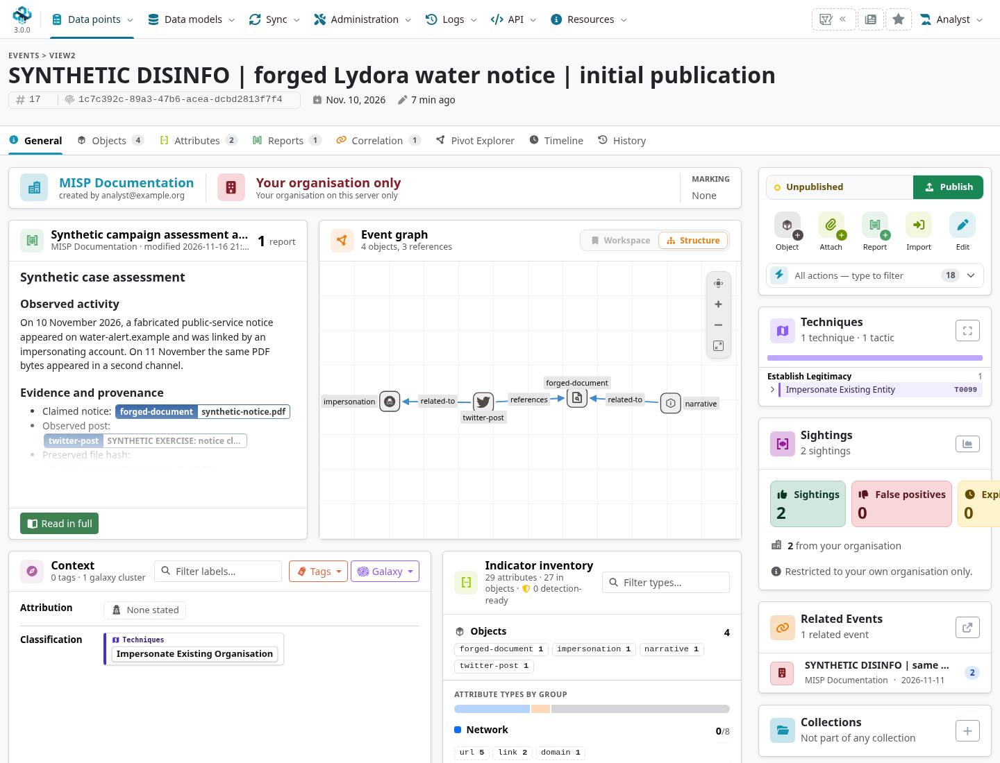
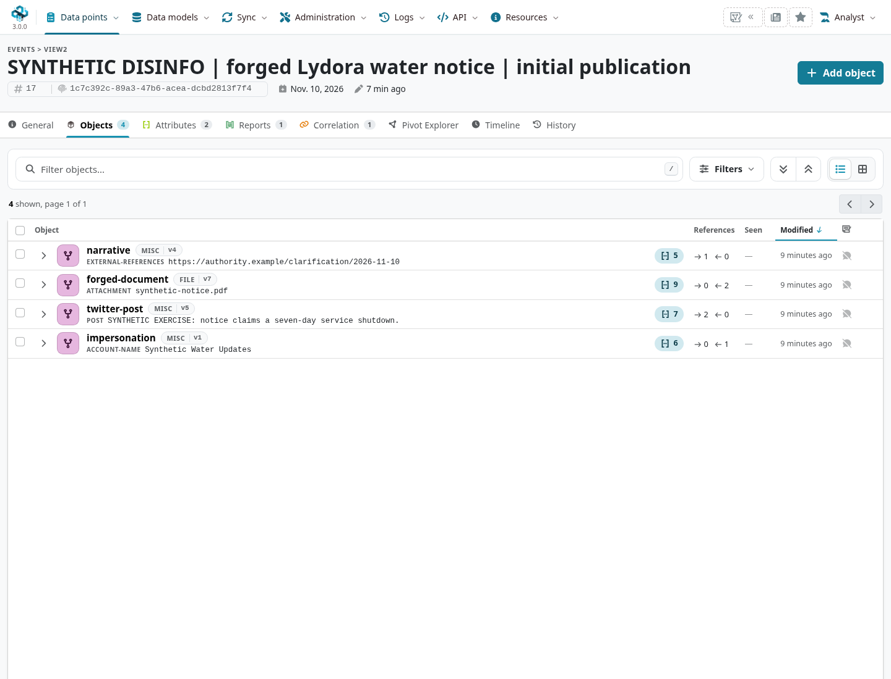
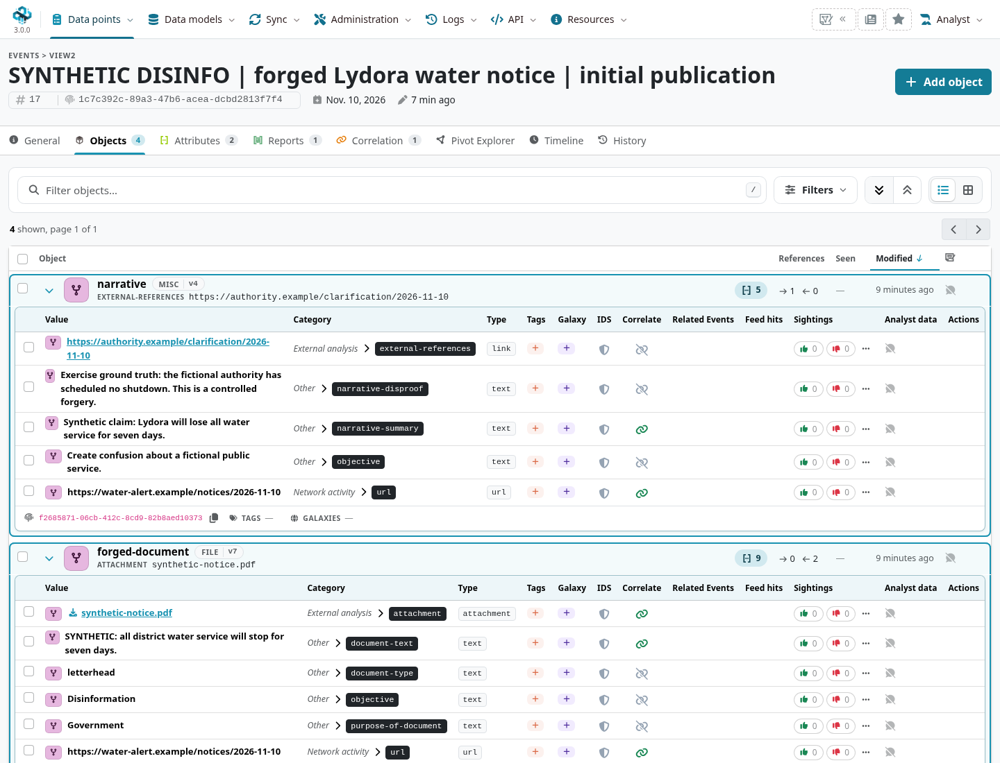
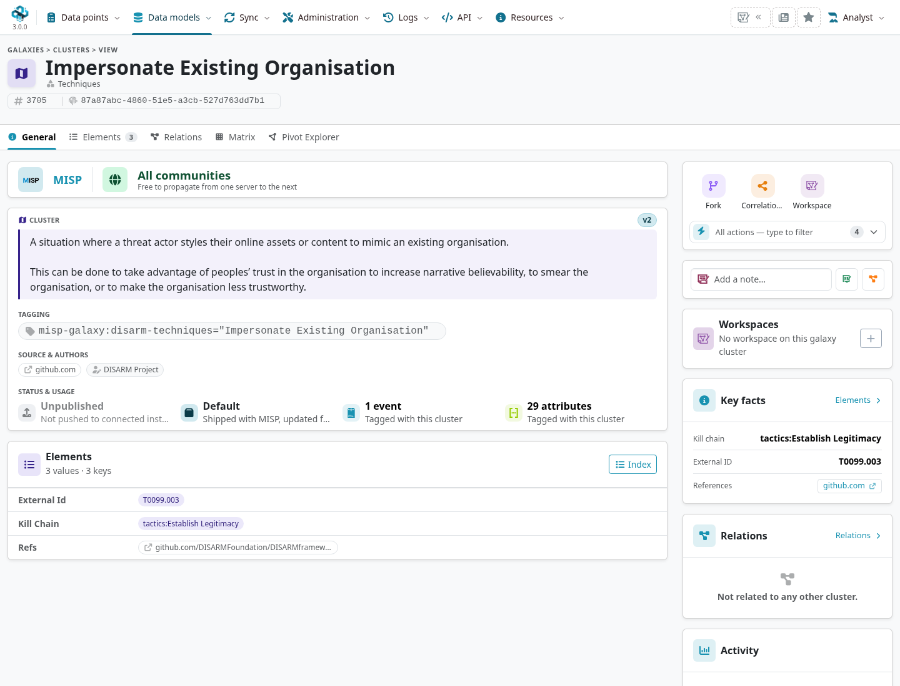
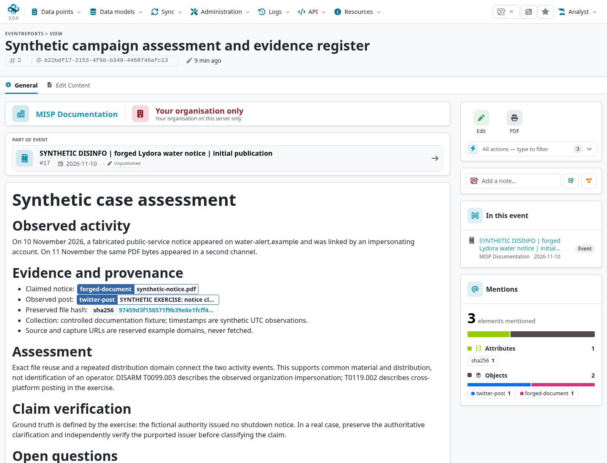
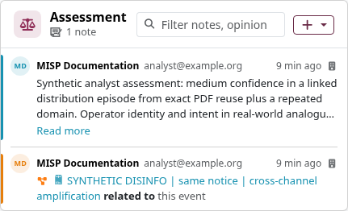
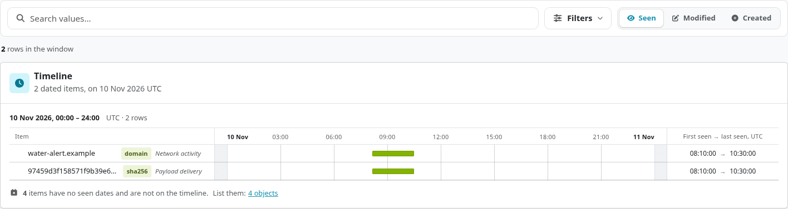
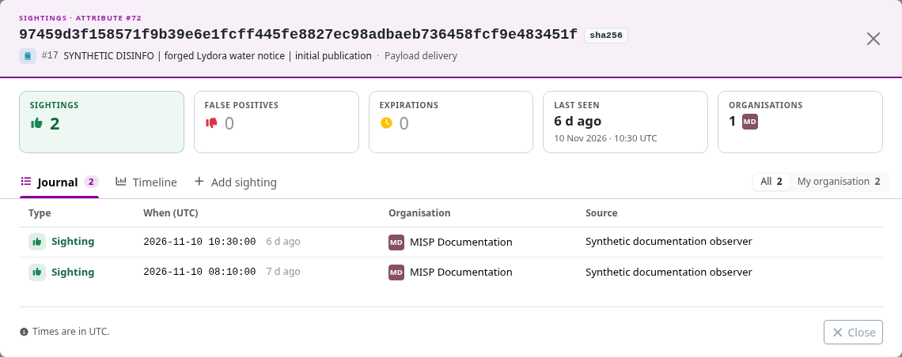
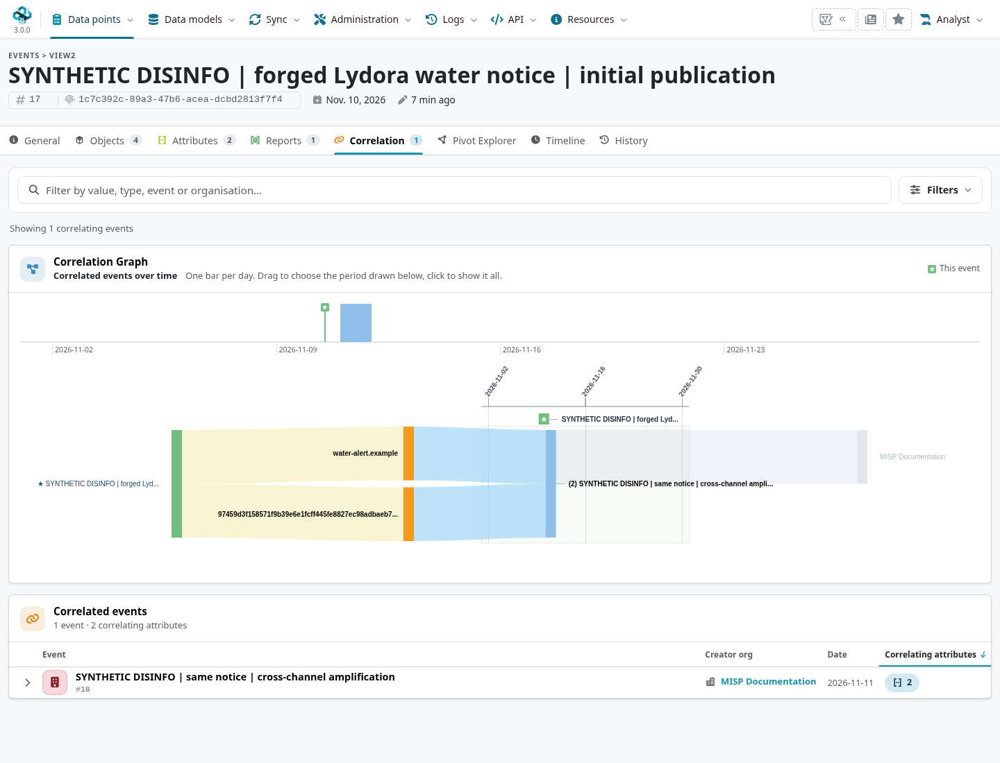

MISP can document suspected disinformation activities, connect repeated evidence across reports, and share an assessment with its supporting observations.
Use it to answer practical questions: where did a claim appear, which accounts and websites distributed it, what material was reused, and what evidence supports treating separate activities as one campaign?
Keep the observed content, the verification of a claim, and the assessment of coordination or intent distinguishable throughout the investigation.

This use case follows a **synthetic forged public-service notice** from initial publication to cross-channel amplification.
It combines existing object templates, DISARM galaxy clusters, Event Reports, Analyst Data, sightings, and native correlation with selected enrichment modules.
MISP provides the evidence and collaboration layer; collection access, claim verification, and campaign attribution still require an analyst or an external analytical process.

::: {.callout-note}
Screenshots use **MISP 3.0.0**, `3.0_wip` commit [`99ebee729`](https://github.com/MISP/MISP/tree/99ebee729702c560528f9788953719bda68aa1c1), in light mode, with a site administrator in an isolated documentation instance.
All campaign names, domains, accounts, documents, and observation times are synthetic; events remain organization-only and unpublished.
Module contracts were reviewed on **November 16, 2026**, against [misp-modules `34821068`](https://github.com/MISP/misp-modules/tree/34821068f6dc2e3259b92ede81568bf766dc9091), a source snapshot whose modules may be newer than an installed release.
The offline text-fingerprint example was executed separately; provider integrations were source-reviewed without making provider queries.
Select a screenshot to enlarge it.
:::

<!-- Source pins, module review, fixture checks and capture hashes: ../assets/disinformation-reference.json -->

## Investigation scenario {#disinfo-scenario}

A notice using the branding of the fictional Lydora Water Authority claims that water service will stop for seven days.
An account links to the notice on `water-alert.example` on November 10, 2026.
On November 11, a second channel redistributes the same PDF and a mirror article links to the original website.
A separate discussion concerns water service but shares no document, distribution domain, or account identifier with the notice.

The investigator needs to preserve the notice, record the impersonation and distribution sequence, and determine whether the later report belongs with the first activity.
The exercise defines the notice as a forgery; a real investigation would need evidence from the purported issuer and other independent sources before reaching that conclusion.
An incorrect claim, a repeated topic, or an unpopular opinion alone does not establish deliberate deception.

Use **one event per bounded activity or reporting episode**, rather than putting every mention of a topic into one growing event.
For a longer investigation, maintain a campaign assessment in an Event Report and use authored relationships or a collection to organize the activity events.
Give each event a stable case reference, a meaningful title, an observation period, and a review status.
This is an investigation convention, not a required MISP campaign schema.

::: {.table-responsive}

| Event | Evidence | Expected result |
|---|---|---|
| Initial publication | Narrative, forged notice, observed post, impersonation, distribution domain, PDF SHA-256 | Establish the first documented episode. |
| Cross-channel amplification | The identical PDF SHA-256, original distribution domain, mirror URL, message permalink | Correlate with the first event through eligible shared values. |
| Unrelated discussion | A different domain and a text description of the same broad topic | Remain separate unless new linking evidence appears. |

:::

## Model claims, sources, and evidence {#disinfo-model}

Create the initial event with **Your organisation only** distribution while evidence is being reviewed.
Set the event's date for the reporting episode, and record precise observation times on the relevant attributes or objects.
Preserve platform publication dates and document dates in their own fields.
Use **Objects** to add structured entities and **Attach** to preserve supporting files.
Use the latest definitions for these observations. [MISP object catalogue](../misp-objects/index.qmd#objects-maintenance).

::: {.table-responsive}

| Template | Use in the investigation |
|---|---|
| `narrative` | Record the claim in `narrative-summary`, the assessed objective, source URLs, archives, external references, and a documented `narrative-disproof` where supported. |
| `forged-document` | Preserve the purported notice, its text, document type, objective, source URL, and first/last observed availability. |
| `impersonation` | Distinguish the observed account from the entity it purports to represent, with both account URLs and the suspected objective. |
| `twitter-post`, `facebook-post` | Record platform post IDs, text, account identifiers, source links, media, and supported metadata. The `twitter-post` template name also appears in X-related workflows. |
| `telegram-account`, `user-account` | Describe an observed account. A Telegram account is not a Telegram message; preserve message identifiers, permalinks, and content separately. |
| `page-capture`, `image`, `ocrized-image` | Keep captured page content or imagery and any extracted text with its source and collection context. OCR module output does not automatically instantiate an `ocrized-image` object. |
| `domain-ip`, `url`, `whois`, `x509` | Describe distribution infrastructure and enrichment results with the dates and source of the observation. |

:::

Use the real platform's template for collected data, when available.
The illustrated `twitter-post` uses reserved `social.example` URLs to keep the example shareable.
Templates are storage models; their presence does not provide access to platform APIs or collect posts automatically.

Add object references within an event to connect the post, document, and impersonation observation.
Use an authored Analyst Data **Relationship** for a supported link between separate activity events.
These complement native value correlation: a reference records a relationship you assert; correlation exposes matching evidence for review.
See [MISP Objects](../misp-objects/index.qmd) and [Analyst Data](../analyst-data/index.qmd) for the different relationship mechanisms.

Expand an object to inspect its source references, assessment fields, individual values, and correlation controls.
The narrative's summary and disproof are separate properties, allowing an analyst to preserve the claim while documenting the verification result.

For each collected item, retain the original URL or platform ID, publication time if known, collection time and timezone, collector/source, original bytes or an archive reference, and an integrity hash.
Document edits, deletions, translations, OCR, and other transformations without replacing the original evidence.
A screenshot preserves a rendered view; the source file, page capture, and acquisition notes provide additional context that the image alone cannot establish.
Where a template lacks a suitable field, use an attachment and a linked report or note rather than inventing an undocumented relation.

## Classify observed behavior {#disinfo-classification}

Attach techniques from the [DISARM Techniques galaxy](https://misp-galaxy.org/disarm-techniques/) that the evidence supports.
The exercise uses **T0099.003 — Impersonate Existing Organisation** for the forged-authority episode and **T0119.002 — Post across Platform** for the later distribution activity.
Choose clusters through the galaxy picker and verify their external IDs and descriptions.
Keep their UUIDs and framework version in exchanged analytical records; a technique label alone is a weak identifier across revisions.

The [DFRLab Dichotomies of Disinformation taxonomy](https://github.com/MISP/misp-taxonomies/blob/3bb56dbbf54131f4305dfff30dc6c00a622a673f/DFRLab-dichotomies-of-disinformation/machinetag.json) offers additional descriptions of methods and narrative techniques.
Use the vocabulary your community has agreed to apply and record the rationale for each material classification.
Treat older AMITT classifications as a versioned vocabulary when importing historical records, rather than silently equating their identifiers with current DISARM entries.

Record confidence and source reliability separately from behavior labels.
Event threat level and analysis stage are not a truth rating for a claim.
Handling tags such as TLP communicate sharing expectations; configure distribution and sharing groups to control visibility.
See [Taxonomies](../taxonomy/index.qmd) and [Galaxies](../galaxy/index.qmd).

## Write an assessment linked to the evidence {#disinfo-reporting}

In **Reports**, create an Event Report that explains the claim, chronology, verification, relationships, and open questions.
Use live references such as `@[object](UUID)` and `@[attribute](UUID)` to connect statements to the stored evidence.
The report should make clear which statements are observations, which come from a source, and which are analyst judgments.
Keep competing explanations and the evidence that would change the assessment visible.

For this exercise, the assessment says that exact PDF reuse and a repeated distribution domain support a linked distribution episode.
It leaves the operator's identity and the extent of coordination unresolved.
In a real case, add the purported issuer's response, verification sources, and the reasoning supporting any inference of intentional deception.
Several reposts of the same original item are not several independent confirmations.

Use an Analyst Data **Note** for a dated, attributable assessment or caveat.
An **Opinion** can record agreement with an assessment, with a justification; its numeric value is not a calibrated probability that content is false.
Give notes, opinions, relationships, reports, and attachments appropriate distribution as well as reviewing the event's audience.

## Track observations over time {#disinfo-tracking}

Record separate publication and collection times where known, and update an observation's `first_seen` and `last_seen` as evidence changes.
Open **Timeline** to inspect those observation windows.
For placement in this view, populate the attribute or object's seen metadata; a template property named `first-seen` is a separate stored datetime value.
The event Correlation view also has a timeline, but its event dates serve a different purpose from precise attribute observation times.
See [Correlation](../correlation/index.qmd#correlation-investigate).

Add a positive **sighting** when a tracked attribute is observed again, including the observation time and source.
In this example, two sightings record observations of the preserved PDF hash.
A sighting counts an observation of that value; it does not establish that an audience believed the claim or that every use of the value was malicious.
The false-positive sighting type concerns an indicator assessment, not whether a narrative is factually false.
Use a report or note for a correction to a claim assessment.

Keep reach, views, repost counts, and audience estimates as source-attributed measurements with collection dates and platform definitions.
Do not substitute MISP event totals or sighting counts for platform reach, unique people, or measured impact.
See [Sightings](../sightings/index.qmd).

## Correlate the next activity with the first {#disinfo-correlation}

Create the amplification event and add the SHA-256 of the actual preserved PDF and the original distribution domain.
Keep post URLs and account IDs in their platform context; a shared handle on two services does not establish a shared operator.
Leave `to_ids=false` for contextual evidence unless you have a specific, reviewed detection use.
The IDS flag is independent of whether an attribute can correlate.

Open **Correlation** on the initial event and inspect the related event and its matching values.
The example produces two distinct pivots to the amplification episode: `water-alert.example` and the PDF's SHA-256.
The unrelated discussion remains outside this relationship because it has no shared eligible value.
Native correlation uses eligible stored values and supported matching rules; it does not infer semantic agreement between two narrative summaries.
Template correlation flags, attribute types, exclusions, engine settings, and visibility can affect the result.

Expand the matching event, inspect the preserved evidence, and record what the match means.
An exact document hash establishes identical bytes; a shared hosting IP or a widely reused graphic provides much weaker evidence of common control.
Check common hosting, syndication, quotations, debunking articles, and legitimate reporting before treating the relationship as coordinated activity.
Use [warninglists](../warninglists/index.qmd), scoped filtering, and carefully justified exclusions to manage noisy infrastructure.

## Choose enrichment modules for this workflow {#disinfo-modules}

Start with the [module catalogue](https://misp-project.org/modules/) and the identifiers below, then verify availability with `GET /modules` on the **running module service**.
A source file in upstream does not mean that it loaded or that your organization can use it.
Install its dependencies, enable it in MISP, configure required accounts, and inspect the result on a synthetic item before applying it to case evidence.
The [Modules chapter](../modules/index.qmd#modules-configuration) covers configuration and review of enrichment results.

### Preserve and extract content

The following modules were reviewed in the [pinned expansion-module source](https://github.com/MISP/misp-modules/tree/34821068f6dc2e3259b92ede81568bf766dc9091/misp_modules/modules/expansion).
They support evidence preparation; none decides whether a statement is true.

::: {.table-responsive}

| Module identifier | Useful result | Requirements and limits |
|---|---|---|
| `extract_url_components` | Parse a URL into a structured `url` object for domain and path pivots. | Local parser using PyMISP's URL support; does not visit the page or establish ownership. |
| `import_external_reference` | Fetch a public reference into a `page-capture` object; HTML becomes Markdown and a PDF is retained as an attachment. | Public HTTP(S), ports 80/443; bounded retrieval. No browser rendering, login session, or visual screenshot. |
| `html_to_markdown` | Convert fetched HTML to text for reading and further analysis. | Network fetch and Markdown conversion dependencies; does not preserve the full original page or its rendered appearance. |
| `pdf_enrich` | Extract text from an attached PDF for the freetext importer. | `pdftotext` and supporting dependencies; scanned pages need OCR, and extracted indicators need review. |
| `ocr_enrich` | Read text from an image attachment and pass it to freetext parsing. | OpenCV, NumPy, pytesseract, and the Tesseract runtime/language data; recognition errors can alter names and URLs. |
| `content_fingerprint` | Generate exact and approximate fingerprints, with optional pairwise comparison evidence. | Local text processing; image/video require FFmpeg and ffprobe ≥5. Load the current `content-fingerprint` template in MISP. Similarity requires interpretation. |

: Content preservation and extraction modules {tbl-colwidths="[40,28,32]"}

:::

The separate [`ocr` import module](https://github.com/MISP/misp-modules/blob/34821068f6dc2e3259b92ede81568bf766dc9091/misp_modules/modules/import_mod/ocr.py) accepts a file rather than an existing attachment enrichment request.
It requires Pillow, Wand/ImageMagick, pytesseract, and their runtimes; PDF rasterization also depends on the installed conversion policy and delegates.
Prefer a small, bounded input and verify the recognized text against the preserved image.

### Investigate distribution infrastructure

::: {.table-responsive}

| Module identifier | Useful result | Requirements and limits |
|---|---|---|
| `lookyloo` | Find existing captures by URL, hostname/domain, IP, SHA-512 resource/favicon hash, or capture UUID; optionally retrieve details. | A reachable Lookyloo instance, optional API key, and its object template. These lookup paths do not submit a new capture. |
| `lookyloo_capture` | Retrieve an existing capture's resources, redirects, hashes, and context, with screenshot/export links. | Capture UUID or capture link, Lookyloo configuration, and template. Capture a new page separately when needed. |
| `urlscan` | Submit a scan and retrieve linked infrastructure and screenshot context. | Requires `apikey`. Despite the lookup label, this source submits to `/api/v1/scan/` and sets no explicit visibility; check provider defaults before disclosing a target. |
| `rst_screenshot` | Return a rendered page screenshot as an `image` object linked to the target. | RST Cloud API key and `rstapi` ≥1.2.0. Sends the target to an external scanning service. |
| `rdap` | Obtain structured registration context in a `whois` object. | Queries public RDAP services without an API key; redaction, missing coverage, and registered-domain scope limit inference about control. |
| `whois` | Return raw registration text for freetext extraction where useful. | Configured local `uwhoisd` server and port. RDAP is a simpler structured option where coverage is available. |
| `circl_passivedns` | Retrieve historical domain/IP observations as passive-DNS objects. | CIRCL account and `pypdns`. Dates describe provider observations, not continuous exclusive hosting or ownership. |
| `circl_passivessl` | Retrieve certificates observed on an IP as `x509` objects. | CIRCL account and `pypssl`. Shared certificates or hosting do not identify an operator by themselves. |
| `socialscan` | Check username/email availability on supported platforms; successful occupied results can produce account context. | `socialscan` dependency; advertised as hover. Availability checks do not authenticate an identity, collect a post history, or prove cross-platform account ownership. |

: Distribution infrastructure modules {tbl-colwidths="[40,28,32]"}

:::

The contracts above are in the [same pinned source snapshot](https://github.com/MISP/misp-modules/tree/34821068f6dc2e3259b92ede81568bf766dc9091/misp_modules/modules/expansion).
Distinguish lookups from submissions, and inspect per-module behavior rather than assuming every expansion module is read-only.
For a fresh browser capture, a separate Lookyloo collection workflow can preserve a page before its existing capture is enriched in MISP.

### Compare reused or lightly edited content

The [current `content_fingerprint` documentation](https://github.com/MISP/misp-modules/blob/34821068f6dc2e3259b92ede81568bf766dc9091/documentation/expansion/content_fingerprint.md) describes local exact hashing, normalized text hashing, word-shingle SimHash, and perceptual image/video-frame hashes.
Supply a `text` attribute or an attachment, with its UUID, and optionally a second complete attribute as `reference`.
For HTML articles, extract the relevant text first; for images containing words, preserve the image and review OCR separately.

An executed synthetic article comparison changed “seven days” to “eight days.”
The original-byte hashes differed; the module returned SimHash distance **4**, shingle Jaccard similarity **0.8901**, and `similar=true` under its documented heuristic.
That is a candidate reuse relationship, not proof of authorship or intent.
An unrelated text comparison returned `similar=false`.

The module returns `content-fingerprint` objects and, for a pair, an `annotation` containing comparison evidence.
MISP can correlate equal fingerprint keys; ordinary correlation does **not** calculate distances between unequal SimHashes or perceptual hashes.
Use explicit pairwise comparison or an external candidate-search process for approximate matching.
Preserve algorithm/decoder versions, parameters, and coverage limits with the result.
Heavy image edits, short text, translations, and unsampled video segments need other methods and analyst review.

### Plan the remaining integrations

Use an authorized collection process or platform API to supply posts, message permalinks, timestamps, and media through PyMISP or a reviewed import path.
Choose a custom object template when required platform fields cannot be represented faithfully by existing models.
Large-scale multilingual narrative clustering, semantic similarity, coordination analysis, audience measurement, and media-authenticity assessment need an external pipeline or specialist tooling; these reviewed modules do not provide those functions end to end.
Return derived findings to MISP with their source evidence, method/version, collection period, and uncertainty.

For automation, begin with a review task when new evidence matches a tracked value or a relevant source arrives.
Configured [workflows](../workflows/index.qmd) can route enrichment or notifications; the analyst should review new campaign membership and attribution.
Native MISP JSON is the starting point for sharing MISP-specific structure; check which fields survive any STIX or flat-table export.
See [Automation](../automation/index.qmd) and [PyMISP](../pymisp/index.qmd).

## Review and share an update {#disinfo-sharing}

Before publishing, verify that the saved objects, report, markings, and authored relationships agree on the evidence and audience.
Use a sharing group for the intended partner community, and verify attribute, object, report, attachment, and Analyst Data visibility within that scope.
Publication makes reviewed data eligible for configured sharing; it does not override distribution or guarantee delivery.
See [Sharing and Synchronisation](../sharing/index.qmd) and [Using the System](../using-the-system/index.qmd).

For each update, report the new activity, its evidence links, observation interval, supported techniques, confidence and rationale, and what remains unresolved.
Track investigation quality through the proportion of records with provenance, review time, and the number of proposed links that survive analyst review.
Keep reach and impact measurements tied to their external sources.
When evidence changes, revise the assessment and retain the correction's date and rationale so partners can distinguish current judgments from earlier hypotheses.
