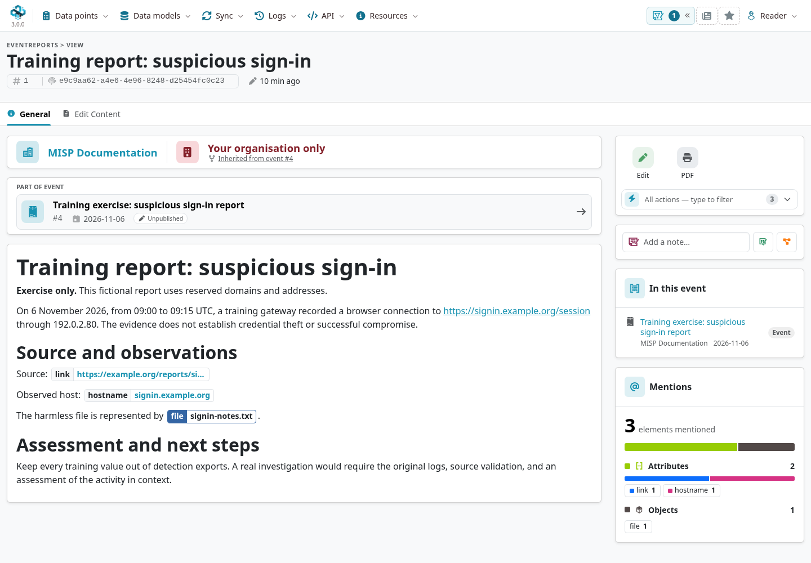
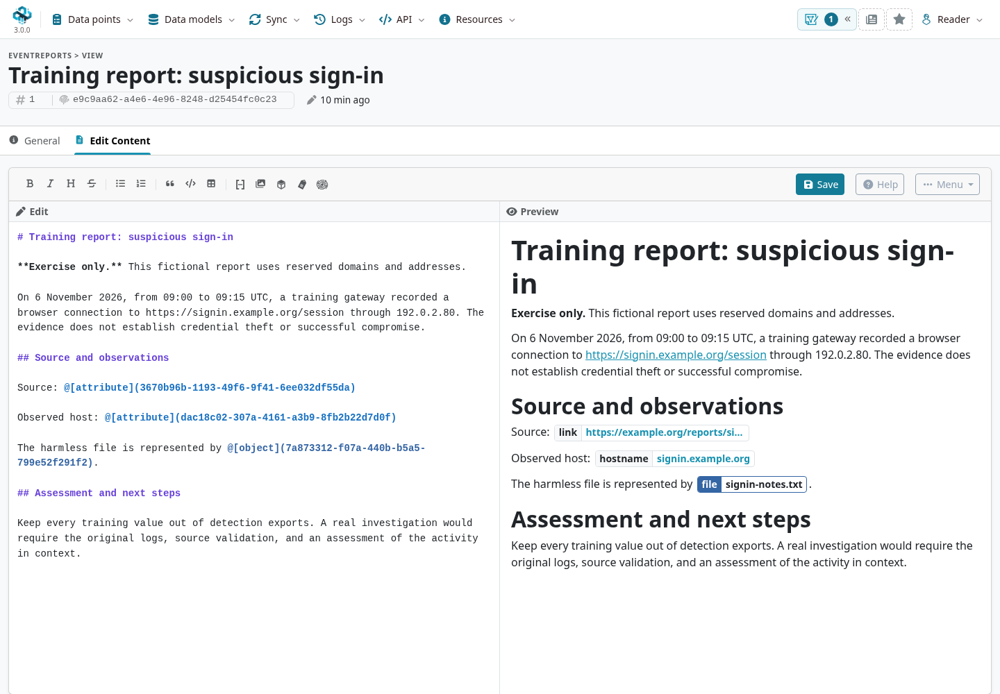

An **Event Report** keeps the narrative of an investigation alongside its structured evidence.
Use it to explain the source, observations, assessment, limitations, and next steps, with live references to the event's attributes and objects.
A report belongs to one event and has its own UUID, name, Markdown content, and distribution.

::: {.callout-note}
This chapter describes the [`3.0_wip`](https://github.com/MISP/MISP/tree/3.0_wip) development branch in light mode.
The MISP 3.0 report page has **General** and **Edit Content** tabs.
For a guided exercise starting from an external source, see [Create an Event Based on a Report](../create-event-report/index.qmd).
Select a screenshot to enlarge it.
:::

<!-- Capture source, fixture and image hashes: ../assets/using-misp-screenshots.json -->

## Writing a report

Start with a short summary, then separate what was observed from what you infer.
Record the source, relevant time window, confidence, and what the recipient should do next.
Use headings and lists to make the report readable, and avoid copying raw indicator lists when a reference will preserve their context.

The **General** tab displays the rendered narrative, parent event, audience, and referenced elements.
Use **Edit** for report metadata, or **Edit Content** for the Markdown source and preview.
The latter offers formatting controls, element insertion, **Save**, **Help**, and **Menu**.
Save explicitly and review the rendered result before leaving the page.

### Referencing MISP elements inline

Use the editor's element controls to insert references rather than copying identifiers manually.
Supported reference syntax includes:

::: {.table-responsive}

| Syntax | Purpose |
|---|---|
| `@[attribute](UUID)` | Display and link an attribute. |
| `@[object](UUID)` | Display and link an object. |
| `@[tag](TAG_NAME)` | Reference a tag by name, such as `@[tag](tlp:green)`. |
| `@[galaxymatrix](UUID)` | Embed the supported galaxy/ATT&CK matrix. |
| `@` | Display a picture held by an attachment attribute. |
| `{{variable_name}}` | Expand a configured template variable. |

:::

References resolve against data available to the reader, including supported references in an [extended-event](../extended-events/index.qmd) context.
A reference does not grant access to restricted source material.
If you paste a raw value or a restricted detail into the prose, it becomes part of the report's own content: review the report's audience separately.

## Creating a report

Open an event and use **Report**, **Write a report**, or the controls in its **Reports** tab.
Enter a descriptive name, choose distribution, write the initial content, and save with **Add Report**.
Use **Inherit event** when the report has the same audience as its event.

Other creation tools can generate a report from event data or import one from a URL, depending on permissions and configuration.
Their availability is separate from ordinary Markdown editing.

### Import from URL

Where enabled, MISP fetches the source URL on the server and converts the supported content to Markdown.
HTML can be converted directly; document formats can require corresponding [misp-modules](../modules/index.qmd).
The `Security.eventreport_enable_arbitrary_urls` setting controls arbitrary URL imports.

Check that the source can be retrieved and copied under your sharing agreement.
Preserve attribution, review converted content for errors, and inspect the report's distribution before sharing it.
Enabling this feature allows server-side fetching; administrators should configure it for their intended users and network environment.

### Generate report from Event

The generation tool builds a narrative from selected event data.
Options can include metadata, correlations, an ATT&CK matrix, and either live element references or raw values.
Use it as a draft: add the reasoning and limitations that a list of event fields cannot explain.
Review which fields and restricted context are included before distributing the result.

## Extracting indicators from a report

MISP can detect candidate indicators in report text and connect narrative to structured evidence.
Depending on the tool and view, it can suggest existing attribute references, propose new attributes, or run a bulk **Extract all IoCs** operation.
Extraction can also identify contextual tags and galaxy clusters.

Review the detected type, category, value, provenance, distribution, and IDS eligibility.
A textual mention may describe benign infrastructure, a source URL, or an example rather than a detection indicator.
Bulk extraction can create attributes and rewrite references in the report; save the intended source text and inspect the outcome.
For a step-by-step review of mixed values, see the [freetext exercise](../create-event-report/index.qmd#freetext-import-tool).

## Template variables

**Event Report Template Variables** provide named snippets such as a standard banner or an organization logo.
Use `{{variable_name}}` in the Markdown to request the configured expansion.
Administrators maintain the available definitions; the editor's **Menu** includes a template-variable configuration entry where permitted.

Check the rendered and exported report after using a variable, especially when the report will be read on another instance.
An event template used to create structured data is a separate feature from these report snippets.

## Exporting a report

The editor's **Menu** offers downloads where available:

- **PDF via print** uses browser printing; the report's action card also offers this route.
- **PDF via misp-module** requires the configured `convert_markdown_to_pdf` module. A disabled entry indicates that the module is unavailable.
- **Markdown** downloads the source, including MISP-specific reference syntax.
- **GFM simplified** replaces custom syntax with ordinary Markdown representations for use outside MISP.

Review the exported file before handing it over.
A raw UUID reference in Markdown will not resolve in an unrelated editor, and a download containing expanded values needs the same handling review as any other shared document.

## Distribution, visibility and sync

A report supports distribution levels **0–4** and **Inherit event**.
The event's access restrictions still apply: a report cannot widen access beyond its parent event.
Use a narrower report audience for internal analysis, and check visibility from the intended receiving organization.

Reports travel with event synchronization, subject to distribution and sync filters, and are reconciled by UUID.
Publishing or exporting an event can include its report content according to the selected path; review the narrative as carefully as the indicator list.
An unpublished event or report is not a personal privacy setting.

## AI-assisted extraction (experimental)

MISP 3.0 adds report-scoped AI actions when **AI services** (`Plugin.AI_services_enable`) and the required modules and permissions are configured:

- **Summarise report** writes a generated summary into the report. Review the result; running it again can replace an earlier generated summary.
- **Extract indicators** sends the selected report to the AI module. In the browser, the returned attributes and objects are presented for review before they are added to the event.

These actions can run as background jobs. Their REST endpoints can apply results directly rather than offering the browser's review step; integrations must implement their own validation and approval policy.
AI actions are distinct from the older **Send report to LLM** / CTIInfoExtractor integration, which has its own `Plugin.CTIInfoExtractor_*` configuration.

Before invoking an external service, check which report content it receives and whether the service is approved for that audience and handling level.
Generated text is an assessment aid, not a verified source. Check assertions, sources, proposed tags, object fields, and IDS flags before relying on it.
The screenshots in this chapter use no external AI service.

## Permissions and API

Creating and extracting require the appropriate event-add permissions; editing or deleting also requires authorization over the parent event.
Viewing remains subject to access checks. Report tagging requires tagging permission.
Some generation, AI, module, or template-variable actions have additional permissions and configuration requirements.

The `/eventReports/` API includes `add`, `view`, `index`, `edit`, `delete`, `restore`, `extractAllFromReport`, `importReportFromUrl`, `reportFromEvent`, and supported download actions.
The 3.0 branch also exposes `aiSummarize` and `aiExtractIndicators` for the conditional AI workflows above.
Template-variable operations are under `/eventReportTemplateVariables/`.
See [Automation & API](../automation/index.qmd) for authentication and the request envelope.
