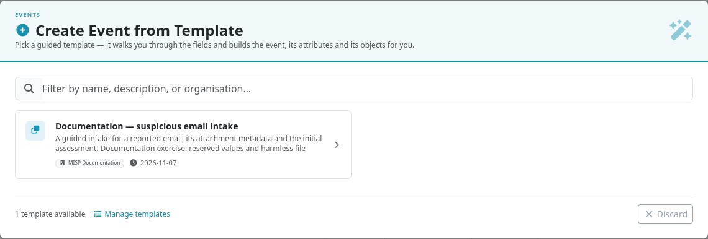
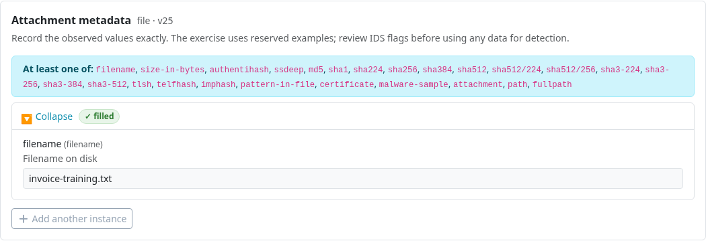
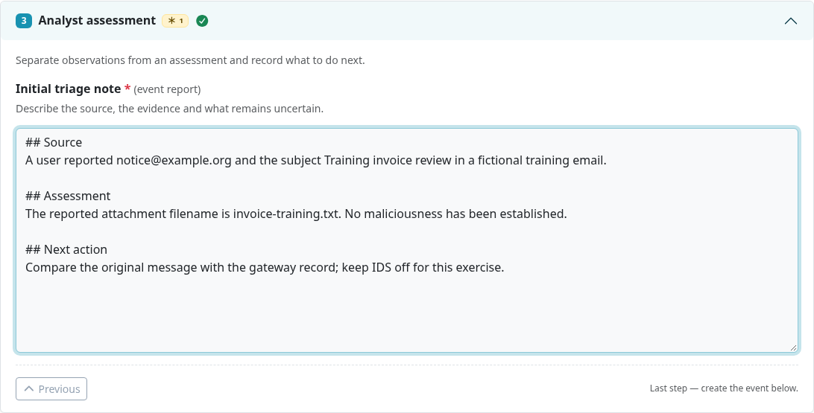
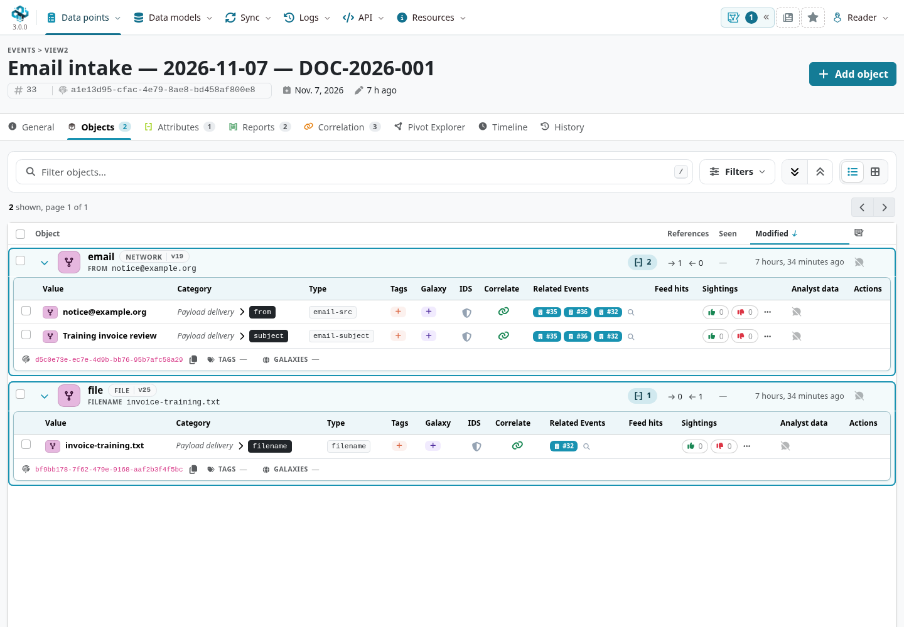
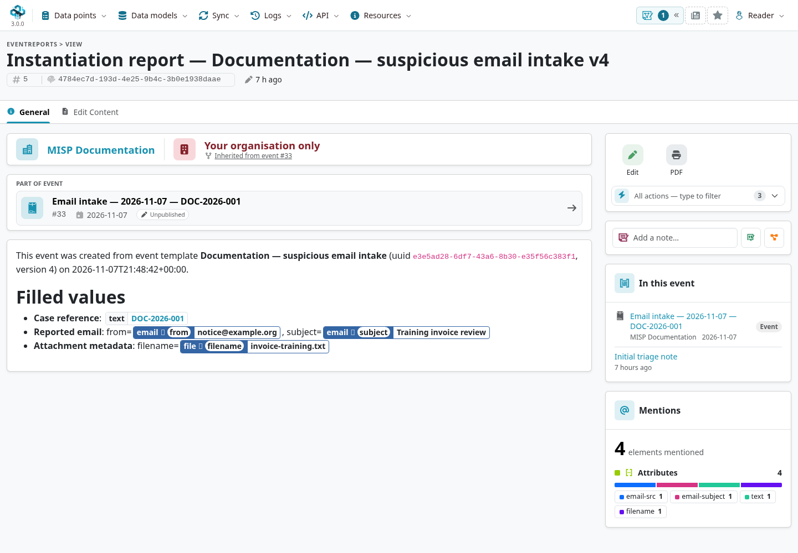
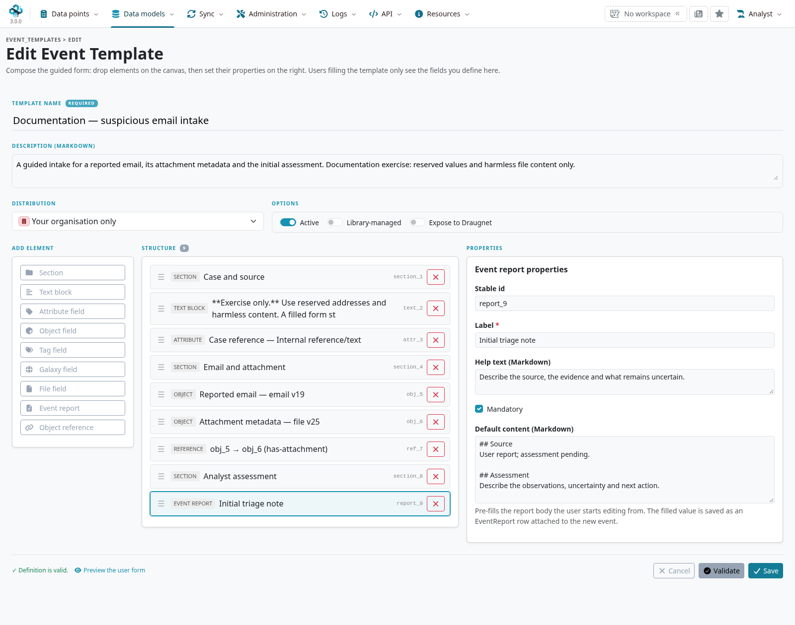
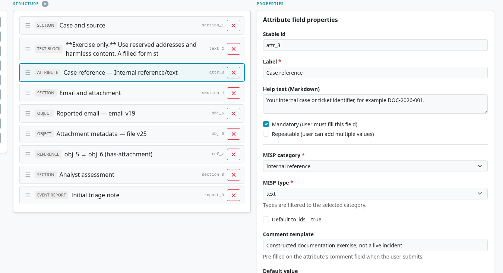
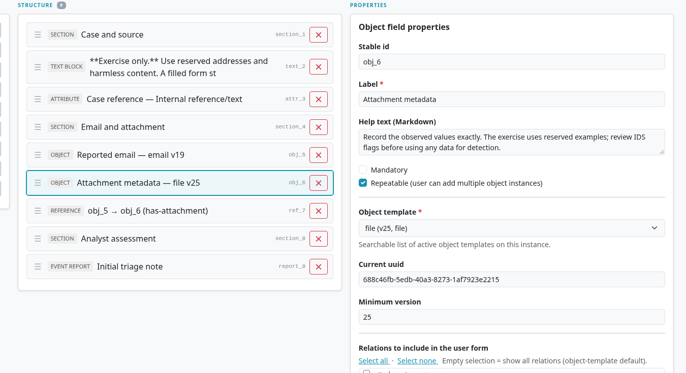
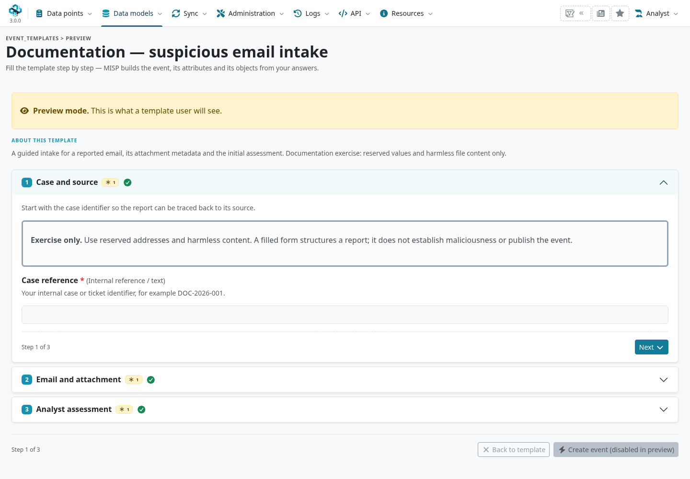
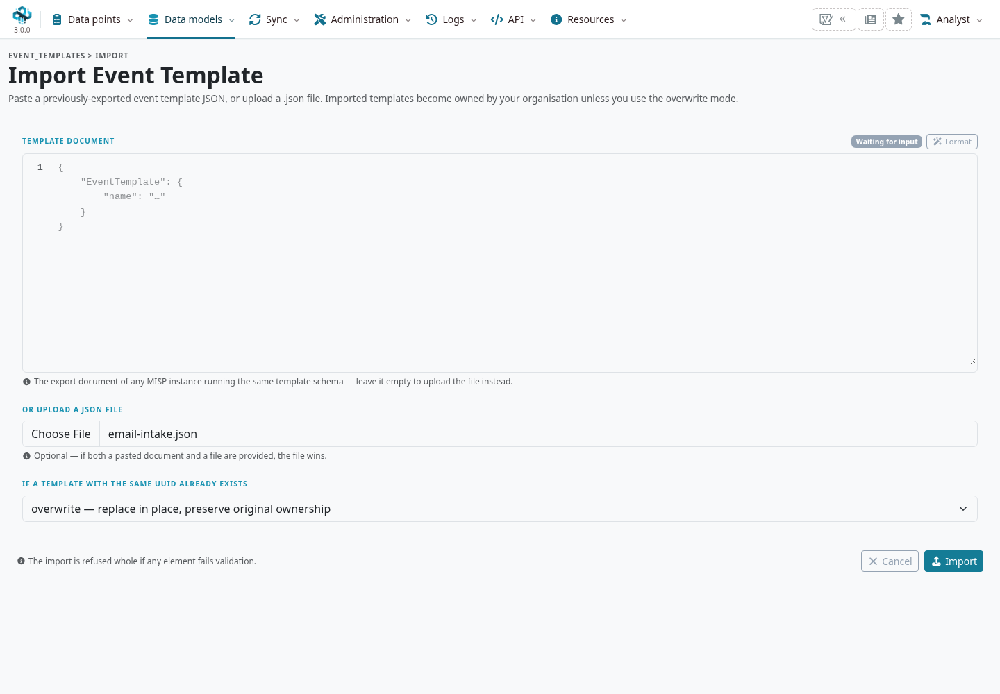

An **event template** turns a recurring reporting task into a guided form.
A creator chooses the fields, explains what evidence belongs in them, and defines how the answers become attributes, objects, relationships and reports.
A reporter supplies the observations without having to reconstruct that structure for every event.
Use templates for repeatable intake, such as a suspicious email, exposed credentials or a vulnerability disclosure; leave room for uncertainty and subsequent analysis.

::: {.callout-note}
This chapter follows MISP **3.0.0**, [`3.0_wip` commit `99ebee729`](https://github.com/MISP/MISP/commit/99ebee729702c560528f9788953719bda68aa1c1).
Screenshots come from an isolated instance using constructed, organization-only, unpublished events and harmless training values.
IDS flags were reviewed and disabled on the resulting exercise attributes.
Select a figure to enlarge it.
:::

<!-- Source checks, fixture behavior and screenshot provenance: ../assets/event-template-screenshots.json -->

## Choose the right kind of template {#templates-scope}

| Template | What it defines | Where to read more |
|---|---|---|
| **Event template** | A complete intake form and the structure of a new event, potentially containing several objects, attributes and reports. | This chapter. |
| **Object template** | The relations and constraints of one structured entity, such as an email or a file. An event template can reuse it. | [MISP Objects](../misp-objects/index.qmd). |
| **Dashboard template** | A reusable arrangement of widgets and their settings. | [Dashboards](../dashboards/index.qmd#dashboard-templates). |

An event template is a reusable definition, not a previously populated event to copy.
Each use creates a new event and new data instances.
Editing the definition later does not rewrite events that reporters already created.

## Create an event from a template {#templates-use}

1. Open **Data points → Events**. Open **More actions**, the dropdown beside **Add Event**, and choose **From template**.
2. Search the picker by name, description or organization. It lists active templates visible to your account.
3. Select a template and read its instructions. In the interface shown here, sections become steps in a guided form.
4. Fill the required fields, expand object entries, and use the repeat controls when there is more than one observation. Leave unknown optional values empty.
5. Review the answers and choose **Create event**. MISP opens the resulting event for inspection and further work.



Required fields are marked with an asterisk; the form prevents submission while required answers are missing.
Object templates can add their own requirements, such as at least one identifying relation.
A filled field still has to pass MISP's type validation: a nonempty string is not necessarily a valid address or hash.
Follow the field help rather than guessing a value to satisfy the form.

You need permission to create events (`perm_add`) and visibility of the template.
Creating or maintaining templates additionally requires the template permission (`perm_template`).
Depending on its contents, instantiation can also require tagging permission or access to the selected sharing group.
See [User Management](../user-management/index.qmd) and [roles](../administration/index.qmd#roles).

## Practical example: intake a reported email {#templates-example}

The exercise captures a reported email, the metadata of its harmless attachment, and an initial assessment.
It deliberately leaves the threat level **Undefined** and the analysis **Initial**.
A report being suspicious is not a conclusion that its sender or attachment is malicious.

::: {.content-visible when-format="html" unless-format="epub"}
A creator can import the [complete email-intake example](examples/email-intake.json), review it, and enable **Active** before the reporter starts.
:::

::: {.content-hidden when-format="html" unless-format="epub"}
A creator can import the [complete email-intake example](https://github.com/MISP/misp-book/blob/main/event-templates/examples/email-intake.json), review it, and enable **Active** before the reporter starts.
:::

The downloadable template is organization-only, inactive and locally managed by default.
It requires installed, active `email` and `file` object templates at versions **19 or later** and **25 or later**, respectively.
Use **Data models → Templates → Event Templates** to inspect the definition and its **Dependencies** tab.
The [authoring walkthrough](#templates-create) below builds the same structure in the visual editor.

| Field | Exercise answer |
|---|---|
| **Case reference** | `DOC-2026-001` |
| **Reported email → from** | `notice@example.org` |
| **Reported email → subject** | `Training invoice review` |
| **Attachment metadata → filename** | `invoice-training.txt` |
| **Initial triage note** | Source, observations, uncertainty and the next investigative step. |

This exercise records the reported attachment filename in a `file` object; it does not upload a binary, hash a file or run extraction.
Only record properties you have observed.
In **Email and attachment**, expand **Reported email** and **Attachment metadata**, then enter the observed values.
The creator has limited the form to the sender and subject for the email, and the filename for the file.
**Add another instance** adds another complete file object, rather than another hash on the first file.



In **Analyst assessment**, replace the instructional text with a short account of the source, what you observed and what remains to be checked.
For example:

```markdown
## Source
A user reported a fictional email from notice@example.org
with the subject Training invoice review.

## Assessment
The attachment invoice-training.txt is harmless training content.
No maliciousness has been established.

## Next action
Compare the original message with the gateway record.
Keep IDS off for this exercise.
```



### Check what was created

Open the resulting event and inspect:

- **General:** the generated event title, organization-only audience, publication state, analysis and threat level.
- **Attributes:** the case reference as an Internal reference / `text` attribute.
- **Objects:** an `email` object and a `file` object with the values you supplied. The email's `has-attachment` reference points to the file.
- **Reports:** the initial triage note and the generated instantiation report, which records the template identity/version and supplied answers.



Template fields do not share one universal IDS setting.
The case-reference attribute explicitly has IDS off; object attributes take their defaults from the matched object template.
**For this exercise, turn IDS off on the generated object attributes too**, then verify the saved state.
A mandatory field means the report needs an answer, not that the value is suitable for detection.

The event starts unpublished, but **unpublished does not mean private**.
Check its distribution separately, along with tags, galaxy context, reports and any generated relationships, before using the ordinary [review and publication workflow](../using-the-system/index.qmd#publish-an-event).
The exercise keeps the event organization-only and unpublished.
The instantiation report is useful provenance; its answers inherit the event's handling requirements and should be reviewed before sharing.



## Create a template for your team {#templates-create}

Start with a reporting decision and a small set of evidence you consistently need.
For the email example, the questions are: which case is this, what message was reported, which attachment did it contain, and what should the next analyst check?
Avoid a form that forces speculative attribution or asks for every possible email header.

Open **Data models → Templates → Event Templates → Add Event Template**.
The visual builder has an element palette, an ordered structure and a properties pane.
Click a palette item to add it, select it in the structure to edit its properties, and use its drag handle to reorder it.

Set a clear **Template name** and a description that explains when to use the form.
Choose **Your organisation only** for the exercise.
Keep **Library-managed** and **Expose to Draugnet** off.
Leave a draft inactive while reviewing it; enable **Active** when it is ready to appear in the event picker.



### Build the example structure

Add these elements in order:

| Element | Configuration |
|---|---|
| **Section** | Label **Case and source**; explain the need for a traceable source reference. |
| **Text block** | Explain that the exercise uses reserved addresses and harmless content, and that the form does not establish maliciousness. |
| **Attribute field** | Label **Case reference**; category **Internal reference**, type **text**, **Mandatory** on, **Default to_ids** off. Give an example of the case-number format. |
| **Section** | Label **Email and attachment**. |
| **Object field** | Label **Reported email**; choose `email`, **Mandatory** on. Select only `from` and `subject` in its relations list. |
| **Object field** | Label **Attachment metadata**; choose `file`, **Repeatable** on, **Mandatory** off. Select only `filename`. |
| **Object reference** | Select the reported-email field as **From**, the attachment field as **To**, and enter `has-attachment` as the relationship type. |
| **Section** | Label **Analyst assessment**. |
| **Event report** | Label **Initial triage note**, **Mandatory** on; provide a Markdown outline for source, assessment and next action. |

The builder generates stable element IDs and displays them read-only.
These identify fields in the definition and in relationship endpoints; the label is what the reporter reads.
The supplied example uses `attr_3`, `obj_5` and `obj_6` for the case, email and file fields.
Use the IDs actually shown in your definition when creating JSON references.



For object fields, selecting a template records its UUID and a **minimum version**.
The event uses a compatible installed template; this is not an exact version lock.
The saved object's template version identifies the version actually used.
A nonempty relations selection limits the relations shown in the form; an empty selection means all template relations, not an object with no fields.
The installed object's requirements still matter, so retain the relations needed to satisfy them.



An **Object reference** declares a relationship between two object-field elements; it is not another question for the reporter.
The relationship direction matters: the email **has-attachment** the file.
On the checked branch, repeated endpoints connect their **first instances only**.
After creating an event with several attachments, inspect and add the remaining relationships explicitly in the event's object controls.
Do not assume one template reference fans out to every repeated object.

### Other element choices

| Element | When to use it |
|---|---|
| **Tag field** | Let the reporter select classification/handling tags; restrict the available taxonomies and decide whether multiple choices are appropriate. |
| **Galaxy field** | Let the reporter supply supported galaxy context from selected galaxy types. Require attribution only when the intake genuinely needs established evidence for it. |
| **File field** | Upload file content as an `attachment` or `malware-sample`, according to the creator's choice. This differs from describing a file's metadata in an object field. Follow the normal [attachment-handling workflow](../using-the-system/index.qmd#add-attachment). |
| **Text block / Section** | Supply instructions and group the work. Neither creates an intelligence record by itself. |

Use labels that describe evidence, and help text that says where to find it, how to preserve its meaning and what to do when it is unknown.
Make only essential fields mandatory.
Default values and prefilled report text must not silently stand in for observations the reporter has never checked.

## Set event defaults and generated titles {#templates-defaults}

**Template distribution** controls who can read the reusable definition: organization-only or community-visible on this instance.
**Event distribution** controls the audience of each newly created event.
They are separate settings; sharing a form with the community does not require sharing its reports with the community.

The definition's `event_defaults` can set event distribution, sharing-group ID, threat level, analysis, default tags, galaxy clusters and an event-title pattern.
In the checked 3.0 visual builder, these advanced defaults are retained in the definition but do not have a dedicated editor.
Use the validated JSON export/import or authenticated API to change them, then review the **General** and **Definition** tabs.
The example JSON contains:

```json
"event_defaults": {
  "info_template": "Email intake — {{date}} — {{field:attr_3}}",
  "distribution": 0,
  "threat_level_id": 4,
  "analysis": 0
}
```

For a case reference of `DOC-2026-001`, the title becomes *Email intake — YYYY-MM-DD — DOC-2026-001*, using the creation date.
Supported title variables include `{{date}}`, `{{now}}`, `{{user}}` and `{{field:element_id}}`.
`{{user}}` inserts the reporter's email; use it only when that belongs in the event title.
Check repeated or structured field substitutions rather than assuming every answer becomes a useful title string.

The reporter form shown here does not offer overrides for these event defaults.
Review the resulting event and edit it through the normal event workflow when a change is required.
A sharing-group default requires a group the creating user is permitted to use.
Tags and galaxy context also depend on that user's permissions and installed data.

## Validate, preview and test {#templates-validation}

**Validate** checks the current definition against the server's schema and semantic rules.
It checks IDs, required labels, valid attribute category/type combinations, object-template dependencies and reference endpoints.
Correct the reported errors before saving.
A successful validation does not test every possible answer or prove that the form captures the right evidence.

**Save** persists the definition and advances its version.
**Preview** opens the reporter form for the **last saved version**, with event creation disabled.
Save before previewing a change; preview is not an unsaved live version of the builder.



Before enabling a template for colleagues, try a complete example, a minimal example, missing mandatory values, an invalid typed value, an empty optional object and repeated objects.
Check the resulting event, relationship direction, IDS flags, distribution, reports and template provenance as an ordinary reporter.
Report/audit creation occurs after the event's main transaction on this branch; if a report is missing, investigate it rather than repeatedly submitting and creating more events.

## Reuse, maintain and exchange templates {#templates-maintenance}

The catalogue's **General**, **Structure**, **Dependencies** and **Definition** tabs let a reviewer inspect the purpose, defaults, fields, installed requirements and full JSON.
An active flag makes a visible template available in the picker; it is not a replacement for organization visibility or role permissions.
Template editing is limited to authorized creators in the owning organization and site administrators.

Use **Duplicate** to start an independent template with a fresh UUID.
On the checked branch, that copy starts active and organization-only; review its visibility and active state before colleagues use it.
Use **Export** to retain a reviewable JSON snapshot before significant changes or to move a definition between instances.
An export contains the definition and object-template UUID/minimum-version references, not the object-template catalogue or previously created events.
The recipient must install compatible dependencies.

**Import** accepts pasted JSON or an uploaded file. Select the collision behavior deliberately:

| Mode | Result |
|---|---|
| **fail** | Refuse a UUID collision; the default. |
| **overwrite** | Replace an existing template in place, preserving its ownership. You must be authorized to edit it. Export a backup first. |
| **duplicate_as_new** | Create an independent copy with a fresh UUID when the supplied UUID already exists. |



### Use the shared library carefully

[MISP event templates](https://github.com/MISP/misp-event-templates) provides reusable reporting definitions, shipped as the `app/files/misp-event-templates` submodule.
A site administrator can populate the catalogue from the installed library and use **Update from library** to review and apply subsequent changes.
New library entries start inactive for local review.
Updating files on disk and reconciling the database are separate operations; follow your supported MISP deployment/update process for the files.

**Library-managed** entries follow the library's content on subsequent updates.
For a local adaptation, duplicate the entry and verify that the copy is locally managed, or explicitly clear **Library-managed** before customizing it.
Library updates skip locally managed rows with matching library UUIDs and preserve the active state of managed rows they update.
Keep exported snapshots and review dependency changes before enabling an updated form.

**Expose to Draugnet** opts a definition into the exposed-template listing used by that integration.
It does not bypass the authenticated reader's template visibility rules or publish an event.
Leave it off unless your organization uses that reporting workflow.

## Troubleshooting and source references {#templates-troubleshooting}

| Symptom | What to check |
|---|---|
| No template in the picker | Its active state, organization/community visibility and your event-creation permission. Reload the Events page after changing the catalogue. |
| Builder or preview is unavailable | Template-author permission and ownership where required; preview itself requires the template permission. |
| A dependency is missing | Install/activate a compatible object template and revalidate. A missing dependency is not a reason to silently omit evidence. |
| The feature reports missing PHP packages | Ask the administrator to complete the supported Composer installation for the deployed MISP version. Database upgrades alone do not install PHP dependencies. |
| Submission fails | Read the inline error; check mandatory answers, type validity, tags and sharing-group permissions. Check whether an event was already created before retrying after a report-side error. |
| An entered object value is missing from the event | Compare the saved child attributes with every answer. On the checked branch, some relations without an explicit category in their object-template definition can be dropped during instantiation. The exercise uses verified fields; inspect and correct missing data through the normal object editor. |
| A new field is absent in preview | Save the edited template, then reopen preview. Existing events retain the structure they were created with. |
| Local edits disappear after a library update | Check **Library-managed** and restore/review a saved export. |

Implementation and library references for this chapter:

- [Event-template controller: access, authoring, import/export and instantiation](https://github.com/MISP/MISP/blob/99ebee729702c560528f9788953719bda68aa1c1/app/Controller/EventTemplatesController.php).
- [Definition schema](https://github.com/MISP/MISP/blob/99ebee729702c560528f9788953719bda68aa1c1/app/files/schemas/event-template-v1.schema.json), [validator](https://github.com/MISP/MISP/blob/99ebee729702c560528f9788953719bda68aa1c1/app/Lib/Tools/EventTemplateValidator.php) and [instantiator](https://github.com/MISP/MISP/blob/99ebee729702c560528f9788953719bda68aa1c1/app/Lib/Tools/EventTemplateInstantiator.php).
- [Event-template model and library reconciliation](https://github.com/MISP/MISP/blob/99ebee729702c560528f9788953719bda68aa1c1/app/Model/EventTemplate.php), [export format](https://github.com/MISP/MISP/blob/99ebee729702c560528f9788953719bda68aa1c1/app/Lib/Tools/EventTemplateExporter.php) and [import behavior](https://github.com/MISP/MISP/blob/99ebee729702c560528f9788953719bda68aa1c1/app/Lib/Tools/EventTemplateImporter.php).
- [Library snapshot shipped by the checked MISP revision](https://github.com/MISP/misp-event-templates/tree/9ed997a05d2db71c93c2c37f832e2859eb1c5f8d).
