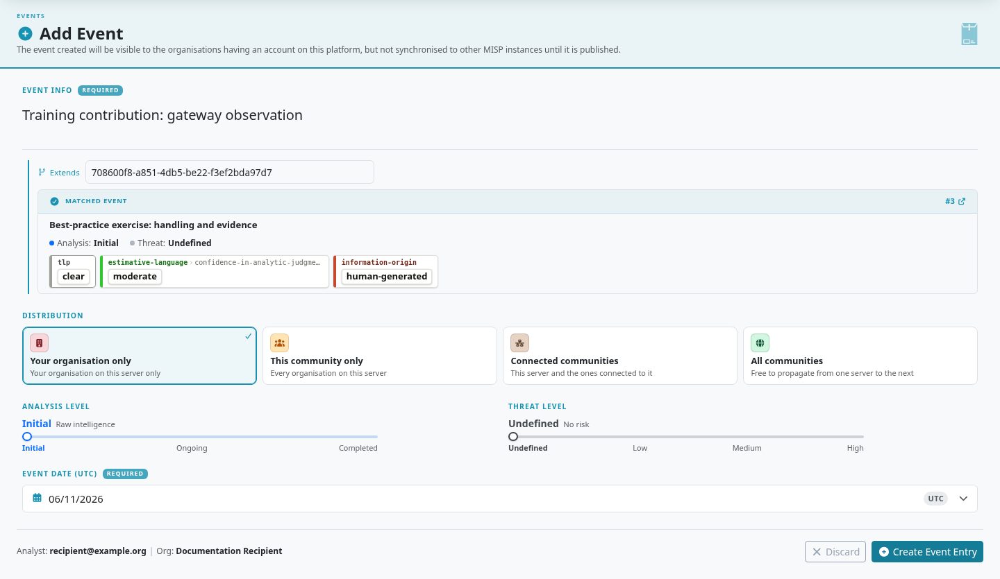
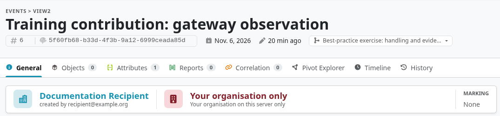

An **extended event** adds your organization's findings to an existing event while keeping the original and your contribution separately owned.
Your event records the original event's UUID in `extends_uuid`. A combined view can then show the contributions together.

::: {.callout-note}
The workflow and screenshots use the [`3.0_wip`](https://github.com/MISP/MISP/tree/3.0_wip) development branch and fictional data.
Select a screenshot to enlarge it.
:::

<!-- Capture source, fixture and image hashes: ../assets/using-misp-screenshots.json -->

## When to use an extended event

To copy selected attributes, objects or reports into an existing event, see [Data Maintenance](../data-maintenance/index.qmd#maintenance-merge). That operation writes copies; the combined extension view described here preserves separate events.

Use an extension when your contribution deserves its own event, source attribution, and publication lifecycle:

- Add observations to intelligence received from a partner while allowing the partner's original event to keep receiving updates.
- Maintain your organization's contribution to an investigation involving several organizations.
- Separate a raw source report from a curated analysis with its own distribution and assessment.

Choose a [proposal](../using-the-system/index.qmd#proposing-changes-to-another-organisations-event) to request a correction to the original event.
Use [Analyst Data](../analyst-data/index.qmd) for a Note, Opinion, or Relationship that does not require a separate event.
An extension references the parent; it does not transfer ownership or give you permission to edit it.

## Creating an extended event

1. Open the original event and copy its **UUID**.
2. Create an event through **Data points → Events → Add event**.
3. Enter the parent UUID in **Extends**. The form also accepts a local event ID, which is resolved to the parent.
4. Give your contribution a specific title, set its date and audience, and create it.
5. Add your evidence, source references, and analysis, then review and publish your event when ready.

The parent can be a local event or a copy received through synchronization.
Use UUIDs in durable references and automation: local numeric IDs can differ between instances.
Your extension has its own distribution, sharing group, attributes, objects, reports, and publication state.

## Viewing extended events

The event's extension information links the parent and the events extending it.
Use the available **Extended view** or **Extending view** action to inspect the combined context.
The exact action depends on whether you opened the parent or the contribution.

A combined view only includes data the current user may access.
Review the source event attached to each contribution before editing, exporting, or drawing conclusions; a combined screen does not merge ownership or override distribution.
Publishing your extension does not publish the parent, and changing the parent does not automatically approve your analysis.

## Finding extended events

The event index and API can distinguish base events from contributions.
For [REST searches](../automation/index.qmd), use the supported filters:

| Filter | Purpose |
|---|---|
| `extended` | Request the combined form of matching events. |
| `is_extended` | Find events extended by another event. |
| `is_extension` | Find events that extend another event. |

Check the returned UUIDs and your access to the source events before treating a result as a complete investigation.

## Further reading

The original [Extended Events design article](https://www.misp-project.org/2018/04/19/Extended-Events-Feature.html) explains the model and its motivation.
For current interface orientation, see [General Layout](../general-layout/index.qmd); for sharing choices, see [Best Practices](../best-practices/index.qmd#setting-distribution).
