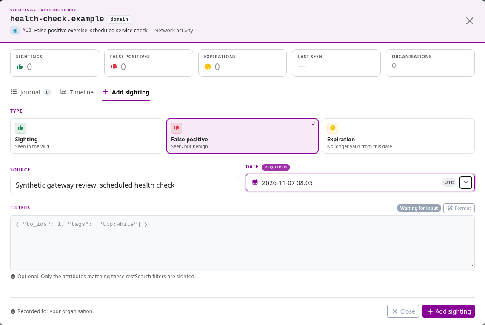
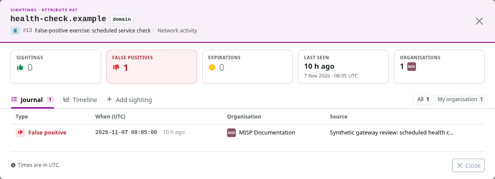
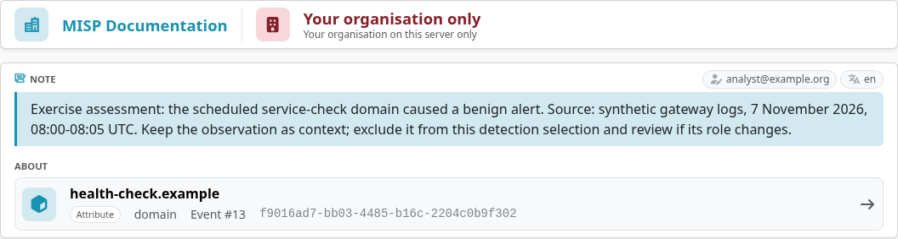
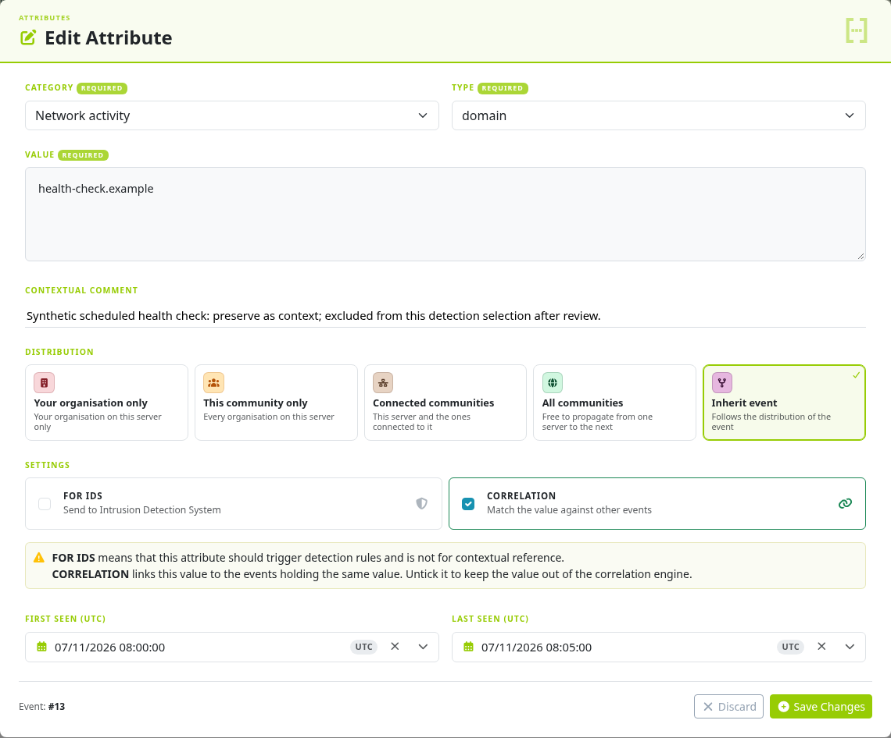
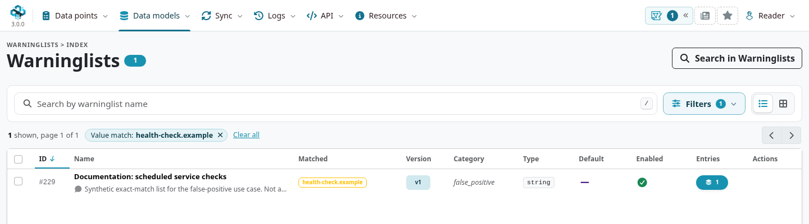
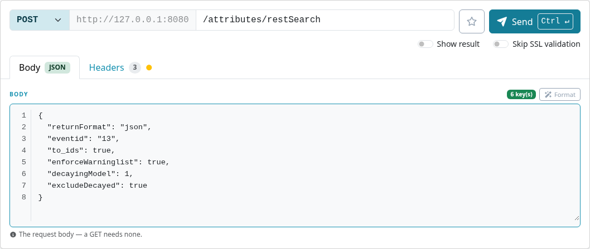
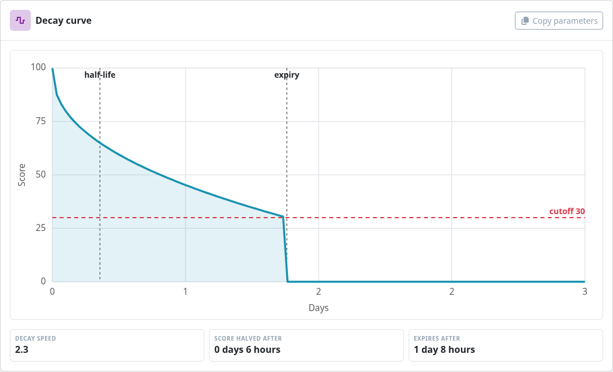
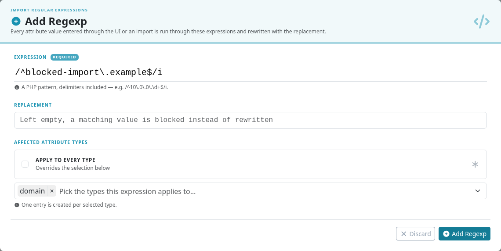
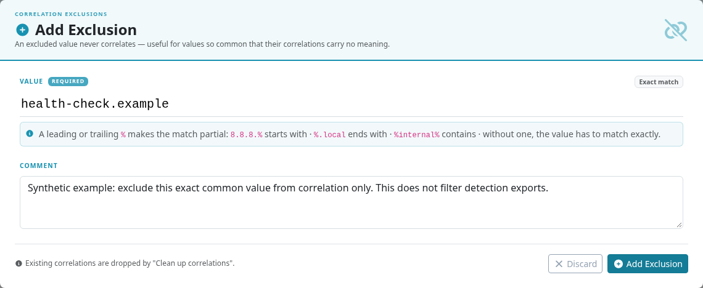

A false-positive alert does not always mean that the underlying observation is wrong.
A domain may really have been contacted, yet be unsuitable for a particular detection rule.
Keep that distinction when deciding whether to report feedback, correct a record, exclude an indicator from detection, or change an import policy.

This use case follows a scheduled service check that triggered an alert on `health-check.example`.
Review of the exercise's gateway logs establishes that this connection was expected in that environment.
The aim is to stop the unwanted detection while preserving useful investigation context and telling the producer what was learned.

::: {.callout-note}
The screenshots and checks use MISP **3.0.0**, [`3.0_wip` commit `99ebee729`](https://github.com/MISP/MISP/commit/99ebee729702c560528f9788953719bda68aa1c1).
All values are synthetic reserved names in a private, unpublished event.
Form screenshots identify staged changes; the export and import behavior was also checked on the local exercise instance.
Select an image to enlarge it.
:::

<!-- Screenshot hashes, source references and behavior checks: ../assets/false-positive-screenshots.json -->

## Investigate the alert before choosing a control {#fp-triage}

1. Identify the exact event and attribute UUID, the exported value and the rule that matched it.
   For an object attribute, inspect its object relation and the surrounding fields as well.
2. Review the source, observation time, comments, sightings and warninglist hits against the actual logs.
   Distinguish an incorrect value from a correct observation used in the wrong detection context.
3. Decide the scope of the finding: one occurrence, one detection rule, one environment, or a value that needs a broader review.
   A shared service, private address or familiar domain can still matter to an investigation.
4. Record the evidence and a review condition, such as a change of role, ownership or observation time.

Use the smallest control that solves the problem:

::: {.table-responsive}

| Need | Technique | Effect and boundary |
|---|---|---|
| Tell the producer about a benign alert | False-positive sighting and an explanatory Note | Records feedback; does not itself clear IDS or withdraw a detection. |
| Preserve an observation as context | Clear **For IDS** on the attribute | Changes detection eligibility for that occurrence; consumers must select IDS-enabled data. |
| Exclude known matches from a selection | Enabled warninglists and `enforceWarninglist` | Filters supported searches/exports without deleting the source observation. |
| Stop using stale indicators | Decaying model and `excludeDecayed` | Applies a query-time relevance policy; age is not proof of benignness. |
| Reject a precisely defined incoming value | Type-scoped Import Regexp | Rejects matching values on applicable capture paths; can discard evidence before review. |
| Reduce noisy investigative links | Attribute correlation control or correlation exclusion | Changes correlations; does not remove a value from detection exports. |

:::

## Report the finding and preserve its reasoning {#fp-report}

Open the event's **Attributes** tab, find the relevant occurrence and open **Sighting details**.
In **Add sighting**, choose **False positive**, enter the source and the observation time in UTC, and save.
Use a source description that recipients are allowed to see.



Check the **Journal** to confirm the saved record and its target.
A false-positive sighting has type **1**; an ordinary observation has type **0** and an expiration has type **2**.
The journal's records and organization identities depend on permissions and the instance's sighting policy.
Feedback delivery also depends on synchronization settings; do not assume that the producer has received it just because it appears locally.



Add an [Analyst Data Note](../analyst-data/index.qmd) on the relevant attribute to explain what was checked, why the alert was inappropriate, and when to revisit the decision.
Choose the Note's distribution separately from the target's visibility.
Attach an occurrence-specific explanation to the attribute UUID; use MISP 3.0 value-level analysis only when the assessment should concern the shared value across occurrences.



An Opinion or a confidence taxonomy can complement the explanation if your community has an agreed interpretation.
Neither automatically filters an export.
Do not treat the ratio of observations to false-positive reports as a calibrated probability: an observation is not necessarily a confirmed true positive, and repeated reports or visibility restrictions can skew the counts.
See [Sightings](../sightings/index.qmd) for policies and sharing behavior.

## Keep the observation but remove its detection intent {#fp-context-only}

If you can edit the source attribute, open its row menu, choose **Edit**, clear **For IDS**, and explain the decision in the contextual comment.
Save, then confirm the resulting attribute state.
Leave **Correlation** enabled if the value remains a useful investigation pivot.
Clearing IDS and disabling correlation answer different questions.



The IDS flag applies to this occurrence, including when it belongs to an object.
Other occurrences of the same value can retain their own flags and context.
Consumers that request all attributes, ignore `to_ids`, or retain earlier copies can still contain the value.

For an event created by another organization, use **Propose change** when you cannot modify the source, and record the feedback alongside it.
A proposal needs acceptance; it does not immediately change the producer's record.
See [proposing changes](../using-the-system/index.qmd#proposing-changes-to-another-organisations-event).

## Use warninglists deliberately {#fp-warninglists}

Open **Data models → Filters & Lists → Warninglists** and use **Search a value** to investigate a match.
Inspect the list's source, enabled state, matching type, applicable attribute types and matched entry.
A `known` list identifies known context; a `false_positive` list expresses a different purpose.
Neither is ground truth about an incident.



For a local policy, an authorized maintainer can use **Add Warninglist** to define narrowly scoped entries and matching types.
Test matching and non-matching values before enabling it.
An exact domain match and a hostname/subdomain rule can have very different reach.
Displaying a warning does not itself turn off IDS, block publication or remove an attribute.

To exclude matches from a supported search/export, request `enforceWarninglist` explicitly.
It checks the enabled applicable lists; it is not limited to the one list you just inspected or to lists in the `false_positive` category.
An investigation query may need the matched data even when a detection selection should omit it.
See [Warning Lists](../warninglists/index.qmd#warninglists-export).

## Check the actual detection selection {#fp-export}

In **API → REST Client**, prepare an authenticated `POST /attributes/restSearch` for a controlled event or selection.
Set **POST**, enter the endpoint and JSON body, supply your own authorization under **Headers**, and enable **Show result** before sending the request.
Start with an unfiltered result, then add one control at a time so you can explain each omission.
For example, replace the event and model IDs with ones appropriate to your deployment:

```json
{
  "returnFormat": "json",
  "eventid": "REPLACE_WITH_EVENT_ID",
  "to_ids": true,
  "enforceWarninglist": true,
  "decayingModel": 1,
  "excludeDecayed": true
}
```

Choose the publication state, audience and output format required by your consumer as well.
The exercise uses a private unpublished event for read-only checks; it does not require publishing training values.
The model ID `1` is an example, not a portable identifier for every installation.



The exercise contains four domain attributes: the reviewed service check, a control awaiting review, a context-only observation and a stale observation.
After clearing IDS on the service check, separate searches produced these results:

::: {.table-responsive}

| Selection within the exercise event | Result |
|---|---|
| Unfiltered JSON search | All four observations remain available as context. |
| `to_ids: true` only | Two occurrences remain: the control and the stale observation. |
| `enforceWarninglist: true` only | Three remain; the exact service-check match is omitted. |
| `excludeDecayed: true` with the selected model | Three remain; the stale observation is omitted. |
| All three controls together | Only the control awaiting review remains. Selection alone does not establish that it is malicious or suitable for detection. |

:::

Repeat the check using the destination's real account, format and integration.
A JSON search demonstrating a filter is not proof that a different export or connector applies it.
See [API exports](../automation/index.qmd#api-exports) and [Connectors](../connectors/index.qmd).

### Use decay for relevance, not as a benign verdict {#fp-decay}

Open **Data models → Decaying Models** and inspect the selected model's formula, parameters and assigned attribute types.
Use `includeDecayScore` to inspect representative attributes before enabling `excludeDecayed`.
The exercise's stale observation returns a score of zero and `decayed: true` under the selected Phishing model.
Its source record and IDS flag remain present until changed separately.



Check observation times and the model's fallback behavior, type mappings and treatment of missing scores.
The Sightings formula can use feedback types with configurable settings, but its terminology does not turn a type-0 observation into a verified true positive.
MISP 3.0 Value Intelligence assessments and analyst profiles are a separate assessment path.
See [Decaying Models](../decaying-models/index.qmd).

## Prevent a narrow class of unwanted imports {#fp-import}

Fix the source or importer when possible, especially if the problem is a bad field mapping or loss of context.
Use an administrator's **Import Regexp** control when you deliberately want a matching value rejected or normalized on the applicable input path.
This is an instance-level intake rule, rather than an event-specific detection exception.

For a synthetic rejection test:

1. Open **Administration → Import Regexp** and choose **Add Regexp**.
2. Enter the anchored PHP expression `/^blocked-import\.example$/i`, including delimiters.
3. Leave **Replacement** empty to reject matching values.
4. Turn off **Apply to every type** and select only `domain`.
5. Test the matching domain, a non-matching domain and the same value outside the selected type scope before deploying a real rule.



On the tested attribute-creation path, the matching domain was rejected, `allowed-import.example` was accepted, and `blocked-import.example` as a hostname remained outside the rule's type scope.
Test the actual importer or synchronization path you use; a single capture check does not establish behavior for every input route.
A non-empty replacement rewrites data, which can change its meaning, validation, stored value address and correlations.
Do not run a broad cleanup on existing data merely to test a new rule.

If an entire source is unsuitable, review feed/server selection and filters with the producer.
An organization blocklist is a much broader intake decision based on creator-organization UUIDs, not a fix for one noisy attribute or an account-login ban.
See [incoming-data controls](../administration/index.qmd#admin-ingestion-controls).

## Handle correlation noise separately {#fp-correlation}

If the problem is a large number of investigative links, inspect why the value is shared before suppressing those links.
For one occurrence, the attribute edit form's **Correlation** setting controls its participation.
For an instance-wide value policy, an administrator can add a **Correlation exclusion**, using an exact value or a deliberately reviewed pattern.
Existing matches may need the separate cleanup action; review its scope before running it.



Disabling correlation does not clear IDS, record a false-positive sighting or filter a detection export.
Use the detection controls above when that is the intended outcome.
The historical **Signature allowedlist** page/controller suggested in older workflows is absent from this MISP 3.0 snapshot; review IDS flags, warninglist-aware selection and destination policy instead of substituting a correlation exclusion.
See [correlation administration](../administration/index.qmd#admin-correlations).

## Verify the correction reaches the consumer {#fp-verify}

Before closing the investigation:

- Confirm the feedback, explanation and intended attribute flags in the saved source records.
- Compare the original and revised selections by UUID, using the recipient's account and real export settings.
- Check the SIEM, IDS or other destination for removal or revision of the earlier detection, including cached and materialized rules.
  An integration that only adds new indicators can retain an old detection even after a later export omits it; reconcile or withdraw it through that integration's lifecycle.
- Check whether the producer and partners received the feedback or accepted proposal, according to the configured sharing rules.
- Keep the evidence and review condition so the decision can be revisited if the value's role changes.

Deleting the observation is appropriate when the record itself should be removed, rather than as a substitute for these selection and feedback decisions.
Publication, a local edit, or omission from one export cannot recall every previously delivered copy.
