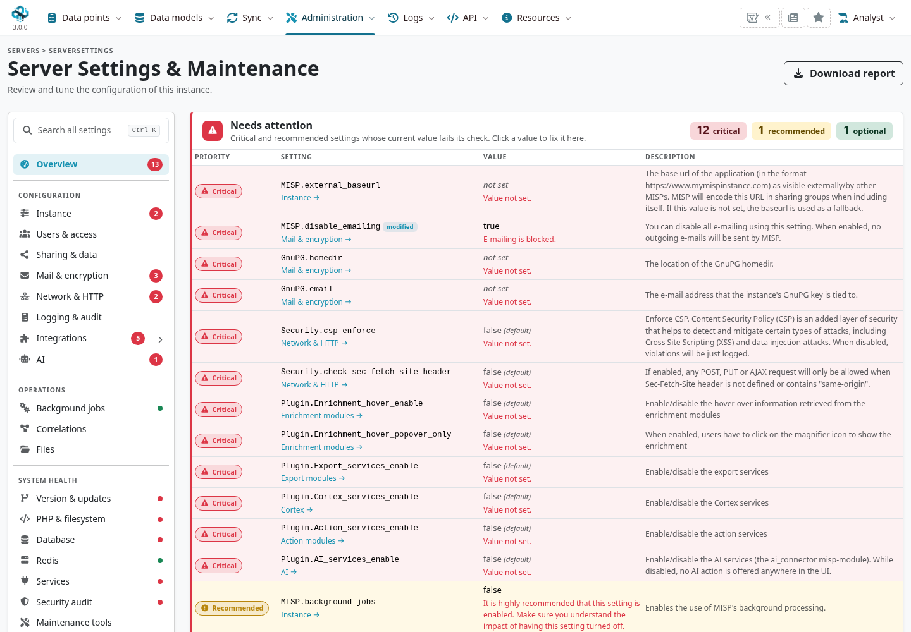
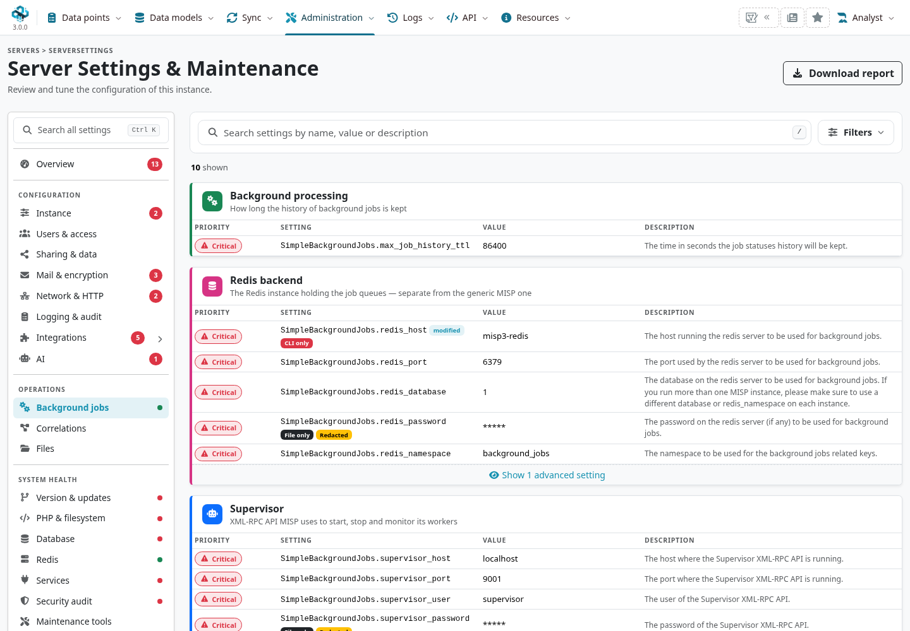
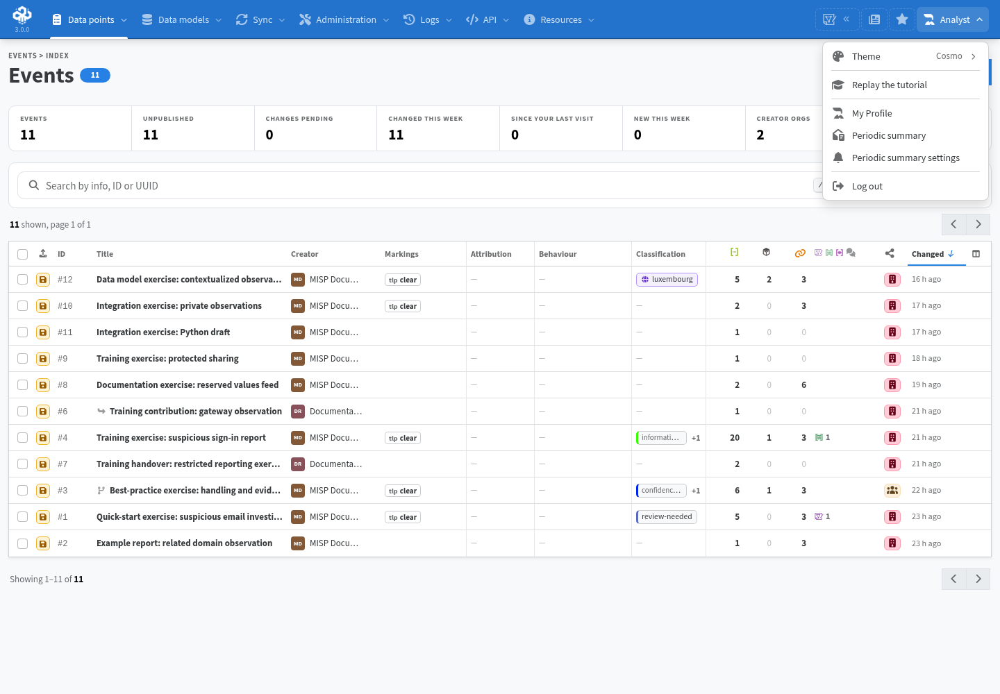

Start with the question closest to the symptom, then use the linked chapter for the full
procedure. Record the installed version, component and exact error before changing configuration.
A failed request is not by itself evidence that the database needs repair.

::: {.callout-note}
Checked against MISP **3.0.0**, `3.0_wip` commit `99ebee729`.
Deployment paths, service names and optional integrations vary. The answers below replace
older 2.4/2.5 recipes; a historical error message is not a current repair instruction.
:::

<!-- Source checks, synthetic fixture and capture provenance: ../assets/reference-faq-screenshots.json -->

<a id="frequently-asked-questions"></a>
<a id="general-questions"></a>
<a id="how-do-i-harden-my-misp-instance"></a>

## Support and first checks {#faq-support}

<a id="is-there-taxii-support"></a>
<a id="where-can-i-get-support"></a>

### Where can I get help or report a defect? {#faq-reporting}

Use [MISP core issues](https://github.com/MISP/MISP/issues) for application defects and the
relevant companion repository for modules, clients or content definitions. Follow the issue
template, check existing reports, and include the branch/commit, runtime, reproduction steps
and sanitized error. Report security vulnerabilities through the
[security policy](https://github.com/MISP/MISP/security/policy).

The [MISP project website](https://www.misp-project.org/) links current community and support
resources; [professional services](https://www.misp-project.org/professional-services/) are also
available. Never post a full configuration, API key or diagnostic export without reviewing it.

<a id="what-are-the-hardware-requirements"></a>

### What hardware and software should I use? {#faq-requirements}

Size for retained observations, correlations, simultaneous users, imports and background work.
A small demonstration and a large sharing hub have different storage/memory requirements.
Follow the [Requirements](../requirements/index.qmd#misp-instance-requirements) and
[installation](../get-your-instance/index.qmd#choosing-a-deployment-method) chapters and the deployment's supported dependency
versions. The [MISP sizing guide](https://www.misp-project.org/sizing-your-misp-instance/) helps
plan larger instances. Avoid treating an old fixed RAM recommendation as a capacity guarantee.

<a id="how-to-monitor-misp"></a>

### Where do I check instance health? {#faq-health}

Open **Administration → Server Settings & Maintenance**. The 3.0 overview separates configuration
issues from health pages for versions, PHP/filesystem, database, Redis and services. Background
jobs have their own page. Inspect the failing check and its detailed message; an isolated
example with mail/providers disabled is not expected to be a healthy production baseline.



Use [logs](../administration/index.qmd#admin-logs), worker/queue health and deployment metrics
alongside application checks. Track disk usage, database growth, job failures, response times,
backup/restore checks and certificate expiry. A responsive login page does not prove jobs are
running or the instance can synchronize.



## Login, URLs and requests {#faq-access}

<a id="how-can-i-redirect-http-to-https"></a>
<a id="how-do-i-set-the-baseurl-from-the-command-line"></a>
<a id="when-i-try-to-access-my-new-installation-i-am-redirected-to-localhost8443-and-get-an-error"></a>
<a id="when-i-try-to-access-my-new-installation-i-am-redirected-to-localhost8443-and-get-an-error."></a>

### Why does MISP redirect to localhost or the wrong URL? {#faq-baseurl}

Align the externally reachable HTTPS URL with **`MISP.baseurl`**, the reverse proxy and the
deployment configuration (`BASE_URL` in the Docker setup). Include a required port/subpath.
In a container deployment, persist the value in the managed configuration rather than changing
a generated file that will be replaced on restart.

For a filesystem-managed installation, the setting command is:

```bash
sudo -u www-data /var/www/MISP/app/Console/cake Admin setSetting MISP.baseurl https://misp.example.org
```

Adapt the service account/path to the installation and verify the effective setting and redirects.
See [Docker quick start](../quick-start/index.qmd#start-misp-with-docker) and
[network settings](../administration/index.qmd#admin-configuration-baseline).

<a id="constantly-acknowledging-my-self-signed-certificate-drives-me-nuts"></a>
<a id="what-to-do-if-my-rest-client-cannot-reach-the-host-despite-me-being-able-to-issue-requests-using-curl--postman--etc"></a>
<a id="what-to-do-if-my-rest-client-cannot-reach-the-host-despite-me-being-able-to-issue-requests-using-curl-postman-etc."></a>
<a id="what-to-do-if-my-rest-client-is-throwing-ssl-errors-when-trying-to-query-my-misp-instance"></a>

### How should HTTPS and internal certificate trust work? {#faq-tls}

Terminate HTTPS at the deployment's supported web server/proxy, configure the correct hostname
and certificate chain, and redirect HTTP there. A browser, PHP REST client, Python client and
remote synchronization peer can use different trust stores. Install the appropriate CA/chain
where the failing client validates TLS and confirm DNS, hostname and expiry.

A server-side REST client request originates from the MISP server, not from the browser. The
server must resolve and reach the configured base URL. If a full remote URL is used, check the
destination before sending an authentication key. Disabling certificate verification does not
repair trust or a hostname mismatch. See
[API TLS configuration](../pymisp/index.qmd#pymisp-installation) and
[sync connection tests](../sharing/index.qmd#test-connection).

<a id="i-can-no-longer-log-in-how-do-i-reset-the-admin-password"></a>
<a id="i-can-no-longer-log-in.-how-do-i-reset-the-admin-password"></a>
<a id="i-deleted-the-admin-user-by-mistake"></a>

### How do I recover access or a missing site administrator? {#faq-account-recovery}

First distinguish a wrong password, disabled account, MFA problem and external authentication
failure. For an authorized local recovery, the current console supports `User change_pw` and
`User change_role`; inspect their help and choose the intended account and existing role:

```bash
sudo -u www-data /var/www/MISP/app/Console/cake User change_pw --help
sudo -u www-data /var/www/MISP/app/Console/cake User change_role --help
```

The password command takes the new password as an argument, so use the installation's secure
administrative process and account for shell history/process visibility. A role change is a
privileged recovery action, not a workaround for normal authorization. Preserve the user database;
do not truncate users or delete the remaining account to trigger initialization. See
[users and authentication](../administration/index.qmd#admin-authentication).

<a id="why-do-i-see-the-request-has-been-black-holed-when-i-submit-forms"></a>

### Why was a form request “black-holed”? {#faq-csrf}

The framework rejected a security/CSRF or form-validation condition. Reload the current form
and retry once with valid input; stale tabs, session expiry, a back-button resubmission, proxy
URL/cookie mismatches or a custom form missing its token can cause failures. Check the matching
server log entry. Do not assume a universal 15-minute timeout, disable form protection or turn
an authenticated browser request into an unlocked endpoint to suppress the symptom.

<a id="i-have-many-users-or-api-accesses-whats-the-best-php-session-handler"></a>

### Should I change the session handler for API traffic? {#faq-sessions}

Inspect the deployment's PHP/CakePHP session configuration, locking, storage availability and
expiry. Redis-backed sessions can be appropriate, but this is distinct from the job/cache Redis
connections. Apply the supported deployment configuration to the correct PHP runtime, including
authentication/TLS where needed, and test browser logins and concurrent requests. Do not copy
an incomplete `session.save_path` example into production or flush Redis as a general login fix.

<a id="specific-questions"></a>
<a id="usage-questions"></a>

## Jobs, services and filesystem {#faq-services}

<a id="how-can-i-restart-the-workers"></a>

### Why are workers missing or jobs stuck? {#faq-workers}

Inspect **Background jobs**, the job list and the Supervisor/Redis state. A queued job is not
proof a worker is consuming its queue. The 3.0 worker subsystem uses SimpleBackgroundJobs with
Supervisor; queue names, groups and service names depend on the deployment.



Use [worker diagnostics and commands](../administration/index.qmd#admin-worker-commands).
Check Supervisor's actual process group before restarting it; do not launch a second worker
pool beside the managed one. Restarting a worker can interrupt a job, so inspect job state and
retry behaviour. Recurring work and workflow executions have separate configuration/status.

<a id="can-i-configure-misp-encrypted-notification-emails-to-contain-more-information-in-the-subject"></a>
<a id="i-have-many-failed-jobs-when-doing-email-notification-what-should-i-do"></a>
<a id="i-have-many-failed-jobs-when-doing-email-notification.-what-should-i-do"></a>

### How do I diagnose mail failures? {#faq-mail}

Check the failing job, mail transport, recipient, sender and encryption settings. Verify relevant
PGP keys and expiry through the supported user/key checks; not every mail failure is a PGP
problem. `MISP.extended_alert_subject` can add event context to notification subjects. A subject
is outside an encrypted message body, so choose its contents for the audience and transport.
See [mail configuration](../administration/index.qmd#admin-configuration-baseline).

<a id="mariadbmysqlredis"></a>
<a id="misp-modules-connection-refused"></a>
<a id="redis-connection-problems"></a>
<a id="rhelcentos"></a>
<a id="rhelcentos-selinux-debug"></a>

### Why can MISP not contact Redis or misp-modules? {#faq-service-connections}

Check the configured host/port, container/service DNS, credentials, service state and the
network path from the application runtime. Container `127.0.0.1` means that container, not a
separate Redis/modules service. The grouped **Redis** and **Services** checks help distinguish
these failures. Use the deployment's service manager for misp-modules rather than an ad-hoc
background shell process. See [Modules](../modules/index.qmd#modules-families).

On an SELinux-enforcing host, inspect AVC denials and the appropriate service policy before
changing it. For example, `ausearch -m AVC -ts recent` is diagnostic. Keep audit evidence and
apply a narrowly appropriate policy/label; deleting audit logs or disabling enforcement is not
a connectivity diagnosis.

<a id="configphp-is-not-writeable"></a>
<a id="permission-issues"></a>

### What should I do about unwritable files or config.php? {#faq-permissions}

Use the PHP/filesystem checks to identify the exact path and runtime identity. Distinguish
managed read-only configuration from directories the application must write. Correct ownership,
permissions, mount mode or security labels for that path using the deployment's documented
layout. Avoid recursive ownership/permission changes over the entire checkout or web root.
For container-managed settings, fix the durable configuration source.

<a id="importing-large-feeds-creates-php-fatal-error"></a>

### Why does a large import run out of memory? {#faq-memory}

Inspect the failing job and the PHP runtime/limit it used; the web and worker/CLI runtimes can
have different limits. Consider input size, enrichment, tags, batching and available RAM as well
as `memory_limit`. Reduce or batch the import, then size the deployment for measured needs.
A higher limit alone will not cure repeated feed imports, runaway work or an exhausted host.

## Data, imports and sharing {#faq-data}

<a id="how-can-i-define-the-default-sharing-level"></a>
<a id="how-to-disable-freetextcustomuser-created-tags-and-only-allow-certain-tags"></a>

### Which distribution and tag defaults should I choose? {#faq-distribution}

Choose the audience for your community and review saved records. Event distribution supports
organisation, community, connected communities, all communities and an explicit sharing group.
Attribute/object inheritance is distinct from a wider audience; the stored child inheritance
value is **5**. Inspect `MISP.default_event_distribution` and
`MISP.default_attribute_distribution` rather than assuming every value means the same thing
on each entity. A handling tag is not an access grant. See
[distribution boundaries](../sharing/index.qmd#distribution-mechanisms).

Use roles to control tag creation and enable the taxonomies/tags your community needs.
`MISP.incoming_tags_disabled_by_default` affects incoming tag availability; review sync-account
permissions and exportability before changing a tagging policy. See
[Taxonomies](../taxonomy/index.qmd#taxonomy-management).

<a id="how-would-one-set-up-a-sharing-group-with-a-remote-org-where-we-only-share-a-mutual-community-instance-i.e.-we-both-have-sync-users-on-that-instance.-on-our-local-instance-they-exist-as-a-remote-org-from-events-that-have-synced-from-their-instance-via-our-shared-community-instance."></a>
<a id="how-would-one-set-up-a-sharing-group-with-a-remote-org-where-we-only-share-a-mutual-community-instance-ie-we-both-have-sync-users-on-that-instance-on-our-local-instance-they-exist-as-a-remote-org-from-events-that-have-synced-from-their-instance-via-our-shared-community-instance"></a>
<a id="i-have-issues-with-pushing-events"></a>

### Why will an event not synchronize? {#faq-sync}

Check connection/version tests, peer identities and key restrictions, publication state,
distribution/sharing-group eligibility, push/pull enablement, filters and the actual job result.
A successful connection test alone does not establish event eligibility. A local attachment,
private analyst record or collection reference has its own sharing rules. See
[synchronization troubleshooting](../sharing/index.qmd#troubleshooting).

A community relay also has administrators with access to its hosted data. Include the intended
hosting/recipient organisations and servers in a sharing-group design; it is not a hidden
end-to-end channel through an excluded relay organisation. Review each hop using the
[sharing-group guidance](../sharing/index.qmd#sharing-groups).

<a id="how-to-debug-misp-dashboard"></a>

### Can I use TAXII or a live dashboard? {#faq-integrations}

MISP has TAXII integration, but TAXII collections and native MISP synchronization have different
data/format contracts. Configure the intended supported server/collection and direction; check
[external connectors](../connectors/index.qmd#connectors-mechanisms).
MISP's built-in dashboards are separate from the external **misp-dashboard** application.
For an external dashboard, inspect its subscription/transport, processing and web service in
turn; enabling ZMQ does not install or configure the consumer. See
[ZMQ and streaming](../misp-zmq/index.qmd#zmq-overview).

<a id="how-can-i-deal-with-a-misp-instance-that-has-pulled-in-feeds-over-and-over-into-new-events-generating-hundreds-of-gbs-of-junk-correlations-rendering-the-instance-unusable"></a>

### Why do feeds create duplicates or too many correlations? {#faq-feed-growth}

Pause the relevant recurring import and inspect its source format, fixed-event/update strategy,
UUID handling and previous job results. Evaluate caching versus importing full local events;
feed cache hits are not the same as locally owned event data. Back up and measure the affected
records before planning a scoped cleanup. Do not start with SQL truncation or global correlation
disablement. See [feed operations](../managing-feeds/index.qmd#feeds) and
[value/correlation maintenance](../administration/index.qmd#admin-correlations).

<a id="how-to-use-the-enforcewarninglist-parameter-in-rest-search"></a>

### How do warninglists, sightings and IDS flags interact? {#faq-warninglists}

A warninglist hit is context, not a verdict. The list's matching rules, category, enabled state
and the input's type matter. IDS flags describe intended detection use; they do not switch off
storage or all correlation. A false-positive/expiration sighting records a claim, not an
unconditional instruction to delete a value or clear every IDS flag.

Supported `restSearch` exports accept `enforceWarninglist` to exclude matching attributes.
Choose source scope, publication/detection filters and output format explicitly and inspect the
response. Do not infer the default publication scope for every format from a historical Suricata
example. See [warninglist exports](../warninglists/index.qmd#warninglists-export) and
[API exports](../automation/index.qmd#api-exports).

<a id="how-can-i-import-data-directly-from-pdf-reports"></a>
<a id="how-to-add-a-galaxy-to-an-event-via-pymisp"></a>
<a id="how-to-enable-the-csv-import-module"></a>

### How do I import PDF/text/CSV data or add galaxy context? {#faq-imports}

Use the event's current import controls. For a document, review extracted text and proposed
observables before saving. Import/OCR/CSV modules require the relevant service, module,
dependencies and configuration; a module name in a list does not make extraction automatic.
See [import modules](../modules/index.qmd#modules-families).

Attach a galaxy cluster through the supported picker/API using the actual cluster identity
and the intended local/global scope. Do not invent a `misp-galaxy:*` tag string from a name;
default and custom cluster tag representations can differ. See
[galaxy attachments](../galaxy/index.qmd#galaxy-attachments).

<a id="is-it-possible-to-propose-objects-to-an-event"></a>

### Can another organisation propose a whole object? {#faq-object-proposals}

Check the installed branch's supported proposal paths. The pinned event UI/API uses attribute
proposals; do not assume that an attribute proposal is a full object-template proposal.
For separately owned structured additions, an
[extended event](../extended-events/index.qmd#when-to-use-an-extended-event) can retain your organisation's event and objects
while linking to the original. Choose the approach for ownership, visibility and review needs.

<a id="how-to-create-a-customized-watchlist"></a>
<a id="how-to-create-a-customized-watchlist."></a>
<a id="how-to-update-object-templates"></a>
<a id="updating-pymisp-to-incorporate-newer-versions-of-the-misp-object-templates"></a>
<a id="watchlist-customization"></a>

### How do object templates and local lists get updated? {#faq-definitions}

Deploy the intended companion-repository revision, then import the definitions through the
corresponding update action. Template versions and existing observed objects are separate;
a catalogue refresh does not automatically migrate every object instance. PyMISP also ships
its own definitions/dependencies, so update the client environment through its supported package
process rather than running a forced system-wide reinstall.

Use the actual [object catalogue](../misp-objects/index.qmd#objects-maintenance),
[warninglist forms/files](../warninglists/index.qmd#warninglists-management) and
[notice-list import](../noticelists/index.qmd#noticelists-management) procedures. “Watchlist” in
an older answer usually meant a warninglist; it is not a separate current matching engine.

<a id="how-to-block-attachment-and-malware-sample-to-be-ingested"></a>
<a id="why-are-there-malicious-files-in-my-misp-directory"></a>

### Why are malware files present, and how do I control attachment intake? {#faq-attachments}

MISP can deliberately store submitted attachments and malware samples. Inspect the record,
storage location and deployment policy before classifying a detection on those files. Keep the
storage non-executable and access-controlled, and coordinate narrowly scoped handling with the
security team. Do not exclude the entire `app/files` tree from security controls as a general fix.

For intake restrictions, review supported validation/import rules and test all relevant paths.
A filename regex is not a file-content/MIME scanner and does not prove every upload/import
path is blocked. See [ingestion controls](../administration/index.qmd#admin-ingestion-controls).

<a id="hardening"></a>

## Updates, history and maintenance {#faq-maintenance}

<a id="apache"></a>
<a id="column-not-found-issue"></a>
<a id="config.php-is-not-writeable"></a>
<a id="error-pathspec-appcomposer.json-did-not-match-any-files-known-to-git"></a>
<a id="error-pathspec-appcomposerjson-did-not-match-any-files-known-to-git"></a>
<a id="git"></a>
<a id="how-to-switch-from-tagged-releases-and-back"></a>
<a id="initsystemd"></a>
<a id="os-upgrades"></a>
<a id="php"></a>
<a id="python3"></a>
<a id="symptoms"></a>
<a id="update-misp-fails"></a>
<a id="what-can-go-wrong-if-i-update-misp"></a>
<a id="when-to-update-misp"></a>

### How do I harden an instance? {#faq-hardening}

Use the deployment's current hardening guidance and the installed security-audit checks. Review
authentication/MFA, roles and keys, TLS, network exposure, sample storage, patching and recovery
together. Verify actual denied access and backup restoration; a handling tag or a green health
card does not enforce every part of the policy. See
[administrative access](../administration/index.qmd#admin-access) and
[backup/recovery](../administration/index.qmd#admin-backup-recovery).

### How do I update or troubleshoot a failed upgrade? {#faq-upgrades}

Record the branch/commit, deployment/dependency versions and migration status. Back up and
rehearse on a copy, then follow the deployment's upgrade process. MISP 3.0 has ordered schema
migrations and shared-value storage; do not assume loading a page makes every partial upgrade
safe. Inspect [migration status, plan and schema diagnostics](../administration/index.qmd#admin-database)
before retrying or applying a repair.

A detached checkout, archive installation, local modifications or unwritable Git metadata can
prevent an in-place update. Use the intended deployment workflow rather than granting the web
server broad write access. An old `app/composer.json` pathspec or missing `Event.org_id` error is
not a reason to ignore a current failure or downgrade to a 2.4 release. Capture the current
command/error and check repository/dependency/schema consistency.

OS/PHP/Python/database/Redis upgrades have their own compatibility and restart requirements.
Preserve configuration and data, use supported dependencies, and verify workers, integrations
and backups afterwards. A successful repository update alone does not establish a healthy instance.

<a id="how-can-i-add-an-organisation-logo-andor-foter-logo"></a>
<a id="how-can-i-change-the-theme"></a>

### How do I change the theme or branding? {#faq-appearance}

Use the MISP 3.0 appearance settings and your account menu's available
Bootstrap theme preferences. `MISP.default_bootstrap_theme` sets the default Bootstrap theme for users
without their own choice. `MISP.enable_themes` and `MISP.default_theme` are separate CLI-only
settings governing alternative application themes; the classic **Default** interface is deprecated.



Use the organisation's supported logo controls and configured instance branding. Do not download
a Bootstrap 2 stylesheet over the application's shipped CSS. See
[general layout](../general-layout/index.qmd#the-top-bar) and
[instance settings](../administration/index.qmd#server-settings-and-maintenance).

<a id="clearing-the-audit-logs"></a>
<a id="how-can-i-see-all-the-deleted-events-in-a-misp-instance"></a>
<a id="i-have-a-long-list-of-events-that-i-want-to-delete-via-the-api-do-i-really-have-to-loop-through-each-and-issue-a-delete-to-eventsdelete"></a>

### Can I inspect deletions or delete many events at once? {#faq-deletions}

Use the current audit-log view/API with the relevant model/action/object filters and your role's
scope. MISP 3.0's audit records and retained detail depend on configuration; the classic
`/logs/index` query is not a universal deletion history or backup. See
[audit logs](../administration/index.qmd#admin-logs).

Bulk deletion is destructive. Use the installed API/UI contract, confirm the exact authorized
records, inspect retention/relationships, and preserve a tested recovery copy first. A list of
IDs copied from an example is not a cleanup plan. For routine growth, examine the feed/import
strategy before deleting observations.

<a id="is-there-a-misp-maintenance-mode"></a>
<a id="maintenance-mode"></a>
<a id="uninstalling-misp"></a>
<a id="wipe-misp-data---remove-all-data"></a>

### Is there a maintenance mode, and how do I retire an instance? {#faq-maintenance-mode}

`MISP.live` controls general access; when it is off, site administrators can still access the
instance. `MISP.maintenance_message` supplies the notice. This is not a complete worker,
scheduler, API or synchronization shutdown plan. Follow
[backup/recovery and maintenance guidance](../administration/index.qmd#admin-backup-recovery)
for a coordinated change window.

To retire an instance, account for database, uploaded files/object storage, configuration,
keys, logs, backups and replicas. Revoke its integration/peer credentials and communicate the
sharing impact through your operational process. Removing an application directory or a Docker
container does not remove every retained copy of the data.

<a id="what-are-the-required-steps-after-a-misp-installation-to-have-a-properly-running-instance"></a>

### What should I verify after installation? {#faq-first-checks}

Complete the [quick start's first steps](../quick-start/index.qmd#first-steps-after-login): replace installation credentials,
configure the instance/host organisation and reachable URL, create appropriate roles/accounts,
choose sharing/classification defaults and verify backups, jobs and logs. Enable feeds,
warninglists, modules and remote servers deliberately after reviewing their meaning and scope.
Do not enable every external source or list simply to make a setup checklist longer.
