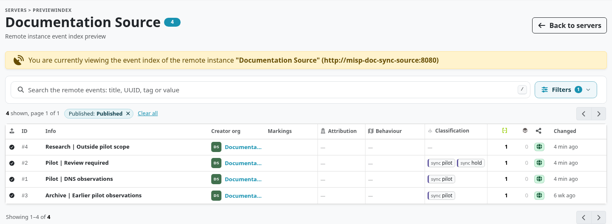
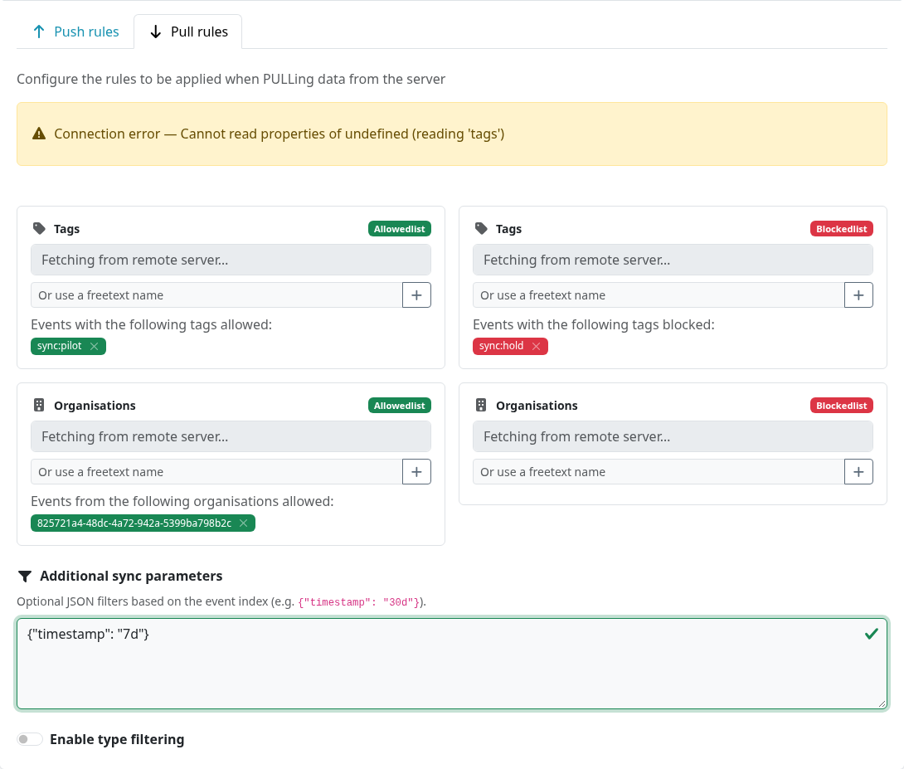
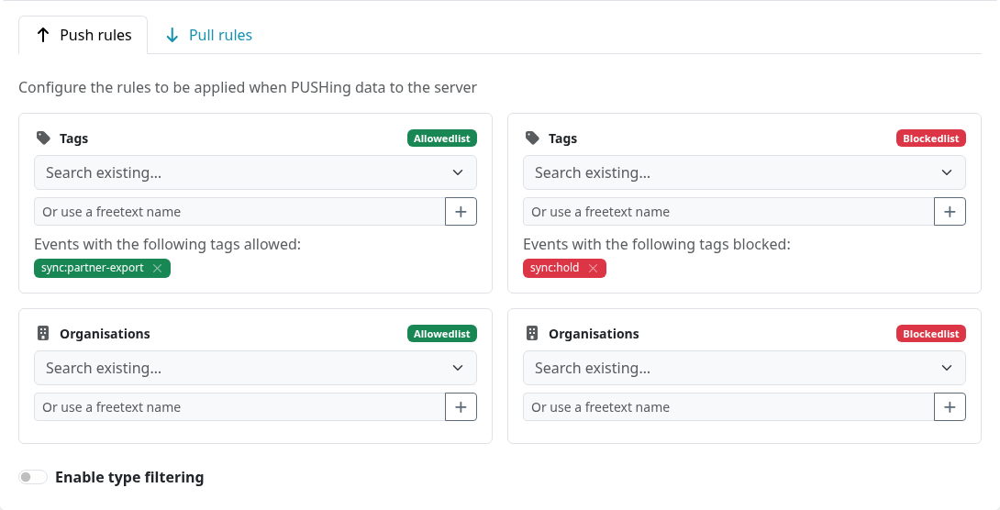
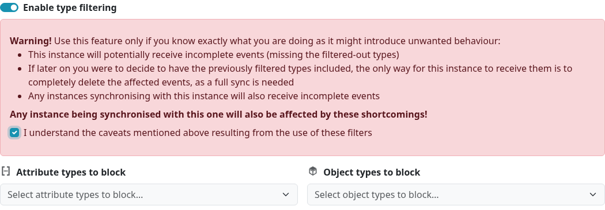
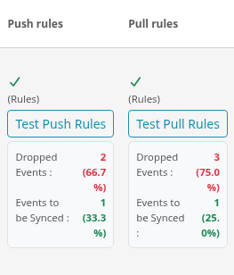

A new connection to an established MISP instance can make years of intelligence available at once.
Start by inspecting what the remote sync account can see, then agree on a first batch and test the saved rules before transferring data.

::: {.callout-note}
This chapter follows the light Overmind interface in MISP 3.0.0 from the [`3.0_wip` development branch](https://github.com/MISP/MISP/tree/3.0_wip).
The receiver uses a **site administrator** account to manage the connection and a dedicated **Sync user** account issued on the source to authenticate to it.
Screenshots use synthetic events on MISP commit [`357030cc`](https://github.com/MISP/MISP/commit/357030ccb6a70b388a3bab6798854eb50dc2588a).
:::

<!-- Screenshot provenance: ../assets/first-synchronization-screenshots.json. -->

## Agree on the scope

Decide with the remote administrator which direction to enable and what data can cross the connection.
For an inbound pilot, agree on a few published events, their producing organizations and event tags, and how much history you need.
Record the expected event UUIDs and at least one visible event that should be excluded.
Using UUIDs lets both sides identify the same event even when their numeric IDs differ.

Choose **Events** if the goal is to ingest intelligence for local analysis.
An event can include eligible attributes, objects, tags, and reports, and the full pull can also bring over proposals and sightings.
Review the separate switches for galaxy clusters, Analyst Data, and collections if those records are in scope.
For local correlation lookups against remote values, **Cache remote values** is available as a separate operation.
See [what can synchronize](../sharing/index.qmd#synchronising-analyst-data-and-collections) for the full list.

Check how the source distributes the sample events and whether the remote sync account belongs to the required organizations and sharing groups.
Check expected attribute and object visibility as well.
If the intended audience is changing, coordinate that through [distribution and sharing groups](../sharing/index.qmd#sharing-groups).

Choose a maintenance window for a large backfill and check available disk space, database capacity, and worker health on the receiver.
Agree with the source administrator on when to run the job and who will verify the result.

## Save the connection and explore the source

1. On the receiving instance, open **Sync → Servers & Feeds → Servers → Add Server**.
   Enter the HTTPS base URL, the remote host organization's identity, and the key issued on the remote instance.
   See [identities and credentials](../sharing/index.qmd#concept) for the organization and account setup.
2. In **What to synchronise**, turn off **Push** and **Pull** for **Events** while you browse.
   Turn off the other synchronization switches and **Cache remote values** for this first pass.
   Save the connection, then check **Connection Test** and **Sync User** in the server list’s card view.
3. Open the server name or select **Explore server** in the server's actions menu.
   Search for representative events by title, UUID, tag, or value.
   Use **Published** and **Distribution** to narrow the preview, then open several events.
   Check the producing organization, event tags, distribution, and representative attributes or objects.

{fig-alt="Published is active in the remote event preview. Four synthetic events are visible before any local import."}

**Explore server** reads the remote event index using the saved credentials.
Its search and filter controls change the current view.
Use the preview to inspect visibility and sample the data, then use the saved sync-rule test to estimate the scope of a regular pull.
Browsing the index or opening an event leaves the local event inventory unchanged.

## Configure saved synchronization rules

Edit the saved server, open **Sync rules**, and select **Pull rules** for inbound events or **Push rules** for outbound events.
Save the peer before configuring pull selectors so MISP can load the remote tags and organizations.
For push, select existing tags and organizations on the local instance.
If the pull pickers fail to load, enter the exact remote tag names and creator organization UUIDs in the free-text fields.
Use **+** to add each entry, check that it appears as a chip, and then save and run **Test Pull Rules**.

### Tags and organizations in either direction

| Rule | How MISP evaluates it |
|---|---|
| **Tags → Allowedlist** | When populated, any listed tag can qualify an event. For push, this matches event tags. On a `3.0_wip` pull source, a tag on a visible attribute can also satisfy this rule. |
| **Tags → Blockedlist** | A matching event-level tag excludes the event, even if it matches the allowedlist. For a pull, an attribute-only tag is insufficient to exclude the whole event. |
| **Organisations → Allowedlist** | When populated, the event's creator organization (`Orgc`) must be one of the listed organizations. |
| **Organisations → Blockedlist** | An event from any listed creator organization is excluded. |

A populated tag allowedlist and a populated organization allowedlist must both match.
MISP also applies any blocklists and, for a regular pull, the additional event-index parameters.
Empty lists impose no restriction in that category.
An empty rule set makes every otherwise eligible event a candidate for a regular pull, including historical events.
Use that setting when the entire eligible corpus is in scope and the receiving instance can handle it.

Set agreed routing tags on the event so both directions can evaluate them consistently.
Tags and rules narrow synchronization.
Set the event, object, and attribute distribution and sharing-group membership to control access.
Confirm that tagging and organization filtering are enabled on the source before relying on those pull rules.

### Pull rules and time windows

Under **Pull rules → Additional sync parameters**, enter a JSON object for the remote event index.
These settings are evaluated by the source during a regular full pull and are also used by **Test Pull Rules**.

| Goal | JSON example | What it selects |
|---|---|---|
| Start with recently updated events | `{"timestamp": "7d"}` | Events whose modification timestamp falls in the last seven days, including older events edited recently. |
| Start with recently republished or newly published events | `{"publish_timestamp": "30d"}` | Events whose most recent publication was within 30 days. Republishing an older event can bring it into the window. |
| Select recently first-published events | `{"firstpublished": "30d"}` | Events whose first recorded publication was within 30 days. This field depends on support from the source version. |
| Backfill a fixed modification window | `{"timestamp": [1767225600, 1769903999]}` | Events modified in January 2026 UTC, using inclusive Unix timestamp bounds in seconds. |
| Backfill by the event's recorded date | `{"datefrom": "2026-01-01", "dateuntil": "2026-01-31"}` | Events with an event date in January 2026, including both endpoints. |
| Target a verified event cohort | `{"eventid": "6fad47cb-c554-43fc-8293-393882be93b3"}` | The eligible event with that UUID. Replace the example with an agreed UUID from the source. |

Combine distinct parameters in one JSON object if both criteria should apply.
A regular pull selects published events, and MISP manages its own pagination.
Use time windows, specific UUIDs, or a narrow tag or organization pilot to bound the batch.
Confirm the accepted fields on the remote version, particularly for mixed-version connections.

For example, add `sync:pilot` to **Tags → Allowedlist**, add `sync:hold` to **Tags → Blockedlist**, and add the agreed producer to **Organisations → Allowedlist**.
Use this seven-day window in **Additional sync parameters**.

```json
{"timestamp": "7d"}
```

The pilot selects eligible published events from that creator organization, with a matching allow tag and an event modification in the past seven days.
An event-level `sync:hold` tag excludes the event.
A rolling window moves on every run.
After an outage, check whether the last successful pull falls outside the window.
If it does, use a wider or fixed window to catch up before restoring the recurring rule.

{fig-alt="Pull rules allow sync:pilot and the source organization UUID, block sync:hold, and set timestamp to 7d."}

### Push rules for a destination

Set the receiving organization's access through distribution and sharing groups first.
In **Push rules**, choose a local event-level allow tag agreed for that destination and add a block tag for events awaiting review.
Apply an organization allowedlist if the destination should receive events from specific producers only.
For example, allow `sync:partner-export` and block `sync:hold`.
An event carrying both tags is excluded.
With empty push rules, any otherwise eligible outbound event can be a candidate.

The push tab has no **Additional sync parameters** field.
To stage an outbound batch by date, review a local event search, apply the export tag to the approved events while Push is disabled, and save the push rule.
Review the publication and distribution of those events before enabling Push.
Publishing an eligible event can trigger delivery as soon as Push is enabled.
If the partner also pulls, review the rules on its connection separately.
For **Push all**, a blocked tag on a standalone attribute can also omit that attribute even when the event itself passes.

{fig-alt="Push rules allow sync:partner-export and block sync:hold. Both organization lists are empty."}

### Optional attribute and object type filters

If the local administrator has enabled `MISP.enable_synchronisation_filtering_on_type`, both rule tabs show **Enable type filtering**.
After acknowledging the form's warning, choose **Attribute types to block** or **Object types to block**.
These controls can remove standalone attributes, attributes inside objects, or entire objects from transferred events.

{fig-alt="After the warning is acknowledged, separate selectors are available for attribute types and object types to block."}

Leave type filters off for the first pass unless the receiving scope specifically requires incomplete event records.
A sync-rule test counts event candidates.
Inspect a representative received event, including an object with multiple attributes, before relying on type filtering.
If you later expand the allowed types, verify that already-synced events get refreshed.
Removing the rule alone does not recover previously omitted content.

## Test the rules and run a pilot

1. Save the intended rules and enable **Events → Pull** for an inbound pilot.
   Keep automated pulls paused until you have verified the manual run.
2. In the server list, switch to table view and select **Test Pull Rules** under **Pull rules**.
   For a planned outbound run, enable **Events → Push** during a controlled window and select **Test Push Rules** under **Push rules**.
   Read **Dropped Events** and **Events to be Synced** for each direction.
   An unexpectedly large count calls for a narrower rule or a check that the source recognized it.
3. For a pilot through the normal pull rules, use the server's **Pull all** action.
   With rules saved, this is a full pull of the eligible subset.
   Check the pull result or background job, then compare the received UUIDs, distribution, tags, attributes, and objects with your expected examples.
   Confirm that the event you deliberately excluded did not arrive.
4. For push, publish an approved pilot event or use **Push all** after restricting the eligible set.
   Have the destination administrator confirm receipt and check a negative case before scheduling or widening the exchange.

{fig-alt="The Push rules and Pull rules columns each show one event to be synced and the number of dropped events."}

::: {.callout-important}
**Fetch this event** and bulk **Fetch** in **Explore server** pull the chosen remote event IDs directly.
They bypass saved pull rules that select candidates by tag, organization, or additional event-index parameters.
Use these actions only for explicitly approved events, and use **Pull all** with a narrow saved rule to validate the recurring policy.
The `update` pull technique also bypasses the saved event-index rules and targets UUIDs already present locally.
:::

The rule tests report candidate counts.
Actual results can differ because of existing local versions, blocklists, distribution, content filtering, and errors during delivery.
If a job is queued, wait for completion and check the logs for individual failures.

## Expand the backfill and schedule ongoing sync

Widen the rules in batches, for example by extending a fixed date window or adding one agreed tag or producer at a time.
After each change, save the rules, rerun the count, and record the job outcome before starting the next batch.
Watch worker progress, database and disk use, and the source's response times.
Event candidate counts cover events.
Enable additional data types separately after verifying the pilot and checking each type’s sharing scope.

Once you have backfilled the agreed history, save the steady-state rules and [schedule synchronization](../administration/index.qmd#automating-certain-console-tasks).
Keep a record of the chosen scope and the last verified batch so you can recover from a missed run.
Changing a rule or disabling the connection does not recall events already transferred.
