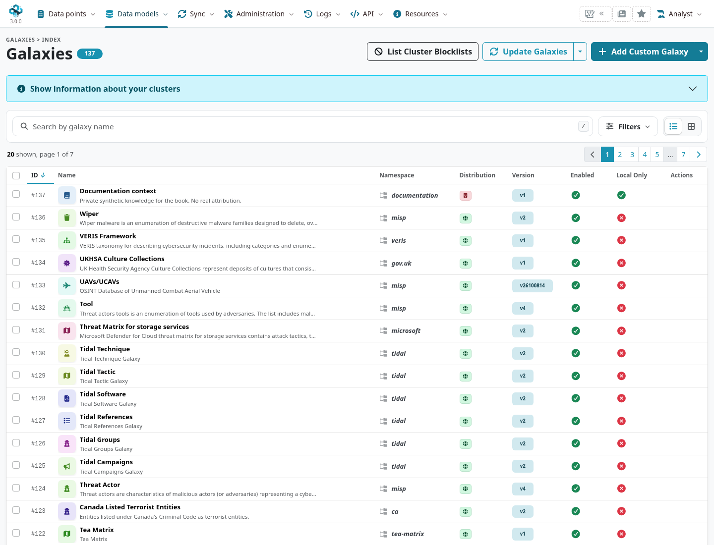
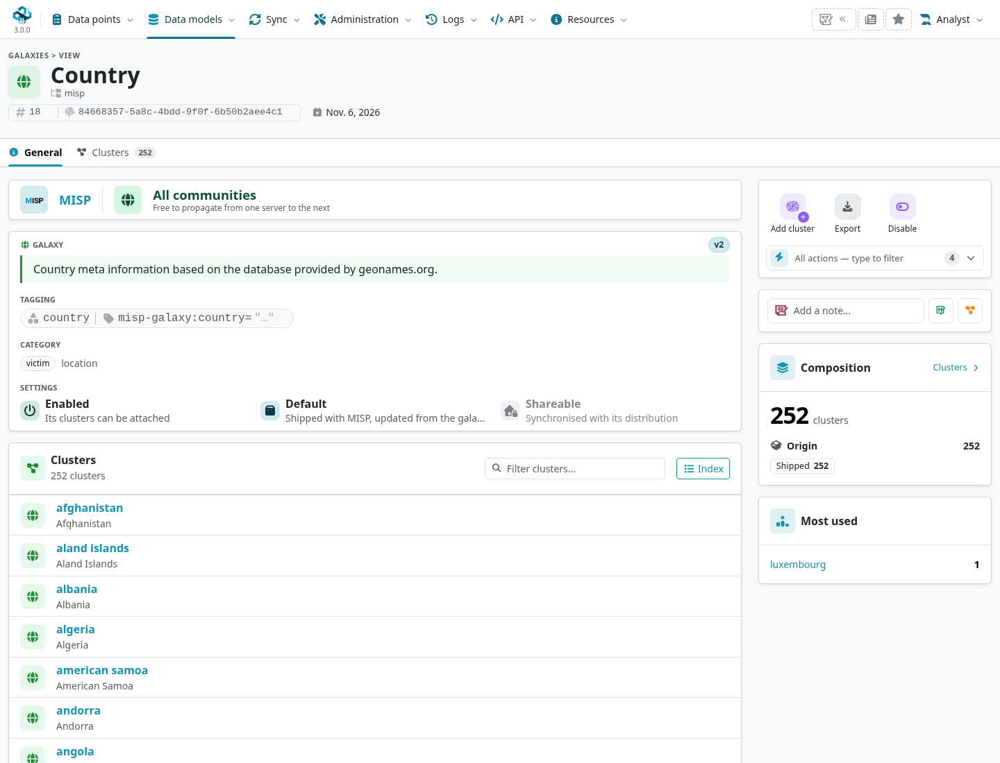
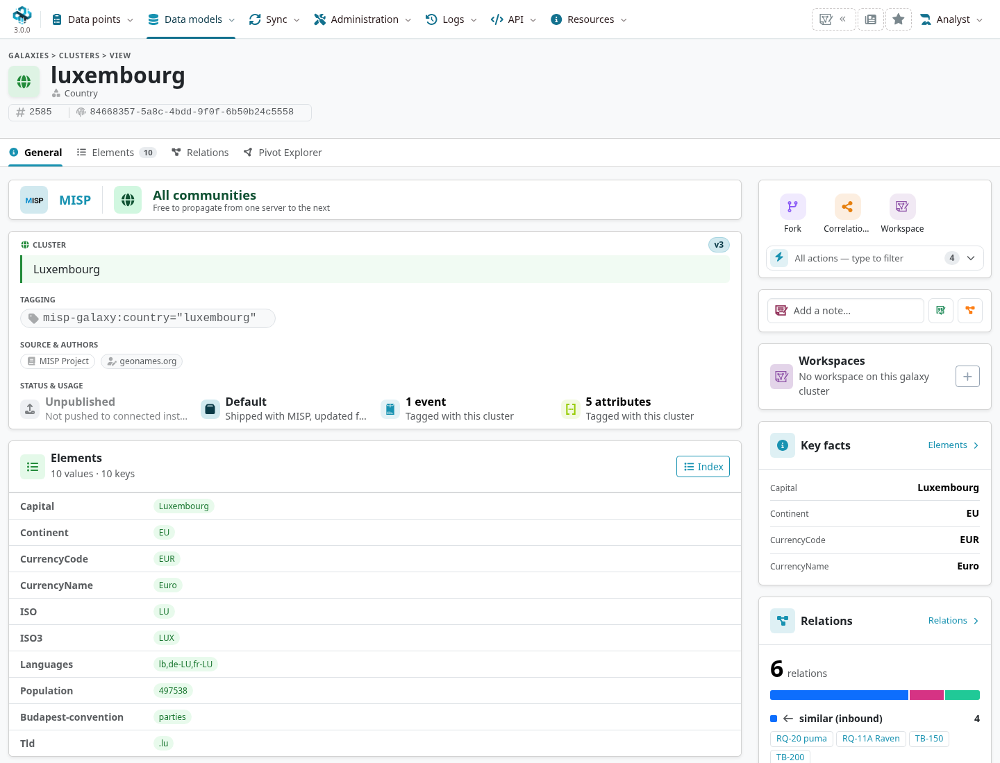
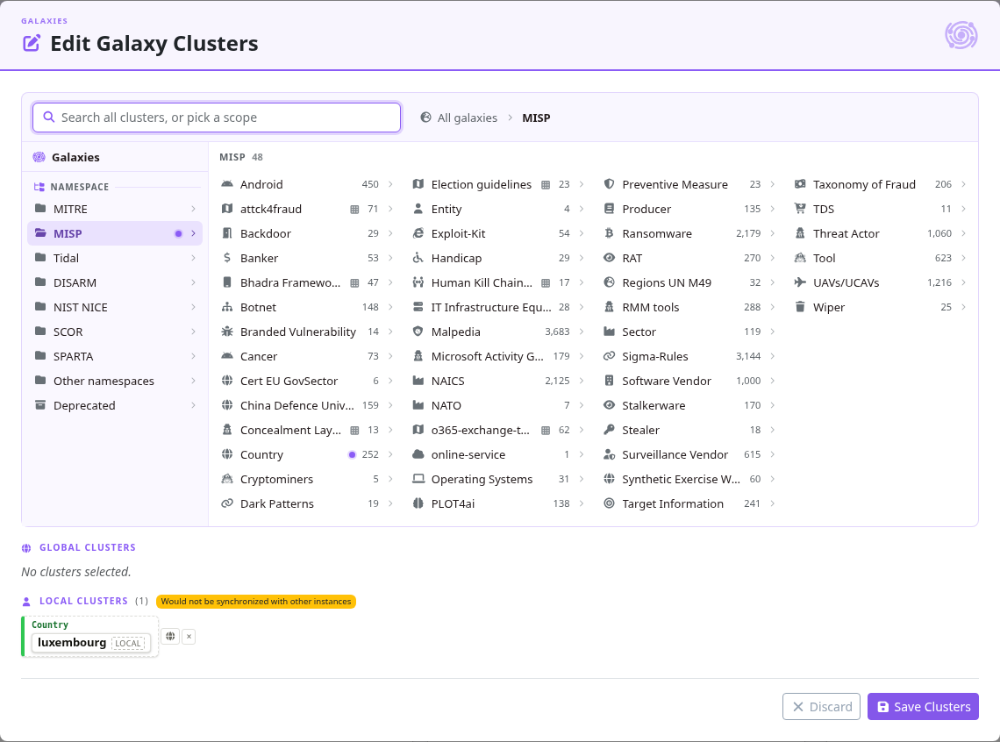
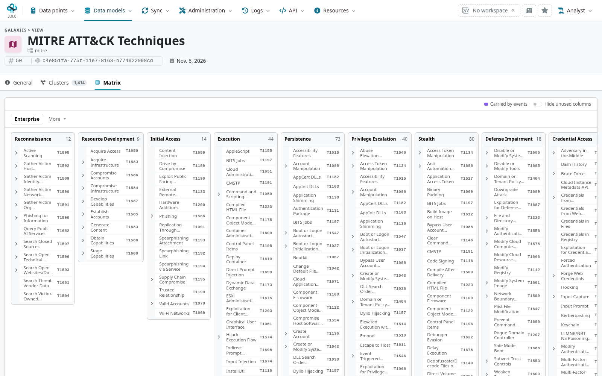
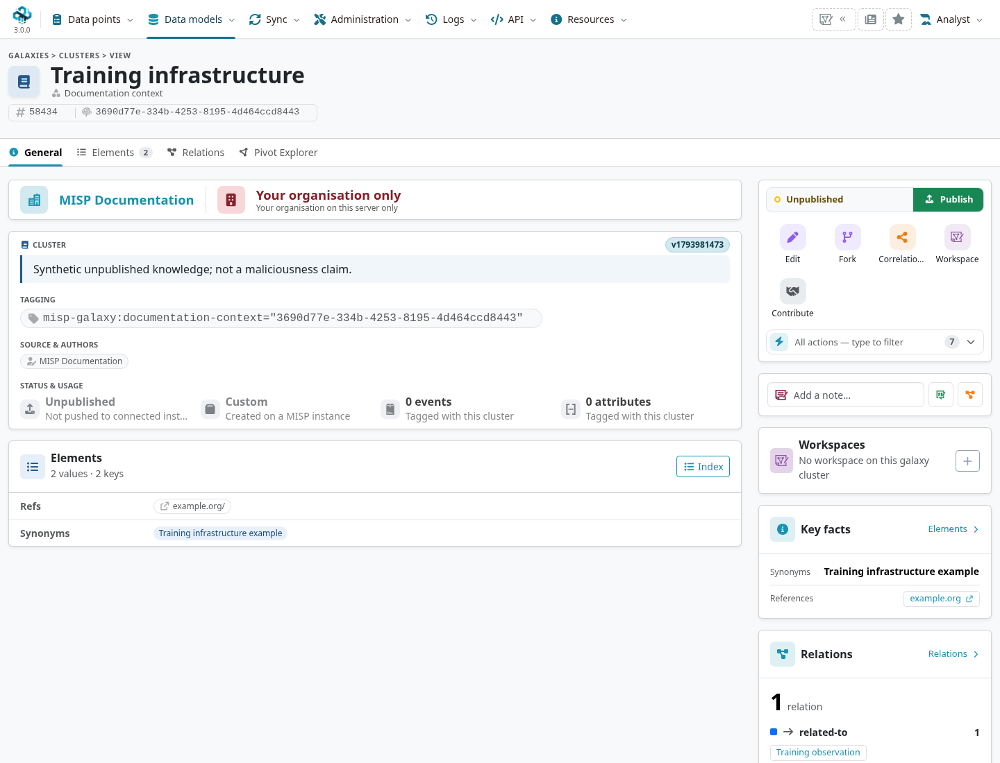

A galaxy organizes reusable knowledge such as techniques, actors, malware families, sectors
or countries. Its **clusters** carry a name, UUID, description, metadata and relationships.
Attach a cluster to an observation when the relationship is supported by your evidence;
matching a familiar name is not sufficient attribution.

::: {.callout-note}
This chapter follows MISP **3.0.0**, `3.0_wip` commit `99ebee729`, in Overmind.
The community library comes from [misp-galaxy](https://github.com/MISP/misp-galaxy).
Examples use a neutral country attachment and private unpublished custom knowledge.
:::

<!-- Definition pins, private fixture and captures: ../assets/data-model-screenshots.json -->

## Distinguish the entities {#galaxy-concepts}

::: {.table-responsive}

| Entity | Role |
|---|---|
| Galaxy | Defines a knowledge collection: name/type, namespace, description and optional matrix layout. |
| Cluster | A particular entry, with its own UUID, metadata, version, source and distribution. |
| Cluster relationship | A directional statement between knowledge entries, with a relationship type and its own scope. |
| Event/attribute attachment | Associates a cluster with one observation, using an underlying tag and a local/global scope. |

:::

The underlying tag is not the entire cluster. Shipped entries can have tags based on their
value, while custom entries use UUID-based tags; read the stored `tag_name` and cluster UUID
rather than constructing a tag string or assuming every suffix is a UUID.

## Browse galaxies and clusters {#galaxy-management}

Open **Data models → Galaxies** (`/galaxies/index`). Search/filter the catalogue and inspect
enabled/local-only status. A disabled galaxy is not normally offered by the attachment picker.
Use a local-only galaxy when its attachments must remain local; this is distinct from an
individual cluster's distribution.

Open a galaxy to inspect its metadata and clusters. Overmind's **General** and other context
tabs, searchable cluster list and related views replace the old left-menu walkthrough.
Use exact identifiers, descriptions, sources and synonyms to distinguish similarly named entries.

A cluster view exposes its **Elements**, relationships and activity alongside source/identity
information. Synonyms and references help discovery; they are not independent confirmation of
a source's assessment. In 3.0, the view also links to workspace/research context. Those records
retain their own ownership and visibility rules.

## Attach context to an event or attribute {#galaxy-attachments}

Open the target's context/tagging controls and choose the cluster attachment action. Search by
galaxy, cluster name or synonym, inspect the entry, then confirm the target and local/global
scope. A default cluster can be used without publishing it as a custom cluster.

A **local** attachment stays with this instance in normal native sharing. A **global** attachment
is eligible for propagation according to the event, tag and synchronization rules; it does not
make the event or cluster visible to everyone. Review format-specific/manual exports separately.
Cluster distribution, attachment scope and event distribution answer different questions.

The pinned branch's multi-event attachment path can downgrade a global preference to a local
attachment on events the user cannot modify. Check the per-event result rather than assuming
all selected events were changed globally. A local-only galaxy rejects a global attachment.

Detach the attachment when the observation no longer supports it; deleting the knowledge entry
is a different action. Changes to a global event/attribute attachment can unpublish the event.
Review the saved state before any later publication.

## Matrix galaxies {#galaxy-matrices}

Galaxies with a `kill_chain_order`, such as ATT&CK collections, can render techniques by tactic
in a matrix. Check the selected framework/version and what the highlighting counts. An attached
technique is an assertion/context link, not proof of coverage, detection quality or attribution.

Use the matrix to navigate/compare context and inspect the underlying clusters. Preserve
external IDs and references when exchanging knowledge with another tool; matching a label or
column position is not a stable cross-version identity.

## Create and relate custom knowledge {#galaxy-custom}

Use **Add Custom Galaxy** for a local knowledge collection, then **Add cluster** for entries.
Galaxy editing requires the relevant role permission. Review the name/namespace, local-only
choice, distribution, owner and creator organisation rather than inheriting an unintended audience.

A custom cluster can include authors, source, description and key/value elements such as
`synonyms` and `refs`. The UI supports structured element entry. Save a private draft first,
then check its UUID, version and resulting scope.

The normal attachment picker offers published custom clusters and shipped defaults. Review and
publish custom knowledge before offering it through that picker or synchronization. Publication is
a separate privileged action and can start cluster propagation; it is not required for the
private drafting example. Shipped default clusters are a separate case. Editing custom knowledge
or its relationships can unpublish it, requiring a deliberate review/republication later.

Use cluster relationships for statements such as one knowledge entry being related to another.
Choose a source, target UUID, type and distribution; optional tags qualify the relationship.
Inspect direction and inbound/outbound views. This is different from an
[object reference](../misp-objects/index.qmd#object-references-and-relationships) between observed entities.

Fork a cluster when an editable derivative should retain a link to its parent. The fork has its
own identity; review parent-version changes before merging them. A fork is not a local edit of
the shared default entry. Use the cluster blocklist for identifiers that should not be captured
or synchronized; see [Administration](../administration/index.qmd#galaxy-cluster-blocklist).

## Update and author definitions {#galaxy-definition-updates}

Update the pinned `app/files/misp-galaxy` files through the deployment process, then import them
with **Update Galaxies** or `cake Admin updateGalaxies`. Normal update, forced reimport and
wiping default clusters have different effects; inspect the selected action and preserve custom
knowledge before a destructive repair. Importing definitions does not attach them to every event.

For repository contributions, validate the paired galaxy definition (`galaxies/<type>.json`)
and cluster collection (`clusters/<type>.json`), including their shared identifiers, metadata,
versions and relationship targets. Use the upstream schema/tests. The
[MISP Engineering Bay](https://github.com/MISP/misp-engineering-bay) offers authoring tools;
validate the exported data and installed-version compatibility before importing it.

The available library changes independently of the book. Browse your installed catalogue or
[MISP's galaxy catalogue](https://www.misp-project.org/galaxy.html) rather than relying on a
fixed printed list of every cluster.
