MISP separates navigation between the main menus, the controls for the page you are viewing, and side panels you can keep open while working.
This chapter shows where to find common tasks and how those parts of the interface fit together.
For a first hands-on exercise, follow the [Quick Start](../quick-start/index.qmd).

::: {.callout-note}
The screenshots show MISP **3.0.0** from the development branch [`3.0_wip`](https://github.com/MISP/MISP/tree/3.0_wip), in light mode with fictional data.
Your menus can differ with your role, enabled features, and theme.
Select a screenshot to enlarge it in the website.
:::

<!-- Screenshot source commits, account roles and capture details: screenshots.json -->

## The top bar

The MISP logo opens your personal homepage, or the instance's default landing page if you have not chosen one.
The named menus on the left group related tools; the controls on the right open workspaces, news, bookmarks, and your account menu.
The current menu is highlighted so you can see which part of MISP you are using.

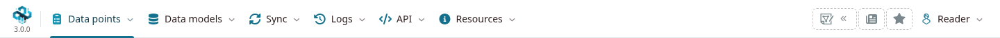

### Why menus differ between accounts

MISP filters menu entries according to your permissions and the instance's configuration.
For example, **Administration** is absent for the regular user above and present for the site administrator below.
**Logs** depends on audit permissions, while **Sync** can also be available to a user in the host organization; both can be available to non-administrators.

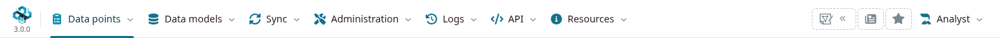

Use these roles as a starting point, rather than assuming every instance uses identical permissions:

| Role | Typical scope |
|---|---|
| User | Work with events, attributes, and other intelligence within the granted permissions. Publication can require a separate permission. |
| Read Only | Browse permitted data without the editing controls available to contributors. |
| Organization administrator | Manage users in the administrator's own organization. |
| Site administrator | Manage instance-wide settings, organizations, roles, and administrative tools. |

Menu access and data visibility are separate: your organization, event distribution, and sharing-group membership also affect which records you can see.
Ask your administrator if a tool is missing, and see [Roles](../administration/index.qmd#roles) for the permission model.

## Main navigation

Start with the group that matches your task:

| Menu | Use it to… |
|---|---|
| **Data points** | Find and work with events, attributes, objects, reports, collections, and analyst data. |
| **Data models** | Find tags, taxonomies, galaxies, templates, and the lists that help interpret data. |
| **Sync** | Reach feeds, remote servers, sharing groups, and permitted integrations. |
| **Administration** | Manage users and the instance, subject to administrator permissions. |
| **Logs** | Inspect the log views your account is allowed to access. |
| **API** | Open API documentation, the REST client, and automation guidance. |
| **Resources** | Open the user guide, reference information, and available interface themes. |

Some entries open another submenu before you reach a page.
For example, **Data models → Tags & Taxonomies → List Taxonomies** opens the taxonomy list.

### Data points

This is the main starting point for analysis.
Open **Events** to browse reports and create a new event, or use **Objects** and **Attributes** to work across the data you can access.
**Value Intelligence** provides an entry point for investigating a value.

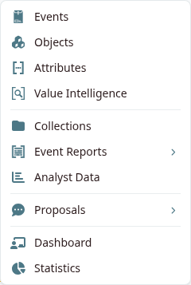

**Collections**, **Event Reports**, and **Analyst Data** organize related intelligence and its narrative or assessment.
**Proposals** groups suggested changes and related requests.
[**Dashboard**](../dashboards/index.qmd) and **Statistics** provide overview pages.
See [Using MISP](../using-the-system/index.qmd), [Collections](../collections/index.qmd), and [Analyst data](../analyst-data/index.qmd) for the detailed workflows.

### Data models

Use this menu to find the vocabularies, structures, and reference lists that give intelligence context.

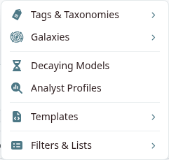

- **Tags & Taxonomies** contains **List Taxonomies**, **List Tags**, and **List Tag Collections**.
- **Galaxies** leads to galaxy knowledge bases and cluster relationships.
- **Templates** contains event templates, object templates, and object relationships.
- **Filters & Lists** groups warninglists, noticelists, import regular expressions, and correlation exclusions.
- **Decaying Models** and **Analyst Profiles** provide additional modeling tools where available.

Warninglists help flag well-known values that may be false positives; noticelists explain relevant policy or technical considerations.
Import regular expressions apply input rules, while correlation exclusions prevent chosen values from creating correlations.
See [Taxonomies](../taxonomy/index.qmd), [Galaxies](../galaxy/index.qmd), [Objects](../misp-objects/index.qmd), [Warninglists](../warninglists/index.qmd), and [Noticelists](../noticelists/index.qmd) for more.

### Sync

**Servers & Feeds** leads to the remote-server and feed pages your account can access.
Remote servers synchronize data between MISP instances; feeds provide intelligence to cache for correlation or fetch into the instance.

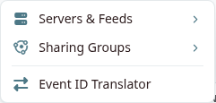

**Sharing Groups** manages defined sharing audiences, while **Event ID Translator** helps map event IDs between connected instances.
Accounts with the appropriate permissions can also see **Integrations**, including community, Cerebrate, TAXII, or SightingDB connections.
See [Sharing and synchronization](../sharing/index.qmd) and [Managing feeds](../managing-feeds/index.qmd) before configuring exchanges.

### Administration

Organization administrators and site administrators see the tools appropriate to their scope.
Use **Users & Orgs** for account and organization management, and **Roles & Permissions** for the available role and authentication-key administration views.
Site administrators can open **Server Settings & Maintenance** to configure and diagnose the instance.

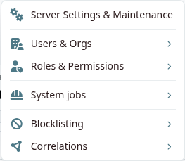

Other groups cover system jobs, blocklisting, and correlation management.
Jobs, scheduled tasks, workflows, and benchmarking entries depend on permissions and enabled features.
See [Administration](../administration/index.qmd) for those workflows; the presence of a menu entry does not grant access to every action within it.

### Logs

**Application logs** records application activity such as authentication and other logged actions.
**Audit logs** records data changes when the audit feature is enabled and your role permits access.
**Access logs** provides request-level information to site administrators.
The example instance below exposes application and access logs to its site administrator.

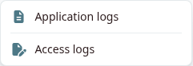

See [Logs](../administration/index.qmd#admin-logs) for the available log types and access requirements.

### API

**Open API** opens the instance's API reference.
**REST Client** lets you construct requests and inspect responses, and **Automation** provides guidance for programmatic access.
API operations use the permissions of the authenticated account; a write request can change data just as an action in the web interface can.

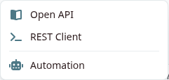

See [Automation](../automation/index.qmd) and [PyMISP](../pymisp/index.qmd) for authentication and examples.

### Resources

Use **User Guide** to return to this book and **Categories & Types** to look up the attribute data model.
The menu can also expose the instance's public encryption material and interface themes when configured.

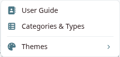

## Your account

Open the menu labeled with your name on the right of the top bar.
The label identifies the signed-in account; permissions come from its assigned role.

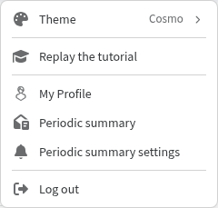

- **My Profile** opens your account details and the available profile and authentication-key controls.
- **Theme** selects a visual theme; **Dark mode** switches palettes when the selected theme supports it.
- **Replay the tutorial** restarts the interface orientation tour.
- **Log out** ends your authenticated session.

The available appearance options depend on the instance and theme.
See [User management](../user-management/index.qmd) for profile settings, notifications, and multi-factor authentication.

## Page-level controls

The main menu chooses a feature; the page itself provides the controls for working with its records.
On an index page such as **Events**, look for the page heading, primary action, search and filters, result count, table headings, and pagination.

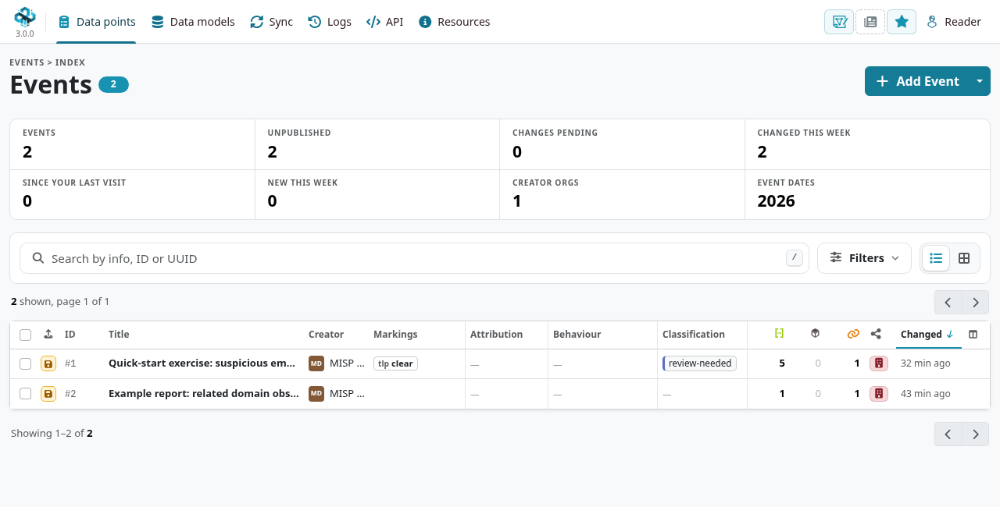

Use the search field and **Filters** to narrow the results, then check the active filters and result count before acting on the list.
Where a table offers sorting or pagination, use those controls to change the order or move between pages.
Creation, editing, and publication controls appear according to your permissions.

On an event page, tabs such as **General**, **Attributes**, **Objects**, **Reports**, and **Correlation** separate the different views of the same event.
Use the event's action panel for import, editing, and downloads.
See the [Quick Start event walkthrough](../quick-start/index.qmd#create-an-event) for examples.

## Side panels

The controls at the right of the top bar can open a workspace, news, or bookmarks alongside the current page.
Panels can offer controls to widen, undock, or close them, so you can consult them without leaving the record you are working on.
**News** shows the instance's news content and any unread-news indication; it is not a list of every data change in MISP.

### Bookmarks and your homepage

Open **Bookmarks** using the star control.
Select **Bookmark this page**, review the name and URL, and save it for later use.
Bookmarks can be private or, where permitted, exposed to your organization; review that choice when saving.

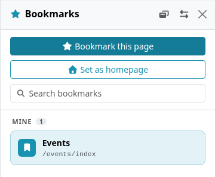

**Set as homepage** makes the current page your own landing page.
It changes where the MISP logo takes you and applies to your account.

### Workspaces

The **Workspace** control opens the current analysis workspace or lets you choose one.
A workspace provides a graph for bringing related items together while you browse; it is separate from the event's own attributes and reports.
Make sure the intended workspace is active before using **Add to workspace** controls on other pages.
Additions are saved as they arrive; use **Save layout** to keep changes to node positions.

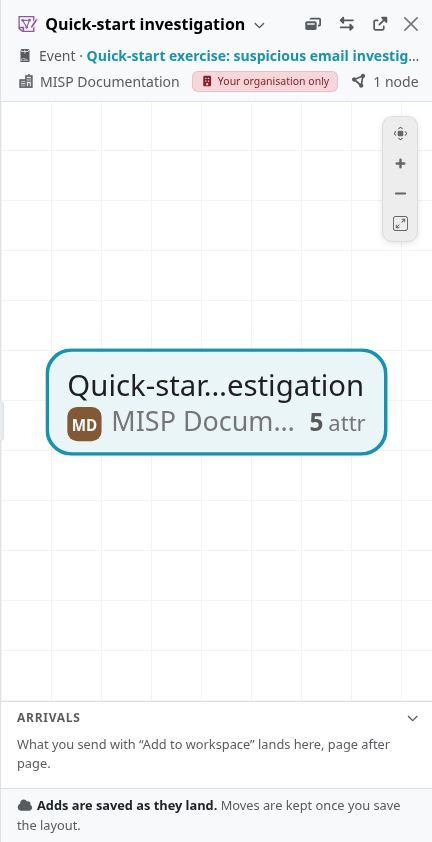

Workspaces have their own name and distribution settings.
The example uses **Your organisation only**, so it can be accessible to other authorized members of your organization.
Creating or selecting one is optional; you can continue using the event lists and event views without an active workspace.

## Smaller screens and keyboard access

On a smaller screen, use **Menu** to expand the main navigation.
The same permission rules apply even when the controls are rearranged or shown as icons.

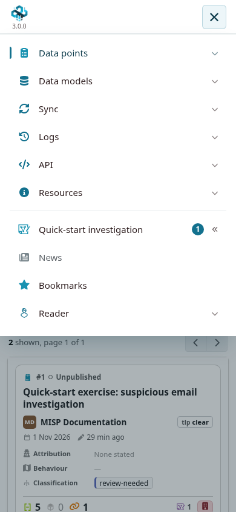

Use the on-page keyboard-shortcut helper to check the shortcuts supported by your current view.
See [Keyboard shortcuts](../keyboard-shortcuts/index.qmd) for an introduction, and use **Replay the tutorial** from the account menu if you want another guided tour of the interface.
