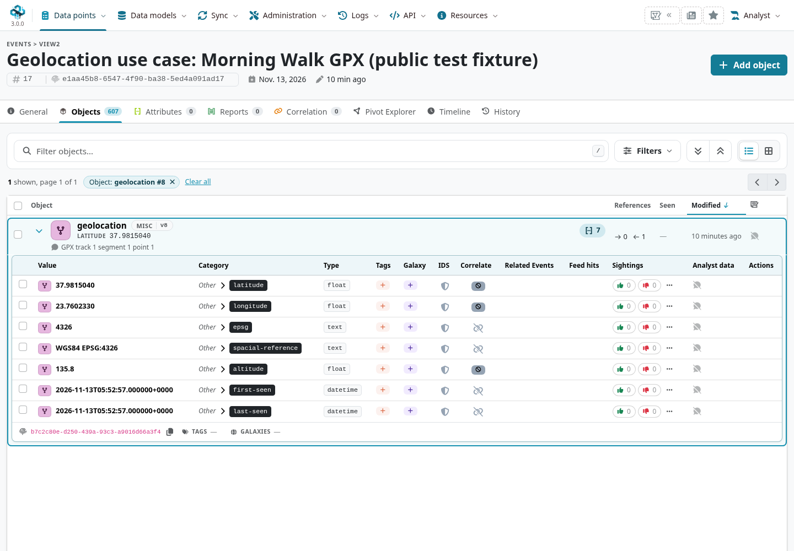
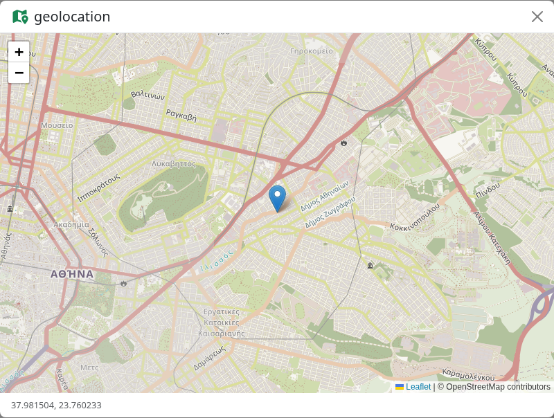
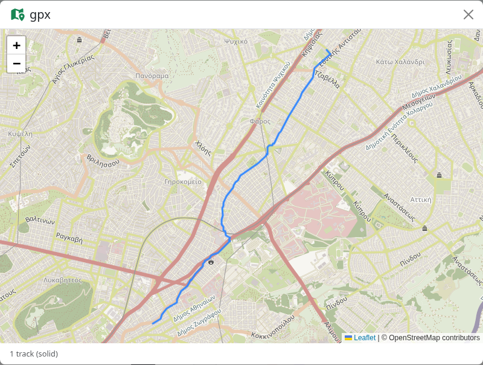
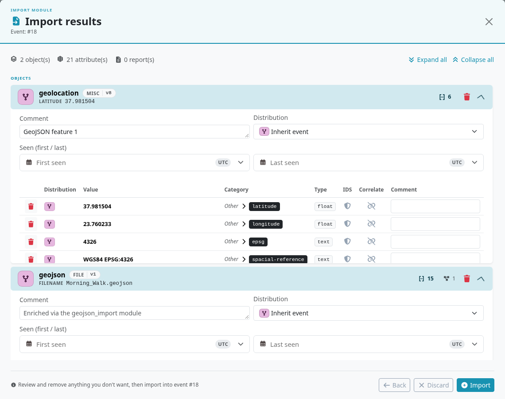

Geographic context can describe a reported place, an observed position, a journey or an area of interest.
Choose a representation that preserves what the source actually establishes: an IP geolocation estimate, for example, does not establish where a person or device was physically present.
This use case imports a recorded walk, inspects its dataset and individual observations, and exports the original track for use in another geographic tool.

::: {.callout-note}
The screenshots use MISP **3.0.0**, [`3.0_wip` commit `0aaeb964b`](https://github.com/MISP/MISP/commit/0aaeb964b4e2330d081d8b36050744df3ebe0819), with the Overmind light theme and a site administrator account.
The GPX and GeoJSON handlers were checked at [misp-modules commit `47eb69eab`](https://github.com/MISP/misp-modules/commit/47eb69eab4ab1da6f6464992bd8e470e602ac800), using PyMISP 2.5.34.4.
The exercise event is private and unpublished; all imported attributes have **For IDS** off.
The example is a public test fixture, not an incident or an attribution claim.
Select an image to enlarge it.
:::

<!-- Source pins, fixture statistics, checks and screenshot hashes: ../assets/geolocation-screenshots.json -->
<!-- Refreshed module inventory and source hashes: ../assets/geolocation-modules-reference.json -->

## Choose the geographic object {#geo-objects}

Keep coordinates together in a [`geolocation` object](../misp-objects/index.qmd), rather than trying to pair unrelated event-level `float` attributes.
Use a dataset object as well when the source has a path, geometry or metadata worth retaining.

::: {.table-responsive}

| Representation | Use it for | What it preserves |
|---|---|---|
| `geolocation` | One location observation or a reported place | Latitude/longitude, optional altitude, place names, reference system, observation times and accuracy where known. A country-only object is valid but cannot supply a coordinate marker. |
| `gpx` | GPS waypoints, routes and tracks | Original GPX attachment, hashes, metadata, counts, bounds and time extent. The import module also creates linked `geolocation` observations. |
| `geojson` | Points, lines, polygons and geometry collections | Original GeoJSON attachment, hashes, feature count, geometry types and bounds. Point geometries also produce linked `geolocation` objects. |
| `nmea` | NMEA 0183 receiver sentence logs | Original checksummed log, sentence/fix counts, talkers, bounds and dated time extent; valid GGA/RMC/GLL positions become linked geolocations. |
| `kml` | KML documents and KMZ packages | Original XML or complete archive, assets, geometry/observation counts and bounds; Point and `gx:Track` observations become linked geolocations. |
| `uav` | A documented unmanned aircraft observation | A specialized object with a `flight-path` attachment that the map can read as GPX. Use it when the evidence concerns a UAV; a generic walk belongs in `gpx`. |

:::

The object definitions checked here are `geolocation` **v8**, `gpx` **v1** and `geojson` **v1** in [misp-objects](https://github.com/MISP/misp-objects/tree/b22919c9fccef9f73964f5bea0c8548ebe3cbf13/objects).
The additional `nmea` **v1** and `kml` **v1** templates were checked at [misp-objects commit `092484900`](https://github.com/MISP/misp-objects/tree/0924849002dfa706e165698908d389c2b5bcd88a/objects).
The NMEA and KML importers bundle their dataset templates for older PyMISP installations; install matching templates in MISP for editor/display support.
Administrators should update the instance's object templates and the module service's PyMISP templates when these objects are missing.
Updating one catalogue does not update the other.

### Coordinates, times and uncertainty {#geo-coordinates}

For a point, record decimal-degree WGS84 `latitude` and `longitude`, `epsg` = `4326`, and `spacial-reference` = `WGS84 EPSG:4326`.
The template's stored relation really is spelled **`spacial-reference`**.
Validate coordinate ranges and signs, and transform projected coordinates before sending them to the GPX/GeoJSON exporters; changing the EPSG label does not transform values.
GPX names its `lat` and `lon` attributes, whereas GeoJSON positions are ordered **longitude, latitude, optional altitude**.

Add `altitude` only when the source supplies an elevation and its meaning is understood.
The template describes a WGS84 altitude; a device's reported elevation may use another vertical reference, which should be explained in provenance rather than silently assumed equivalent.
`accuracy-radius` is a radius in **kilometers**, not meters or a confidence score.
Do not invent precision from the number of decimal places, or substitute GPX dilution-of-precision values for a geographic radius.

The GPX importer records a point's timestamp in the **`first-seen` and `last-seen` object relations**, setting both to the same instant.
These datetime attributes are distinct from the generic `first_seen` / `last_seen` fields on a MISP object or attribute.
Consequently the object's **Seen** column can remain empty even though its timestamp relations are populated.
The MISP record's creation/update timestamp is another separate concept.

Record the source and the relationship to the observed entity, for example a location estimate linked to the IP attribute that was looked up.
A directional object reference expresses that relationship; equal coordinates or a shared country do not establish that two records concern the same entity.
The coordinate and time relations in this template disable exact-value correlation by default, and MISP correlation is not a spatial-distance search.
See [Correlation](../correlation/index.qmd) for how investigative links are computed.

## Geographic module inventory {#geo-modules}

This inventory was checked against [misp-modules commit `84327b2c8`](https://github.com/MISP/misp-modules/tree/84327b2c85062c048e7818c2d42cd8e19402f71b/misp_modules/modules).
It covers **four dedicated geographic importers**, **five geographic exporters**, the **13 enrichment modules that explicitly create `geolocation` objects**, and the additional geographic context described below.
The [source audit](../assets/geolocation-modules-reference.json) records identifiers, families, configuration names and file hashes, including the GoAML address mapping.
Generic serializers such as CSV can also carry geolocation objects when configured for their schema.
Check your running `/modules` catalogue: source availability does not prove that a handler or its dependencies are installed, enabled or configured on your instance.
The screenshots retain their earlier source pins; NMEA/KML behavior was checked with the refreshed module tests, and provider output mappings were reviewed in source without making provider calls.

### Geographic file import and export {#geo-file-modules}

All handlers in this table process files locally, with no provider account or external lookup.
Import results require review and a final save in MISP.
Exports of stored datasets need the selected datasets' attachment bytes, as shown in the [API example](#geo-export).
Exports of standalone `geolocation` objects need no attachments; send only the selected location objects.

::: {.table-responsive}

| Identifier | Input | MISP result or exported file |
|---|---|---|
| `gpx_import` | GPX 1.0/1.1 XML | `gpx` dataset plus linked waypoint, route-point and track-point geolocations. |
| `geojson_import` | GeoJSON geometry, Feature or FeatureCollection | `geojson` dataset; Point/MultiPoint observations become linked geolocations, while lines and polygons remain geometry. |
| `nmea_import` | Checksummed ASCII NMEA 0183 sentence log | `nmea` dataset plus valid GGA/RMC/GLL position observations; fix quality, talker and source sentence remain context. |
| `kml_import` | KML XML **or KMZ** archive, detected from content | `kml` dataset plus Point and nonempty `gx:Track` observations; KMZ assets remain in the attachment. This handler imports both formats. |
| `gpx_export` | `gpx` datasets and standalone geolocations | GPX; a single stored dataset can be returned unchanged, and standalone points become waypoints. |
| `geojson_export` | `geojson` datasets and standalone geolocations | GeoJSON; a single stored dataset can be returned unchanged, and standalone locations become Point features. |
| `nmea_export` | `nmea` dataset attachments | **ZIP of separate original logs**, with each member's bytes unchanged. It does not synthesize NMEA sentences from geolocations. |
| `kml_export` | One stored KML dataset, or standalone geolocations | KML XML; preserves one stored KML unchanged when no extra points are needed. Use `kmz_export` for KMZ input, multiple datasets or a dataset plus extra points. |
| `kmz_export` | KML/KMZ datasets and standalone geolocations | KMZ; preserves a single KMZ unchanged when possible, or packages source documents/assets separately and adds standalone Point Placemarks. |

:::

For NMEA details, see the maintained [import](https://github.com/MISP/misp-modules/blob/84327b2c85062c048e7818c2d42cd8e19402f71b/documentation/import_mod/nmea_import.md) and [export](https://github.com/MISP/misp-modules/blob/84327b2c85062c048e7818c2d42cd8e19402f71b/documentation/export_mod/nmea_export.md) contracts.
For KML/KMZ, see the [shared importer](https://github.com/MISP/misp-modules/blob/84327b2c85062c048e7818c2d42cd8e19402f71b/documentation/import_mod/kml_import.md) and [KML/KMZ exporters](https://github.com/MISP/misp-modules/blob/84327b2c85062c048e7818c2d42cd8e19402f71b/documentation/export_mod/kml_export.md).
There is no separate `kmz_import` identifier in this snapshot; use `kml_import`.

## Import the Morning Walk GPX {#geo-gpx-import}

Download the [Morning_Walk.gpx example](examples/Morning_Walk.gpx).
It is byte-identical to the [public misp-modules fixture](https://github.com/MISP/misp-modules/blob/47eb69eab4ab1da6f6464992bd8e470e602ac800/tests/fixtures/gpx/Morning_Walk.gpx); [example provenance](examples/README.md) identifies the source and derivative.
The file is GPX 1.1, identifies its creator as `StravaGPX`, and contains:

- **1 track**, **1 segment**, **606 track points**, no routes and no waypoints;
- a time extent from **2026-11-13 05:52:57 UTC** to **06:52:26 UTC**;
- latitude bounds **37.981504–38.012107** and longitude bounds **23.760233–23.785524**;
- **197,419 bytes**, including per-point sensor extensions.

Its SHA-256 is:

```text
77e36202f8bb56cbc31c5bf5cc1ab104841a368c0c9e206853a9110f1b6170a8
```

### Enable the handlers and review the results

1. Have a site administrator connect the [module service](../modules/index.qmd#modules-service-checks) and open **Administration → Server Settings & Maintenance → Integrations**.
   On **Import modules**, configure and enable the Import service and `gpx_import`; on **Export modules**, configure and enable the Export service and `gpx_export`.
   See [Configure MISP 3.0](../modules/index.qmd#modules-configuration) for the service URL, port and per-module settings.
   Confirm both identifiers appear in the running service's `/modules` response.
   These handlers run locally and require no provider account or external lookup.
2. Create an event with distribution **Your organisation only** for the exercise.
   From its General tab, choose **Import from…**, expand **Gpx Import**, select **Upload a file instead of pasting**, and choose `Morning_Walk.gpx`.
3. Choose **Run Gpx Import** and inspect **Import results** before saving.
   Expand a location to check coordinates, elevation, reference system and time; check the dataset at the end of the list as well.
   The complete example produces **607 objects** and **4,263 object attributes**.
4. Keep the dataset and its intended locations together, review distribution and IDS flags, then choose **Import** to save.
   The module response alone is a preview; running the handler directly does not create a MISP event.


### Inspect the dataset and observations {#geo-gpx-inspect}

Open the event's **Objects** tab and filter for `gpx`, then expand the dataset.
The original file is an `attachment`; the other relations describe its hashes, byte size, creator, version, point/track/segment counts, geographic bounds and start/end time.
The dataset has **606 outgoing `contains` references**, one to each imported observation.
A reference records containment; it does not itself encode track ordering or segment breaks.


Follow a reference, or filter for `geolocation`, and expand an observation.
The first point has latitude `37.9815040`, longitude `23.7602330`, reported elevation `135.8`, and both timestamp relations set to `2026-11-13T05:52:57Z`.
Its comment identifies **GPX track 1 segment 1 point 1**.
The importer follows the same pattern for GPX waypoints and route points, with comments identifying their source context.



Heart rate, cadence, temperature and other vendor extensions remain in the original attachment.
They are not all flattened into geolocation attributes.
Retain the file to preserve those fields, track order and segment structure; the derived point objects provide a searchable view of selected observations.
Object categories such as **Payload delivery** on a filename/hash reflect attribute defaults, and do not classify this walk as malicious.

## Display a point, track or area {#geo-map}

An administrator enables `Plugin.Geolocation_enabled` and configures `Plugin.Geolocation_url` for the instance's tile service.
From an object's three-dot action menu in the Objects tab, choose **Show on map**.
The current interface supports coordinate-bearing `geolocation` objects, `gpx` and `geojson` attachments, and `uav` flight paths.
It draws GPX tracks as solid lines and distinguishes routes; a point with an accuracy radius can show its uncertainty circle.

Open **Show on map** on the first `geolocation` object to inspect one observation at `37.9815040, 23.7602330`.
The map displays a single marker and a coordinate readout for the selected point.



Open the parent `gpx` object's map to inspect the complete recorded track.



The General tab also provides geographic object views, but these are bounded summaries.
In this snapshot the overview reads at most **200 objects per template**, so its point display is not proof that all 606 locations were shown.
Use the dataset's own map and counts to inspect the complete source track.
With map tiles disabled, the overview can still draw coordinate observations and offer dataset downloads, but it does not draw the GPX tracks or GeoJSON areas.
A missing basemap is a tile-service/network issue, separate from whether the attachment geometry was parsed.

Location files can expose precise movement, times and sensor readings.
Review the attachment itself before sharing: restricting or deleting a derived point does not remove that point from the preserved file.
Apply the event/object/attribute distribution and any sharing-group policy to the complete evidence you intend to disclose.
See [Sharing](../sharing/index.qmd) for those controls.
Map tile requests also reveal the viewed area to the configured tile provider; use the deployment's approved service.

The captured maps use `https://a.tile.openstreetmap.fr` as the configured tile URL.
Map data © [OpenStreetMap contributors](https://www.openstreetmap.org/copyright); the humanitarian style is by the [Humanitarian OpenStreetMap Team](https://www.hotosm.org/) and the tiles are hosted by [OpenStreetMap France](https://www.openstreetmap.fr/).

## Use GeoJSON for geographic geometry {#geo-geojson}

Enable `geojson_import` and `geojson_export` in the same way as the GPX handlers.
The importer accepts a WGS84 GeoJSON geometry, Feature or FeatureCollection and preserves the original bytes in a `geojson` object.
It records feature count, geometry types and coordinate bounds.
Point and MultiPoint geometries produce linked geolocation objects, including points nested in GeometryCollections.
LineString and Polygon vertices stay in the dataset: they are geometry, and are not automatically interpreted as individual location observations.

The [Morning_Walk.geojson comparison](examples/Morning_Walk.geojson) contains **two features**: a Point for the first observation and a LineString using all 606 track positions.
Importing it produces **one geojson dataset and one linked geolocation**, rather than 607 independent points.



It illustrates geometry handling; this derivative does not retain GPX sensor extensions, all timestamps or GPX segment semantics.

A Point's coordinate order looks like this:

```json
{
  "type": "Feature",
  "properties": {
    "name": "First GPX observation",
    "observed_at": "2026-11-13T05:52:57Z"
  },
  "geometry": {
    "type": "Point",
    "coordinates": [23.760233, 37.981504, 135.8]
  }
}
```

The module preserves properties and feature IDs in the derived location's `text` relation as JSON.
It does **not** infer `first-seen` from an arbitrary property such as `observed_at`; map those semantics deliberately if a downstream workflow needs datetime relations.
Polygon holes, lines and other source geometry remain available through the original attachment and its map representation.
For boundaries or areas of interest, retain that geometry rather than replacing it with a centroid that implies a precise observation.

## Import NMEA receiver logs and KML/KMZ packages {#geo-nmea-kml}

The upstream [receiver log](https://github.com/MISP/misp-modules/blob/84327b2c85062c048e7818c2d42cd8e19402f71b/tests/fixtures/nmea/receiver.nmea) and [mixed KML fixture](https://github.com/MISP/misp-modules/blob/84327b2c85062c048e7818c2d42cd8e19402f71b/tests/fixtures/kml/mixed.kml) provide small test inputs for these importers.

Enable `nmea_import` on **Integrations → Import modules** and `nmea_export` on **Export modules**.
Upload an ASCII receiver log or paste its sentence text, then review the `nmea` dataset and linked positions before saving.
Checksums are mandatory for every sentence, including unsupported sentence types.
Invalid/no-fix positions are counted and retained in the source without creating a location observation.
Other messages, including proprietary sentences and AIS encapsulation, remain in the attachment without being decoded as positions.
Repeated observations remain separate; the importer does not fuse GGA, RMC and GLL into one fix.

RMC and ZDA establish dates; subsequent GGA/GLL times use the dated context of the same talker, with continuous-stream rollover handling.
Undated positions retain time-of-day as context with a warning, instead of taking a date from the host clock.
GGA mean-sea-level height becomes WGS84 ellipsoid `altitude` only when the reported geoid separation is also present in meters, by adding the two values.
HDOP stays contextual and is not converted into `accuracy-radius`.
Keep each original log: `nmea_export` returns separate ZIP members to avoid combining independent receivers' date context.

Enable `kml_import`, `kml_export` and `kmz_export` on their respective integration pages.
Upload KML or KMZ through **Kml Import**, or paste KML XML, then review the `kml` dataset and extracted observations.
The importer recognizes Point, LineString, LinearRing, Polygon, MultiGeometry and `gx:Track`/`gx:MultiTrack` geometry.
Only Point geometries and nonempty track samples become geolocations; line/polygon vertices contribute to counts and bounds.
Complete timezone-qualified observation times become datetime relations; partial or timezone-less times remain context.
KML height and altitude mode also remain context, since sea-level/ground-relative heights cannot be assigned directly to WGS84 ellipsoid `altitude`.

For KMZ, the original archive retains styles, icons, overlays and other assets.
The parser follows local KML NetworkLinks inside the package, with cycle detection, and warns about unresolved links; it never fetches remote resources or extracts archive members to disk.
Use `kmz_export` to retain assets and separate source-document style scopes when combining datasets.
The importers enforce bounded parsing and return errors rather than partial results for invalid supported content; consult their contracts for framing and size limits.

The pinned MISP UI shown in this chapter maps `geolocation`, GPX, GeoJSON and UAV flight paths.
It does not provide the same dataset-map action for `nmea` or `kml` objects.
Inspect their derived geolocation markers, or open an exported file in a suitable geographic application.

## Export without losing the source {#geo-export}

`gpx_export` includes stored `gpx` attachments and standalone coordinate-bearing `geolocation` objects.
`geojson_export` similarly includes stored `geojson` datasets and standalone locations.
`kml_export`/`kmz_export` exchange `kml` datasets and standalone geolocations; `nmea_export` preserves original `nmea` logs in a ZIP.
These exporters include contextual data even when **For IDS** is off.
Each exporter accepts specific object types: for example, GPX export does not consume a `geojson` attachment, and GeoJSON export does not consume a `gpx` attachment.

::: {.callout-important}
The preserved attachment is authoritative.
For one GPX, GeoJSON, KML or KMZ dataset with no additional standalone points, the corresponding exporter can return its bytes unchanged.
Those dataset exporters skip `contains`-linked geolocations to avoid duplicates.
NMEA export returns a ZIP whose individual log members retain the source bytes.
Editing or deleting a derived location does **not** rewrite or redact the dataset attachment.
To export current derived coordinates, select the geolocation objects alone and use GPX, GeoJSON, KML or KMZ.
Prepare and re-import a revised dataset when the track, area or receiver log itself must change.
:::

Standalone locations become GPX waypoints, GeoJSON Point features or KML Point Placemarks, depending on the selected exporter.
Multiple datasets or additional standalone points require a combined output; original formatting may then change.
GPX combination preserves routes, tracks, segments and extensions; GeoJSON combination preserves source features and records collection metadata under `misp:source-datasets`.
Place-only geolocations are skipped with a warning, incomplete coordinate pairs cause an error, and non-WGS84 reference systems are rejected.
Deleted records are excluded.

### A verified API export path

::: {.callout-warning}
At the pinned `3.0_wip` commit, the event's `/events/exportModule/gpx_export/{eventId}` action did not fetch attachment bytes and returned an empty download in this exercise.
The same attachment-data requirement applies to stored GeoJSON, NMEA and KML/KMZ datasets; use the attachment-aware API path for them as well.
Fetch the selected dataset attachments and call the module API directly as below; verify the file before relying on the UI export action on another deployment.
This is an observed snapshot limitation, not evidence of an empty source track.
:::

The following Python example requires `requests`, a MISP API key authorized to read the selected objects and any dataset attachments being exported, and access to the module service.
Set `MISP_URL`, `MISP_API_KEY`, `MISP_EVENT_ID` and `MISP_MODULES_URL` in the environment.
Use HTTPS with certificate verification for MISP, and keep the module service on an approved private connection.
Choose the module identifier, dataset `object_name` and output extension from the [file-module table](#geo-file-modules): for example `geojson_export` with `geojson` and `.geojson`, `nmea_export` with `nmea` and `.zip`, or `kmz_export` with `kml` and `.kmz`.
The selected exporter must support the event's dataset objects; changing a filename extension does not convert an unsupported source format.

The example selects the event's `gpx` dataset objects, fetches their attachment bytes individually and forwards only those objects.
For an export of location objects alone, set `object_name = "geolocation"` and use GPX, GeoJSON, KML or KMZ; that path downloads no attachments.
NMEA export requires `nmea` dataset objects.
If only a subset of the matching objects is intended, also restrict the selection by object UUID before downloading or forwarding data.
The event search deliberately uses `withAttachments: false` in both cases, so unrelated event files are not fetched or sent to the module service.

```python
import base64
import os
from pathlib import Path

import requests

misp_url = os.environ["MISP_URL"].rstrip("/")
modules_url = os.environ["MISP_MODULES_URL"].rstrip("/")
headers = {
    "Authorization": os.environ["MISP_API_KEY"],
    "Accept": "application/json",
}
export_module = "gpx_export"
object_name = "gpx"
response = requests.post(
    f"{misp_url}/events/restSearch",
    headers=headers,
    json={"eventid": os.environ["MISP_EVENT_ID"],
          "withAttachments": False},
    timeout=120,
)
response.raise_for_status()
events = response.json()["response"]
if not events:
    raise ValueError("No readable event returned")

objects = [
    obj
    for event in events
    for obj in event["Event"].get("Object", [])
    if obj["name"] == object_name
]
if not objects:
    raise ValueError("No matching objects selected")

for obj in objects:
    for attribute in obj.get("Attribute", []):
        attribute.pop("data", None)
        if (object_name != "geolocation"
                and attribute["object_relation"] == "attachment"
                and attribute["type"] == "attachment"):
            download = requests.get(
                f"{misp_url}/attributes/download/{attribute['id']}",
                headers=headers,
                timeout=120,
            )
            download.raise_for_status()
            attribute["data"] = base64.b64encode(
                download.content
            ).decode("ascii")

response = requests.post(
    f"{modules_url}/query",
    json={"module": export_module,
          "data": {"Event": {"Object": objects}}},
    timeout=120,
)
response.raise_for_status()
result = response.json()
if "error" in result:  # A module error may arrive with HTTP 200.
    raise ValueError(result["error"])
if result.get("warnings"):
    print(result["warnings"])
payload = base64.b64decode(result["data"], validate=True)
if not payload:
    raise ValueError("Empty geographic export")
Path("export.gpx").write_bytes(payload)
```

With the Morning Walk dataset selected, this example exported through `/query` to **197,419 bytes with the same SHA-256 as the input**.
It still contains 606 track points and no duplicated waypoints.
The location-only setting exported one waypoint without downloading any attachments in a separate check.
An unrelated event attachment was neither fetched nor forwarded in either check.
This verifies the preserved-source round trip; it does not establish that every later edit to derived objects is reflected in that source.
The GPX handlers limit decoded source/output size to **20 MiB** and points to **10,000**; the GeoJSON handlers also limit features/coordinate positions and nesting.
Check the maintained [GPX import](https://github.com/MISP/misp-modules/blob/47eb69eab4ab1da6f6464992bd8e470e602ac800/documentation/import_mod/gpx_import.md), [GPX export](https://github.com/MISP/misp-modules/blob/47eb69eab4ab1da6f6464992bd8e470e602ac800/documentation/export_mod/gpx_export.md), [GeoJSON import](https://github.com/MISP/misp-modules/blob/47eb69eab4ab1da6f6464992bd8e470e602ac800/documentation/import_mod/geojson_import.md) and [GeoJSON export](https://github.com/MISP/misp-modules/blob/47eb69eab4ab1da6f6464992bd8e470e602ac800/documentation/export_mod/geojson_export.md) contracts when preparing larger datasets.

## Enrich an IP with location context {#geo-enrichment}

IP-based enrichment answers a different question from a recorded GPX position.
It reports a provider's association between an address and a place, often with substantial uncertainty and a time-dependent database.
Record the provider/database version, lookup time, source IP attribute and available accuracy; do not describe a city estimate as a measured GPS fix or personal attribution.

::: {.table-responsive}

| Module identifier | Source/configuration | Result and limitation |
|---|---|---|
| `geoip_city` | Local MaxMind GeoIP2/GeoLite2 City MMDB; `local_geoip_db` or `local_geolite_db`, plus `geoip2` | Available city, region, country, coordinates and accuracy radius in kilometers. |
| `geoip_country` | Local MaxMind Country MMDB; the same path settings and dependency | Country-level geolocation; a coordinate marker is not guaranteed. |
| `geoplugin` | geoPlugin HTTPS API; `api_key` | Available location and accuracy context for public IPv4, linked to the input attribute. |
| `ip2locationio` | IP2Location.io API; `key` | Location fields linked to the input IP through `locates`; subscription controls available fields. |
| `ipgeolocation` | IPGeolocation API with `api_key`, or local databases in `mmdb_paths` | Geographic/network context; local database mode takes precedence. API fields depend on the plan. |
| `ipinfo` | IPinfo API; `token`, `api` (`legacy`, `lite` or `lookup`) | Country/place data and optional coordinates. Lite supplies country/continent context without city coordinates. |
| `ipapi_is` | ipapi.is API; optional `api_key` | Available location, ASN and provider intelligence; keyless operation has reduced data and limits. |
| `mmdb_lookup` | MMDB HTTP server; `custom_API`, `db_source_filter`, `max_country_info_qt` | Country data and **country-average coordinates**, plus ASN. Defaults to CIRCL's public service; it does not directly open a local MMDB file. |
| `censys_enrich` | Censys API; `api_id`, `api_secret`, Censys client dependency | A geolocation when a host/website response contains location data; certificate-only results need not contain a location. |
| `lamis_network` | Lamis Network API; `api_key`, `risk_threshold`, `timeout` | Country/code and city in a geolocation object; the current mapping does not add latitude/longitude. |
| `modat` | MODAT Magnify API; `apikey` and query controls | Host geographic context, with coordinates and accuracy radius when present, linked to infrastructure observations. |
| `urlscan` | urlscan.io search API; `apikey` | Scan-host country/city context linked to the resolved infrastructure; the current geolocation mapping does not add coordinates. |
| `whoisfreaks` | WhoisFreaks API; `apikey` | IP lookup can create a geolocation from country, region, city and coordinates, alongside WHOIS/security context. Domain lookups follow a different output path. |

:::

Verify the running catalogue, dependencies and provider configuration before enabling a handler, then use the attribute's enrichment action and review returned objects before saving.
The [Modules chapter](../modules/index.qmd) covers administration, review and troubleshooting.
The 13 handlers above are the enrichment modules that explicitly construct the `geolocation` template in the checked source snapshot.
Some return only a place name; the presence of that object does not imply a usable map point.
No external geolocation provider was queried for this exercise; the screenshots show GPX-derived evidence, not enrichment results.
When a lookup is imprecise or conflicts with another source, retain both sources and explain the assessment in an [Analyst Data Note](../analyst-data/index.qmd) rather than overwriting an observed track with an estimate.

## Other modules carrying geographic context {#geo-other-modules}

Some integrations use other object templates or text fields for geographic information.
Their output needs its own interpretation before being promoted to a coordinate observation.

::: {.table-responsive}

| Module identifier | Geographic context and boundary |
|---|---|
| `goamlimport`, `goamlexport` | Import/export GoAML financial-report address structures through `geolocation` objects and their references. These mappings cover city, region, country, address and ZIP code; they do not import GPS tracks or infer coordinates. |
| `shodan` | Country, city and available latitude/longitude in an `ip-api-address` object. |
| `crowdsec` | Country/code, city and available coordinates in `crowdsec-ip-context`. |
| `hyasinsight` | HYAS-specific objects, including **Mobile Geolocation Information** and geographic fields in other result types; endpoint/source semantics vary. |
| `ipqs_fraud_and_risk_scoring`{.text-wrap .text-break} | Geographic fields in the IPQS-specific result object, alongside risk-scoring data. |
| `greynoise` | Source/destination country context in GreyNoise objects; it does not create a `geolocation` point. |
| `onyphe_full` | Network/service country context in ONYPHE results, including `ip-port` and service objects. |
| `ptrclassify` | City/region/country hints in `ptrclassify` objects from hostname rules. Rule-derived hints are not verified positions. |
| `countrycode` | Country text derived from a domain's country-code TLD; domain registration naming does not establish hosting location. |
| `phone_number_info`{.text-wrap .text-break} | Country/area from numbering-plan metadata in `phone-number` and text output; this is allocation geography, not a subscriber's physical location. |
| `geoip_asn` | ASN objects from a local MaxMind ASN MMDB. This is network ownership/routing context, not a physical position. |

:::

For provider-backed handlers, check the accepted input types, configuration and disclosure behavior in the running catalogue before invoking them.
An IP, hostname, phone number or provider-derived country field can be useful context without establishing where a person or device was physically observed.
