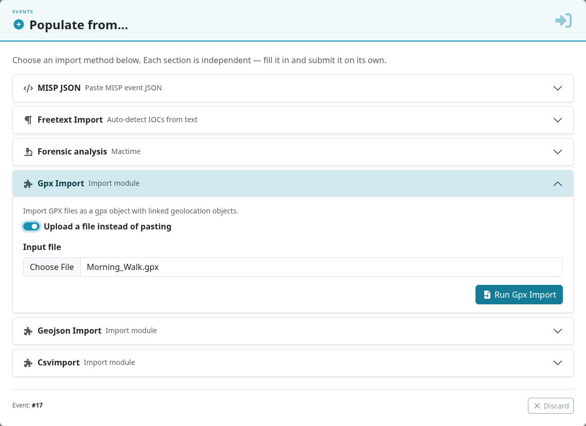
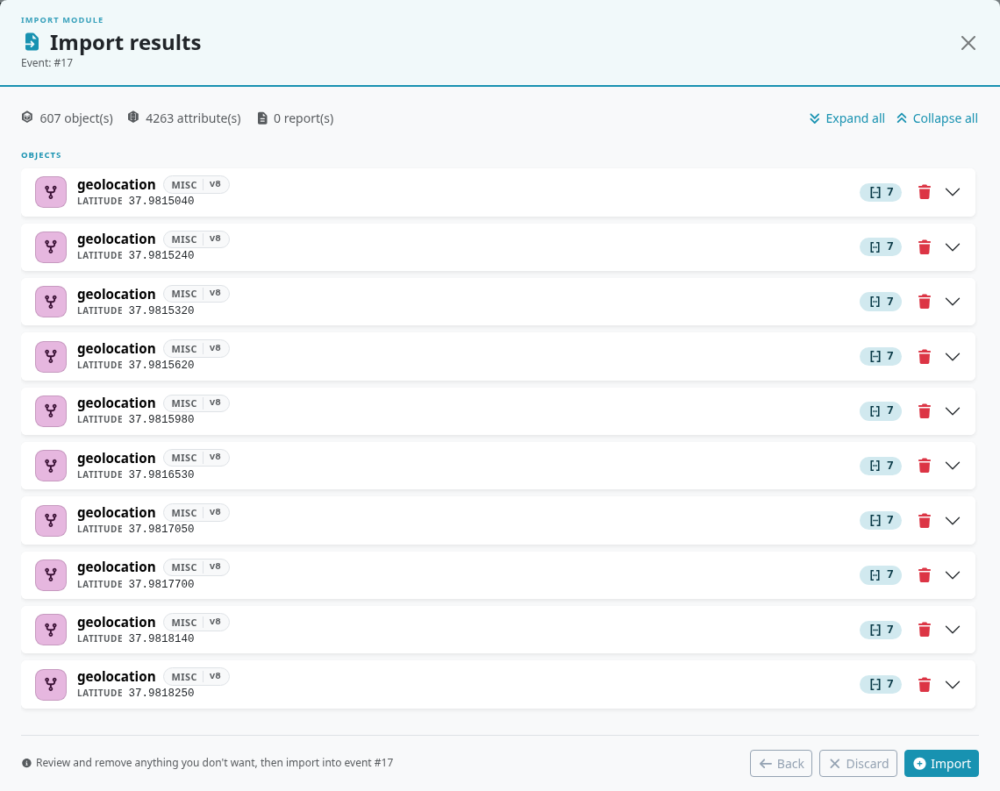
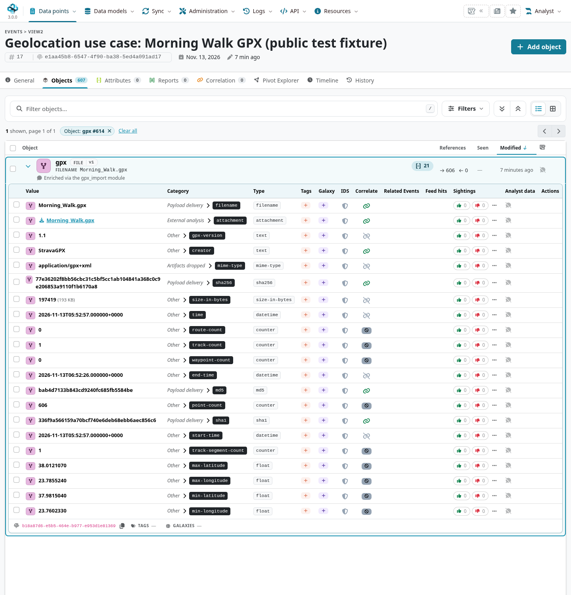

Geographic context can describe a reported place, an observed position, a journey or an area of interest.
Choose a representation that preserves what the source actually establishes: an IP geolocation estimate, for example, does not establish where a person or device was physically present.
This use case imports a recorded walk, inspects its dataset and individual observations, and exports the original track for use in another geographic tool.

::: {.callout-note}
The screenshots use MISP **3.0.0**, [`3.0_wip` commit `0aaeb964b`](https://github.com/MISP/MISP/commit/0aaeb964b4e2330d081d8b36050744df3ebe0819), with the Overmind light theme and a site administrator account.
The GPX and GeoJSON handlers were checked at [misp-modules commit `47eb69eab`](https://github.com/MISP/misp-modules/commit/47eb69eab4ab1da6f6464992bd8e470e602ac800), using PyMISP 2.5.34.4.
The exercise event is private and unpublished; all imported attributes have **For IDS** off.
The example is a public test fixture, not an incident or an attribution claim.
Select an image to enlarge it.
:::

<!-- Source pins, fixture statistics, checks and screenshot hashes: ../assets/geolocation-screenshots.json -->

## Choose the geographic object {#geo-objects}

Keep coordinates together in a [`geolocation` object](../misp-objects/index.qmd), rather than trying to pair unrelated event-level `float` attributes.
Use a dataset object as well when the source has a path, geometry or metadata worth retaining.

::: {.table-responsive}

| Representation | Use it for | What it preserves |
|---|---|---|
| `geolocation` | One location observation or a reported place | Latitude/longitude, optional altitude, place names, reference system, observation times and accuracy where known. A country-only object is valid but cannot supply a coordinate marker. |
| `gpx` | GPS waypoints, routes and tracks | Original GPX attachment, hashes, metadata, counts, bounds and time extent. The import module also creates linked `geolocation` observations. |
| `geojson` | Points, lines, polygons and geometry collections | Original GeoJSON attachment, hashes, feature count, geometry types and bounds. Point geometries also produce linked `geolocation` objects. |
| `uav` | A documented unmanned aircraft observation | A specialized object with a `flight-path` attachment that the map can read as GPX. Use it when the evidence concerns a UAV; a generic walk belongs in `gpx`. |

:::

The object definitions checked here are `geolocation` **v8**, `gpx` **v1** and `geojson` **v1** in [misp-objects](https://github.com/MISP/misp-objects/tree/b22919c9fccef9f73964f5bea0c8548ebe3cbf13/objects).
Administrators should update the instance's object templates and the module service's PyMISP templates when these objects are missing.
Updating one catalogue does not update the other.

### Coordinates, times and uncertainty {#geo-coordinates}

For a point, record decimal-degree WGS84 `latitude` and `longitude`, `epsg` = `4326`, and `spacial-reference` = `WGS84 EPSG:4326`.
The template's stored relation really is spelled **`spacial-reference`**.
Validate coordinate ranges and signs, and transform projected coordinates before sending them to the GPX/GeoJSON exporters; changing the EPSG label does not transform values.
GPX names its `lat` and `lon` attributes, whereas GeoJSON positions are ordered **longitude, latitude, optional altitude**.

Add `altitude` only when the source supplies an elevation and its meaning is understood.
The template describes a WGS84 altitude; a device's reported elevation may use another vertical reference, which should be explained in provenance rather than silently assumed equivalent.
`accuracy-radius` is a radius in **kilometers**, not meters or a confidence score.
Do not invent precision from the number of decimal places, or substitute GPX dilution-of-precision values for a geographic radius.

The GPX importer records a point's timestamp in the **`first-seen` and `last-seen` object relations**, setting both to the same instant.
These datetime attributes are distinct from the generic `first_seen` / `last_seen` fields on a MISP object or attribute.
Consequently the object's **Seen** column can remain empty even though its timestamp relations are populated.
The MISP record's creation/update timestamp is another separate concept.

Record the source and the relationship to the observed entity, for example a location estimate linked to the IP attribute that was looked up.
A directional object reference expresses that relationship; equal coordinates or a shared country do not establish that two records concern the same entity.
The coordinate and time relations in this template disable exact-value correlation by default, and MISP correlation is not a spatial-distance search.
See [Correlation](../correlation/index.qmd) for how investigative links are computed.

## Import the Morning Walk GPX {#geo-gpx-import}

Download the [Morning_Walk.gpx example](examples/Morning_Walk.gpx).
It is byte-identical to the [public misp-modules fixture](https://github.com/MISP/misp-modules/blob/47eb69eab4ab1da6f6464992bd8e470e602ac800/tests/fixtures/gpx/Morning_Walk.gpx); [example provenance](examples/README.md) identifies the source and derivative.
The file is GPX 1.1, identifies its creator as `StravaGPX`, and contains:

- **1 track**, **1 segment**, **606 track points**, no routes and no waypoints;
- a time extent from **2026-11-13 05:52:57 UTC** to **06:52:26 UTC**;
- latitude bounds **37.981504–38.012107** and longitude bounds **23.760233–23.785524**;
- **197,419 bytes**, including per-point sensor extensions.

Its SHA-256 is:

```text
77e36202f8bb56cbc31c5bf5cc1ab104841a368c0c9e206853a9110f1b6170a8
```

### Enable the handlers and review the results

1. Have an administrator connect the [module service](../modules/index.qmd#modules-service-checks), enable the Import and Export families, then enable `gpx_import` and `gpx_export` in **Server Settings & Maintenance → Plugin settings**.
   Confirm both identifiers appear in the running service's `/modules` response.
   These handlers run locally and require no provider account or external lookup.
2. Create an event with distribution **Your organisation only** for the exercise.
   From its General tab, choose **Import from…**, expand **Gpx Import**, select **Upload a file instead of pasting**, and choose `Morning_Walk.gpx`.
3. Choose **Run Gpx Import** and inspect **Import results** before saving.
   Expand a location to check coordinates, elevation, reference system and time; check the dataset at the end of the list as well.
   The complete example produces **607 objects** and **4,263 object attributes**.
4. Keep the dataset and its intended locations together, review distribution and IDS flags, then choose **Import** to save.
   The module response alone is a preview; running the handler directly does not create a MISP event.







### Inspect the dataset and observations {#geo-gpx-inspect}

Open the event's **Objects** tab and filter for `gpx`, then expand the dataset.
The original file is an `attachment`; the other relations describe its hashes, byte size, creator, version, point/track/segment counts, geographic bounds and start/end time.
The dataset has **606 outgoing `contains` references**, one to each imported observation.
A reference records containment; it does not itself encode track ordering or segment breaks.



Follow a reference, or filter for `geolocation`, and expand an observation.
The first point has latitude `37.9815040`, longitude `23.7602330`, reported elevation `135.8`, and both timestamp relations set to `2026-11-13T05:52:57Z`.
Its comment identifies **GPX track 1 segment 1 point 1**.
The importer follows the same pattern for GPX waypoints and route points, with comments identifying their source context.


Heart rate, cadence, temperature and other vendor extensions remain in the original attachment.
They are not all flattened into geolocation attributes.
Retain the file to preserve those fields, track order and segment structure; the derived point objects provide a searchable view of selected observations.
Object categories such as **Payload delivery** on a filename/hash reflect attribute defaults, and do not classify this walk as malicious.

## Display a point, track or area {#geo-map}

An administrator enables `Plugin.Geolocation_enabled` and configures `Plugin.Geolocation_url` for the instance's tile service.
From an object's three-dot action menu in the Objects tab, choose **Show on map**.
The current interface supports coordinate-bearing `geolocation` objects, `gpx` and `geojson` attachments, and `uav` flight paths.
It draws GPX tracks as solid lines and distinguishes routes; a point with an accuracy radius can show its uncertainty circle.


The General tab also provides geographic object views, but these are bounded summaries.
In this snapshot the overview reads at most **200 objects per template**, so its point display is not proof that all 606 locations were shown.
Use the dataset's own map and counts to inspect the complete source track.
With map tiles disabled, the overview can still draw coordinate observations and offer dataset downloads, but it does not draw the GPX tracks or GeoJSON areas.
A missing basemap is a tile-service/network issue, separate from whether the attachment geometry was parsed.

Location files can expose precise movement, times and sensor readings.
Review the attachment itself before sharing: restricting or deleting a derived point does not remove that point from the preserved file.
Apply the event/object/attribute distribution and any sharing-group policy to the complete evidence you intend to disclose.
See [Sharing](../sharing/index.qmd) for those controls.
Map tile requests also reveal the viewed area to the configured tile provider; use the deployment's approved service.

The captured map uses `https://a.tile.openstreetmap.fr` as the configured tile URL.
Map data © [OpenStreetMap contributors](https://www.openstreetmap.org/copyright); the humanitarian style is by the [Humanitarian OpenStreetMap Team](https://www.hotosm.org/) and the tiles are hosted by [OpenStreetMap France](https://www.openstreetmap.fr/).

## Use GeoJSON for geographic geometry {#geo-geojson}

Enable `geojson_import` and `geojson_export` in the same way as the GPX handlers.
The importer accepts a WGS84 GeoJSON geometry, Feature or FeatureCollection and preserves the original bytes in a `geojson` object.
It records feature count, geometry types and coordinate bounds.
Point and MultiPoint geometries produce linked geolocation objects, including points nested in GeometryCollections.
LineString and Polygon vertices stay in the dataset: they are geometry, and are not automatically interpreted as individual location observations.

The [Morning_Walk.geojson comparison](examples/Morning_Walk.geojson) contains **two features**: a Point for the first observation and a LineString using all 606 track positions.
Importing it produces **one geojson dataset and one linked geolocation**, rather than 607 independent points.


It illustrates geometry handling; this derivative does not retain GPX sensor extensions, all timestamps or GPX segment semantics.

A Point's coordinate order looks like this:

```json
{
  "type": "Feature",
  "properties": {
    "name": "First GPX observation",
    "observed_at": "2026-11-13T05:52:57Z"
  },
  "geometry": {
    "type": "Point",
    "coordinates": [23.760233, 37.981504, 135.8]
  }
}
```

The module preserves properties and feature IDs in the derived location's `text` relation as JSON.
It does **not** infer `first-seen` from an arbitrary property such as `observed_at`; map those semantics deliberately if a downstream workflow needs datetime relations.
Polygon holes, lines and other source geometry remain available through the original attachment and its map representation.
For boundaries or areas of interest, retain that geometry rather than replacing it with a centroid that implies a precise observation.

## Export without losing the source {#geo-export}

`gpx_export` includes stored `gpx` attachments and standalone coordinate-bearing `geolocation` objects.
`geojson_export` similarly includes stored `geojson` datasets and standalone locations.
These exporters include contextual data even when **For IDS** is off.
Neither is a general-purpose converter of every object type: for example, GPX export does not consume a `geojson` attachment, and GeoJSON export does not consume a `gpx` attachment.

::: {.callout-important}
The preserved attachment is authoritative.
For a single dataset with no additional standalone points, the corresponding exporter returns its bytes unchanged.
Its `contains`-linked geolocations are skipped to avoid duplicates.
Editing or deleting a derived location does **not** rewrite or redact the dataset attachment.
Export selected geolocation objects alone to use their current values, or prepare and re-import a revised dataset when the track/area itself must change.
:::

Standalone locations become GPX waypoints or GeoJSON Point features.
Multiple datasets or additional standalone points require a combined output; original formatting may then change.
GPX combination preserves routes, tracks, segments and extensions; GeoJSON combination preserves source features and records collection metadata under `misp:source-datasets`.
Place-only geolocations are skipped with a warning, incomplete coordinate pairs cause an error, and non-WGS84 reference systems are rejected.
Deleted records are excluded.

### A verified API export path

::: {.callout-warning}
At the pinned `3.0_wip` commit, the event's `/events/exportModule/gpx_export/{eventId}` action did not fetch attachment bytes and returned an empty download in this exercise.
The equivalent risk applies to stored GeoJSON datasets.
Use an event fetch with attachment data and call the module API directly as below; verify the file before relying on the UI export action on another deployment.
This is an observed snapshot limitation, not evidence of an empty source track.
:::

The following Python example requires `requests`, a MISP API key authorized to read the event and its attachments, and access to the module service.
Set `MISP_URL`, `MISP_API_KEY`, `MISP_EVENT_ID` and `MISP_MODULES_URL` in the environment.
Use HTTPS with certificate verification for MISP, and keep the module service on an approved private connection.
For GeoJSON, change the module identifier to `geojson_export` and the output filename accordingly.

```python
import base64
import os
from pathlib import Path

import requests

misp_url = os.environ["MISP_URL"].rstrip("/")
modules_url = os.environ["MISP_MODULES_URL"].rstrip("/")
response = requests.post(
    f"{misp_url}/events/restSearch",
    headers={
        "Authorization": os.environ["MISP_API_KEY"],
        "Accept": "application/json",
    },
    json={"eventid": os.environ["MISP_EVENT_ID"],
          "withAttachments": True},
    timeout=120,
)
response.raise_for_status()
events = response.json()["response"]
if not events:
    raise ValueError("No readable event returned")

response = requests.post(
    f"{modules_url}/query",
    json={"module": "gpx_export", "data": events},
    timeout=120,
)
response.raise_for_status()
result = response.json()
if "error" in result:  # A module error may arrive with HTTP 200.
    raise ValueError(result["error"])
if result.get("warnings"):
    print(result["warnings"])
payload = base64.b64decode(result["data"], validate=True)
if not payload:
    raise ValueError("Empty geographic export")
Path("export.gpx").write_bytes(payload)
```

The complete imported Morning Walk event, fetched with attachment data, exported through `/query` to **197,419 bytes with the same SHA-256 as the input**.
It still contains 606 track points and no duplicated waypoints.
This verifies the preserved-source round trip; it does not establish that every later edit to derived objects is reflected in that source.
The GPX handlers limit decoded source/output size to **20 MiB** and points to **10,000**; the GeoJSON handlers also limit features/coordinate positions and nesting.
Check the maintained [GPX import](https://github.com/MISP/misp-modules/blob/47eb69eab4ab1da6f6464992bd8e470e602ac800/documentation/import_mod/gpx_import.md), [GPX export](https://github.com/MISP/misp-modules/blob/47eb69eab4ab1da6f6464992bd8e470e602ac800/documentation/export_mod/gpx_export.md), [GeoJSON import](https://github.com/MISP/misp-modules/blob/47eb69eab4ab1da6f6464992bd8e470e602ac800/documentation/import_mod/geojson_import.md) and [GeoJSON export](https://github.com/MISP/misp-modules/blob/47eb69eab4ab1da6f6464992bd8e470e602ac800/documentation/export_mod/geojson_export.md) contracts when preparing larger datasets.

## Enrich an IP with location context {#geo-enrichment}

IP-based enrichment answers a different question from a recorded GPX position.
It reports a provider's association between an address and a place, often with substantial uncertainty and a time-dependent database.
Record the provider/database version, lookup time, source IP attribute and available accuracy; do not describe a city estimate as a measured GPS fix or personal attribution.

::: {.table-responsive}

| Module identifier | Source/configuration | Result and limitation |
|---|---|---|
| `geoip_city` | Local MaxMind GeoIP2/GeoLite2 City MMDB; `local_geoip_db` or `local_geolite_db`, plus the `geoip2` dependency | A related geolocation with available city, region, country, coordinates and accuracy radius in kilometers. It is a database estimate. |
| `geoip_country` | Local MaxMind Country MMDB; the same path settings and dependency | Country context in a geolocation object; no precise position is implied. |
| `geoip_asn` | Local MaxMind ASN MMDB | An **asn** object for network ownership/routing context, rather than a physical geolocation. |
| `ip2locationio` | IP2Location.io API; config `key` | A geolocation linked to the input IP through `locates`; the lookup sends the IP to the provider. |
| `ipgeolocation` | IPGeolocation API with `api_key`, or local databases through `mmdb_paths` | Geographic context and, depending on available data, provider/network objects. Local database mode takes precedence when configured; API fields depend on the plan. |
| `geoplugin` | geoPlugin HTTPS API; config `api_key` | Available location context for public IPv4 input, linked to the original attribute. No usable location is guaranteed. |

:::

Verify the running catalogue, dependencies and provider configuration before enabling a handler, then use the attribute's enrichment action and review returned objects before saving.
The [Modules chapter](../modules/index.qmd) covers administration, review and troubleshooting.
No external geolocation provider was queried for this exercise; the screenshots show GPX-derived evidence, not enrichment results.
When a lookup is imprecise or conflicts with another source, retain both sources and explain the assessment in an [Analyst Data Note](../analyst-data/index.qmd) rather than overwriting an observed track with an estimate.
