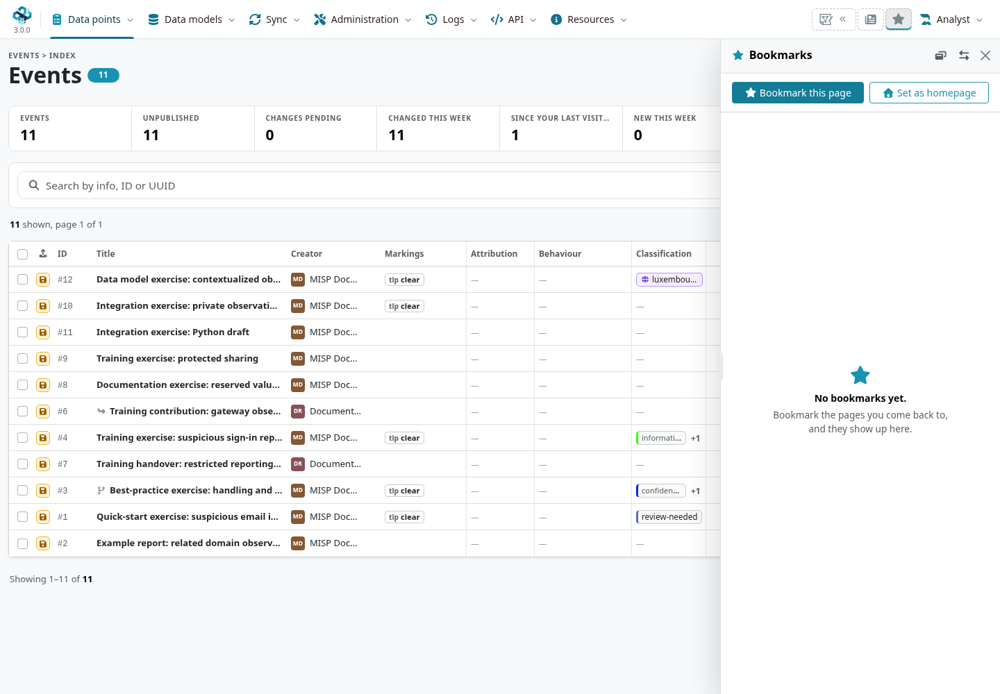
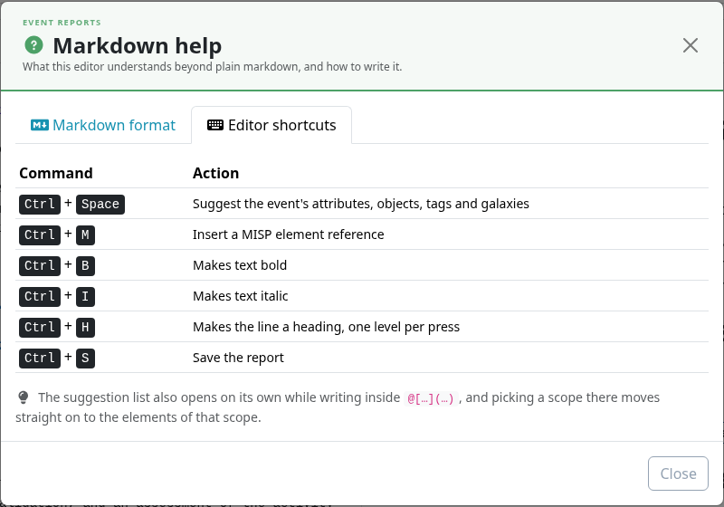

Use the keyboard to move through navigation, search a list and work in the report editor.
Shortcuts belong to the interface and control that implements them; they are not a single
instance-wide command language.

::: {.callout-note}
Checked against MISP **3.0.0**, `3.0_wip` commit
[`99ebee729`](https://github.com/MISP/MISP/commit/99ebee729702c560528f9788953719bda68aa1c1),
using the MISP 3.0 interface. The classic interface's `l`, `e`, `t`, `a`, `o`, `s` and `?`
shortcut manager is **not loaded by the MISP 3.0 interface**. Its old help triangle is not the guide for this UI.
:::

<!-- Source checks and actual UI captures: ../assets/reference-faq-screenshots.json -->

## Navigate and search in MISP 3.0 {#shortcuts-navigation}

::: {.table-responsive}

| Context | Key | Action |
|---|---|---|
| Navigation and forms | `Tab` / `Shift+Tab` | Move between focusable controls. Use `Enter` or `Space` as appropriate to activate a button. |
| Supported list filter bar | `/` | Focus and select the text in the visible list search field. |
| Supported list filter bar | `f` / `F` | Show or hide the Filters panel. An open picker/browser keeps its own keys. |
| Server settings | `Ctrl+K` / `Command+K` | Open the search across settings. |
| News panel, when available | `n` / `N` | Show or hide News. |
| Bookmarks panel, when available | `b` / `B` | Show or hide Bookmarks. |
| Focus inside a side panel | `Escape` | Close it and return focus to its toggle. |

:::

The list and side-panel letter shortcuts do not activate while typing in supported editable
fields or behind an open modal. They also leave Ctrl/Command/Alt combinations to the browser
or editor. A page without the relevant search bar or panel has no corresponding action.

The navbar and optional rail have their own arrow-key navigation. Start with `Tab` to focus a
menu control, use the keys supported by that menu, and use `Escape` to dismiss it. Keep the
visible focus indicator in view; browser Find (`Ctrl+F` / `Command+F`) is separate from MISP's
list filtering.

## Event-report editor {#shortcuts-report-editor}

Open an editable event report and choose **Markdown help → Editor shortcuts** for the editor's
own reference. The pinned help lists these Ctrl combinations:

::: {.table-responsive}

| Key | Editor action |
|---|---|
| `Ctrl+Space` | Suggest the event's attributes, objects, tags and galaxies. |
| `Ctrl+M` | Insert a MISP element reference. |
| `Ctrl+B` / `Ctrl+I` | Apply bold / italic formatting. |
| `Ctrl+H` | Make the line a heading, advancing one level per press. |
| `Ctrl+S` | Save the report. This changes the saved report; it is not a preview shortcut. |

:::

Browser, operating-system and input-method bindings can intercept a combination. Use the
visible toolbar/help action when a key is unavailable. See
[Event Reports](../event-reports/index.qmd#writing-a-report) for editing and element references.

## Troubleshoot or extend shortcuts {#shortcuts-maintenance}

Check the page, focused element, open dialogs and user permissions before diagnosing a missing
action. The relevant MISP 3.0 interface sources are `app/webroot/js/index-filters.js`, `side-panel.js`,
the navbar/rail scripts under `app/webroot/js/`, `server-settings.js` and the event-report view/editor code.

`keyboard-shortcuts-definition.js` and `keyboard-shortcuts.js` still describe the deprecated
classic interface. Editing them does not add a MISP 3.0 shortcut. There is no general GUI
shortcut editor. For a contribution, use the appropriate component, respect editable fields
and modal focus, provide a visible equivalent, and test with the supported browser and layout.
Keep deployment customizations under version control rather than replacing shipped assets.
