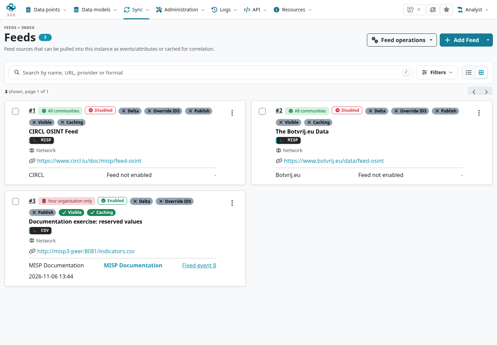
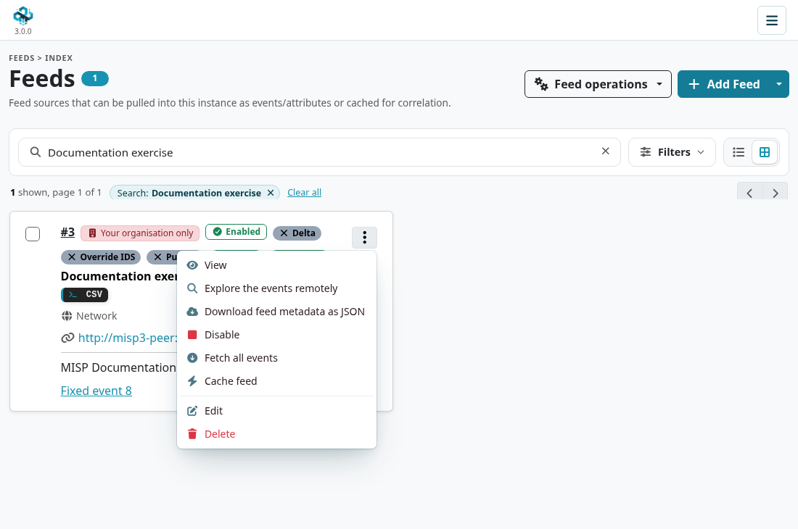
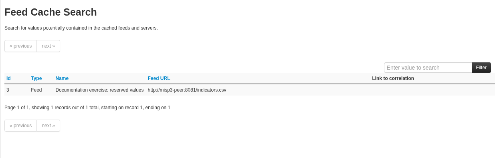
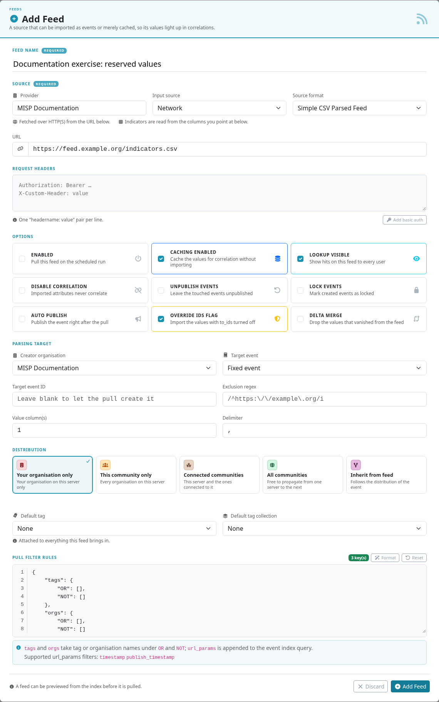
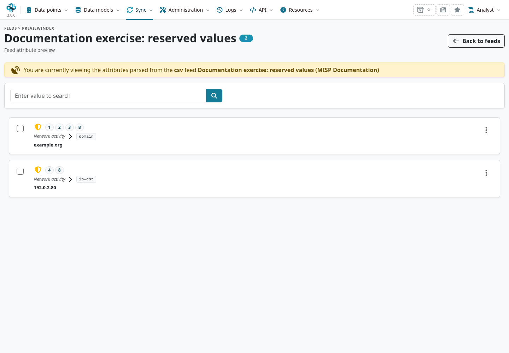

Feeds let you look up or import intelligence from a published source without configuring a
two-way MISP connection. A feed can contain **MISP events**, **free text** or **CSV**. Its
definition records where to get the data, how to parse it and what to do with the result.

::: {.callout-note}
Instructions and screenshots use MISP **3.0.0**, the [`3.0_wip`](https://github.com/MISP/MISP/tree/3.0_wip)
development branch, in light mode. Feed administration requires a **site
administrator**. Select a screenshot or diagram to enlarge it.
The per-feed cache action shown here was checked at commit
[`4dcd953d1`](https://github.com/MISP/MISP/commit/4dcd953d1b987c4ce7089c6b9d55237fa81835a8).
:::

<!-- Capture source and hashes: ../assets/sharing-screenshots.json -->

## Choose cache or import {#feeds}

**Caching** makes source values available for lookups and overlap analysis without creating local
events. **Fetching/importing** creates or updates events and attributes. You can use either or
both; enabling caching does not automatically enable ingestion.



## Managing feeds

Open **Sync → Servers & Feeds → Feeds**. The list shows each source's format, enabled state,
caching, lookup visibility and import options. Use **Filters** to narrow the list. **Feed
operations** groups default-metadata loading, caching and bulk fetching. Row actions
apply to one source; bulk actions apply to the selected sources.



### Default feeds

Use **Load default feed metadata** to add the feed definitions shipped in
`app/files/feed-metadata/defaults.json`{.text-wrap .text-break}. This loads definitions, not the feed contents.
Existing entries are matched by URL and skipped, preserving local settings. Review each source's
relevance, licensing, freshness and volume before enabling it; the default list is not a
recommendation to ingest everything.

### Caching feeds

As a site administrator:

1. Edit the feed, turn on **Caching enabled**, and save it.
2. Open that feed's **Actions** menu (the three-dot menu on its card or table row) and choose
   **Cache feed**. This action appears only for a feed with caching enabled.
3. Follow the result or background job and check the successful cache time before relying on lookups.

**Cache feed** applies to that one source. The **Enabled** flag controls ingestion independently;
a feed can be cached while ingestion is disabled. Use **Feed operations** to cache a wider scope
such as all feeds, freetext/CSV feeds or MISP feeds.



MISP stores a hashed value-membership cache in Redis for feed hits and comparisons. It does not
create events in the database. Inspect the last successful cache time and job outcome: a stale
or failed cache cannot establish that a value is absent from the current source.

**Lookup visible** makes hits available to other users. With it off, lookup results are limited
to site administrators. Feed lookup visibility is separate from the distribution of imported events.

### Fetching feeds

Enable the source and use its fetch action to import the data. For an initial test, prefer one
feed over a bulk fetch. With background jobs enabled, follow the job to completion and inspect
the created or updated event. A successful download is not the same as a completed import.

Leave **Auto publish** off while evaluating a source. Review the resulting distribution, tags,
parsed types, duplicate handling and detection flags before making the data operational.

### Keep imported history out of aging detection exports {#feed-export-policy}

Use a feed's **Default tag**, for example `expireMeInAMonth`, to identify its imported events for an export policy.
If a **Default tag collection** is set, include the label there because the collection takes precedence.
Set it before fetching, confirm the tag on resulting events, and review previously imported events separately.
The label itself does not expire or delete anything.
Keep correlation enabled and review **Delta merge** or other deletion settings if the aim is to retain history.

The [two-query export recipe](../automation/index.qmd#api-feed-export-policy) combines eligible data outside this tag with tagged data published in the past 30 days.
Its cutoff uses event publication time; a repeatedly republished fixed event can keep older attributes eligible.
For indicator relevance based on observations and configured evidence, consider [decay filtering](../decaying-models/index.qmd#decay-export-policy).
Both approaches require the receiving tool to withdraw detections that stop matching; neither requires deleting the observations from MISP.

### Search feed caches

Open `/feeds/searchCaches`. At this development commit it uses a legacy-layout page rather than
the MISP 3.0 feed list. Search for an
exact value to check the caches of feeds and eligible remote servers. A hit means the cached
source contains that value; it is not a verdict that the value is malicious.



### Adding feeds

Choose **Add Feed**. The form changes with **Input source** and **Source format**. Start with a
recognisable name, provider and source location, then set the import behaviour explicitly.



| Setting | Effect and suggested first check |
|---|---|
| **Enabled** | Makes the feed eligible for ingestion. This is independent of caching. |
| **Caching enabled / Lookup visible** | Choose whether to maintain the lookup cache and who may see its hits. |
| **Input source / URL** | **Network** fetches over HTTP(S). **Local** reads an approved server-side path, where permitted by instance policy. A native MISP feed normally uses the feed directory's base URL; see the format notes below. |
| **Request headers** | Extra headers, one `headername: value` per line, for authenticated sources. Treat the definition and its exports as sensitive when they contain credentials. |
| **Creator organisation** | The creator of events produced from free-text/CSV data. Confirm it before importing. |
| **Target event** | A **Fixed event** is updated on later fetches; **New event each pull** creates a fresh event each time. Verify the target ID belongs to the intended event. |
| **Distribution / Sharing group** | The audience of imported data. Start restricted when evaluating a new source. Native MISP feeds also offer **Inherit from feed**. |
| **Default tag / Default tag collection** | Apply consistent source or handling labels. A tag collection is a preset bundle of tags, distinct from a content Collection. |
| **Auto publish** | Publishes imported events automatically. Enable only after reviewing the source and its outgoing routes. |
| **Override IDS flag** | Sets imported attributes' `to_ids` to **false**. Useful while assessing detection suitability. |
| **Delta merge** | For a fixed parsed-feed event, soft-deletes attributes absent from the newest fetch. Source disappearance is not proof of expiry. |
| **Unpublish events / Disable correlation / Lock events** | Control how imported events are handled. Check these against the intended review and ownership workflow. |

Local feeds may be disabled by policy. An administrator must use the supported CLI setting to
change `Security.disable_local_feed_access`{.text-wrap .text-break}; do not enable local file access just to consume
an ordinary network feed. **Remove input after ingestion** can delete a local input, so use it
only for a deliberate one-shot workflow.

#### Source formats

- **MISP Feed**: a feed directory with `manifest.json` and event JSON files named by UUID.
  Enter its base URL, such as `https://www.circl.lu/doc/misp/feed-osint`{.text-wrap .text-break}. It is a published
  snapshot, not a native two-way sync connection. With **Inherit from feed**, usable source
  distribution must be present; missing distribution falls back to organisation-only.
- **Freetext Parsed Feed**: MISP extracts candidate indicators from the text. Preview the
  recognised values and types, and use **Exclusion regex** to remove known noise.
- **Simple CSV Parsed Feed**: specify the delimiter and the indicator column numbers.
  **Columns start at 1**; `1,3` selects the first and third columns. With no column selection,
  every field is considered for parsing. Lines beginning with `#` are comments.

For example, save the following as a CSV feed and select value column **1** with delimiter `,`:

```csv
# value,context
example.org,Reserved documentation domain
192.0.2.80,Reserved documentation address
```

Preview it before importing. The expected candidates are `example.org` and `192.0.2.80`, not
the explanatory text. In this training example, keep **Override IDS flag** on, **Auto publish**
off and distribution **Your organisation only**.



#### Filter rules

For native MISP feeds, use the **Pull filter rules** editor to allow or block tags and
organisations, and to add supported manifest-query filters. Rules operate on feed metadata;
parsed free-text/CSV sources instead need appropriate column selection and exclusion patterns.
Review a sample result after any rule change.

### Importing feed definitions {#importing-feeds}

Open the menu beside **Add Feed** and choose **Import JSON** (`/feeds/importFeeds`) to add
metadata from another instance. This does not import its
cached contents or events. Review URLs and headers, and remap local IDs such as `event_id`,
`orgc_id`, `sharing_group_id`, `tag_id` and any tag-collection reference. Numeric IDs are not
portable identities across instances.

### Analyse feed overlap {#analyze-feed-overlap}

The overlap matrix at `/feeds/compareFeeds` compares **cached values**, helping identify sources that duplicate much of
another feed. Cache the selected sources successfully first. Overlap does not measure accuracy,
trust, timeliness or the quality of context; consider those separately when choosing sources.

### Exporting feed definitions {#exporting-feeds}

Retrieve feed metadata in JSON with an authenticated `GET /feeds/index` request and an
`Accept: application/json` header, or the legacy **Export Feed settings** link. Inspect the JSON before
sharing it: authenticated URLs, request headers and instance-specific IDs can require removal
or replacement. Imported definitions should begin disabled until their settings have been reviewed.

## Feed correlation

An event attribute matching a cached source can show **Feed hits**, subject to lookup visibility
and correlation settings. Open the source context and check its cache age before acting on the
match. These are feed-cache lookups, not locally imported related events, and they do not add a
new node to the event's correlation graph. See [best practices](../best-practices/index.qmd)
for reviewing sources and selecting detection attributes.
