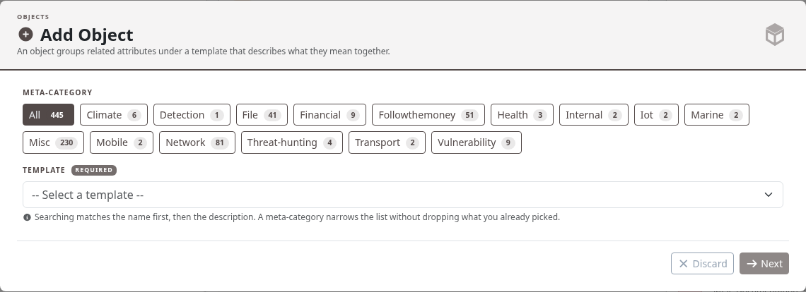
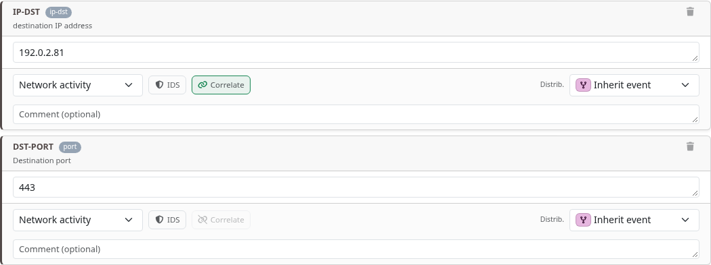
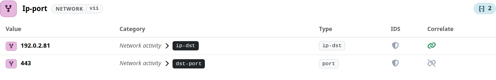
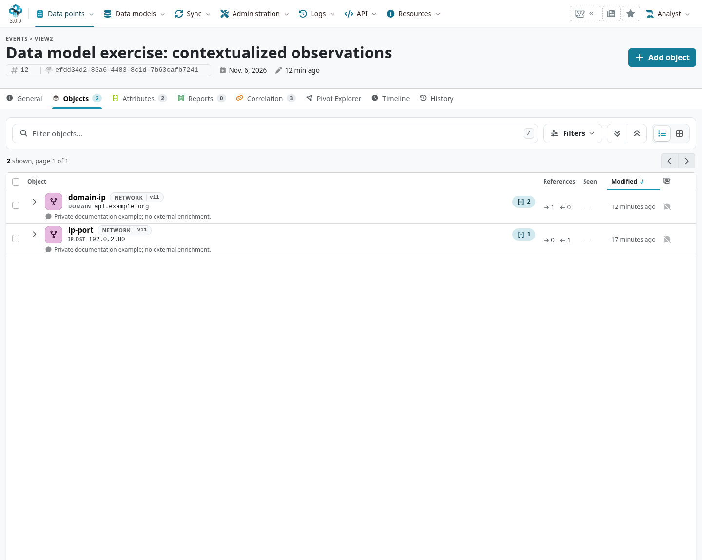
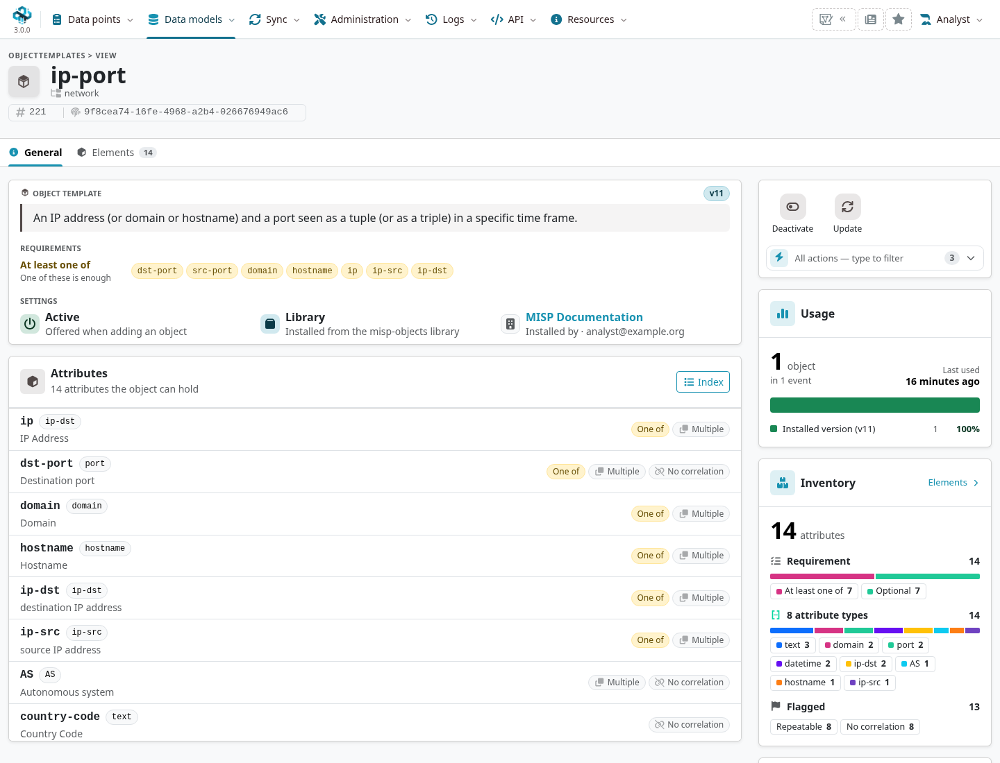

An object groups attributes that describe one observed entity, using a template to give each
attribute a named **object relation**. A `file` can contain its filename and hashes; a
`domain-ip` can describe a domain/address observation. Each contained attribute still has its
own UUID, type, detection flag, visibility context and correlatable value.

::: {.callout-note}
This chapter follows MISP **3.0.0**, `3.0_wip` commit `99ebee729`.
Templates come from [misp-objects](https://github.com/MISP/misp-objects). Screenshots use reserved
values in a private unpublished event; no example requires enabling IDS or publishing it.
:::

<!-- Template pins, creation checks and capture hashes: ../assets/data-model-screenshots.json -->

## Choose and populate a template {#objects-use}

Start with a sentence describing what the source establishes: "this domain resolved to this address at this time" or "this message included this file."
That statement helps you choose both the object boundary and the template.
Several templates may accept the same value; the best fit preserves the observation's meaning, relationships and useful context.

### Compare candidate templates {#objects-selection}

1. **Identify the entity or observation.** Group properties of the same file, message or network observation.
   Use separate objects for distinct entities, and [references](#object-references-and-relationships) for supported relationships between them.
   A single independently useful data point can remain a [standalone attribute](../categories-and-types/index.qmd#types-selection).
2. **Read the template's purpose and relation descriptions.** Search the installed catalogue by name and meta-category, then inspect the [template details](#objects-maintenance).
   Prefer the template whose purpose matches the evidence; a shared field name alone is insufficient.
3. **Compare the available fields and their roles.** Check relation names, underlying types, units, allowed values and multiplicity.
   Prefer a more specific template when its additional structure expresses facts you actually know and your consumers can use it.
   More available fields do not by themselves make a template a better choice.
4. **Check the minimum requirements.** Confirm that the evidence satisfies `required` and `requiredOneOf` without guessing.
   Leave unknown optional properties absent; a suggested value is not an observation.
5. **Check the intended consumer.** Confirm that your search, export or receiving tool uses the chosen relations and preserves the context you need.
   Composite attributes such as `ip-dst|port` can serve consumers that expect them; document why you need a second representation if you retain both.

For example, `domain-ip` and `ip-port` both accept domains, addresses and ports.
Choose `domain-ip` for a domain/address association in a time frame, and `ip-port` for an address or hostname and port observed together.
If the source contains both a DNS answer and a separate connection observation, keep those observations distinguishable, including their sources and times.
The common address can support investigation without proving that the connection used that DNS answer.

::: {.table-responsive}

| What the source establishes | Starting representation | Context to preserve |
|---|---|---|
| A domain resolved to an address | `domain-ip` object with `domain` and `ip` | Resolver/source and the observation window. |
| A connection had a destination address and port | `ip-port` object with `ip-dst` and `dst-port` | Endpoint roles, protocol if known, source and time. |
| A file had a name, hash and size | `file` object with the known relations | Which file the properties describe, hash algorithm and size in bytes. |
| An email included a separately described file | `email` and `file` objects with a supported directional reference | Message evidence and the basis for identifying the included file. |
| A report lists a domain without an address association | Standalone `domain` attribute | Source and the role stated by the report. |

:::

These are starting points, not an exhaustive catalogue or a requirement to create several objects for every input.
The relation examples below follow the book's [pinned template revision](https://github.com/MISP/misp-objects/tree/5b17a1e03ada9dee01a64bd91c34a5f1ea42e326/objects); inspect the definitions installed on your instance.

### Populate and review the form {#objects-populate}

From an event, choose **Add Object**. Search the template picker and use its meta-category and
description to select the intended representation. A meta-category such as `network` groups
object templates; it is not the same field as an attribute category such as Network activity.

The 3.0 form separates template selection, attributes, optional relationships and review.
Choose the relations you need; optional relations appear as addable controls rather than a
requirement to fill every possible field.

::: {.table-responsive}

| Template field | Meaning |
|---|---|
| `misp-attribute`{.text-wrap .text-break} | The underlying attribute type. The relation `dst-port`{.text-wrap .text-break}, for example, uses type `port`{.text-wrap .text-break}. |
| `required`{.text-wrap .text-break} | Every listed relation must be present. |
| `requiredOneOf`{.text-wrap .text-break} | At least one listed relation must be present. It does not require all of them. |
| `multiple`{.text-wrap .text-break} | Whether that relation can occur more than once. |
| `categories`{.text-wrap .text-break}, `to_ids`{.text-wrap .text-break}, `disable_correlation`{.text-wrap .text-break} | Template constraints/defaults for that relation; inspect the actual saved attribute. |
| `sane_default`{.text-wrap .text-break}, `values_list`{.text-wrap .text-break}, `ui-priority`{.text-wrap .text-break} | Suggested/allowed values and presentation hints, according to the template/schema. |

:::

An object is not inherently required to contain two attributes. The pinned `ip-port` template,
for example, accepts one of its required-one-of relations; a single `ip-dst` can satisfy that
rule. A valid object still needs useful context and the template's actual constraints.

Review values, comments, observation times, distribution and IDS/correlation flags before the
final save. Object distribution can inherit from the event; child distribution must stay within
its parent. A populated field or template default does not establish detection value.

For a worked example combining `geolocation`, `gpx` and `geojson`, see [Representing Geolocation and Movement](../geolocation/index.qmd).
The use case explains coordinate systems, observation times, dataset references and source-preserving export.

## Encode the information at the right scope {#objects-encoding}

Map each fact to a defined relation whose meaning and underlying attribute type match it.
The relation names the property's role inside the object; the type controls value validation and normalization.
For example, `ip-port` relation `dst-port` uses type `port`, while `email` relation `from` uses type `email-src`.
Keep the value itself limited to that property: enter `443` as the port and put an explanation of the observation in a comment or report.
See [Categories and Types](../categories-and-types/index.qmd#attribute-categories-vs-types) for valid type/category combinations.

- **Preserve roles and units.** Keep source and destination distinct, use the stated hash algorithm, and convert units only when the conversion is justified and recorded.
  Record a file's size in bytes in `size-in-bytes`; a rounded size from a report may be better retained in the narrative than presented as an exact byte count.
- **Preserve which values belong together.** Use repeatable relations only for properties of the same modeled observation.
  Repeating two addresses and two ports does not encode which address used which port.
  Use separate objects when the source establishes separate endpoint pairs, files, messages or observation windows.
- **Keep source and time context.** Use comments and source references for provenance, and `first_seen` / `last_seen` for the observation window where known.
  A template relation such as `send-date` describes a different fact from when you observed or imported the message.
  When a template also offers `first-seen` / `last-seen` relations, check their meaning and how your importer/exporter maps them; avoid conflicting copies of the same time.
- **Put classification and knowledge context in their own fields.** Use [taxonomy tags](../taxonomy/index.qmd#taxonomy-machine-tags) for classification and [galaxy clusters](../galaxy/index.qmd#galaxy-concepts) for relevant reusable knowledge.
  Choose their attachment scope according to the claim.
- **Separate evidence from analysis.** Use an [Event Report](../event-reports/index.qmd) for the account of the investigation and [Analyst Data](../analyst-data/index.qmd) for assessments, uncertainty or competing interpretations.
  An inferred relationship needs its basis recorded; a matching value alone is insufficient.
- **Review operational settings separately.** Set distribution, `to_ids` and correlation behavior for the saved attributes.
  A valid object or a suspicious-looking value does not automatically justify detection use.

### Worked example: a destination observation {#objects-encoding-example}

A synthetic network log records a connection to destination `192.0.2.10`, TCP port `443`, at `2026-01-15T10:30:00Z`.
It identifies neither a domain nor an application protocol, and provides no verdict about the activity.
An `ip-port` object preserves the destination tuple:

::: {.table-responsive}

| Source fact | Where to record it | Example value |
|---|---|---|
| Destination address | Relation `ip-dst`, type `ip-dst` | `192.0.2.10` |
| Destination port | Relation `dst-port`, type `port` | `443` |
| Transport protocol | Relation `protocol`, type `text` | `tcp` |
| One observed connection time | Object `first_seen` and `last_seen` metadata | Both `2026-01-15T10:30:00Z` |
| Provenance | Object comment and retained source evidence | `Synthetic network log, row 7; destination tuple as recorded.` |

:::

Leave the domain absent and do not infer HTTPS solely from port `443`.
For this training example, use **Your organisation only**, let the attributes inherit their parent audience, and keep IDS off.
After saving, inspect the relation names, types, values, timestamps and flags; check the intended export as well if another tool will consume it.

If row 8 records `192.0.2.20` on port `8443`, create a separate observation rather than adding both addresses and ports to the first object.
That preserves the two endpoint pairs without implying four possible combinations.

### Worked example: an email and its file {#objects-encoding-email}

A synthetic message from `sender@example.org`, with subject `Training document`, contains a file named `exercise.txt`.
Create an `email` object with `from` (type `email-src`) and `subject` (type `email-subject`).
Create a `file` object with `filename` and any verified hashes or byte size of that same file.
Add a directional reference from the email to the file using a relationship supported by the installed catalogue, such as `includes`, and record that the original message establishes the inclusion.
Preserve the message as source evidence when available and permitted; the email's `attachment` relation records an attachment name, while `eml` can hold the original message as an attachment.
Keep the interpretation and any uncertainty in a report or Note, and review each attribute's detection and sharing settings.

### When no template fits {#objects-no-fit}

First check whether an appropriate template is installed and active, and whether the [catalogue needs updating](#objects-maintenance).
If a suitable model is unavailable, preserve the source and encode the facts you can accurately represent as typed attributes or smaller related objects.
Record the mapping limitation in a report or Note.
Use a template's free-text relation for appropriate supplementary context, while keeping properties that need typed search or export in defined relations.
For a recurring gap, propose an extension to an existing template or [author a reusable template](#objects-authoring), with example evidence and consumer requirements.

## Identity and MISP 3.0 values {#objects-identities}

An instance records its template UUID/version, object UUID and relation names. The template is
not the observation itself: updating a template catalogue does not silently turn every older
object into a newly validated instance of the latest schema.

In MISP 3.0, a contained attribute retains its occurrence identity while its stored value can
share a [value address](../categories-and-types/index.qmd#types-values) with other occurrences.
Do not replace object/attribute UUIDs with a value hash when maintaining references or tracking
updates. Object and attribute first/last-seen times describe observations, not publication times.

## Object references and relationships {#object-references-and-relationships}

Use **Add reference** / the object's relationship controls to link a source object to a target
object or attribute. Select the target UUID and a relationship type, and document what the link
means. References are directional; a matching value does not automatically create every
relationship you might infer from it.

The training example uses `related-to` between two private observed entities. A more precise
relation should be supported by the observation, not chosen for a visually pleasing graph.
Object references differ from galaxy-cluster knowledge relationships and Analyst Data
relationships; use the model appropriate to the statement.

The event's **Pivot Explorer** can help explore connections, and a [saved graph](../analyst-data/index.qmd#saved-graphs) can keep the view.
Preserve the source, timestamps, comments and assessment in the underlying records.

## Edit observations and maintain templates {#objects-maintenance}

[Data Maintenance](../data-maintenance/index.qmd#maintenance-group) covers grouping standalone attributes, identity changes and the checked development-branch save limitation.

Edit an object's fields/attributes through the current object controls. Review the resulting
attributes, references and event state; changes can unpublish the event. Deleting a relation,
attribute or object has a different scope, so check the confirmation and any dependent links.

Open **Data models → Templates → List Object Templates** (`/objectTemplates/index`) to inspect installed
versions, active state, elements and requirements. The template's detail view is a better
starting point than a fixed example copied from an older installation.

To update the catalogue, deploy the intended `app/files/misp-objects` revision, then use
**Update Object** or `cake Admin updateObjectTemplates`. Keep older instance/template version
relationships in mind when planning migrations. Do not rewrite event data simply to make a
catalogue version indicator look current.

## Author a template {#objects-authoring}

To build a guided form that combines several objects and other event content, use an [event template](../event-templates/index.qmd).
The object template described here defines the structure of one entity.

Follow the [current object schema](https://github.com/MISP/misp-objects/blob/main/schema_objects.json).
Choose a stable template UUID, increment its version for changes and define meaningful relation
names with existing MISP attribute types. State required/required-one-of and multiplicity rules,
then validate representative complete, minimal and invalid objects.

An object template's defaults can differ from the
[base attribute defaults](../categories-and-types/index.qmd#types). A relation's data type and
its name are separate: adding a relation does not create a new core attribute type. Test the
form, saved JSON and intended export/client compatibility.

The [MISP Engineering Bay](https://github.com/MISP/misp-engineering-bay) includes a guided
Object Template Creator. Treat it as an authoring aid: validate its output against the intended
schema/installed version, load the definition into the catalogue and test the resulting object.
Keep private templates under managed deployment control and contribute reusable public ones
through the upstream repository's review process.
