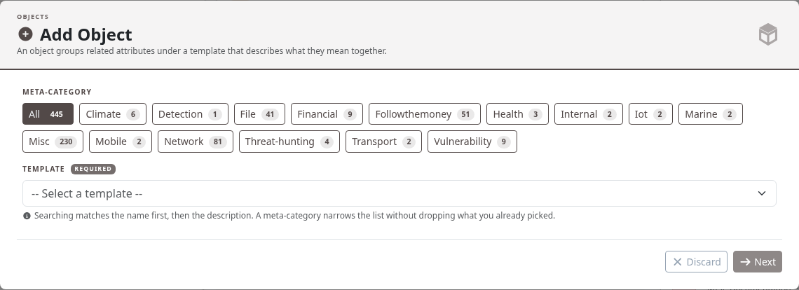
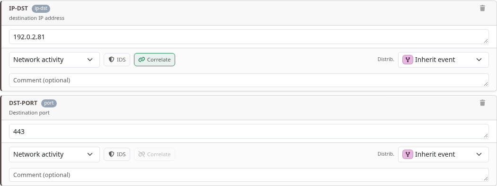
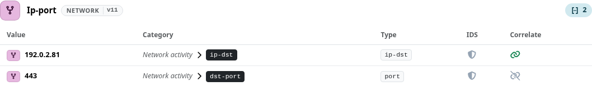
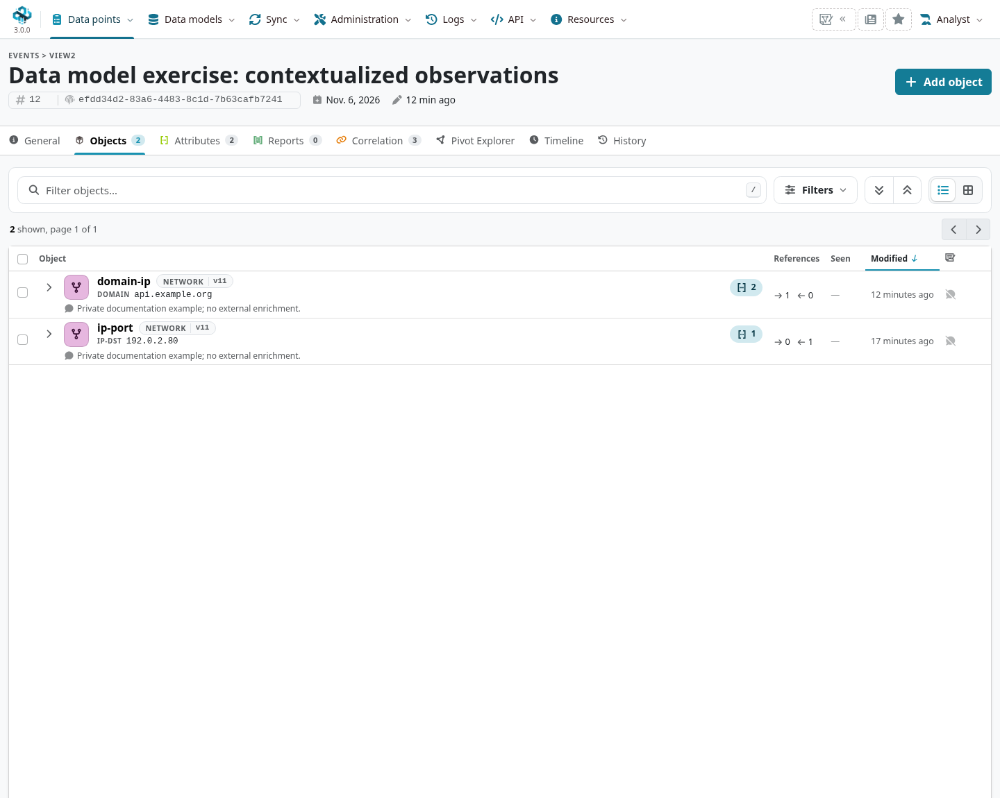
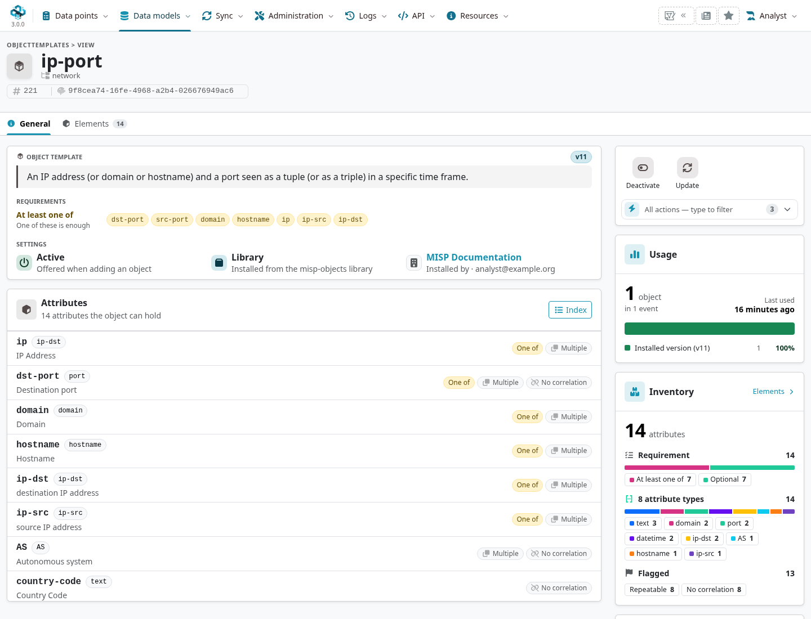

An object groups attributes that describe one observed entity, using a template to give each
attribute a named **object relation**. A `file` can contain its filename and hashes; a
`domain-ip` can describe a domain/address observation. Each contained attribute still has its
own UUID, type, detection flag, visibility context and correlatable value.

::: {.callout-note}
This chapter follows MISP **3.0.0**, `3.0_wip` commit `99ebee729`, in Overmind.
Templates come from [misp-objects](https://github.com/MISP/misp-objects). Screenshots use reserved
values in a private unpublished event; no example requires enabling IDS or publishing it.
:::

<!-- Template pins, creation checks and capture hashes: ../assets/data-model-screenshots.json -->

## Choose and populate a template {#objects-use}

From an event, choose **Add Object**. Search the template picker and use its meta-category and
description to select the intended representation. A meta-category such as `network` groups
object templates; it is not the same field as an attribute category such as Network activity.

The 3.0 form separates template selection, attributes, optional relationships and review.
Choose the relations you need; optional relations appear as addable controls rather than a
requirement to fill every possible field.

::: {.table-responsive}

| Template field | Meaning |
|---|---|
| `misp-attribute`{.text-wrap .text-break} | The underlying attribute type. The relation `dst-port`{.text-wrap .text-break}, for example, uses type `port`{.text-wrap .text-break}. |
| `required`{.text-wrap .text-break} | Every listed relation must be present. |
| `requiredOneOf`{.text-wrap .text-break} | At least one listed relation must be present. It does not require all of them. |
| `multiple`{.text-wrap .text-break} | Whether that relation can occur more than once. |
| `categories`{.text-wrap .text-break}, `to_ids`{.text-wrap .text-break}, `disable_correlation`{.text-wrap .text-break} | Template constraints/defaults for that relation; inspect the actual saved attribute. |
| `sane_default`{.text-wrap .text-break}, `values_list`{.text-wrap .text-break}, `ui-priority`{.text-wrap .text-break} | Suggested/allowed values and presentation hints, according to the template/schema. |

:::

An object is not inherently required to contain two attributes. The pinned `ip-port` template,
for example, accepts one of its required-one-of relations; a single `ip-dst` can satisfy that
rule. A valid object still needs useful context and the template's actual constraints.

Review values, comments, observation times, distribution and IDS/correlation flags before the
final save. Object distribution can inherit from the event; child distribution must stay within
its parent. A populated field or template default does not establish detection value.

## Identity and MISP 3.0 values {#objects-identities}

An instance records its template UUID/version, object UUID and relation names. The template is
not the observation itself: updating a template catalogue does not silently turn every older
object into a newly validated instance of the latest schema.

In MISP 3.0, a contained attribute retains its occurrence identity while its stored value can
share a [value address](../categories-and-types/index.qmd#types-values) with other occurrences.
Do not replace object/attribute UUIDs with a value hash when maintaining references or tracking
updates. Object and attribute first/last-seen times describe observations, not publication times.

## Object references and relationships {#object-references-and-relationships}

Use **Add reference** / the object's relationship controls to link a source object to a target
object or attribute. Select the target UUID and a relationship type, and document what the link
means. References are directional; a matching value does not automatically create every
relationship you might infer from it.

The training example uses `related-to` between two private observed entities. A more precise
relation should be supported by the observation, not chosen for a visually pleasing graph.
Object references differ from galaxy-cluster knowledge relationships and Analyst Data
relationships; use the model appropriate to the statement.

The event graph/workspace can help explore connections, but a graph's layout is not evidence
of causality. Preserve the source, timestamps, comments and assessment in the underlying records.

## Edit observations and maintain templates {#objects-maintenance}

Edit an object's fields/attributes through the current object controls. Review the resulting
attributes, references and event state; changes can unpublish the event. Deleting a relation,
attribute or object has a different scope, so check the confirmation and any dependent links.

Open **Data models → Templates → List Object Templates** (`/objectTemplates/index`) to inspect installed
versions, active state, elements and requirements. The template's detail view is a better
starting point than a fixed example copied from an older installation.

To update the catalogue, deploy the intended `app/files/misp-objects` revision, then use
**Update Object** or `cake Admin updateObjectTemplates`. Keep older instance/template version
relationships in mind when planning migrations. Do not rewrite event data simply to make a
catalogue version indicator look current.

## Author a template {#objects-authoring}

Follow the [current object schema](https://github.com/MISP/misp-objects/blob/main/schema_objects.json).
Choose a stable template UUID, increment its version for changes and define meaningful relation
names with existing MISP attribute types. State required/required-one-of and multiplicity rules,
then validate representative complete, minimal and invalid objects.

An object template's defaults can differ from the
[base attribute defaults](../categories-and-types/index.qmd#types). A relation's data type and
its name are separate: adding a relation does not create a new core attribute type. Test the
form, saved JSON and intended export/client compatibility.

The [MISP Engineering Bay](https://github.com/MISP/misp-engineering-bay) includes a guided
Object Template Creator. Treat it as an authoring aid: validate its output against the intended
schema/installed version, load the definition into the catalogue and test the resulting object.
Keep private templates under managed deployment control and contribute reusable public ones
through the upstream repository's review process.
