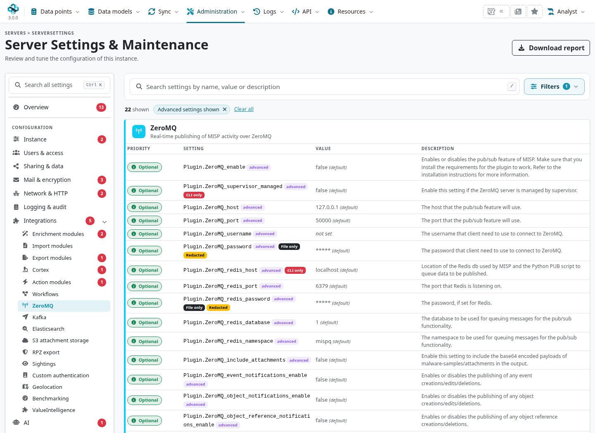
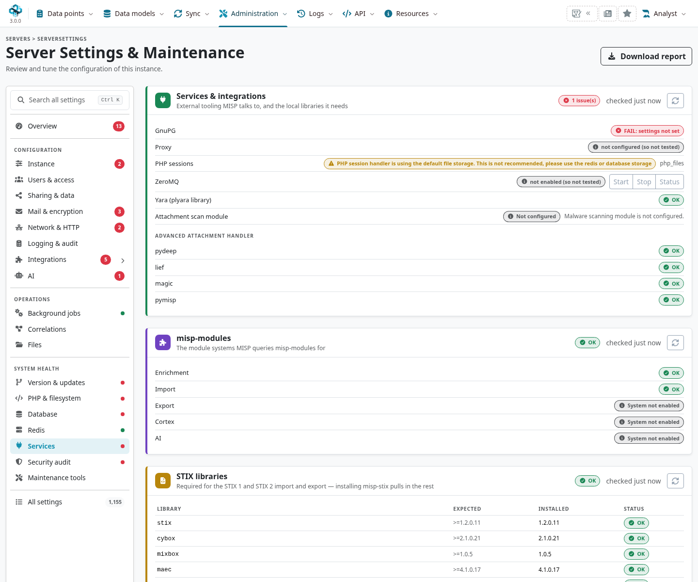

Use MISP's publish/subscribe interface when a trusted integration needs activity notifications
with low latency. ZeroMQ emits a live stream; a consumer can react to event changes, sightings
or other configured activity and fetch current state through the REST API when needed.

::: {.callout-note}
This chapter follows MISP **3.0.0**, `3.0_wip` commit `99ebee729`.
The stream operates at **instance level**: normal per-user REST distribution filtering is not
applied to each subscriber. Treat access to the stream as privileged access to the enabled
notifications, including activity on unpublished or restricted data.
:::

<!-- Source checks and capture hashes: ../assets/automation-screenshots.json -->

<a id="misp-zeromq"></a>

## Choose notifications or polling {#zmq-overview}

Use [REST polling](../automation/index.qmd#api-incremental-polling) for bounded, account-scoped
queries. Use notifications to react promptly, while retaining a recovery/reconciliation path.
ZeroMQ PUB/SUB does not provide durable replay or consumer acknowledgements: disconnected,
slow or restarting consumers can miss messages.



Do not expose a broad instance stream directly to a partner who should see only selected events.
Use native synchronization, an appropriately scoped API account or a filtered integration boundary.

<a id="misp-zeromq-configuration"></a>

## Configure ZeroMQ {#zmq-configuration}

As a site administrator, open **Administration → Server Settings & Maintenance → Integrations
→ ZeroMQ**. In MISP 3.0, integrations are grouped pages rather than the old Plugin tab.
The settings retain their `Plugin.ZeroMQ_*` names.



::: {.table-responsive}

| Setting | Purpose |
|---|---|
| `Plugin.ZeroMQ_enable`{.text-wrap .text-break} | Enable MISP's ZeroMQ publishing path. The publisher service and dependencies must also work. |
| `Plugin.ZeroMQ_host`{.text-wrap .text-break}, `ZeroMQ_port`{.text-wrap .text-break} | Publisher bind address and port; the defaults are `127.0.0.1`{.text-wrap .text-break} and `50000`{.text-wrap .text-break}. A subscriber must be able to reach that address. |
| `Plugin.ZeroMQ_<type>_notifications_enable`{.text-wrap .text-break} | Select individual supported activity types. Enable only the required channels. |
| `Plugin.ZeroMQ_include_attachments`{.text-wrap .text-break} | Whether attachment content is included in supported payloads. Consider volume and data exposure. |
| `Plugin.ZeroMQ_username`{.text-wrap .text-break}, `ZeroMQ_password`{.text-wrap .text-break} | Optional ZeroMQ PLAIN authentication. PLAIN credentials do not encrypt the transport. |
| `Plugin.ZeroMQ_redis_*`{.text-wrap .text-break} | Redis connection/database/namespace for the publisher queue. This is separate from the subscriber's TCP endpoint. |

:::

Keep the publisher on a trusted local/private path. Use an authenticated, encrypted transport
boundary for remote access; setting a username/password alone is not TLS. A queue in Redis does
not make ZeroMQ subscribers durable.

The publisher is `app/files/scripts/mispzmq/mispzmq.py`{.text-wrap .text-break}, using MISP's Python environment.
Follow the installation or container's service-management instructions. When a supervisor owns
the service, use that supervisor; `Plugin.ZeroMQ_supervisor_managed` is a CLI-only setting.
Do not start a second publisher competing for the same bind address or PID file.

<a id="misp-zeromq-debugging-and-testing"></a>

### Check the service {#zmq-diagnostics}

Use **System health → Services** in Server Settings & Maintenance to inspect service checks.
Check the selected Redis connection, Python `pyzmq`/Redis dependencies, publisher process and
bind address. The publisher error log is normally `app/tmp/logs/mispzmq.error.log`.
With a container deployment, inspect its service logs and configuration as well.



A process check alone does not prove delivery to a subscriber. Test connectivity and decoding
with synthetic data in an isolated setup, and monitor both publisher and consumer health.

<a id="notification-schemas"></a>
<a id="misp_json---events-published"></a>
<a id="misp_json_attribute---attribute-updated-or-created"></a>
<a id="misp_json_sighting---sighting-added-to-an-attribute-or-an-event"></a>
<a id="misp_json_user---user-updates-or-creation"></a>
<a id="misp_json_organisation---organisation-updates-or-creation"></a>
<a id="misp_json_self---keep-alive-messages-sent-every-minute"></a>
<a id="mispjson---events-published"></a>
<a id="mispjsonattribute---attribute-updated-or-created"></a>
<a id="mispjsonsighting---sighting-added-to-an-attribute-or-an-event"></a>
<a id="mispjsonuser---user-updates-or-creation"></a>
<a id="mispjsonorganisation---organisation-updates-or-creation"></a>
<a id="mispjsonself----keep-alive-messages-sent-every-minute"></a>

## Message framing and topics {#zmq-topics}

The publisher sends **one ZeroMQ frame** containing the topic, one space and a JSON document:

```text
misp_json_attribute {"Attribute":{"uuid":"...","value":"example.org"},"action":"add"}
```

Split at the **first space**, then decode the remainder as JSON. Do not assume a multipart
`[topic, body]` message. Attribute/event notifications, audit entries and keep-alives have
different payload shapes; the examples below are abbreviated illustrations, not full schemas.

::: {.table-responsive}

| Topic | Contents and interpretation |
|---|---|
| `misp_json`{.text-wrap .text-break} | A full event serialization when sent through the full-event publishing path. This is distinct from every event metadata change. |
| `misp_json_event`{.text-wrap .text-break} | Event change notifications, with an action indicating the operation/path. |
| `misp_json_attribute`{.text-wrap .text-break} | Attribute change payloads; inspect action and deletion state. |
| `misp_json_object`{.text-wrap .text-break}, `misp_json_object_reference`{.text-wrap .text-break} | Object and reference changes. |
| `misp_json_tag`{.text-wrap .text-break} | Tag-related notifications. |
| `misp_json_sighting`{.text-wrap .text-break} | Sighting notifications. |
| `misp_json_warninglist`{.text-wrap .text-break} | Warninglist changes. |
| `misp_json_user`{.text-wrap .text-break}, `misp_json_organisation`{.text-wrap .text-break} | Account/organisation activity. These are privileged operational data, not indicator feeds. |
| `misp_json_audit`{.text-wrap .text-break} | Audit-log notifications. |
| `misp_json_workflow`{.text-wrap .text-break} | Notifications emitted by workflow publishing actions. |
| `misp_json_self`{.text-wrap .text-break} | Publisher idle keep-alive/status messages, not event data. |

:::

The 3.0 publisher no longer lists the old conversation topic. Do not build new discussion
integrations around it. Notes and other research data should be retrieved through their
[current APIs](../automation/index.qmd#api-value-targets); do not invent a topic for every model.

Most change paths include an `action`, but **not every message does**. Full-event payloads and
keep-alives are examples where a consumer must not require that field. In the pinned publisher,
an idle Redis poll produces a keep-alive after about **10 seconds**, not a guaranteed once-per-minute
schedule; sustained traffic changes the idle behaviour.

<a id="testing-with-sub.py-tool"></a>
<a id="testing-with-subpy-tool"></a>

## Build a subscriber {#zmq-subscriber}

Install `pyzmq` in your integration's virtual environment. This example subscribes to attribute
changes and idle status, decodes the actual wire format and handles an unexpected payload:

```python
import json
import logging
import os
import zmq

def decode_notification(frame):
    topic, separator, body = frame.partition(b" ")
    if not separator:
        raise ValueError("Notification has no topic/body separator")
    payload = json.loads(body.decode("utf-8"))
    if not isinstance(payload, dict):
        raise ValueError("Expected a JSON object")
    return topic.decode("utf-8"), payload

context = zmq.Context()
socket = context.socket(zmq.SUB)
socket.setsockopt(zmq.LINGER, 0)
socket.setsockopt(zmq.RCVHWM, 1000)
socket.setsockopt(zmq.RCVTIMEO, 30000)
for topic in (b"misp_json_attribute", b"misp_json_self"):
    socket.setsockopt(zmq.SUBSCRIBE, topic)
socket.connect(os.environ.get("MISP_ZMQ_URL", "tcp://127.0.0.1:50000"))

try:
    while True:
        try:
            topic, payload = decode_notification(socket.recv())
        except zmq.Again:
            logging.warning("No notification received; check stream health")
            continue
        except (UnicodeDecodeError, ValueError):
            logging.exception("Invalid notification")
            continue
        if topic == "misp_json_self":
            continue
        if topic != "misp_json_attribute":
            continue
        attribute = payload.get("Attribute")
        if isinstance(attribute, dict) and attribute.get("uuid"):
            print(payload.get("action", "unknown"), attribute["uuid"])
            # Queue idempotent processing; do not dump the whole payload to logs.
finally:
    socket.close()
    context.term()
```

Subscriptions are **prefix filters**, not access-control rules. Check the decoded topic before
dispatching it. A receive timeout is an operational signal, not proof that a particular event
was lost. The example does not configure PLAIN credentials; add them before `connect` if the
deployment requires that mechanism, through a protected transport boundary.

MISP also ships `tools/misp-zmq/sub.py`. Use the tool from the matching checkout and inspect
`--help`; for example, `--only misp_json_attribute` filters its output. It prints payloads,
so use it with synthetic data or an appropriately controlled terminal/log destination.

<a id="tips-for-building-a-subscriber"></a>

## Process changes and recover {#zmq-consumer-design}

- Retain UUIDs and modification times. An update keeps identity; receiving another message is
  not evidence that the target should create another copy.
- Handle deletes, IDS-flag changes, expiry and filter changes as well as additions. Retire target
  records when they no longer meet the integration's approved selection.
- Treat the notification as a trigger to queue work. Fetch the current authorised object when
  needed, and reconcile after downtime. A REST 404 can also mean restricted access.
- Keep downstream failures and retries out of the socket receive loop where practical. A slow
  sink can exhaust queues/high-water marks and lose ZeroMQ messages.
- Do not use sightings as a substitute for an event update, or a keep-alive as proof that the
  source's API and the entire processing pipeline are healthy.

## Kafka is a separate option {#zmq-kafka}

MISP also supports Kafka publishing under **Integrations → Kafka**, with `Plugin.Kafka_enable`,
broker/client configuration, notification toggles and per-type topics. It requires the relevant
PHP Kafka dependency and broker setup. Its topic names and payloads should be checked against
the installed configuration; do not reuse the ZeroMQ frame parser on Kafka records.

Kafka can provide broker retention and consumer offsets when configured appropriately. Those
properties still require a consumer's own acknowledgement, retry, idempotency and recovery
design. Kafka publishing also needs an explicit data-access boundary; it is not native MISP
sharing-group synchronization. See [External Connectors](../connectors/index.qmd).
