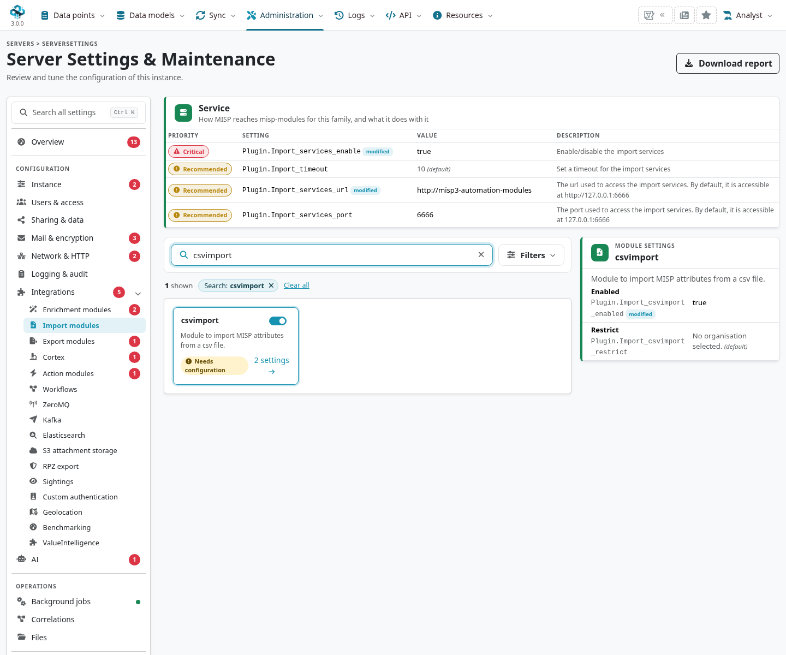
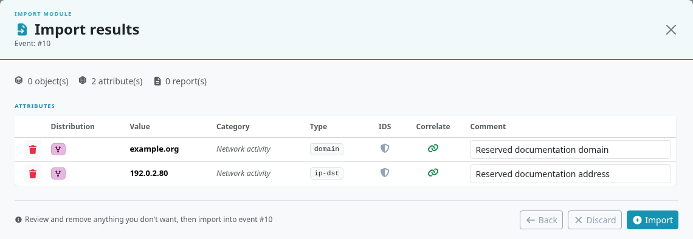
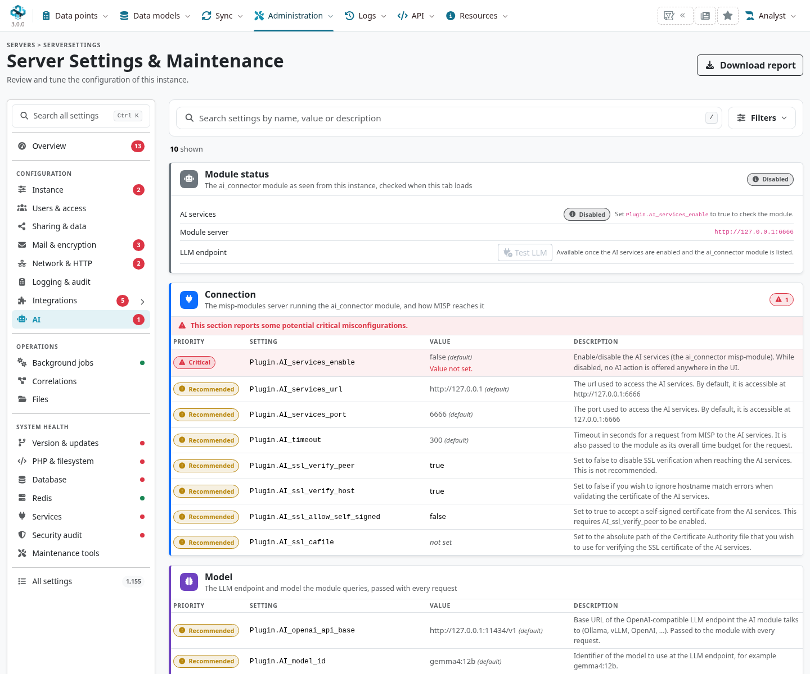

[**misp-modules**](https://github.com/MISP/misp-modules/) extends MISP with **around 300 modules** for enrichment, import, export and workflow actions.
Use it to turn observations into structured context, exchange data with other tools, and automate well-defined tasks without changing MISP's core code.
The Python service can also be used independently through its HTTP API, a dedicated website or a command-line client.

Start with the [module catalogue](https://misp-project.org/modules/) to find an integration, then check what your running service actually provides.
A module may process data locally, query a provider or submit information to another system; its input contract and effects determine how to use it.

::: {.callout-note}
The MISP interface examples follow **3.0.0**, `3.0_wip` commit `99ebee729`.
Service guidance was checked against [misp-modules `5ba217fe`](https://github.com/MISP/misp-modules/tree/5ba217fe765cb5f3b62df0918709c2c0c9df99bb), whose package metadata declares **3.1.3**.
The catalogue and service have their own release cycle: a listed module is not necessarily installed, configured or enabled for every organization.
Select a figure to enlarge it.
:::

## Find a module in the catalogue {#modules-catalogue}

The [live catalogue](https://misp-project.org/modules/) is the starting point for the growing collection of modules.
Search by provider, module name, input type or requirement, and filter by expansion, import, export or action.
Open a module's details to inspect its supported inputs and outputs, dependencies, configuration, references and source code.
The exact count changes as modules are added; the upstream catalogue is broader than any particular installation.

Choose by the task and the result you need:

| Task | Module choice and checks |
|---|---|
| Understand an indicator | Start with URL parsing, DNS/passive DNS, vulnerability or reputation expansion. Check supported attribute types, local versus external processing, and returned objects/references. |
| Bring data into an event | Choose an import module for the source format or service. Check file/text/remote input, required options and the proposed MISP data. |
| Produce data for another tool | Choose an export module for the destination format. Check event input, filtering, output encoding and information the format cannot preserve. |
| Automate a response | Choose an action module and a matching workflow. Check the trigger, configuration, side effects, and whether the module offers a dry run. |

Before enabling a provider integration, check its account requirements, API permissions, rate limits and permitted use of the data.
Use the catalogue for discovery, the module documentation for its contract, and `GET /modules` on your service for actual availability.

<!-- Existing MISP capture provenance: ../assets/automation-screenshots.json. Current service/training audit: ../assets/modules-reference.json. -->

<a id="module-families"></a>
<a id="misp-modules"></a>

## Choose a module family {#modules-families}

| Service family | What it does |
|---|---|
| **Expansion** | Enriches an observation with additional attributes, objects or context. Review proposed results before saving them. |
| **Import** | Parses an external file, text or service response into MISP data. |
| **Export** | Serializes MISP data into another format. |
| **Action** | Executes a task, commonly from a configured workflow; it may change other systems. |

Within MISP's **Enrichment** settings, expansion modules can advertise expansion, hover or both.
Hover supplies lookup context without automatically saving an event update; expansion and hover are capabilities of this family.
MISP's Cortex integration and the dedicated [AI connector](#modules-ai) have their own configuration paths.



<a id="running-the-module-server"></a>

## Run the service {#modules-service}

Follow the maintained [misp-modules installation guide](https://misp.github.io/misp-modules/install/)
or the [official MISP Docker deployment](https://github.com/MISP/misp-docker).
Install the dependencies required by the modules you intend to use, in that service's own environment.
Optional dependencies can make an individual module unavailable even when the service is running.

The usual local HTTP port is **6666**.
In a container deployment, MISP must use a service name reachable from the core container; `127.0.0.1` refers to that container, not another service.
Keep the service on the intended trusted network and configure TLS/CA trust when using HTTPS.

The module service has its own API, including **`GET /modules`** for discovery and
**`POST /query`** for a module request. These are **not** the same routes as MISP's
`/modules/index` and `/modules/queryEnrichment`. Its catalogue/OpenAPI describes module-specific
inputs, user configuration and results. Check the service's version and installed modules when
diagnosing a mismatch with MISP.

### Check the running service {#modules-service-checks}

From a host that can reach the service, adapt these URLs to your deployment:

```sh
curl --fail --silent --show-error http://127.0.0.1:6666/healthcheck
curl --fail --silent --show-error http://127.0.0.1:6666/version
curl --fail --silent --show-error http://127.0.0.1:6666/modules
```

A reachable health endpoint does not prove that a particular module loaded successfully.
Check its identifier and metadata in `/modules`, and inspect startup logs for missing dependencies.
The API identifier is the module's filename without `.py`; its human-readable display name can differ.
The service loads modules at startup, so restart it after installing or changing module code or dependencies.

### Operate the service {#modules-operations}

Current service releases provide several useful operational features.
Check the installed release's documentation before adding an option to an existing deployment.

| Capability | Use and limits |
|---|---|
| API description and explorer | Use `GET /openapi.json` and `/openapi`. Generated at startup from the loaded modules; input and result schemas vary by module. |
| [Local configuration defaults](https://misp.github.io/misp-modules/module-config/) | Start with `--module-config` and a configuration file. Request configuration takes precedence; empty-string/null fallback must be explicitly configured. This does not enable modules in MISP. |
| [Optional result caching](https://misp.github.io/misp-modules/caching/) | Start with `--cache-config` and explicitly select modules. Bounded, process-local and disabled by default; only expansion modules are supported. Select read-only lookups, since some expansion modules submit data or cause other effects. |
| Query statistics | Use `GET /statistics`. Per-module/aggregate outcomes, timings and cache metrics are held per process and reset on restart. |

A cache matches the entire effective request, including configuration, credentials, source UUIDs and context, rather than just an observable's value.
Two attributes containing the same value can therefore require separate queries.
Each service process has its own cache; it is independent of [MISP feed caching](../managing-feeds/index.qmd).

For deployments using [PAP:RED restrictions](https://misp.github.io/misp-modules/pap-red/), `--restrict-pap-red` is an opt-in service policy.
It relies on the caller forwarding applicable attribute/object/event tags and identifying hover requests.
It cannot infer omitted parent markings and does not enforce all PAP/TLP levels or govern import, export and action modules.

<a id="enabling-and-configuring-modules-in-misp"></a>

## Configure MISP 3.0 {#modules-configuration}

As a site administrator, open **Administration → Server Settings & Maintenance → Integrations**.
Choose **Enrichment modules**, **Import modules**, **Export modules**, **Action modules** or **Cortex**, as appropriate.
The old single Plugin tab is replaced by grouped settings pages.



For each family:

1. Set `Plugin.<Family>_services_enable`{.text-wrap .text-break}, its service URL and port.
2. Check that discovery reaches the intended service and that the required module loads.
3. Enable the individual module, such as `Plugin.Import_csvimport_enabled`{.text-wrap .text-break}, and enter its
   required configuration.
   Use only the module's documented fields.
4. Apply an organization restriction where needed.
   In this branch, per-module `_restrict` settings limit use to the selected organization; site administrators have a privileged path.
5. Test with a small synthetic input, inspect the proposed output and confirm the saved result.

Hover also depends on the relevant enrichment/hover settings.
A service URL or enabled family does not enable every module automatically.
Configured workflows can also prevent module queries.
Check **System health → Services** and the module service's logs when discovery or a query fails.

<a id="using-modules"></a>

## Use a module in Overmind {#modules-use}

The available actions depend on role, ownership, family settings, module suitability and
organization restrictions:

- **Import**: from an event, choose **Import**, then the supported module/format. Supply the
  input and user configuration, preview the parsed data and review what will be added.
- **Expansion**: choose **All actions → Enrich Event** when enabled, or the applicable attribute
  enrichment action. Limit a first test to a known observation before enriching a whole event.
- **Hover**: use the enabled value lookup interaction. A lookup response is context, not a saved
  event update or a detection verdict.
- **Export**: choose **All actions → Download as**, then an available export module/format.
  Check which source information the format can represent.
- **Action**: configure and test the relevant workflow. Its execution can send messages or
  modify other systems, so treat it differently from previewing parsed data.



An import module's CSV schema is not necessarily the [feed parser's](../managing-feeds/index.qmd)
schema. For example, `csvimport` uses module-specific header/user-configuration rules and
base64-encoded file contents in API requests. Do not pass a server filesystem path where the
module expects the file's contents.

## Use modules without a MISP instance {#modules-standalone}

The [standalone misp-modules website](https://github.com/MISP/misp-modules/tree/main/website) is a separate client of the service.
It supports enrichment, import, export, results in visual/JSON/Markdown views, history and investigation trees that help follow related observations.
This is useful for exploring a module or building a repeatable analysis process before connecting it to MISP.
Website results do not automatically become saved events in a MISP instance.

Deploy and configure the website separately: it has its own database, administration and module settings.
Follow its maintained installation and interface guides rather than reusing MISP's login or assuming that every service module is enabled in the website.
For scripts and other clients, use the service's HTTP API or the [misp-modules CLI](https://github.com/MISP/misp-modules-cli).

## AI services in MISP 3.0 {#modules-ai}

The 3.0 branch has a separate **AI** configuration page and `Plugin.AI_services_enable` gate.
It calls the fixed **`ai_connector`** module rather than discovering an arbitrary AI module
through the ordinary enrichment catalogue. Supported use cases include event/report
summarization, tag suggestions and information extraction.

Configure the AI service endpoint, its OpenAI-compatible provider/base URL, model and any
credentials deliberately. An enabled button does not establish that sending an event to that
provider is permitted. Review the data scope, intended provider and proposed result first.
The branch marks AI-produced content with the `ai-computer-assisted` taxonomy's generated and
unreviewed provenance tags; those markings do not validate the output's accuracy.



The examples in this chapter do not require enabling AI or sending data to a provider.
[AI-assisted module development](#modules-ai-development) uses an assistant to write and test ordinary Python modules; it does not require an AI service at runtime.
See [best practices](../best-practices/index.qmd) for assessment and provenance.

<a id="module-endpoints"></a>

## Query a module through the API {#modules-api}

| Endpoint | Scope |
|---|---|
| MISP `GET /modules/index` | Enabled enrichment modules visible to the account, with configured service discovery. |
| MISP `POST /modules/queryEnrichment`{.text-wrap .text-break} | An enabled **hover** module request; it does not provide a universal import/expansion/AI route. |
| Module service `GET /modules` | The modules actually loaded by that service. |
| Module service `POST /query` | A request following the selected module's input/configuration schema. |

### Try a local URL extraction {#modules-example}

The `extract_url_components` expansion module parses a URL into a MISP `url` object, including its host, scheme and path, with a reference to the input attribute UUID.
It parses the supplied value without visiting the URL or resolving its hostname.
First confirm that `extract_url_components` appears in your service's `/modules` response.
Save this synthetic request as `url-request.json`:

```json
{
  "module": "extract_url_components",
  "attribute": {
    "type": "url",
    "value": "https://portal.example.org/a?item=1",
    "uuid": "13d8d18b-784a-42a0-9a58-a9cddbfda561"
  }
}
```

Send it directly to the module service, adapting the endpoint to your deployment:

```sh
curl --fail --silent --show-error \
  http://127.0.0.1:6666/query \
  -H 'Content-Type: application/json' \
  --data @url-request.json
```

Inspect `results.Object`, its attributes and the `generated-from` reference to the source UUID.
This service call returns proposed data; it does not save or publish a MISP event.
Other modules can use different request/result structures, including simplified attribute inputs or base64-encoded file contents.
Check their metadata and documentation instead of reusing this body for every family.

An **HTTP 200 response can still contain a module error** in `error` or `errors`.
Check the JSON body as well as the HTTP status; an empty result, a failed query and a successful proposal have different meanings.

### Diagnose a missing module or failed request {#modules-troubleshooting}

Work from the service towards the user interface:

1. **Service and version:** confirm health, version and connectivity from MISP's host/container, not just from your laptop.
2. **Loading and discovery:** find the API identifier in `/modules`; check the installed package/custom directory, dependencies, startup logs and whether the correct process was restarted.
3. **MISP configuration:** check the matching family endpoint, family/individual enablement and organization restriction.
4. **Request contract:** check the supported input type, UUID/file encoding, required configuration and any module error in the response body.
5. **Provider or action target:** check credentials, permissions, rate limits, timeouts and logs, distinguishing a local service failure from a provider failure.
6. **Saved result:** confirm that the analyst reviewed and saved the proposal, or that the workflow performed the intended action.

Use `/statistics` to identify repeated errors and slow modules, alongside service/provider logs.
Ordinary debugging is usually enough; `--debug-extended` logs full outbound HTTP payloads and credentials without redaction, so reserve it for controlled troubleshooting.
See [Automation & API](../automation/index.qmd#api-module-queries) for MISP-side API boundaries.

## Develop and contribute a module {#modules-development}

Start by searching the catalogue and [source repository](https://github.com/MISP/misp-modules/) for an existing integration to extend.
Choose a module of the same family as a reference and follow the maintained [contributor guide](https://misp.github.io/misp-modules/contribute/).
The usual interface consists of:

- `introspection()`: describes accepted input and the module's result format.
- `version()`: returns metadata, including the module type and configuration requirements.
- `handler()`: accepts the JSON request and returns the result or a module error.
  The current dispatcher also supports a `dict_handler()` interface; follow an existing module's convention and preserve any required legacy adapter.

For structured enrichment, use existing PyMISP objects/templates and the documented MISP-standard response format.
Preserve source UUIDs and relevant context, link derived objects to their source, and choose detection flags deliberately.
A parsed value or a provider's reputation score is not automatically suitable for detection.
Add module metadata, dependencies, documentation and tests with the implementation.

### Load a custom module {#modules-custom}

For local development, place the module under a custom root using the appropriate family directory:

```text
/opt/misp-custom-modules/
└── expansion/
    └── my_lookup.py
```

With the service's Python environment active and dependencies installed, start a development service using the **root** directory:

```sh
misp-modules -l 127.0.0.1 -p 6666 --custom /opt/misp-custom-modules
```

Use an available port if another service is running.
The supported directory names are `expansion`, `import_mod`, `export_mod` and `action_mod`.
The loader discovers `.py` files automatically and ignores names beginning with `_`; do not add a module to `__all__`.
Use a unique identifier: a custom module with the same identifier as an installed module replaces it in that service.

Restart after code changes, verify discovery with `/modules`, then send a synthetic request to `/query` and inspect its full result.
Once the service works, configure the matching MISP family and enable the module as described [above](#modules-configuration).
Contributing a file, installing it in the running service and enabling it in MISP are separate steps.

### Build with AI assistance {#modules-ai-development}

The [AI-assisted misp-modules training](https://github.com/MISP/misp-training/tree/main/a.14-ai-assisted-misp-modules) explains how to turn a coding-agent request into a tested contribution.
It includes a [reusable agent brief](https://github.com/MISP/misp-training/blob/main/a.14-ai-assisted-misp-modules/AGENT_BRIEF.md) and a local domain-normalization exercise with unit and HTTP verification.
The exercise performs no DNS lookup or runtime model call.

Use that workflow for a real integration:

1. **Define the gap and contract.** Identify the family, unique identifier, accepted inputs, official provider/schema documentation, expected MISP output, configuration and allowed effects.
2. **Brief the assistant in the checkout.** Supply those requirements and synthetic fixtures, ask it to inspect current conventions, and request a focused implementation with tests and documentation.
3. **Test behavior.** Cover malformed/unsupported input, missing configuration, empty and partial results, source references, detection flags and repeated-call isolation; mock external providers to exercise timeouts, rate limits and failures.
4. **Verify the service boundary.** Load the module, inspect discovery/metadata and exercise `/query`; a passing unit test or HTTP 200 alone does not prove that the integration works in MISP.
5. **Review and contribute.** Compare the code and mappings with the authoritative contract, review dependencies and data handling, and include actual test commands/results and remaining integration limits in the PR.

Keep credentials and private incident data out of prompts and fixtures.
An assistant can help implement and test a module; the contributor still needs to verify its behavior and the evidence submitted for review.

## Training and further reading {#modules-training}

- [**MISP modules: enrichment, data exchange and workflow actions**](https://github.com/MISP/misp-training/tree/main/3.1-misp-modules): analyst, operator and developer routes, with a hands-on API lab covering discovery, structured enrichment, export, actions, configuration defaults, caching and statistics.
- [**Contributing MISP modules with an AI agent**](https://github.com/MISP/misp-training/tree/main/a.14-ai-assisted-misp-modules): task briefs, the module contract, a worked local exercise and verification before an upstream contribution.
- [**Live module catalogue**](https://misp-project.org/modules/): search the growing collection and inspect module details/source.
- [**misp-modules documentation**](https://misp.github.io/misp-modules/): maintained installation, family-specific documentation and contribution instructions.

Start with the general course's README for its reviewed version, prerequisites, runnable examples and expected outcomes.
Follow the companion AI-assisted course when developing a module; its reference exercise is a teaching example rather than a module to submit unchanged.
