[**misp-modules**](https://github.com/MISP/misp-modules/) extends MISP with **300+ modules** for enrichment, import, export, workflow actions and feed gathering.
Use it to turn observations into structured context, exchange data with other tools, and automate well-defined tasks without changing MISP's core code.
The Python service can also be used independently through its HTTP API, a dedicated website or a command-line client.
For examples spanning SOC/SOAR, existing data pipelines and other CTI platforms, see the [TIP integration capability guide](../what-misp-can-do/index.qmd#tip-modules-integrations).

For geographic datasets, see the [geolocation and movement use case](../geolocation/index.qmd): GPX, GeoJSON, NMEA and KML/KMZ import/export, preserved attachments, map views and a source-checked inventory of geographic enrichment modules.

For selected forensic evidence, see [Digital Forensics and Incident Response](../dfir/index.qmd): Windows findings, memory, endpoint and network imports, evidence provenance, timeline exchange and scoped hunting, with a complete candidate module inventory.

For narrative and influence-operation investigations, see [Tracking Disinformation Campaigns](../disinformation/index.qmd): structured claims and evidence, DISARM classification, content comparison, sightings, and cross-event correlation, with a source-reviewed selection of relevant modules.

Start with the [module catalogue](https://misp-project.org/modules/) to find an integration, then check what your running service actually provides.
A module may process data locally, query a provider or submit information to another system; its input contract and effects determine how to use it.

::: {.callout-note}
Except for the gathering walkthrough below, the MISP interface examples follow **3.0.0**, `3.0_wip` commit `99ebee729`.
Service guidance was checked against [misp-modules `8548067a`](https://github.com/MISP/misp-modules/tree/8548067afbb14c2a089c41105ec18b06ef71ab79), whose package metadata declares **3.1.3**.
The catalogue and service have their own release cycle: a listed module is not necessarily installed, configured or enabled for every organization.
Select a figure to enlarge it.
:::

The [gathering walkthrough](#modules-gathering) covers the newer **`develop`** integration, checked at [MISP `19d8ed798`](https://github.com/MISP/MISP/commit/19d8ed79823affc498b686ee81bbefca84043eec) and [misp-modules `36d7a513`](https://github.com/MISP/misp-modules/commit/36d7a513f6e1730d363deb8e7d45811fd6d1d892).
Its screenshots use **MISP 2.5.51, Overmind theme**, on that `develop` commit; verify that both deployed components include gathering contract **version 2**.

## Find a module in the catalogue {#modules-catalogue}

The [live catalogue](https://misp-project.org/modules/) is the starting point for the growing collection of modules.
Search by provider, module name, input type or requirement, and filter by expansion, import, export or action.
Open a module's details to inspect its supported inputs and outputs, dependencies, configuration, references and source code.
The exact count changes as modules are added; the upstream catalogue does not describe what is installed on a particular service.
For the new gathering family, also consult the maintained [gathering module documentation](https://github.com/MISP/misp-modules/blob/main/documentation/mkdocs/gathering.md).

Choose by the task and the result you need:

| Task | Module choice and checks |
|---|---|
| Understand an indicator | Start with URL parsing, DNS/passive DNS, vulnerability or reputation expansion. Check supported attribute types, local versus external processing, and returned objects/references. |
| Bring data into an event | Choose an import module for the source format or service. Check file/text/remote input, required options and the proposed MISP data. |
| Collect a source as complete events | Choose a [gathering producer](#modules-gathering) and configure it as a feed source. Check collection parameters, event identity, revision storage and feed import policy. |
| Produce data for another tool | Choose an export module for the destination format. Check event input, filtering, output encoding and information the format cannot preserve. |
| Automate a response | Choose an action module and a matching workflow. Check the trigger, configuration, side effects, and whether the module offers a dry run. |

Before enabling a provider integration, check its account requirements, API permissions, rate limits and permitted use of the data.
Use the catalogue for discovery, the module documentation for its contract, and `GET /modules` on your service for actual availability.

<!-- Existing captures: ../assets/automation-screenshots.json. New website/MISP captures: ../assets/modules-ui-screenshots.json. Service/training/uv audit: ../assets/modules-reference.json. -->

<a id="module-families"></a>
<a id="misp-modules"></a>

## Choose a module family {#modules-families}

| Service family | What it does |
|---|---|
| **Expansion** | Enriches observations with additional attributes, objects or context. The MISP entry point determines whether results are previewed or written to an event. |
| **Import** | Parses an external file, text or service response into MISP data. |
| **Export** | Serializes MISP data into another format. |
| **Action** | Executes a task, commonly from a configured workflow; it may change other systems. |
| **Gathering** | Collects a source into a standard MISP feed ZIP through a background job. MISP imports its events through the feed workflow; available in the checked `develop` integration. |

Within MISP's **Enrichment** settings, expansion modules can advertise expansion, hover or both.
Hover supplies lookup context without automatically saving an event update; expansion and hover are capabilities of this family.
MISP's Cortex integration and the dedicated [AI connector](#modules-ai) have their own configuration paths.


<a id="running-the-module-server"></a>

## Run the service {#modules-service}

Follow the maintained [misp-modules installation guide](https://misp.github.io/misp-modules/install/)
or the [official MISP Docker deployment](https://github.com/MISP/misp-docker).
Install the dependencies required by the modules you intend to use, in that service's own environment.
Optional dependencies can make an individual module unavailable even when the service is running.

The usual local HTTP port is **6666**.
In a container deployment, MISP must use a service name reachable from the core container; `127.0.0.1` refers to that container, not another service.
Keep the service on the intended trusted network and configure TLS/CA trust when using HTTPS.

The module service has its own API, including **`GET /modules`** for discovery and
**`POST /query`** for a module request. These are **not** the same routes as MISP's
`/modules/index` and `/modules/queryEnrichment`. Its catalogue/OpenAPI describes module-specific
inputs, user configuration and results. Check the service's version and installed modules when
diagnosing a mismatch with MISP.

### Install with uv {#modules-install-uv}

With [uv installed](https://github.com/astral-sh/uv#installation), create a new virtual environment and install the service:

```sh
uv venv --python 3.12 misp-modules-venv
. misp-modules-venv/bin/activate
uv pip install misp-modules
misp-modules -l 127.0.0.1 -p 6666
```

`uv` can obtain Python 3.12 if it is not already available.
Keep that terminal running and use another terminal for the checks below; **Ctrl+C** stops this foreground service.
This installs and starts the module API service; the standalone website and CLI are separate clients.
For a persistent deployment, follow the maintained installation guide's service-management instructions.

The base package loads the modules whose dependencies are available.
For broader coverage, run `uv pip install 'misp-modules[minimal]'` in the same environment, then restart the service.
The optional `all` extra, installed with `uv pip install 'misp-modules[all]'`, can also require native system packages listed in the installation guide.
Extras do not provide provider accounts or enable modules in MISP; verify the required identifiers in `/modules`.

### Check the running service {#modules-service-checks}

From a host that can reach the service, adapt these URLs to your deployment:

```sh
curl --fail --silent --show-error http://127.0.0.1:6666/healthcheck
curl --fail --silent --show-error http://127.0.0.1:6666/version
curl --fail --silent --show-error http://127.0.0.1:6666/modules
```

A reachable health endpoint does not prove that a particular module loaded successfully.
Check its identifier and metadata in `/modules`, and inspect startup logs for missing dependencies.
The API identifier is the module's filename without `.py`; its human-readable display name can differ.
The service loads modules at startup, so restart it after installing or changing module code or dependencies.

### Operate the service {#modules-operations}

Current service releases provide several useful operational features.
Check the installed release's documentation before adding an option to an existing deployment.

| Capability | Use and limits |
|---|---|
| API description and explorer | Use `GET /openapi.json` and `/openapi`. Generated at startup from the loaded modules; input and result schemas vary by module. |
| [Local configuration defaults](https://misp.github.io/misp-modules/module-config/) | Start with `--module-config` and a configuration file. Request configuration takes precedence; empty-string/null fallback must be explicitly configured. This does not enable modules in MISP. |
| [Optional result caching](https://misp.github.io/misp-modules/caching/) | Start with `--cache-config` and explicitly select modules. Bounded, process-local and disabled by default; only expansion modules are supported. Select read-only lookups, since some expansion modules submit data or cause other effects. |
| Query statistics | Use `GET /statistics`. Per-module/aggregate outcomes, timings and cache metrics are held per process and reset on restart. |

A cache matches the entire effective request, including configuration, credentials, source UUIDs and context, rather than just an observable's value.
Two attributes containing the same value can therefore require separate queries.
Each service process has its own cache; it is independent of [MISP feed caching](../managing-feeds/index.qmd).

For deployments using [PAP:RED restrictions](https://misp.github.io/misp-modules/pap-red/), `--restrict-pap-red` is an opt-in service policy.
It relies on the caller forwarding applicable attribute/object/event tags and identifying hover requests.
It cannot infer omitted parent markings and does not enforce all PAP/TLP levels or govern import, export and action modules.

<a id="enabling-and-configuring-modules-in-misp"></a>

## Configure MISP 3.0 {#modules-configuration}

As a site administrator, open **Administration → Server Settings & Maintenance → Integrations**.
Choose **Enrichment modules**, **Import modules**, **Export modules**, **Action modules** or **Cortex**, as appropriate.
The old single Plugin tab is replaced by grouped settings pages.

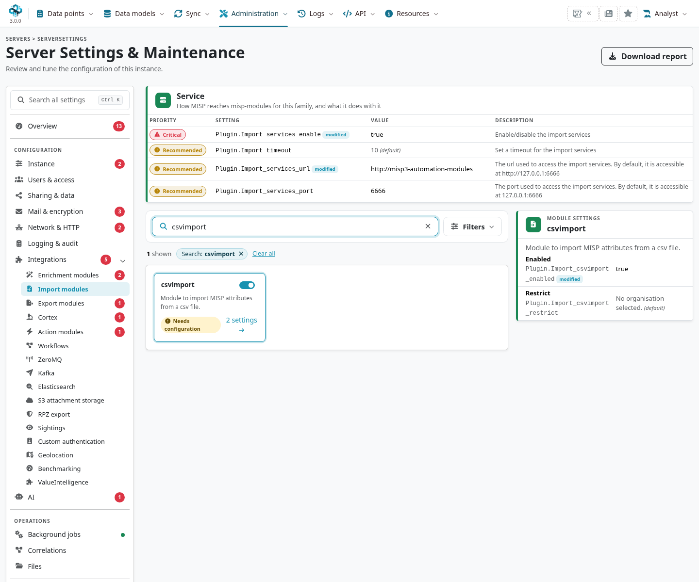

For each family:

1. Set `Plugin.<Family>_services_enable`{.text-wrap .text-break}, its service URL and port.
2. Check that discovery reaches the intended service and that the required module loads.
3. Enable the individual module, such as `Plugin.Import_csvimport_enabled`{.text-wrap .text-break}, and enter its
   required configuration.
   Use only the module's documented fields.
4. Apply an organization restriction where needed.
   In this branch, per-module `_restrict` settings limit use to the selected organization; site administrators have a privileged path.
5. Test with a small synthetic input, inspect the proposed output and confirm the saved result.

Hover also depends on the relevant enrichment/hover settings.
A service URL or enabled family does not enable every module automatically.
Configured workflows can also prevent module queries.
Check **System health → Services** and the module service's logs when discovery or a query fails.

<a id="using-modules"></a>

## Use a module in MISP 3.0 {#modules-use}

Module actions appear where the relevant data is being used.
Their availability depends on role, ownership, family settings, compatible input types and organization restrictions.

| MISP 3.0 surface | Module use |
|---|---|
| Event → **Attributes** → row menu → **Enrich** | Choose a compatible expansion module for one attribute, then review its proposed objects/attributes before importing. |
| Event → **All actions** → **Enrich Event** | Select expansion modules for the event's attributes. This can add results directly to the event, with background processing when enabled. |
| Event → **Import** | Choose an available import module/format, supply its file/text/options, and review the parsed data. |
| Event → **All actions** → **Download as** | Select a built-in format or an enabled export module; check the output format and any module-specific options. |
| **Value Intelligence** → a value → **Enrichment** | Inspect compatible modules, proposed requests and stored value-level answers, or deliberately run a selected module. |
| [**Workflows**](../workflows/index.qmd#workflow-modules) | Configure module-backed actions for a trigger or ad-hoc process; these can affect other systems. |

Configured hover lookups provide context for a value without automatically importing event attributes.
A lookup response is neither a detection verdict nor a saved event update.

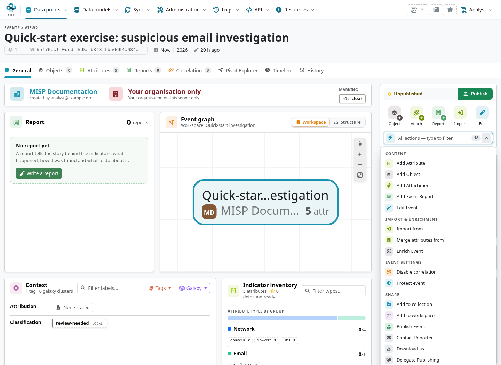

### Enrich one attribute and review the result {#modules-misp-attribute}

Open the event's **Attributes** tab and the required row's action menu, then choose **Enrich**.
The module picker offers enabled modules compatible with that attribute's type.
For a controlled first test, use a synthetic URL and the local `extract_url_components` parser.

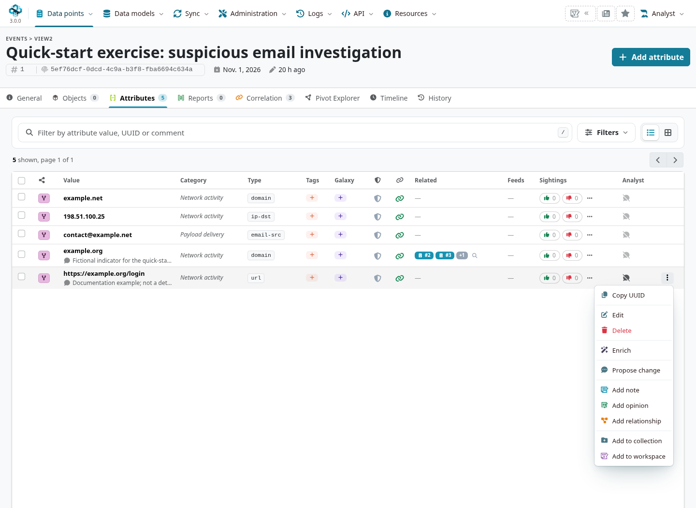

Select the parser, expand its proposed object and inspect the values, source references, distribution, correlation and IDS flags.
The review dialog can propose enabled IDS flags; decide which observations are actually appropriate for detection.
Remove unwanted results and choose **Import** only when the proposal is ready, or **Discard** to leave the event unchanged.
The screenshot below is a real parser response captured before import; its proposals were not saved.

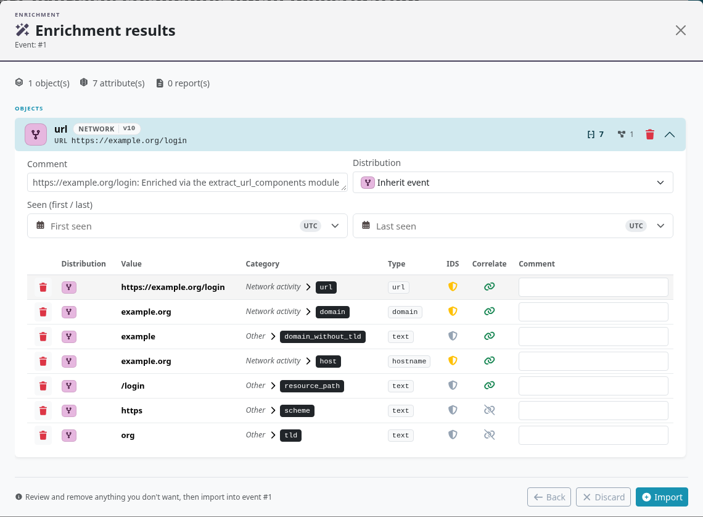

### Enrich an event {#modules-misp-event}

Choose **All actions → Enrich Event**, then select the expansion modules to apply across the event's attributes.
Submitting **Enrich** invokes the event-enrichment workflow, which can create data directly in the event.
With background jobs enabled it queues a job; otherwise it can execute synchronously.
Use the single-attribute review flow above to assess a new integration before running it across an event.

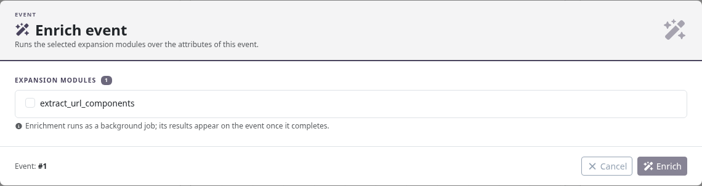

### Inspect a value across occurrences {#modules-misp-value}

Open a value in **Value Intelligence** and select **Enrichment** to see the compatible modules and answers held for your organization.
Selecting a module shows what it would be asked; pressing its run control sends the request.
The resulting value-level answer can be retained and reused according to the analyst profile's reuse settings; it is not automatically imported as an event attribute.
Automatic queries also depend on the administrator's `Plugin.ValueIntelligence_enrichment_auto_run`{.text-wrap .text-break} setting, which is disabled by default, and the effective profile's choices.

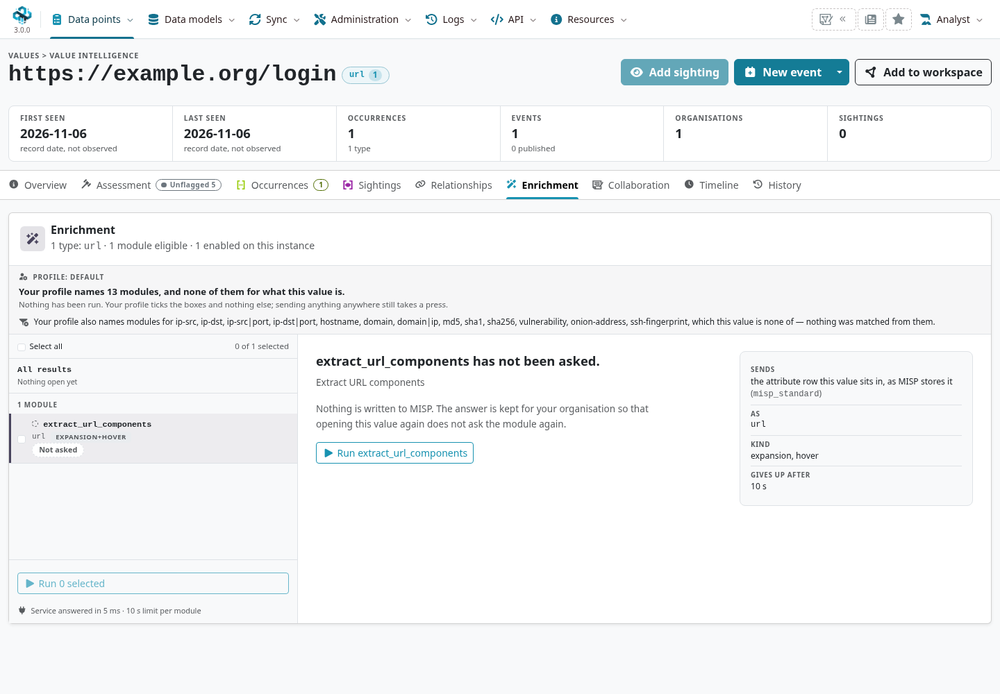

The [Value Intelligence walkthrough](../value-intelligence/index.qmd#value-intelligence-enrichment) runs the local URL parser, inspects its structured answer, reopens the retained result and reviews selected findings before event creation.

### Import, export and workflows {#modules-misp-exchange}

For imports, follow the selected module's input contract and review the preview before saving.
An import module's CSV schema is not necessarily the [feed parser's](../managing-feeds/index.qmd) schema.
For example, `csvimport` uses module-specific header/options and base64-encoded file contents in API requests; a server filesystem path does not supply those contents.

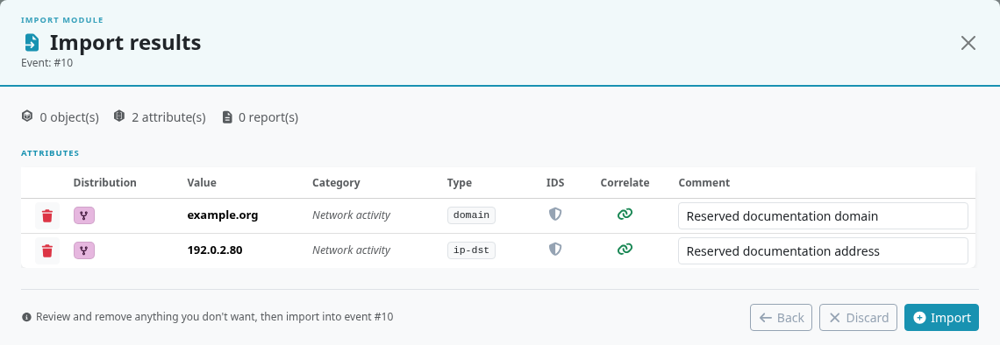

For exports, choose **Download as**, select the required format/module and check which source information it can represent.
For workflow actions, follow the [workflow configuration guidance](../workflows/index.qmd#workflow-modules) and test the action's intended effects before enabling a trigger.
Module-backed enrichment, notifications and publication to another system have different execution and review paths.

## Gather a source into a MISP feed {#modules-gathering}

A gathering module produces complete events from a source, with stable identifiers and revision timestamps for repeated collection.
Use expansion to enrich an existing observation, import to parse supplied data, and gathering to maintain a source through [feed fetching](../managing-feeds/index.qmd).
Source-specific retrieval and conversion run in misp-modules; MISP applies its existing feed filters, distribution policy and UUID/timestamp rules to add, update or skip events.
The configured feed persists between pulls; generation does not create a temporary feed definition for each request.

### Configure the WithAName producer {#modules-gathering-withaname}

The first producer, **WithAName** (API identifier **`withaname`**), reads DDoSia configuration snapshots from [witha.name/data](https://witha.name/data/).
It retrieves the published configurations without contacting the systems listed as targets.
Each snapshot becomes one event containing `ddos-config` objects for target rules, a source link and a canonical JSON attachment preserving random substitution definitions and unmapped fields.

As a site administrator on a MISP revision with the gathering integration:

1. Run a misp-modules revision containing `gathering/withaname.py` and verify `withaname` in `GET /modules`.
   Its descriptor must advertise `type: gathering`, `meta.module-type: ["gathering"]` and `mispattributes.gathering_version: 2`.
2. In MISP's server settings, enable `Plugin.Gathering_services_enable`{.text-wrap .text-break}, set `Plugin.Gathering_services_url`{.text-wrap .text-break} and `Plugin.Gathering_services_port`{.text-wrap .text-break}, then enable `Plugin.Gathering_withaname_enabled`{.text-wrap .text-break}.
   Apply the module's organization restriction where needed; discovery honors normal module access restrictions.
3. Add a feed and choose **Input Source → MISP modules**, then **Gathering module → WithAName**.
   The checked Classic and Overmind forms provide a **Gathering parameters (JSON object)** field.
   The source format is **MISP**, caching is disabled and no source URL is required: the producer knows its source.
4. Enter a small explicit UTC date window, such as the example below, and choose the feed's distribution, filters and publication policy.
   For this walkthrough, use **Your organisation only** and **Unpublish events** while assessing the source.
   Enable the feed, save it and fetch that feed alone for the first import.
5. Follow the fetch/job outcome and inspect the resulting event, its source attachment, objects and detection flags before scheduling recurring pulls.
   Fetching can save events directly through the feed importer; it does not use the single-attribute enrichment review dialog.

Paste this object into **Gathering parameters** to select snapshots observed on June 24, 2023 (UTC):

```json
{
  "date_from": "2023-06-24",
  "date_to": "2023-06-25",
  "max_events": 0,
  "deduplicate_entries": true
}
```

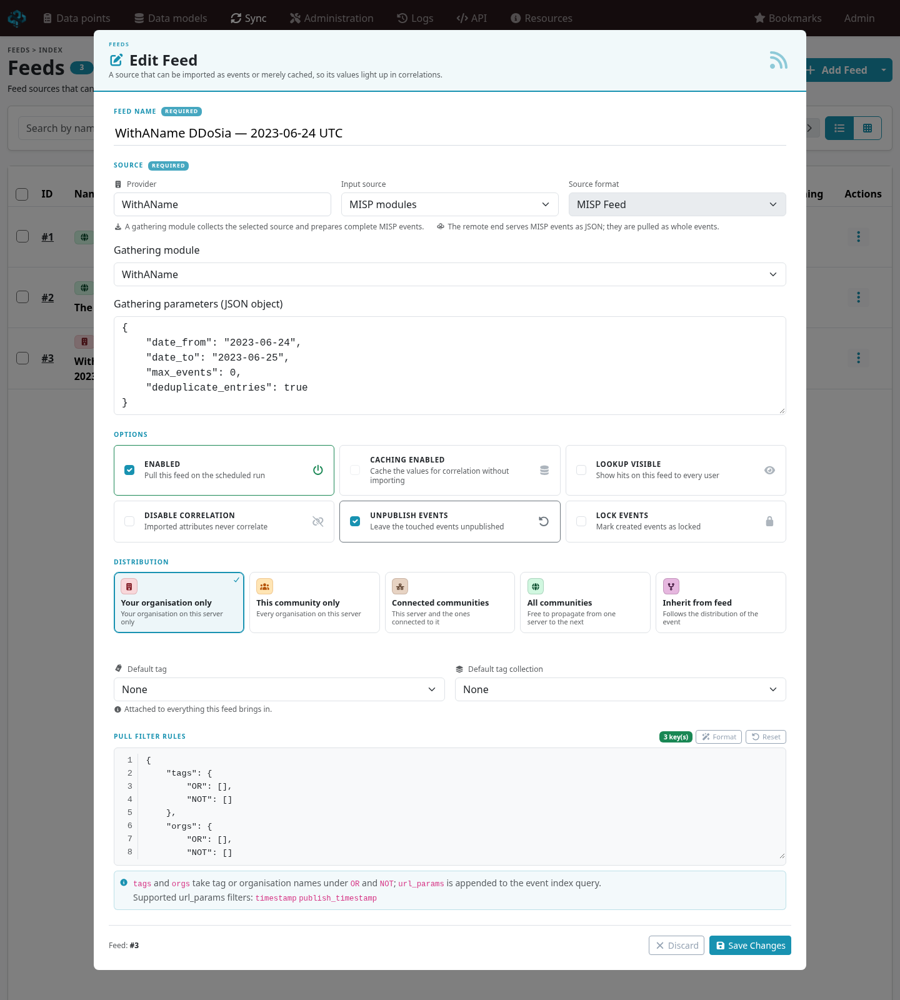

| Parameter | Meaning |
|---|---|
| `date_from` | Inclusive UTC observation date (`YYYY-MM-DD`); defaults to yesterday. |
| `date_to` | Exclusive UTC observation date; defaults to tomorrow. With both dates omitted, the window covers yesterday and today. |
| `max_events` | Non-negative integer budget; `0` collects all matching snapshots. Exceeding a positive budget fails generation instead of truncating the feed. |
| `deduplicate_entries` | Boolean, default `true`; collapses identical rules within a snapshot. Rules for the same host remain separate when their meaning differs. |

::: {.callout-important}
The listed systems are **DDoS victim targets**.
The producer sets `to_ids: false` and `disable_correlation: true` on all generated attributes; preserve this distinction when assessing or sharing the results.
Placeholders in target rules remain literal, and the attachment preserves their definitions.
:::

Stable UUIDs and persisted revision timestamps let overlapping date windows reuse unchanged events and update corrected source content.
Changing `deduplicate_entries` selects a separate view identity, so choose it before repeated ingestion.
Normal MISP merge semantics apply: a corrected rule can receive a new object UUID while an older rule remains in an imported event; the producer emits no deletion tombstones.

The local verification collected **5 events, 137 `ddos-config` objects and 1,517 attributes** from this date window.
All events remained unpublished, and every generated attribute retained disabled IDS export and correlation.
These are actual public-source results from the capture date; a later collection can differ if the source changes.

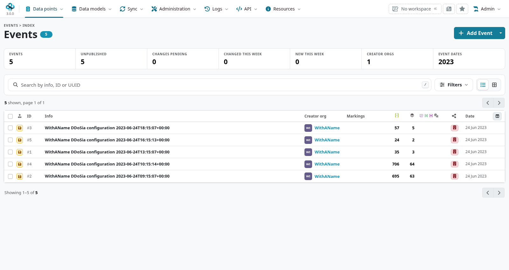

The saved feed and import shown here were created through MISP's authenticated REST API; the screenshots show the real saved configuration and event list.
For the same setup, send this JSON to **MISP `POST /feeds/add`** using the [MISP API authentication headers](../automation/index.qmd#api-headers):

```json
{
  "Feed": {
    "name": "WithAName configurations",
    "provider": "WithAName",
    "input_source": "misp-modules",
    "source_format": "misp",
    "enabled": true,
    "caching_enabled": false,
    "distribution": "0",
    "settings": {
      "unpublish_event": true,
      "gathering": {
        "module": "withaname",
        "parameters": {
          "date_from": "2023-06-24",
          "date_to": "2023-06-25",
          "max_events": 0,
          "deduplicate_entries": true
        }
      }
    }
  }
}
```

Use the returned feed ID with **MISP `POST /feeds/fetchFromFeed/<feed-id>`** to start ingestion.
These MISP routes persist a feed and its imported events; the standalone module-service request [below](#modules-api-gathering) produces an archive.
The [capture record](../assets/gathering-reference.json) identifies revisions, source parameters, checks and remaining validation limits.

### Generation, storage and operating limits {#modules-gathering-operations}

The gathering lifecycle has five stages:

1. MISP submits `operation: prepare` to the module service's `/query` and receives a small job descriptor.
2. It polls the job until generation is ready or failed.
3. It streams the ready binary ZIP to a private local workspace, verifies its size and SHA256, and validates/extracts the feed files.
4. It imports one event file at a time through the existing feed importer.
5. It removes the workspace and releases the module job, including on failure or timeout.

Generation runs independently of the submission HTTP timeout.
For long collections, use MISP background feed jobs and allow sufficient worker/queue execution time.
`Plugin.Gathering_generation_timeout`{.text-wrap .text-break} controls MISP's generation wait budget (default **86400 seconds**); `Plugin.Gathering_timeout`{.text-wrap .text-break} and per-module timeouts cover submission.
PHP's **curl** and **zip** extensions are required, and MISP needs writable temporary storage for both the ZIP and expanded feed.
MISP defaults to **10 GiB** compressed and expanded budgets and **256 MiB** per file, configurable through `Plugin.Gathering_max_archive_bytes`{.text-wrap .text-break}, `Plugin.Gathering_max_expanded_bytes`{.text-wrap .text-break} and `Plugin.Gathering_max_event_bytes`{.text-wrap .text-break}.
The importer reads event content one event at a time; the largest event must still fit in memory, and some filename metadata grows with file count.

Set the module service's `MISP_MODULES_GATHERING_STATE_DIR`{.text-wrap .text-break} to durable, service-owned storage and preserve its SQLite revision index across upgrades and restarts.
That index ensures corrected historical events receive newer timestamps than previously imported versions.
Replicas serving the same feed need the same conversion version and shared storage suitable for SQLite locking, or one designated producer.
Ready artifacts survive restarts with durable storage; interrupted generation fails and must be retried from the source.
The service has bounded workers/queue, generation and disk budgets, and artifact retention; see the maintained [gathering guide](https://github.com/MISP/misp-modules/blob/main/documentation/mkdocs/gathering-guide.md) for settings.

The checked integration supports **import and preview**; keep feed caching/lookup disabled.
Daily aggregation and protected-event signatures are outside the first producer's scope.
If a module is missing from the picker, check family enablement, module enablement, organization restrictions and contract version before debugging source retrieval.
Query statistics measure submission; use the generation job status and feed import outcome to establish completion.
For direct clients, follow the [gathering API lifecycle](#modules-api-gathering).

## Use modules without a MISP instance {#modules-standalone}

The [standalone misp-modules website](https://github.com/MISP/misp-modules/tree/main/website) is a separate client of the service.
It supports enrichment, import, export, results in visual/JSON/Markdown views, history and investigation trees that help follow related observations.
This is useful for exploring a module or building a repeatable analysis process before connecting it to MISP.
Website results do not automatically become saved events in a MISP instance.

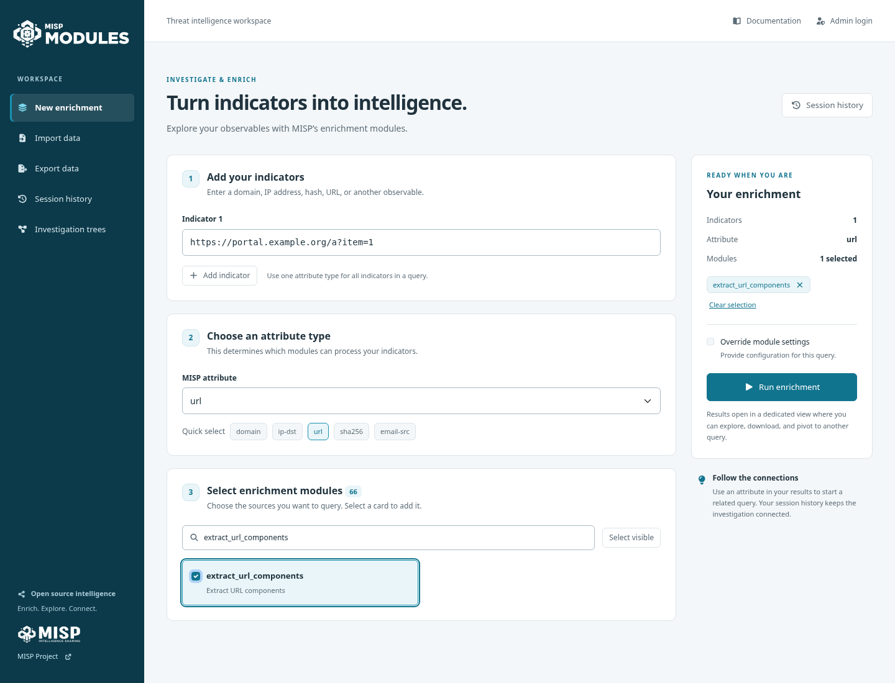

A first local enrichment follows three steps:

1. Choose **New enrichment**, enter `https://portal.example.org/a?item=1` and select the **url** attribute type.
2. Search for `extract_url_components` and select that module alone.
3. Choose **Run enrichment**, then inspect the structured URL object in **Visual**, **JSON** or **Markdown** view.

Use **Choose modules** on a returned attribute to start a related lookup, or download the result for another tool.
Each selected module follows its own processing and provider requirements; this example uses only local parsing.

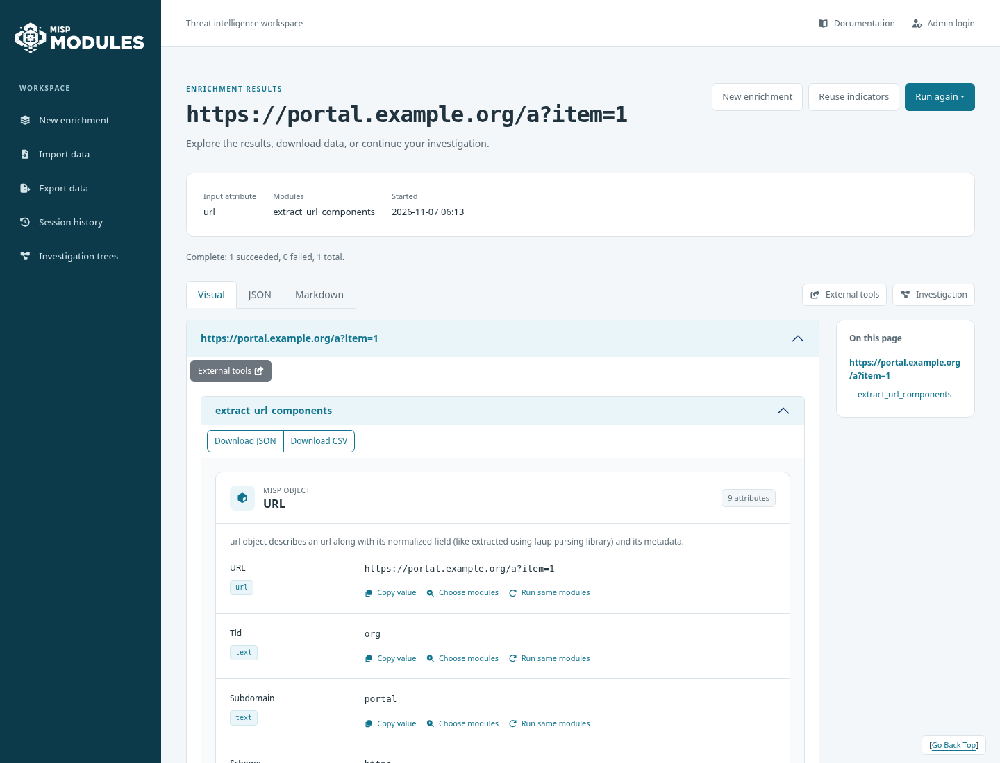

Deploy and configure the website separately: it has its own database, administration and module settings.
Follow its maintained installation and interface guides rather than reusing MISP's login or assuming that every service module is enabled in the website.
For scripts and other clients, use the service's HTTP API or the [misp-modules CLI](https://github.com/MISP/misp-modules-cli).

### Use misp-modules-cli {#modules-cli}

[**misp-modules-cli**](https://github.com/MISP/misp-modules-cli) is a command-line client for a running local or remote module service.
It can discover expansion modules and their input types, infer likely types for a value, restrict execution to named modules, and emit combined JSON or Markdown reports.
Install the client as a separate uv tool:

```sh
uv tool install git+https://github.com/MISP/misp-modules-cli.git
```

If uv reports that its tool directory is not on `PATH`, run `uv tool update-shell` and open a new terminal.
List the expansion modules available from your service:

```sh
misp-modules-cli --url http://127.0.0.1:6666 --list-active-modules
```

Here, active means available from the service, rather than enabled for a particular MISP account.
For the same synthetic URL used above, select a single local module and use type metadata from the MISP 3.0 branch:

```sh
misp_types_url=https://raw.githubusercontent.com/MISP/MISP
misp_types_url="$misp_types_url/refs/heads/3.0_wip/describeTypes.json"
misp-modules-cli --url http://127.0.0.1:6666 \
  --describe-types-url "$misp_types_url" \
  --type url --value 'https://portal.example.org/a?item=1' \
  --module extract_url_components --unified-output
```

The CLI normally fetches type metadata over HTTPS; `--describe-types-url` lets you select a matching published JSON catalogue.
Use `--module` to constrain execution: without a module selection the client can query multiple compatible integrations.
Its local configuration and response cache are separate from MISP settings and the module service's optional result cache.
See the CLI README for configuration, cache controls and `--markdown-output` reporting.

## AI services in MISP 3.0 {#modules-ai}

The 3.0 branch has a separate **AI** configuration page and `Plugin.AI_services_enable` gate.
It calls the fixed **`ai_connector`** module rather than discovering an arbitrary AI module
through the ordinary enrichment catalogue. Supported use cases include event/report
summarization, tag suggestions and information extraction.

Configure the AI service endpoint, its OpenAI-compatible provider/base URL, model and any
credentials deliberately. An enabled button does not establish that sending an event to that
provider is permitted. Review the data scope, intended provider and proposed result first.
The branch marks AI-produced content with the `ai-computer-assisted` taxonomy's generated and
unreviewed provenance tags; those markings do not validate the output's accuracy.

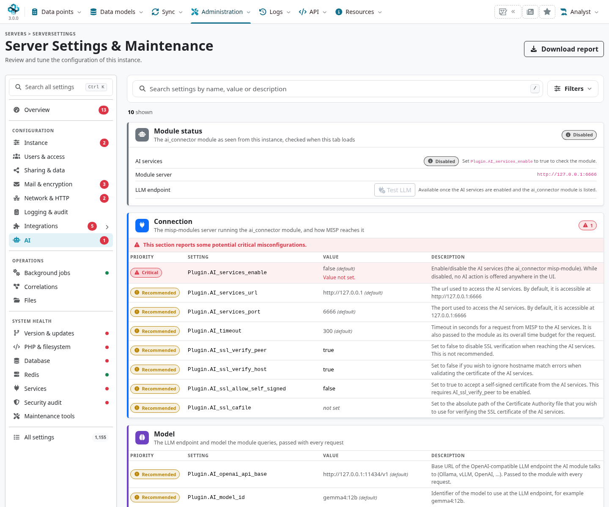

The examples in this chapter do not require enabling AI or sending data to a provider.
[AI-assisted module development](#modules-ai-development) uses an assistant to write and test ordinary Python modules; it does not require an AI service at runtime.
See [best practices](../best-practices/index.qmd) for assessment and provenance.

<a id="module-endpoints"></a>

## Query a module through the API {#modules-api}

| Endpoint | Scope |
|---|---|
| MISP `GET /modules/index` | Enabled enrichment modules visible to the account, with configured service discovery. |
| MISP `POST /modules/queryEnrichment`{.text-wrap .text-break} | An enabled **hover** module request; it does not provide a universal import/expansion/AI route. |
| Module service `GET /modules` | The modules actually loaded by that service. |
| Module service `POST /query` | A request following the selected module's input/configuration schema. |

### Try a local URL extraction {#modules-example}

The `extract_url_components` expansion module parses a URL into a MISP `url` object, including its host, scheme and path, with a reference to the input attribute UUID.
It parses the supplied value without visiting the URL or resolving its hostname.
First confirm that `extract_url_components` appears in your service's `/modules` response.
Save this synthetic request as `url-request.json`:

```json
{
  "module": "extract_url_components",
  "attribute": {
    "type": "url",
    "value": "https://portal.example.org/a?item=1",
    "uuid": "13d8d18b-784a-42a0-9a58-a9cddbfda561"
  }
}
```

Send it directly to the module service, adapting the endpoint to your deployment:

```sh
curl --fail --silent --show-error \
  http://127.0.0.1:6666/query \
  -H 'Content-Type: application/json' \
  --data @url-request.json
```

Inspect `results.Object`, its attributes and the `generated-from` reference to the source UUID.
This service call returns proposed data; it does not save or publish a MISP event.
Other modules can use different request/result structures, including simplified attribute inputs or base64-encoded file contents.
Check their metadata and documentation instead of reusing this body for every family.

An **HTTP 200 response can still contain a module error** in `error` or `errors`.
Check the JSON body as well as the HTTP status; an empty result, a failed query and a successful proposal have different meanings.

### Request a gathering feed directly {#modules-api-gathering}

After confirming version-2 discovery, save this request as `gathering-request.json`:

```json
{
  "module": "withaname",
  "operation": "prepare",
  "parameters": {
    "date_from": "2023-06-24",
    "date_to": "2023-06-25",
    "max_events": 0,
    "deduplicate_entries": true
  },
  "config": {}
}
```

Submitting this request contacts the public source and starts background generation:

```sh
curl --fail --silent --show-error \
  http://127.0.0.1:6666/query \
  -H 'Content-Type: application/json' \
  --data @gathering-request.json
```

Check the body for an error before using its `job_id`.
A successful response has `gathering_version: 2`, `source_format: "misp"` and a status such as `queued`.
Substitute the returned 64-character hexadecimal job ID below, and poll until `ready` or `failed`:

```sh
job_id='<returned-job-id>'
curl --fail --silent --show-error \
  "http://127.0.0.1:6666/gathering/jobs/$job_id"
```

When ready, record `archive_size`, `sha256`, `event_count` and `expires_at`, then download the binary artifact:

```sh
curl --fail --silent --show-error \
  "http://127.0.0.1:6666/gathering/jobs/$job_id/feed.zip" \
  --output feed.zip
```

Verify the downloaded size and SHA256 against the ready metadata before consuming it.
The ZIP contains `manifest.json` and one `<event-uuid>.json` per event, each using the standard `{"Event": {...}}` wrapper.
The query response contains job metadata; the feed is delivered through the binary download endpoint.
Release the job after use, including failed or abandoned attempts:

```sh
curl --fail --silent --show-error --request DELETE \
  "http://127.0.0.1:6666/gathering/jobs/$job_id"
```

Direct clients should put cleanup in a `finally` block; deleting a running job requests cooperative cancellation.
Unclaimed terminal jobs expire according to service retention.
Keep job IDs within the trusted service connection: they grant access to their artifacts.
This standalone workflow produces a feed archive; importing it into MISP requires the configured [gathering feed workflow](#modules-gathering-withaname) or another standard feed consumer.

### Diagnose a missing module or failed request {#modules-troubleshooting}

Work from the service towards the user interface:

1. **Service and version:** confirm health, version and connectivity from MISP's host/container, not just from your laptop.
2. **Loading and discovery:** find the API identifier in `/modules`; check the installed package/custom directory, dependencies, startup logs and whether the correct process was restarted.
3. **MISP configuration:** check the matching family endpoint, family/individual enablement and organization restriction.
4. **Request contract:** check the supported input type, UUID/file encoding, required configuration and any module error in the response body.
5. **Provider or action target:** check credentials, permissions, rate limits, timeouts and logs, distinguishing a local service failure from a provider failure.
6. **Saved result:** confirm that the analyst reviewed and saved the proposal, or that the workflow performed the intended action.

Use `/statistics` to identify repeated errors and slow modules, alongside service/provider logs.
Ordinary debugging is usually enough; `--debug-extended` logs full outbound HTTP payloads and credentials without redaction, so reserve it for controlled troubleshooting.
See [Automation & API](../automation/index.qmd#api-module-queries) for MISP-side API boundaries.

## Develop and contribute a module {#modules-development}

Start by searching the catalogue and [source repository](https://github.com/MISP/misp-modules/) for an existing integration to extend.
Choose a module of the same family as a reference and follow the maintained [contributor guide](https://misp.github.io/misp-modules/contribute/).
The usual interface consists of:

- `introspection()`: describes accepted input and the module's result format.
- `version()`: returns metadata, including the module type and configuration requirements.
- `handler()`: accepts the JSON request and returns the result or a module error.
  The current dispatcher also supports a `dict_handler()` interface; follow an existing module's convention and preserve any required legacy adapter.

For structured enrichment, use existing PyMISP objects/templates and the documented MISP-standard response format.
Preserve source UUIDs and relevant context, link derived objects to their source, and choose detection flags deliberately.
A parsed value or a provider's reputation score is not automatically suitable for detection.
Add module metadata, dependencies, documentation and tests with the implementation.

### Load a custom module {#modules-custom}

For local development, place the module under a custom root using the appropriate family directory:

```text
/opt/misp-custom-modules/
└── expansion/
    └── my_lookup.py
```

With the service's Python environment active and dependencies installed, start a development service using the **root** directory:

```sh
misp-modules -l 127.0.0.1 -p 6666 --custom /opt/misp-custom-modules
```

Use an available port if another service is running.
The supported directory names are `expansion`, `import_mod`, `export_mod`, `action_mod` and, in revisions with gathering support, `gathering`.
The loader discovers `.py` files automatically and ignores names beginning with `_`; do not add a module to `__all__`.
Use a unique identifier: a custom module with the same identifier as an installed module replaces it in that service.

Restart after code changes, verify discovery with `/modules`, then send a synthetic request to `/query` and inspect its full result.
Once the service works, configure the matching MISP family and enable the module as described [above](#modules-configuration).
Contributing a file, installing it in the running service and enabling it in MISP are separate steps.

For a gathering producer, advertise contract version **2** and a parameter schema, submit background work through `get_jobs().submit(...)`, and pass each complete event to `FeedBuilder.add(event, source_timestamp)`.
The framework creates the manifest and ZIP; the producer supplies stable UUIDs, meaningful revisions and cooperative cancellation checks.
Follow the [gathering contributor guidance](https://github.com/MISP/misp-modules/blob/main/documentation/mkdocs/gathering-guide.md#durable-revisions-and-additional-producers) and test retries, corrections, reordered input, limits and cleanup.
Additional producers use the same MISP integration without source-specific converter code in core.

### Build with AI assistance {#modules-ai-development}

The [AI-assisted misp-modules training](https://github.com/MISP/misp-training/tree/main/a.14-ai-assisted-misp-modules) explains how to turn a coding-agent request into a tested contribution.
It includes a [reusable agent brief](https://github.com/MISP/misp-training/blob/main/a.14-ai-assisted-misp-modules/AGENT_BRIEF.md) and a local domain-normalization exercise with unit and HTTP verification.
The exercise performs no DNS lookup or runtime model call.

Use that workflow for a real integration:

1. **Define the gap and contract.** Identify the family, unique identifier, accepted inputs, official provider/schema documentation, expected MISP output, configuration and allowed effects.
2. **Brief the assistant in the checkout.** Supply those requirements and synthetic fixtures, ask it to inspect current conventions, and request a focused implementation with tests and documentation.
3. **Test behavior.** Cover malformed/unsupported input, missing configuration, empty and partial results, source references, detection flags and repeated-call isolation; mock external providers to exercise timeouts, rate limits and failures.
4. **Verify the service boundary.** Load the module, inspect discovery/metadata and exercise `/query`; a passing unit test or HTTP 200 alone does not prove that the integration works in MISP.
5. **Review and contribute.** Compare the code and mappings with the authoritative contract, review dependencies and data handling, and include actual test commands/results and remaining integration limits in the PR.

Keep credentials and private incident data out of prompts and fixtures.
An assistant can help implement and test a module; the contributor still needs to verify its behavior and the evidence submitted for review.

## Training and further reading {#modules-training}

- [**MISP modules: enrichment, data exchange and workflow actions**](https://github.com/MISP/misp-training/tree/main/3.1-misp-modules): analyst, operator and developer routes, with a hands-on API lab covering discovery, structured enrichment, export, actions, configuration defaults, caching and statistics.
- [**Contributing MISP modules with an AI agent**](https://github.com/MISP/misp-training/tree/main/a.14-ai-assisted-misp-modules): task briefs, the module contract, a worked local exercise and verification before an upstream contribution.
- [**Live module catalogue**](https://misp-project.org/modules/): search the growing collection and inspect module details/source.
- [**misp-modules documentation**](https://misp.github.io/misp-modules/): maintained installation, family-specific documentation and contribution instructions.

Start with the general course's README for its reviewed version, prerequisites, runnable examples and expected outcomes.
Follow the companion AI-assisted course when developing a module; its reference exercise is a teaching example rather than a module to submit unchanged.
