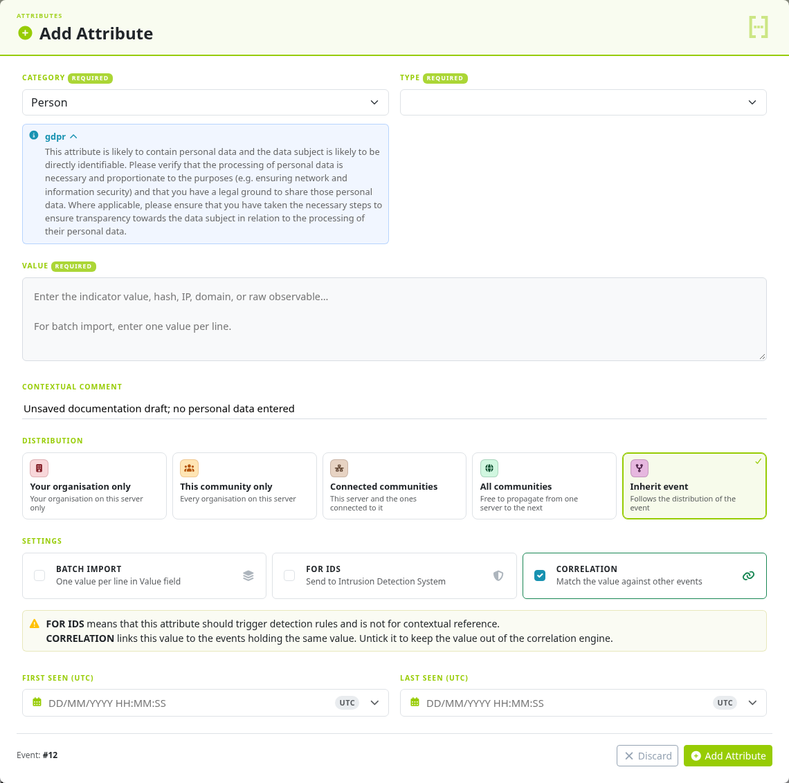
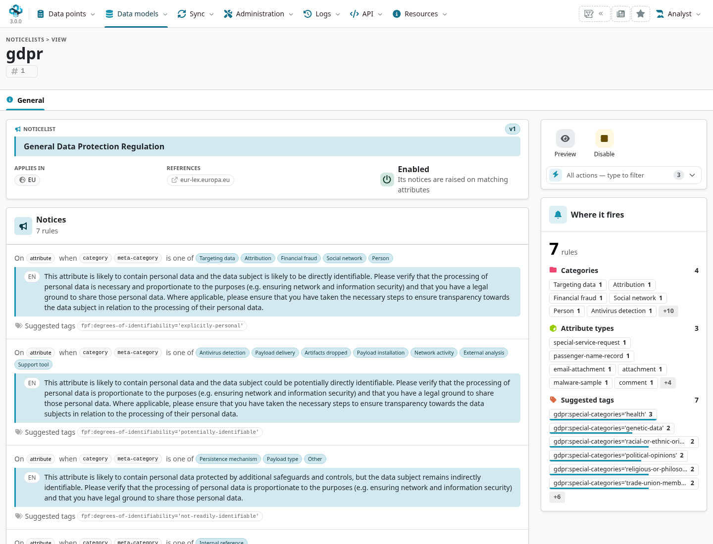

Notice lists show guidance when a user enters a kind of data that needs attention. A notice
can remind an analyst to consider personal data, handling obligations or another policy issue.
It informs a decision; it is not a proof of compliance, a value lookup or an automatic access rule.

::: {.callout-note}
This chapter follows MISP **3.0.0**, `3.0_wip` commit `99ebee729`.
The bundled definitions come from [misp-noticelist](https://github.com/MISP/misp-noticelist).
The training example previews the form without saving personal information.
:::

<!-- Definition pin, supported trigger checks and captures: ../assets/data-model-screenshots.json -->

## Understand what triggers a notice {#noticelists-triggers}

In the pinned implementation, active notices on the attribute form are selected by the
attribute's **category** and **type**. Do not assume a notice searches arbitrary value patterns,
examines all object contents or runs a general policy engine merely because a definition
contains other metadata.

::: {.table-responsive}

| Mechanism | What it evaluates |
|---|---|
| Notice list | Supported category/type selections and informational messages on the form. |
| Warninglist | Actual values matched using enabled lists and their matching rules. |
| Taxonomy | Classification/handling vocabulary and its configured consistency requirements. |
| Distribution / sharing groups | Audience and sharing eligibility. |
| Blocking workflow / intake rule | An explicitly configured operational constraint. |

:::

The form displays the relevant message as category/type choices change. Read the full text and
source reference, then decide whether the observation is necessary and how it should be scoped.
A notice does not block saving, change the IDS flag or automatically apply every suggested tag.

## Browse, enable and update definitions {#noticelists-management}

Open **Data models → Filters & Lists → Noticelists** (`/noticelists/index`) to inspect installed lists and enabled
state. Open a list for its messages, references, geographical area and trigger summary.
Only enabled definitions contribute notice data to the supported form checks.

An administrator can enable/disable a list and import updates using **Update Noticelists** or
`cake Admin updateNoticeLists`. Deploy the intended `app/files/noticelists` revision first;
newly imported lists start disabled, while a version update preserves an existing list's
active state. A file update alone is not a database import.

If a notice does not appear, check enablement, definition version, the supported trigger field
and the form actually in use. A notice present on one entry form is not a guarantee that every
API/import path presents or enforces it.

For local definitions or contributions, follow the upstream schema and supported message/
trigger structure. Keep custom policy under version control, test matching and non-matching
category/type selections, and retain a link to the source guidance. Use the separate
[warninglist](../warninglists/index.qmd#warninglists-use), [classification](../taxonomy/index.qmd#taxonomy-machine-tags) and
[sharing controls](../sharing/index.qmd#sharing-overview) for the decisions those mechanisms actually implement.
