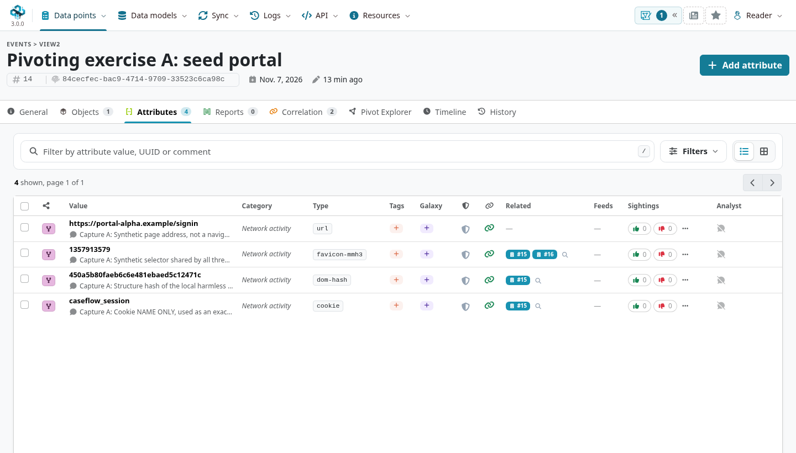
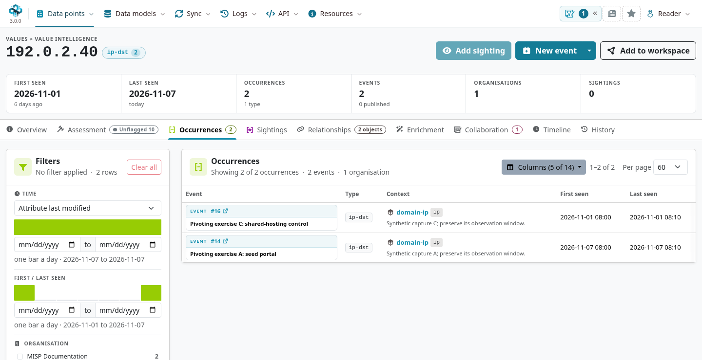
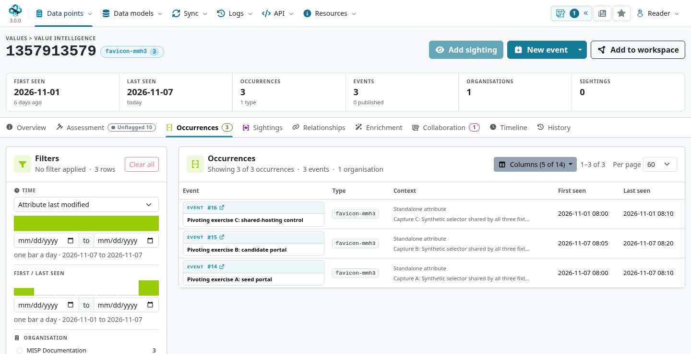
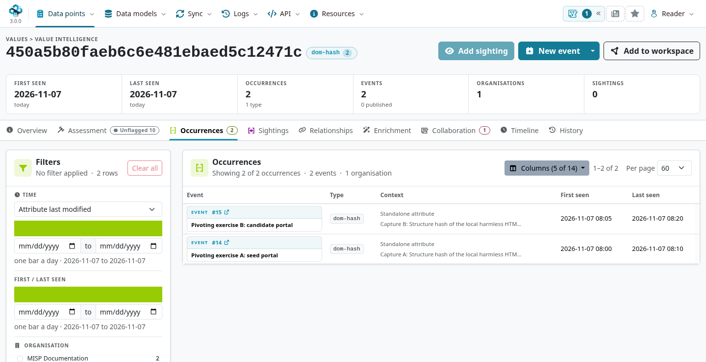
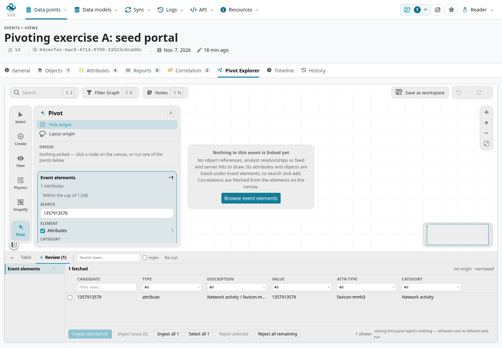
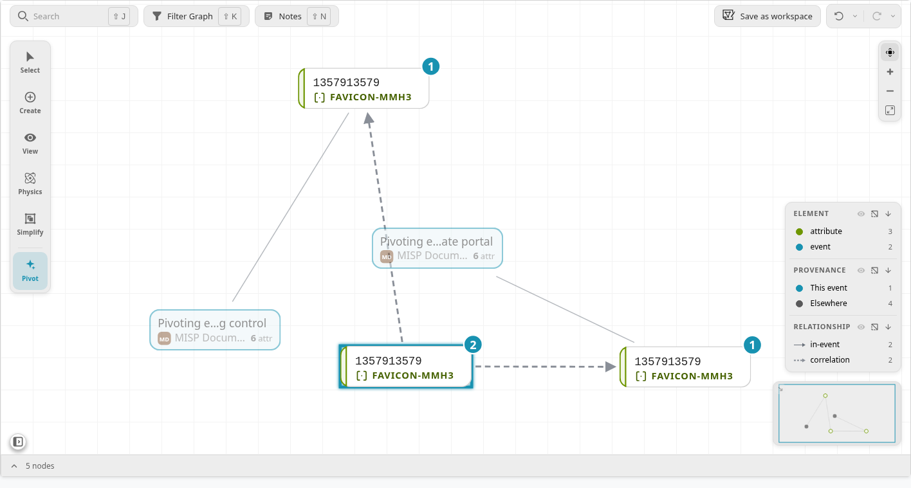
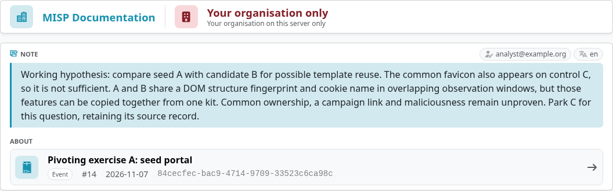

Pivoting turns a known observation into a starting point for another question.
An analyst may follow a domain to its observed address, inspect another site using the same favicon, and compare the sites' structure before deciding what deserves further investigation.
The useful output is an explainable lead with its evidence and limitations.

This use case applies Alexandre Dulaunoy's [*The Art of Pivoting*](https://github.com/adulau/the-art-of-pivoting/blob/3484c8ec60aff3f324a0c15d9ab82ccd9c9182b6/book/book.md) to a worked MISP investigation.
It combines conventional infrastructure observations with uncommon selectors, then validates the results by context, time and provenance.

::: {.callout-note}
The screenshots use MISP **3.0.0**, [`3.0_wip` commit `99ebee729`](https://github.com/MISP/MISP/commit/99ebee729702c560528f9788953719bda68aa1c1).
The three captures below are constructed local examples, not observations of live sites.
All names and addresses are reserved for documentation; events, annotations and workspaces are organization-only, unpublished where applicable, and all attributes have IDS off.
Select an image to enlarge it.
:::

<!-- Source attribution, fixture checks and screenshot hashes: ../assets/pivoting-screenshots.json -->

## Set a question and a stopping condition {#pivot-question}

Start with a question you can evaluate: **does candidate B merit follow-up for possible template reuse with seed A?**
That question is narrower than assuming common ownership or declaring a campaign.
Record what evidence would strengthen or weaken the lead, and set a time, result or hop budget before exploring a large neighborhood.

A **data point** is the recorded domain, address, fingerprint or cookie name.
It becomes a **selector** when you use it to retrieve other observations.
A **pivot** is the investigative step between them.
MISP's computed correlations and an analyst's asserted Relationships are different kinds of connection; preserve which mechanism produced each lead.

## Preserve a coherent seed observation {#pivot-seed}

The exercise gives each capture its own event, source comments and first/last-seen window.
A `domain-ip` object preserves the domain/address observation; standalone attributes hold the URL, favicon fingerprint, DOM fingerprint and cookie name.
In a real investigation with several captures per event, use suitable objects and source references to keep each entity's evidence together.

::: {.table-responsive}

| Capture | Network observation | Page evidence | Observation window, UTC |
|---|---|---|---|
| A: seed | `portal-alpha.example`{.text-wrap .text-break} · `192.0.2.40`{.text-wrap .text-break} | Favicon F, DOM D1, cookie name `caseflow_session`{.text-wrap .text-break} | 7 November 2026, 08:00–08:10 |
| B: candidate | `portal-beta.example`{.text-wrap .text-break} · `198.51.100.27`{.text-wrap .text-break} | Favicon F, DOM D1, cookie name `caseflow_session`{.text-wrap .text-break} | 7 November 2026, 08:05–08:20 |
| C: control | `shared-host.example`{.text-wrap .text-break} · `192.0.2.40`{.text-wrap .text-break} | Favicon F, DOM D2, cookie name `generic_session`{.text-wrap .text-break} | 1 November 2026, 08:00–08:10 |

:::

F is the explicitly synthetic `favicon-mmh3` selector `1357913579`.
D1 and D2 are `dom-hash` values computed from two different local HTML structures; A and B have different text but the same tag sequence.
The exercise records cookie **names only**, without session values or authentication tokens.

Choose correct types and preserve the extraction method.
The `dom-hash` algorithm's fingerprint is separate from MISP 3.0's SHA-256 address for a stored value, and both differ from an attribute occurrence UUID.
Use [Categories and Types](../categories-and-types/index.qmd#types-values) and [MISP Objects](../misp-objects/index.qmd) when choosing a representation.

## Follow a conventional infrastructure pivot {#pivot-infrastructure}

Open `192.0.2.40` in **Value Intelligence**, using the value's controls or **Data points → Value Intelligence**.
Select **Occurrences** and inspect the source event, object relation, comments and observation times.
Use **Columns** to show **First seen** and **Last seen** and keep the table focused on the fields you need.
The exercise shows A and C using that address, while B is on a different address.

This match alone does not establish a common operator.
Shared hosting, reassignment, a proxy, a sinkhole or a collection artifact can explain address reuse.
Check first/last-seen times rather than substituting the event's import or modification date for the time of observation.

Current resolution answers what a hostname resolves to now; historical resolution answers what a source observed earlier.
Keep those records separate.
If you later investigate predicted infrastructure, label it as a hypothesis until observed.
The exercise uses stored records only; it does not perform a live DNS or passive-DNS lookup.

## Change the selector to discover another candidate {#pivot-uncommon}

Return to A and open the favicon value `1357913579` in **Value Intelligence → Occurrences**.
Check the `favicon-mmh3` type and the actual occurrence records rather than treating a value-level summary as sufficient evidence.
The same selector now finds A, B and C, bringing B into the investigation despite its different address.

This illustrates the book's case for keeping useful weak or uncommon selectors.
A non-cryptographic favicon fingerprint can find reuse even though it is unsuitable as a uniqueness guarantee.
Default assets, copied templates and hash collisions can all explain a match.
Record the hash algorithm and input convention so another tool's result is comparable.

The visible count describes the data your account can access under the active filters.
It is neither an Internet-wide frequency nor a count of independent confirmations.
Several reports can copy one source, and a low count may reflect limited collection coverage.

## Refine with additional evidence and time {#pivot-refine}

Open A's `dom-hash` value and inspect **Occurrences** again.
Only A and B share D1; C has D2.
Compare the cookie-name occurrences as another view of the application: `caseflow_session` is shared by A and B, while C records a different name.
The first/last-seen windows of A and B overlap in this constructed example.

Keep the findings separate from their interpretation:

::: {.table-responsive}

| Finding in this exercise | Interpretation for the question |
|---|---|
| A and C share an address, observed at different times. | Retain the infrastructure fact; it does not establish contemporaneous use or ownership. |
| A, B and C share a favicon selector. | A broad candidate set to review. The match has insufficient specificity on its own. |
| A and B share DOM structure and a cookie name in overlapping windows. | Retain B as a lead for possible template reuse and further source validation. |
| C lacks the additional matches and has an earlier window. | Park C for this question while keeping its observation available. This does not prove C is benign. |

:::

Multiple matches are not automatically independent evidence.
A DOM structure, icon and cookie name can all travel together in one copied kit or a legitimate framework.
Review the original captures, extraction quality and source independence before strengthening the claim.
Common ownership, maliciousness and a campaign relationship remain unproven here.

For this exercise, one capture per event makes comparing event sets useful.
In a larger event, finding all selectors somewhere in that event does not show that they describe the same site or time window.
Match the relevant object, source capture and observation context before combining them.
Likewise, a search that returns either of two values is not an automatic conjunction; inspect both result sets and the join you make between them.

## Review a pivot in the graph {#pivot-graph}

Open A's **Pivot Explorer** tab.
If the canvas is empty, use **Browse event elements**, narrow the search to the favicon value, and choose **Fetch** to review the candidate before adding it.
Select the source attribute on the canvas, choose **Correlations**, and fetch the related occurrences for review.
Only add the results useful to the current question.
In this example, two matching attributes bring their two parent events as context, so the review contains four records rather than four independent observations.

A blank starting graph does not mean there are no correlations: this interface fetches them from selected elements on the canvas.
Conversely, an attractive graph layout or a short path does not establish causality.
Open the underlying record and inspect how each edge was produced.
Use the displayed candidate counts and narrowing controls to keep high-cardinality pivots manageable.

For work across pages, create or select an organization-only [workspace](../general-layout/index.qmd#workspaces) and confirm that it is the active destination before using **Add to workspace**.
Additions are saved as they arrive; use the workspace's save controls for layout changes.
Workspace membership and exploratory connections do not automatically create Analyst Data Relationships, and the workspace's distribution does not grant access to its source records.

## Record the lead, alternatives and stopping reason {#pivot-record}

Use [Analyst Data](../analyst-data/index.qmd) to preserve what you concluded and why.
The exercise's event-level Note identifies B as a comparison lead, explains why the favicon is insufficient, records the possibility of copied kit features, and parks C without deleting its source record.
Choose an occurrence, object, event or value-level target according to the scope of your statement, and review the annotation's own distribution.

If you make an explicit directed assertion, use a suitable [object reference or Analyst Data Relationship](../data-model/index.qmd#model-links) and explain its meaning.
Keep it distinguishable from a computed match or an exploratory graph connection.
An Event Report can document the investigation narrative; a [collection](../collections/index.qmd) can organize selected source material for handover.

For each branch, record one of the source book's outcomes: **accept**, **refine**, or **reject** its usefulness to the question.
Parking a branch means that it is not being pursued now, not that its data should disappear.
Stop when the question is answered to the required standard, the next step needs unavailable evidence, or the investigation budget is exhausted.
Record what would justify reopening it.

## Extend the method without assuming tool support {#pivot-further}

The source book also explores HHHash, analytics identifiers, certificate and SSH fingerprints, filenames, QR payloads, and image-derived text.
Look for overlooked traces rather than relying on one fixed ranking of indicator strength.
Record the appropriate installed attribute types or object-template relations, the extraction method and source evidence before making those artifacts selectors.

Exact matching, fuzzy comparison and group-based pivots answer different questions.
MISP's native correlation depends on supported types, the selected engine, configuration and exclusions; storing a similarity hash does not guarantee that every similarity algorithm will be run automatically.
Advanced CIDR/ssdeep matching has additional requirements.
External collection or enrichment through [modules](../modules/index.qmd), Lookyloo or AIL is a separate step: check what data an action sends and which sources it queries before running it.

For noisy matches, first refine the source, time or question.
Use [warninglists](../warninglists/index.qmd), documented correlation policies and the [false-positive use case](../false-positives/index.qmd) when a separate operational control is warranted.
A warninglist hit does not automatically suppress correlation, and clearing IDS does not prevent a value from being useful for investigation.
Review detection eligibility separately before sending any selected data to a consumer.

## Source and further reading {#pivot-source}

Based on *The Art of Pivoting: Techniques for Intelligence Analysts to Discover New Relationships*, © **Alexandre Dulaunoy**, licensed under [CC BY-SA 4.0](https://creativecommons.org/licenses/by-sa/4.0/).
The [reviewed source revision](https://github.com/adulau/the-art-of-pivoting/blob/3484c8ec60aff3f324a0c15d9ab82ccd9c9182b6/book/book.md) covers the broader techniques and examples.
This CC BY-SA 4.0 adaptation adds a constructed MISP 3.0 exercise, version-specific instructions, screenshots and a workflow diagram.
