Get a MISP instance running with Docker, sign in, and create your first event.
This walkthrough uses the official [misp-docker](https://github.com/MISP/misp-docker) project and its pre-built images.
If you already have access to an instance, skip to [Sign in to MISP](#sign-in-to-misp).

## Start MISP with Docker

### Prerequisites

You need Git, Docker Engine **25 or later**, and the Docker Compose plugin **2.17 or later**.
Docker must be running, and your user must be able to run Docker commands.
The host needs access to GitHub Container Registry (`ghcr.io`) and Docker Hub to pull the images.
See the [instance requirements](../requirements/index.qmd) for sizing guidance.

Check your Docker installation:

```bash
docker --version
docker compose version
```

### Prepare the configuration

Clone the project and create its local configuration file:

```bash
git clone https://github.com/MISP/misp-docker.git
cd misp-docker
cp template.env .env
```

Before starting MISP, open `.env` in your editor and review these settings:

| Setting | What to configure |
|---|---|
| `BASE_URL` | Keep `http://localhost` for access from the Docker host. For another hostname or port, use the exact URL you will open in your browser. |
| `ADMIN_EMAIL` | Set the initial administrator's email address. If left empty, it defaults to `admin@admin.test`. |
| `ADMIN_PASSWORD` | Set a unique, strong administrator password. If left empty, it defaults to `admin`. |
| `ADMIN_ORG` | Set your organization's name. |

Uncomment `DISABLE_PRINTING_PLAINTEXT_CREDENTIALS` and set it to `true` to keep the administrator password and API key out of initialization logs.
Keep `.env` private: it contains credentials.
The default Compose configuration publishes web ports **80** and **443** on the host; make sure they are available.
For a different port, consult the `NGINX_HTTP_PORT` and `NGINX_HTTPS_PORT` settings in `template.env` and update `BASE_URL` to match.

::: {.callout-note}
This walkthrough is for getting started on a trusted test host.
Before making the instance available to others, review the [misp-docker production guidance](https://github.com/MISP/misp-docker#production) for credentials, HTTPS, mail, and persistent storage.
:::

### Start the containers

From the `misp-docker` directory, pull the images and start the services:

```bash
docker compose pull
docker compose up -d
docker compose ps
```

The first startup initializes the database and MISP configuration and can take several minutes.
Follow its progress with:

```bash
docker compose logs --follow misp-core
```

Press **Ctrl+C** to stop following the logs; the containers keep running.
Once initialization finishes, open **http://localhost** on the Docker host, or the address you configured in `BASE_URL`.
If the page is not available yet, check `docker compose ps` and the logs before trying again.
The [upstream troubleshooting guide](https://github.com/MISP/misp-docker#troubleshooting) covers common startup problems.

To stop the instance without deleting its data:

```bash
docker compose stop
```

Run `docker compose up -d` from the same directory to start it again.

<a id="login-into-misp"></a>

## Sign in to MISP

Use the `ADMIN_EMAIL` and `ADMIN_PASSWORD` you configured in `.env`.
If you left both empty, the initial credentials are `admin@admin.test` / `admin`; change the default password immediately.
For an existing instance, use the credentials supplied by your administrator.

Accept the terms of use and set a new password if prompted.
See [First run of the system](../user-management/index.qmd#first-run-of-the-system) for the account setup screens.

<a id="tasks-to-do-after-first-start"></a>

## First steps after login

1. **Secure your administrator account.** Use a unique password that meets the [password policy](#password-policy), and enable multi-factor authentication if your instance supports it.
   In Docker, keep `ADMIN_PASSWORD` in `.env` consistent with your intended administrator password: environment-driven settings are reapplied when the container starts.
2. **Set up your organization and users.** Check your organization's name, designate site and organization administrators, and create separate accounts for contributors with the appropriate [roles](../administration/index.qmd#roles).
   Use an account with the permissions you need for daily analysis rather than sharing the initial administrator login.
   See [user administration](../administration/index.qmd#users) and [organizations](../administration/index.qmd#organisations).
3. **Check that the instance is ready.** As a site administrator, open **Administration → Server Settings & Maintenance** and review the diagnostics and background workers.
   Resolve reported configuration issues before importing data; see [server settings and maintenance](../administration/index.qmd#server-settings-and-maintenance).
4. **Choose your tags and feeds.** [Enable a taxonomy](#enable-a-taxonomy), such as `tlp`, so analysts can label information consistently.
   Then [enable a feed](#enable-and-fetch-a-feed) relevant to your work.
   Start with caching for correlation; fetch events only when you want to import them into your instance.
5. **Create a small test event.** Follow [Create an Event](#create-an-event) below, choose **Your organisation only** as the distribution, and add a harmless example indicator such as `example.org`.
   Keep illustrative indicators out of detection exports by clearing **for Intrusion Detection System** (`to_ids`).
   Review the event's tags and distribution before publishing or sharing it; see [distribution guidance](../best-practices/index.qmd#setting-distribution).

## Password Policy

Use a password manager to generate and store a unique password.
The instance's configured policy determines the minimum length and required character types; follow the requirements shown when you change your password.
See [user management](../user-management/index.qmd) for profile settings and multi-factor authentication.

<a id="i-forgot-my-admin-password-"></a>

## Reset an administrator password

For a Docker deployment, run the password reset command from your `misp-docker` directory.
Replace the email address with the administrator's login and `NEW_PASSWORD` with a strong password that meets the instance's policy:

```bash
docker compose exec --user www-data misp-core /var/www/MISP/app/Console/cake User change_pw admin@admin.test 'NEW_PASSWORD'
```

If `ADMIN_PASSWORD` is set in `.env`, update it too so a later container start does not restore the previous value.
For a host installation, run the same Cake command directly as the web server user, using the path to your MISP installation.



<a id="tldr"></a>

## Common actions at a glance

### Create a report

Use **Event Actions → Add Event** to start a report, then add attributes and tags.

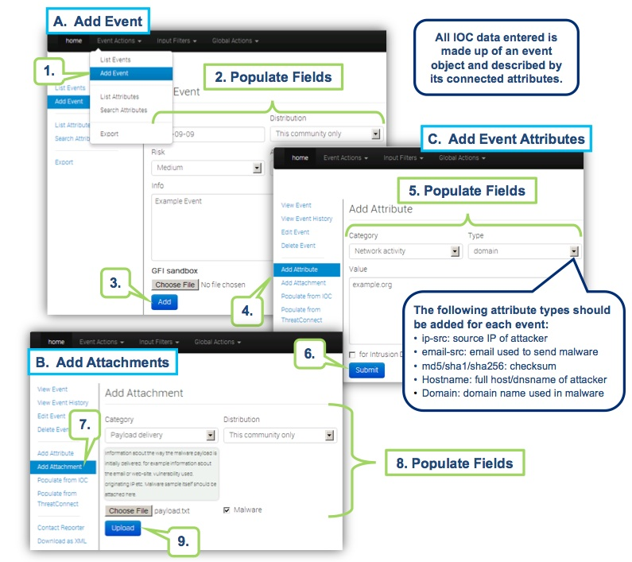

### Find existing events

Use **Event Actions → List Events** to find existing reports and filter the results.

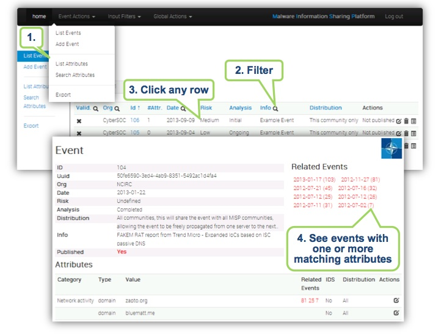

### Export indicators

Export selected indicators in the format your detection or analysis tools need.

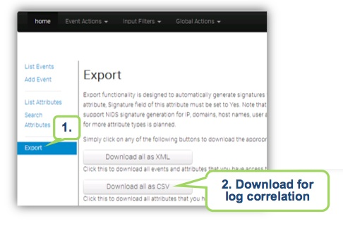



## Create an Event

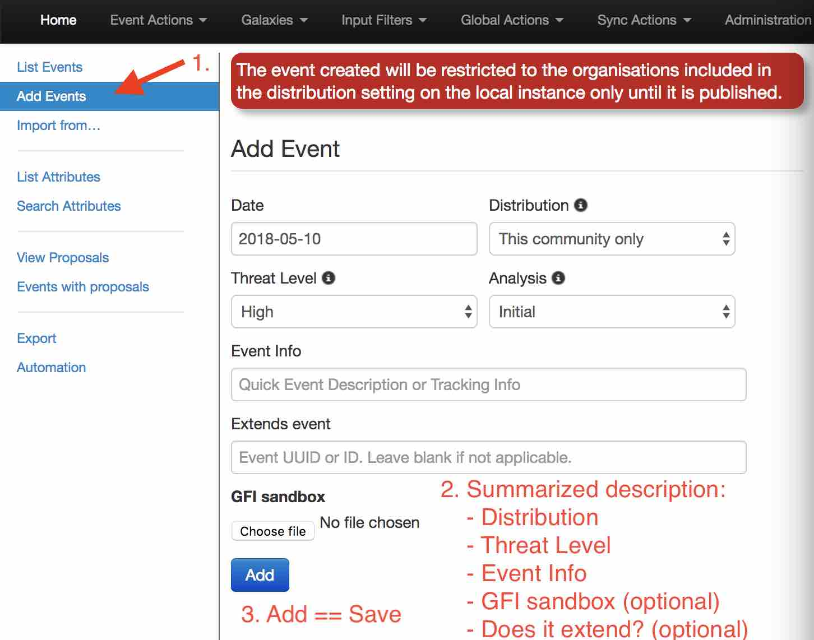

Choose **Event Actions → Add Event**, enter a short, descriptive title in the **Info** field, and complete the date, threat level, analysis, and distribution fields.
For your first test, use **Your organisation only** as the distribution.
Save the event; you can then add its attributes, objects, and tags.

## Describe Event

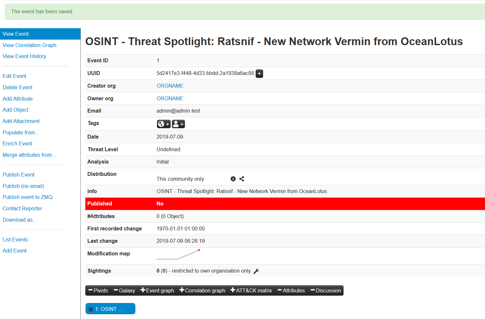

Use the event view to add the indicators and context that describe what happened.
For a simple test, add `example.org` as a `domain` attribute and leave `to_ids` disabled.
Use the free-text import tool below when you have several indicators to add at once.

### Free-Text Import Tool

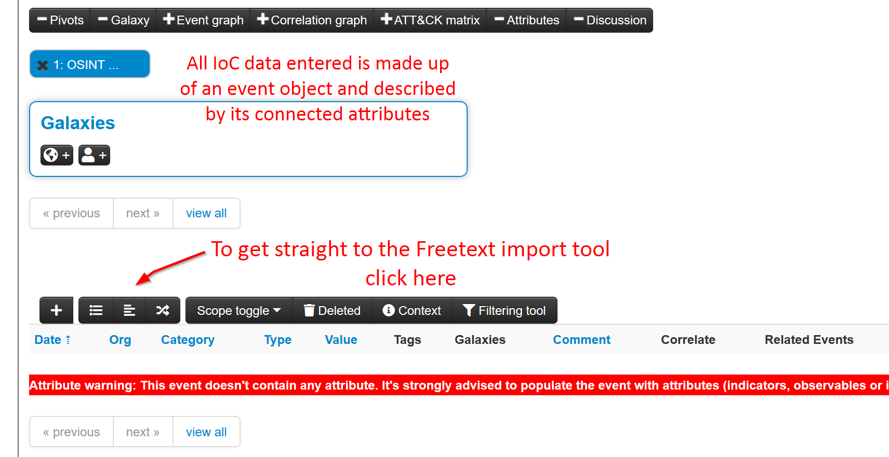

The following will pop-up.

If you have a list of indicators from which you would like to quickly generate attributes then the **Free-text import tool** is
just what you need. Simply paste your list of indicators (separated by line-breaks) into this tool.

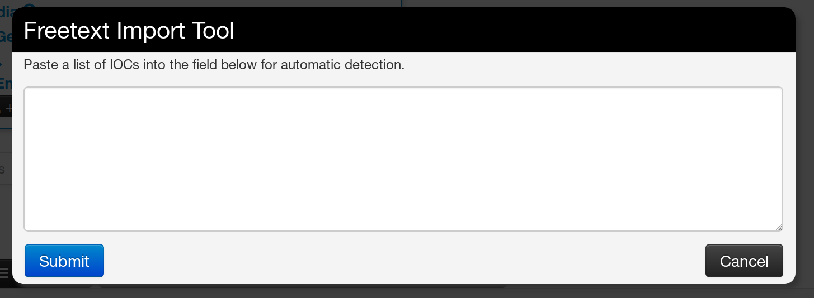

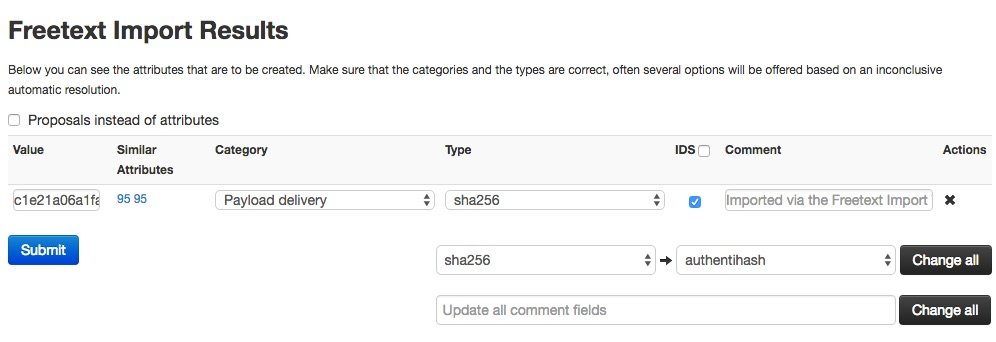

The tool will help you to find similarities between your import and other issues already registered in MISP.

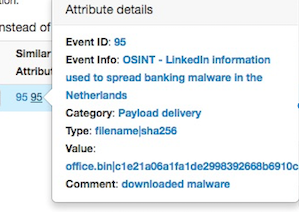

For example, you can see the ID of all related Events and view their information.

##### Alternative to import

An alternative route to reach the Freetext import tool is shown below.

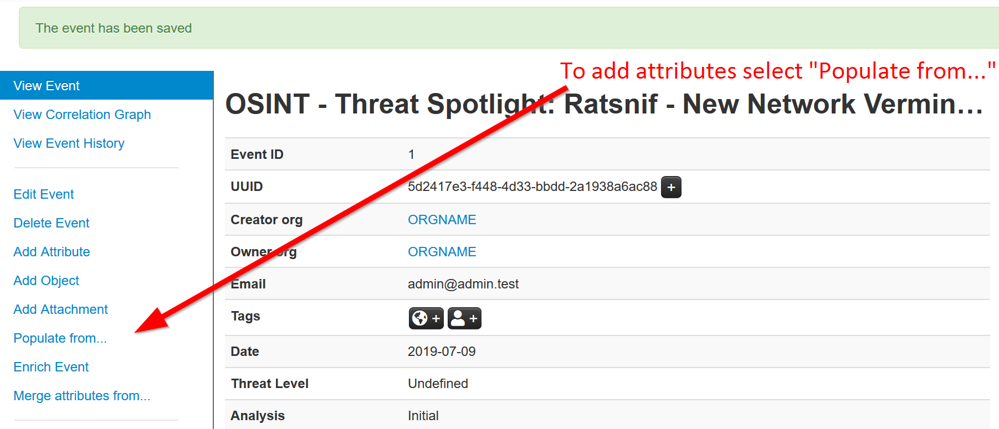

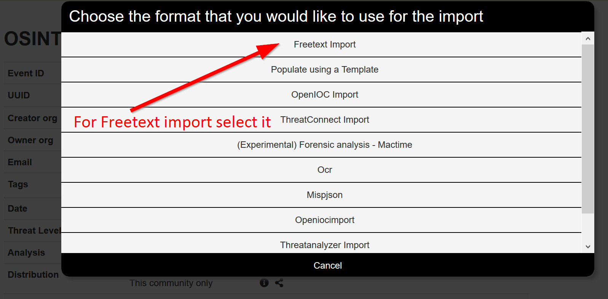

### Tags and Taglist

#### Using existing Data

Another easy way to add information is to use Tags. You can see the result of adding existing Tags (circl:incident-classification=XSS ans circl:incident-classification="information-leak).

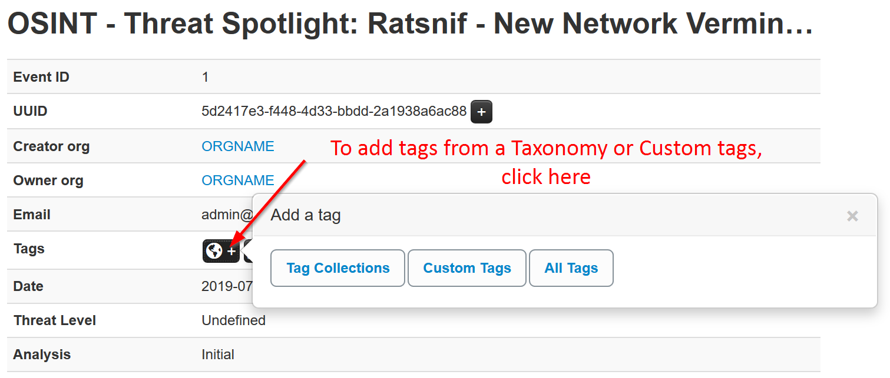

By clicking the button, you can add more tags from an existing Taglist.

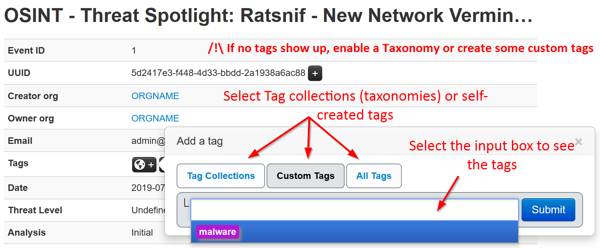

In particular the "Taxonomy Library: circl" Taglist is very complete.

Once you added the tag(s) it will show in you main event window and in the list event view.

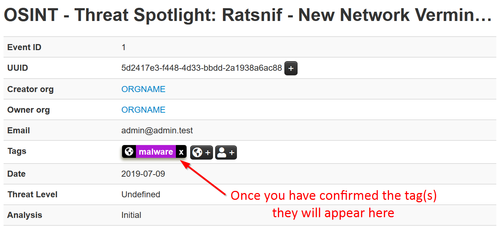

### Local tags

Local tags can be added in a similar fashion.

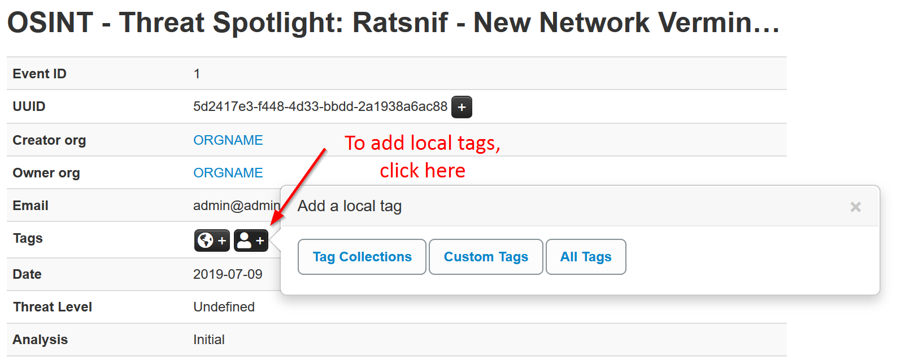

They will be identified by a corresponding icon.

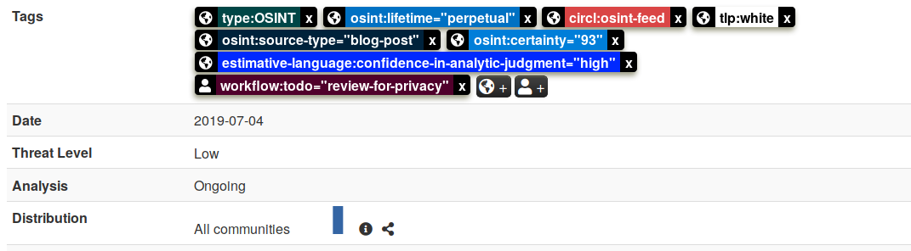

#### No tags in list

In case you get the below. You need to either enable an existing Taxonomy or add some custom tags.

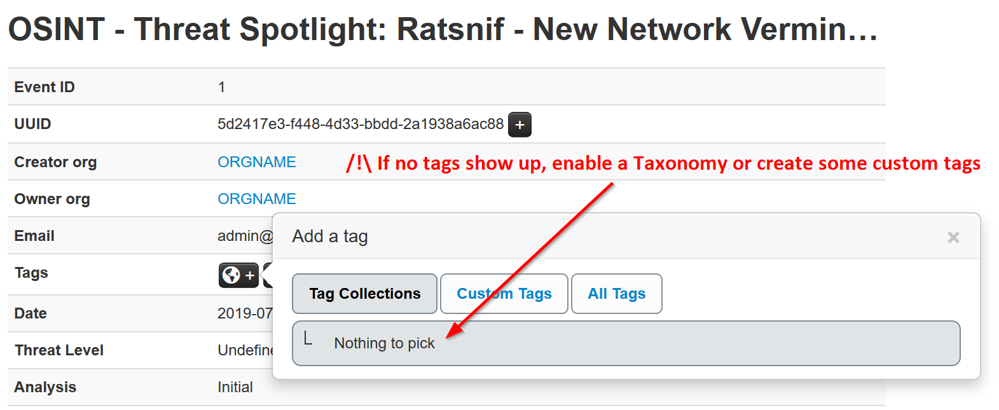

#### Make your own Taglist

If you want make your own Taglist, select Add Tag.

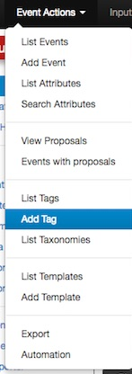

You will see the following window:

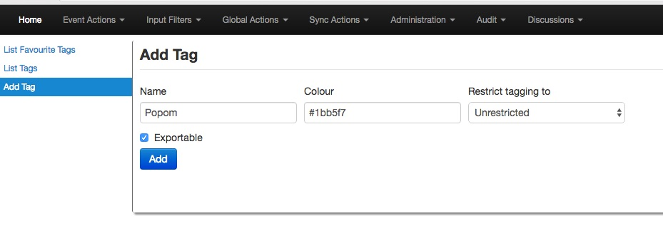

Then, when you add the new tag it will appear in the Custom Taglist.

### Suggestions

The following attribute types should be added for each Event:
- ip-src: source IP of attacker
- email-src: email used to send malware
- md5/sha1/sha256: checksum
- Hostname: full host/dnsname of attacker
- Domain: domain name used in malware

## Browsing Events
To see your Event, select List Events from the menu Events Action. You can click any row and select a filter.

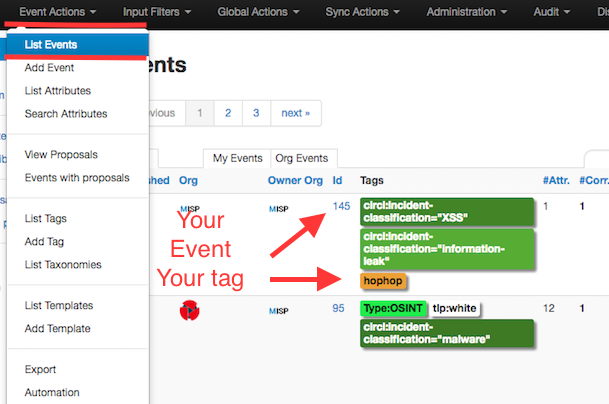

If you click on your Event's number, you can see all the information related to your Event.

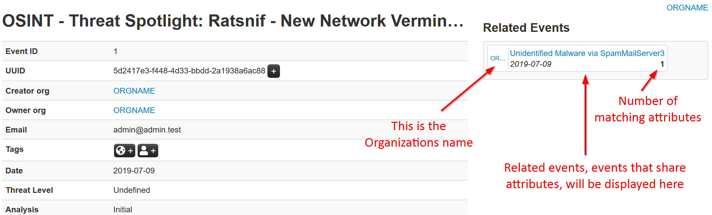

## Export Events for Log Search

MISP can export your data in many formats for use in other tools — from plain MISP JSON/XML to detection rules (Suricata, Snort, Bro/Zeek), host and hash lists, CSV and STIX. Attributes flagged **for Intrusion Detection System** (the `to_ids` flag) are the ones included in the detection-rule exports; attributes without it are treated as context only. Use the export options to download the format you need — see the [automation](../automation/index.qmd) chapter for the full list of formats and the API.

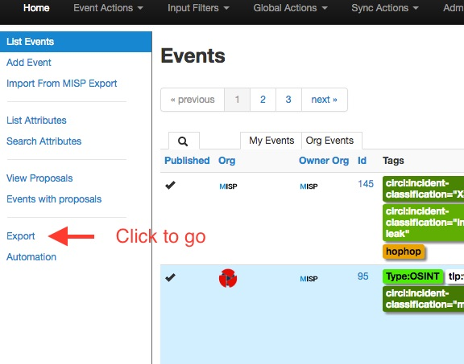

Simply click on any of the following buttons to download the appropriate data for log correlation.

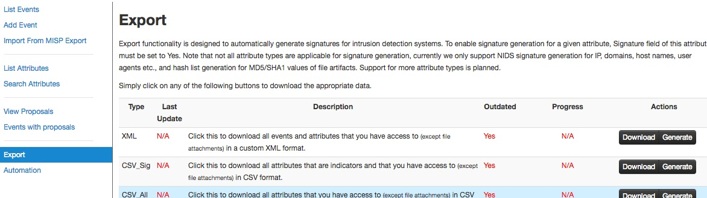

## Enable a Taxonomy

Most taxonomies are disabled out of the box. To start tagging with one, go to
**Event Actions → List Taxonomies**, find the taxonomy you want (for example
`tlp`), and enable it — you can also enable all of its tags at once. Its tags then
appear in the tag picker on events and attributes. See the
[Taxonomies](../taxonomy/index.qmd) chapter for more.

<a id="enable-and-fetch-a-feeds"></a>

## Enable and fetch a feed

MISP ships with a set of public OSINT feeds. To use one, go to **Sync Actions →
Feeds**, enable a feed (the CIRCL OSINT feed is a good starting point), and then
either **cache** it — for fast correlation against your data without importing —
or **fetch** it to import its events into your instance. See the
[Managing feeds](../managing-feeds/index.qmd) chapter for the details.
