Get a MISP instance running with Docker, sign in, and create your first event.
This walkthrough builds MISP 3.0 locally using the official [misp-docker early-access branch](https://github.com/MISP/misp-docker/tree/misp-3.0_wip).
If you already have access to an instance, skip to [Sign in to MISP](#sign-in-to-misp).

::: {.callout-note}
The screenshots show MISP **3.0.0** from the development branch [`3.0_wip`](https://github.com/MISP/MISP/tree/3.0_wip), using fictional data.
The [MISP 3.0 early-access instructions](https://misp.github.io/misp-website/2026/10/16/misp.3.0-early-access.html/) use the Docker branch **`misp-3.0_wip`**, which builds the application from **`3.0_wip`**.
No pre-built images are published for this early-access deployment; build them locally as shown below.
:::

<!-- Screenshot source commits and capture details: screenshots.json -->

## Start MISP with Docker

### Prerequisites

You need Git, Docker Engine **25 or later**, and the Docker Compose plugin **2.17 or later**.
Docker must be running, and your user must be able to run Docker commands.
The build needs access to GitHub, GitHub Container Registry (`ghcr.io`), Docker Hub, and the package repositories used by the Dockerfiles.
See the [instance requirements](../requirements/index.qmd) for sizing guidance.

Check your Docker installation:

```bash
docker --version
docker compose version
```

### Prepare the configuration

Clone the MISP 3.0 Docker branch and create its local configuration file:

```bash
git clone -b misp-3.0_wip https://github.com/MISP/misp-docker.git
cd misp-docker
cp template.env .env
```

Before starting MISP, open `.env` in your editor and review these settings:

| Setting | What to configure |
|---|---|
| `CORE_TAG` | Keep `3.0_wip`, as supplied by this branch's `template.env`, to build MISP 3.0. |
| `BASE_URL` | Keep `http://localhost` for access from the Docker host. For another hostname or port, use the exact URL you will open in your browser. |
| `ADMIN_EMAIL` | Set the initial administrator's email address. If left empty, it defaults to `admin@admin.test`. |
| `ADMIN_PASSWORD` | Set a unique, strong administrator password. If left empty, it defaults to `admin`. |
| `ADMIN_ORG` | Set your organization's name. |

Uncomment `DISABLE_PRINTING_PLAINTEXT_CREDENTIALS` and set it to `true` to keep the administrator password and API key out of initialization logs.
Keep `.env` private: it contains credentials.
The default Compose configuration publishes web ports **80** and **443** on the host; make sure they are available.
For a different port, consult the `NGINX_HTTP_PORT` and `NGINX_HTTPS_PORT` settings in `template.env` and update `BASE_URL` to match.

::: {.callout-note}
This walkthrough is for getting started on a trusted test host.
Before making the instance available to others, review the [misp-docker production guidance](https://github.com/MISP/misp-docker/tree/misp-3.0_wip#production) for credentials, HTTPS, mail, and persistent storage.
:::

### Start the containers

From the `misp-docker` directory, build the application images locally, then start the services once the build succeeds:

```bash
docker compose build
docker compose up -d
docker compose ps
```

The build downloads and installs the application and its dependencies, so it can take some time.
The first startup then initializes the database and MISP configuration and can take several minutes.
Follow its progress with:

```bash
docker compose logs --follow misp-core
```

Press **Ctrl+C** to stop following the logs; the containers keep running.
Once initialization finishes, open **http://localhost** on the Docker host, or the address you configured in `BASE_URL`.
If the page is not available yet, check `docker compose ps` and the logs before trying again.
The [upstream troubleshooting guide](https://github.com/MISP/misp-docker/tree/misp-3.0_wip#troubleshooting) covers common startup problems.

The application branch moves over time.
For a later update, follow the [early-access upgrade instructions](https://misp.github.io/misp-website/2026/10/16/misp.3.0-early-access.html/) and rebuild with `docker compose build --no-cache` to fetch current source, or set `CORE_COMMIT` in `.env` to the specific application revision you intend to build.
Keep the Docker checkout, configuration, and database upgrade steps aligned with that revision.

To stop the instance without deleting its data:

```bash
docker compose stop
```

Run `docker compose up -d` from the same directory to start it again.

<a id="login-into-misp"></a>

## Sign in to MISP

Use the `ADMIN_EMAIL` and `ADMIN_PASSWORD` you configured in `.env`.
If you left both empty, the initial credentials are `admin@admin.test` / `admin`; change the default password immediately.
For an existing instance, use the credentials supplied by your administrator.

Accept the terms of use and set a new password if prompted.
See [First run of the system](../user-management/index.qmd#first-run-of-the-system) for the account setup screens.

Using the initial administrator account, open **Administration → Server Settings & Maintenance → Version & updates** and confirm that the running server reports **MISP 3.0** before continuing with the interface walkthrough.

<a id="tasks-to-do-after-first-start"></a>

## First steps after login

1. **Secure your administrator account.** Use a unique password that meets the [password policy](#password-policy), and enable multi-factor authentication if your instance supports it.
   In Docker, keep `ADMIN_PASSWORD` in `.env` consistent with your intended administrator password: environment-driven settings are reapplied when the container starts.
2. **Set up your organization and users.** Check your organization's name, designate site and organization administrators, and create separate accounts for contributors with the appropriate [roles](../administration/index.qmd#roles).
   Use an account with the permissions you need for daily analysis rather than sharing the initial administrator login.
   See [user administration](../administration/index.qmd#users) and [organizations](../administration/index.qmd#organisations).
3. **Check that the instance is ready.** As a site administrator, open **Administration → Server Settings & Maintenance** and review the diagnostics and background workers.
   Resolve reported configuration issues before importing data; see [server settings and maintenance](../administration/index.qmd#server-settings-and-maintenance).
4. **Choose your tags and feeds.** [Enable a taxonomy](#enable-a-taxonomy), such as `tlp`, so analysts can label information consistently.
   Then [enable a feed](#enable-and-fetch-a-feed) relevant to your work.
   Start with caching for correlation; fetch events only when you want to import them into your instance.
5. **Create a small test event.** Follow [Create an Event](#create-an-event) below, choose **Your organisation only** as the distribution, and add a harmless example indicator such as `example.org`.
   Keep illustrative indicators out of detection exports by clearing **for Intrusion Detection System** (`to_ids`).
   Review the event's tags and distribution before publishing or sharing it; see [distribution guidance](../best-practices/index.qmd#setting-distribution).

## Password Policy

Use a password manager to generate and store a unique password.
The instance's configured policy determines the minimum length and required character types; follow the requirements shown when you change your password.
See [user management](../user-management/index.qmd) for profile settings and multi-factor authentication.

<a id="i-forgot-my-admin-password-"></a>

## Reset an administrator password

For a Docker deployment, run the password reset command from your `misp-docker` directory.
Replace the email address with the administrator's login and `NEW_PASSWORD` with a strong password that meets the instance's policy:

```bash
docker compose exec --user www-data misp-core /var/www/MISP/app/Console/cake User change_pw admin@admin.test 'NEW_PASSWORD'
```

If `ADMIN_PASSWORD` is set in `.env`, update it too so a later container start does not restore the previous value.
For a host installation, run the same Cake command directly as the web server user, using the path to your MISP installation.



<a id="tldr"></a>

## Common actions at a glance

- [Create an event](#create-an-event) to group the indicators and context for one investigation.
- [Browse events](#browsing-events) to find existing intelligence and related reports.
- [Export indicators](#export-events-for-log-search) in a format your analysis or detection tools can consume.

## Create an Event

In the MISP 3.0 navigation, open **Data points → Events** and select **Add Event**.
Enter a descriptive title in **Event Info**, such as `Quick-start exercise: suspicious email investigation`.
Choose **Your organisation only** for this exercise, set the event date, and select the analysis and threat levels that match your information.
Select **Create Event Entry** to save the event.

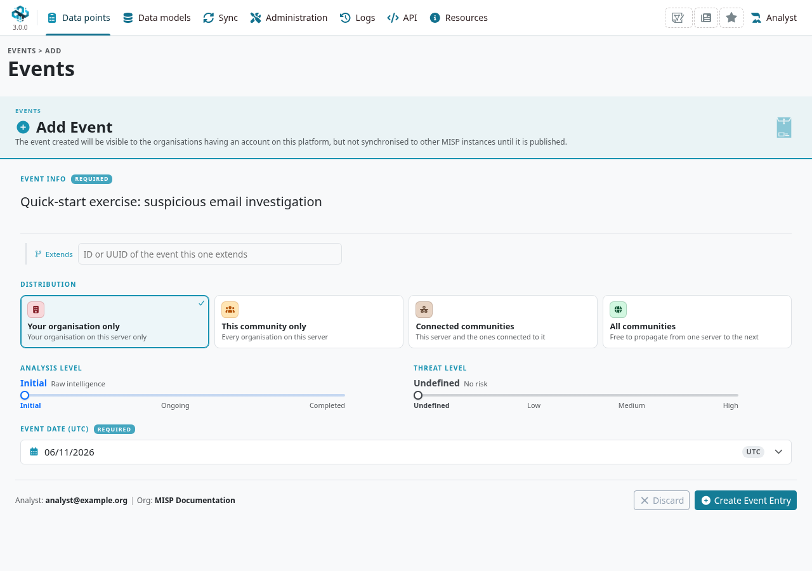

Distribution controls who can receive the event; a tag does not replace this setting.
Keep the exercise private and unpublished while you add and review its contents.

## Describe Event

The **General** tab brings together the event's organization, distribution, context, reports, and indicator inventory.
Use the other tabs to work with **Attributes**, **Objects**, **Reports**, and **Correlation**.
The action panel provides shortcuts to edit the event, import data, or attach files.

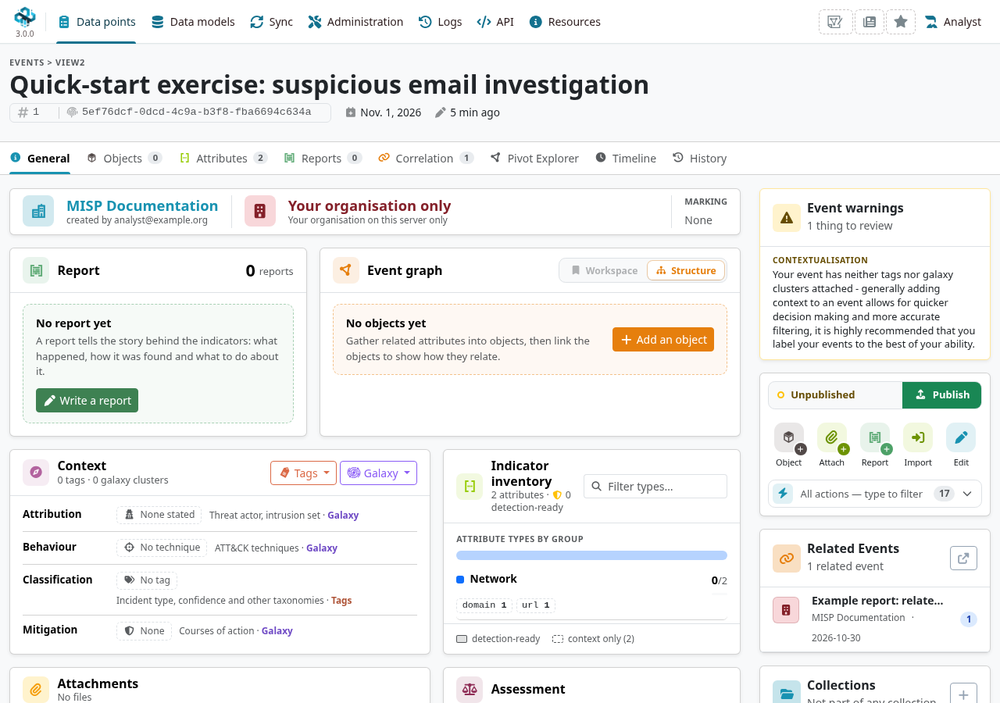

For a simple first indicator, open **Attributes**, choose **Add Attribute**, and add `example.org` as a `domain`.
Clear **for Intrusion Detection System** (`to_ids`) for illustrative data.
Add a comment explaining what the value represents, then save it.
Use [objects](../misp-objects/index.qmd) when several attributes describe the same entity, such as a file or an email.

### Free-Text Import Tool

From the event's **General** tab, select **Import** and expand **Freetext Import**.
Paste one indicator per line into **IOCs**.
For this exercise, use these reserved documentation values:

```text
example.net
198.51.100.25
contact@example.net
```

Select **Run Freetext Import** to review the detected attributes before saving them.

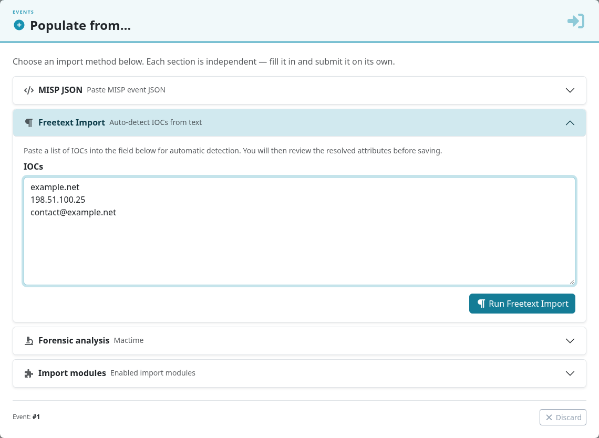

Check each value, category, type, and distribution in **Review detected attributes**.
Use a row's edit control to correct an ambiguous detection or its remove control to exclude a value.
For these examples, turn off the **IDS** shield on each row so the indicators remain context rather than detection rules.
Select **Create attributes** when the preview is correct.

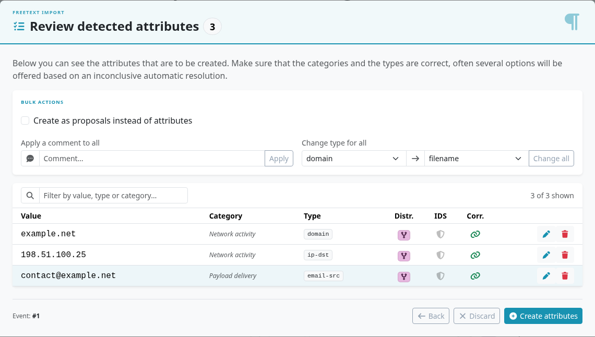

Return to **Attributes** to review the saved values and comments.
The example below contains the initial domain and URL plus the three imported indicators.
The **Correlation** tab and **Related Events** panel help you investigate values that also appear in other events.
A shared value is a lead to assess; it does not by itself prove that two reports describe the same activity.

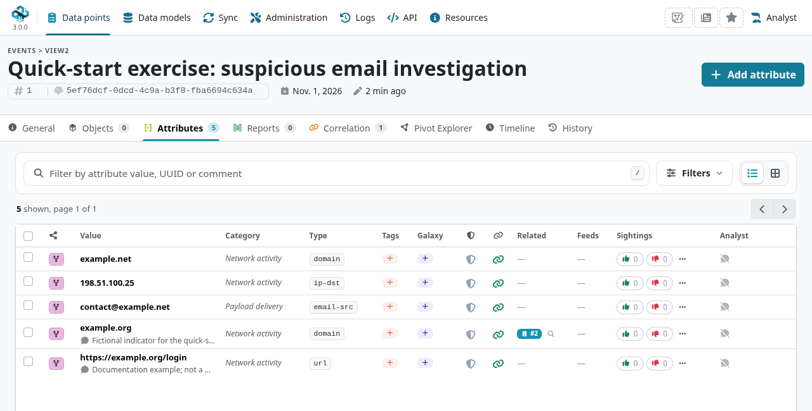

<a id="alternative-to-import"></a>

### Tags and Taglist

#### Using existing Data

On the **General** tab, open **Tags → Edit Tags** in the **Context** panel.
Browse an enabled taxonomy or use the search field to find a tag.
Select the tag, check that it appears under **Global Tags**, and select **Save Tags**.
The example uses `tlp:clear` because the event contains only public documentation values.
Choose the marking appropriate to your actual information when working on real events.

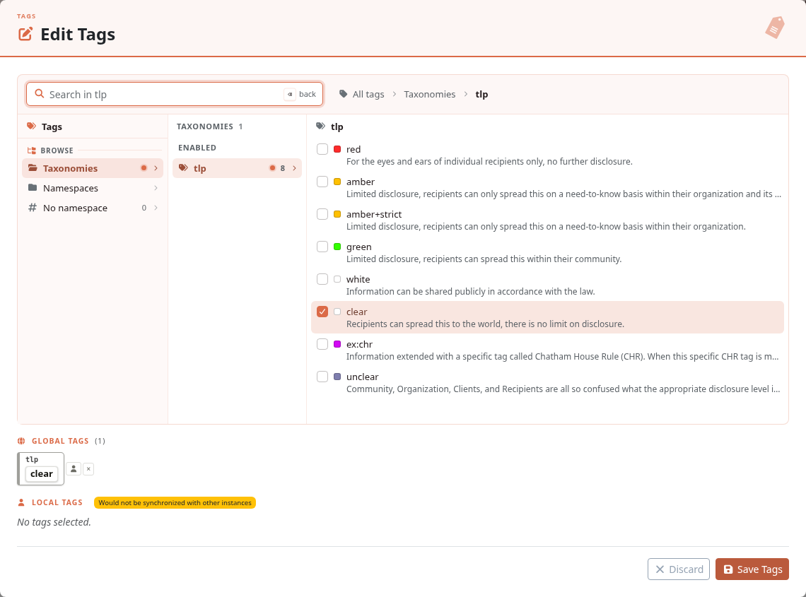

#### No tags in list

If the taxonomy or tag you need is missing, ask a site administrator to [enable the taxonomy and its tags](#enable-a-taxonomy).
Prefer existing taxonomy tags to creating a custom tag with the same meaning.

#### Make your own Taglist

To create a custom tag, open **Data models → List Tags** and select **Add Tag**.
Enter a meaningful name, choose its color, and review its restrictions and options before saving.
In this example, `review-needed` is a **Local only** tag used to track an internal review task.
It will be available in the tag editor after you save it.

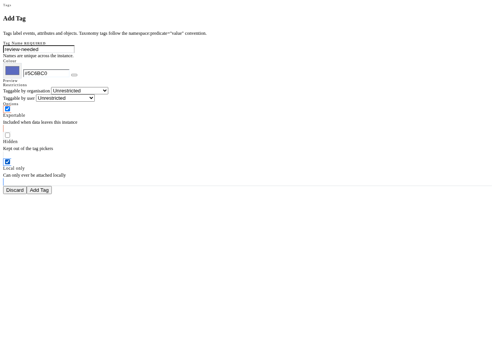

### Local tags

Local tags describe your instance's assessment and are not synchronized to other instances.
For the host-organization and creator-organization rules, see [Who can add local tags to an event?](../taxonomy/index.qmd#taxonomy-local-tagging-permissions).
In **Edit Tags**, select the tag and check which list it appears in before saving.
Tags configured as **Local only** go directly under **Local Tags**.
For an ordinary tag, use the selected tag's **Make it local** control to move it from **Global Tags** to **Local Tags**.

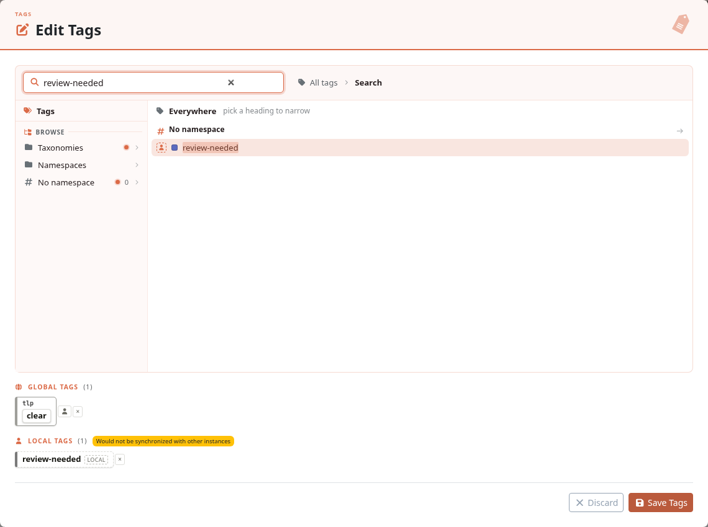

After **Save Tags**, review the local label in the **Context** panel.
Its local-scope indicator distinguishes your assessment from shared labels; the TLP marking is displayed separately in the event's marking area.

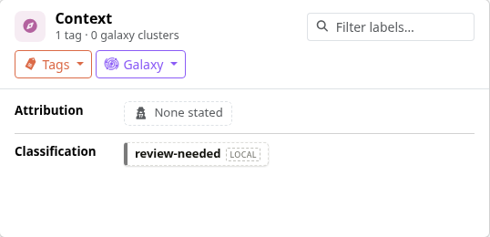

### Suggestions

Choose attribute types that describe what you observed: for example, `domain`, `url`, `ip-src`, `ip-dst`, or `email-src`.
Use comments to explain the source and relevance of each value.
Set `to_ids` only for indicators you intend detection tools to use, and review the event's distribution and tags before sharing it.
See [best practices](../best-practices/index.qmd) for tagging and data-modeling guidance.

## Browsing Events

Open **Data points → Events** to see the events available to your account.
Select **Filters** to narrow the list by criteria such as organization, tags, date, or publication state.
Open an event by selecting its ID or title.

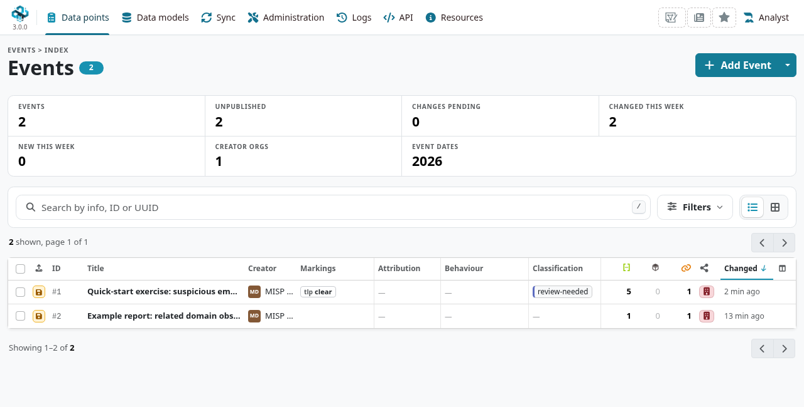

## Export Events for Log Search

From an event, expand the action panel with **Show all actions** and select **Download as**.
Choose the format required by your tool; **MISP JSON** is a useful starting point for exchanging the event with its metadata and attributes.
The download dialog also offers XML, CSV, and detection-oriented formats, with options that vary by format.

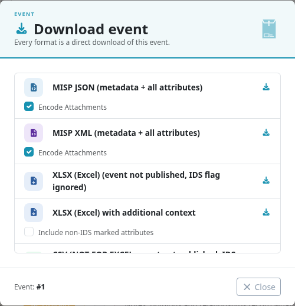

Detection exports can require a published event and attributes marked **for Intrusion Detection System** (`to_ids`).
The documentation indicators in this walkthrough deliberately have `to_ids` disabled, so they should not appear in detection-rule exports.
See [automation](../automation/index.qmd) for export filters, supported formats, and API access.

## Enable a Taxonomy

As a site administrator, open **Data models → List Taxonomies**, find the taxonomy you need, and enable it.
Enable the tags you want analysts to use as well.
For this walkthrough, enable the `tlp` taxonomy so `tlp:clear` is available in the event tag editor.
See [Taxonomies](../taxonomy/index.qmd) for the complete workflow.

<a id="enable-and-fetch-a-feeds"></a>

## Enable and fetch a feed

Open **Sync → Feeds**, choose a feed relevant to your work, and enable it.
Cache a feed to correlate its indicators with your data without importing its events, or fetch it when you want to import those events into the instance.
Start with one relevant feed and review the results before enabling more.
See [Managing feeds](../managing-feeds/index.qmd) for configuration and import details.
