Start a search by deciding what you want back: events, individual attribute occurrences, objects, distinct values, or narrative reports.
Then narrow the results by the fields that answer your question.
The same text can appear in several records and types; a result count is not a count of independent observations or sources.

::: {.callout-note}
This chapter follows MISP **3.0.0**, [`3.0_wip` commit `99ebee729`](https://github.com/MISP/MISP/commit/99ebee729702c560528f9788953719bda68aa1c1).
Screenshots show the real UI with constructed, organization-only, unpublished events and IDS disabled on every exercise attribute.
No enrichment provider or example destination was contacted.
Your role, visibility, enabled features and data determine the controls and results available. Select a figure to enlarge it.
:::

<!-- Screenshot provenance, source checks, UI/API verification and limitations: ../assets/searching-filtering-screenshots.json -->

## Choose the right search {#search-choose}

Use **Data points** to open the relevant index:

::: {.table-responsive}

| Starting point | Result unit | Use it when… |
|---|---|---|
| **Events** | An event | You know a report title, event ID/UUID, creator organization or classification. |
| **Attributes** | An attribute occurrence, including object properties | You need observations of a value, with type, tags, IDS eligibility and source context. |
| **Objects** | An object with its properties | You need the entity and its grouped fields, rather than separate attribute hits. |
| **Value Intelligence** | A distinct stored value, then its accessible context | You want to discover or investigate a value across occurrences. |
| **Event Reports → Index** | A narrative report | The lead may be in a report's name or prose rather than in a structured attribute. |

:::

A search field does not use one universal grammar across MISP.
For example, the Events field searches event information or identifiers, the global Attributes field offers word-start and inside-word matching, and the Objects field can find objects holding a complete value.
Read the matching explanation and active chips on the page you are using.

## A small exercise dataset {#search-exercise}

Create three private events through [Using the System](../using-the-system/index.qmd), keeping them unpublished and all attributes' IDS flags off.
Use these fictional values:

```text
Hostname: portal.search-review.example
URL: https://portal.search-review.example/signin?case=SEARCH-GUIDE-001
```

::: {.table-responsive}

| Event | Content | Event tags |
|---|---|---|
| **Search guide A: email report**, dated 1 November 2026 | A `url` object with `url` and `host` properties; standalone domain with the hostname above and `ip-dst` `192.0.2.210` | `documentation-search-guide`, `search-review:new` |
| **Search guide B: gateway follow-up**, dated 3 November 2026 | The same URL and host in a second `url` object; standalone domain and `ip-dst` `198.51.100.210` | `documentation-search-guide`, `search-review:new`, `search-review:deferred` |
| **Search guide C: quoted control**, dated 6 November 2026 | A `comment` containing the complete URL; standalone domain `archive.search-review.example`; no URL object | `documentation-search-guide`, `search-review:complete` |

:::

Give A's object and URL property first/last-seen times of **1 November, 09:00–09:10 UTC** and B's **3 November, 14:00–14:30 UTC**.
Leave the quoted comment undated: quoting a URL is not a network observation.
Attach **`search-review:exclude` to B's URL attribute**; this is separate from B's event-level deferred tag.
Create a report on A and B, named **Search guide evidence A/B**, with the marker **`SEARCH-GUIDE-001`** in each report's content.
The addresses are constructed context, not DNS answers.
These custom workflow labels exist for the exercise; they are not required MISP taxonomies.

The screenshots use event IDs 40–42. Your IDs will differ.
The key expected results are three events, two URL objects, two typed URL occurrences, one quoted URL comment, and two reports.

## Find and narrow events {#search-events}

Open **Data points → Events**, enter **`Search guide`** in the search field and submit it.
The fixture returns three events.
An exact event ID or UUID is useful when a title is ambiguous; verify the event's source and audience after opening it.
Searching the Events title field is not a search through every attribute and report body.

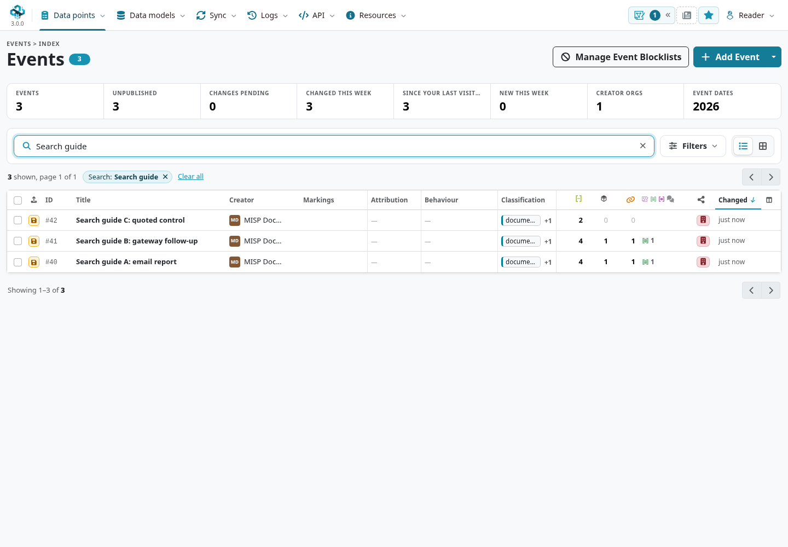

Open **Filters** to see the available controls:

- **Creator org:** choose the organization that created the intelligence. Availability depends on instance settings and your access.
- **Tag:** search or browse custom tags and taxonomy namespaces, include labels, and use the exclusion control for unwanted labels.
- **Galaxy:** select contextual clusters attached to events.
- **Distribution:** restrict the displayed audience level; selecting sharing groups exposes the supported group choices.
- **Published:** choose published or unpublished events. Leaving it unset does not mean published only.
- **Time:** choose the change or publication clock and an available relative preset or range.

**My events** restricts the list to your account's events; it is narrower than every event created by your organization.
Table/card switches and column presentation change how results are shown, rather than adding evidence or changing distribution.
Use sorting and pagination to inspect the selected set.

### Combine included tags, then exclude an event label

1. Open **Tag**. Search for **`documentation-search-guide`** and select it for inclusion.
2. Search for **`search-review:new`** and include that too. With two included values, choose **All of** to require both. **Any of** accepts either included value.
3. Apply the picker using its displayed controls. In this tag browser, **Esc apply** is explicitly shown. Check that the resulting chip says **Tag (all of)**.
4. A and B remain: **two events**. Reopen Tag, find **`search-review:deferred`**, and use its exclusion control.
5. Apply and verify **one event**, A. The chips show both the included labels and the excluded deferred label.

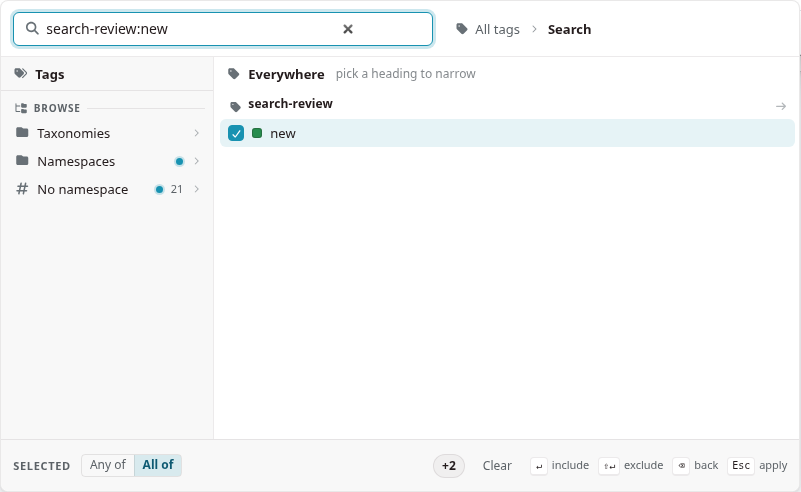

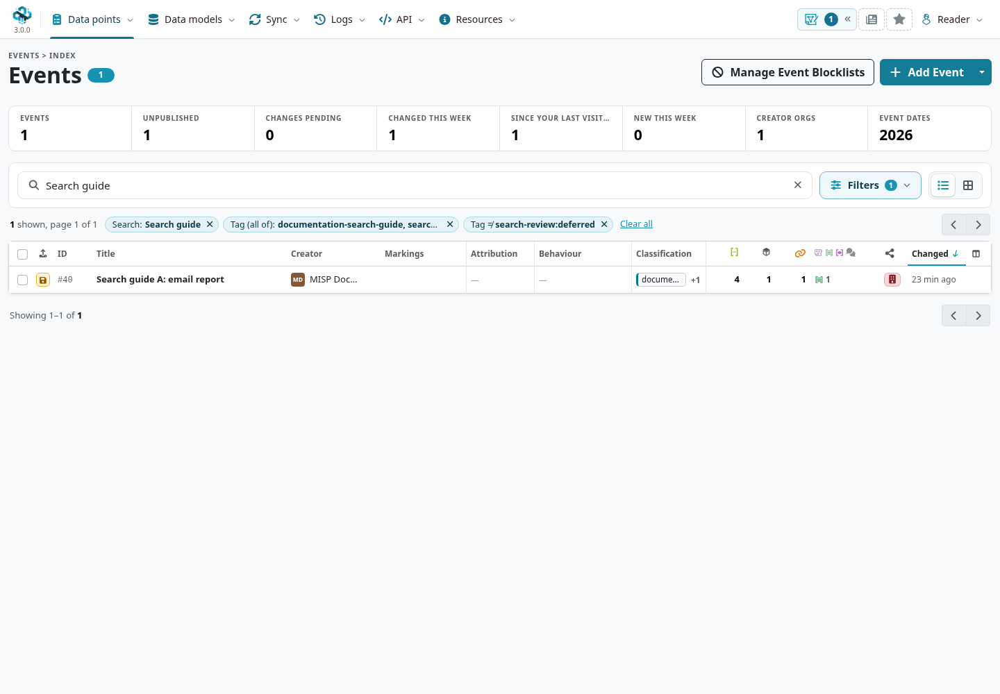

Event tag searches can also find events through attribute tags, but an event and an attribute are different selection units.
In the checked fixture, excluding the attribute-only `search-review:exclude` label from the Events list did **not** remove B, while excluding B's event-level deferred label did.
Use event-level labels for the whole-event queue in this exercise and attribute filters for the occurrence-level exclusion below.
Do not infer that every listed event contains the same matching attribute, or that several included labels sit on one attribute.

### Read the time field before selecting a period

The Events **Time** picker distinguishes **Changed** from **Published**.
The exercise records were entered on 8 November, even though their event dates are 1, 3 and 6 November.
A recent-change query can therefore find an older-dated event.
A publication-time query cannot find a publication that has never happened.
For an event-date interval through the API, use the endpoint's `from` and `to` parameters; those are a different clock.

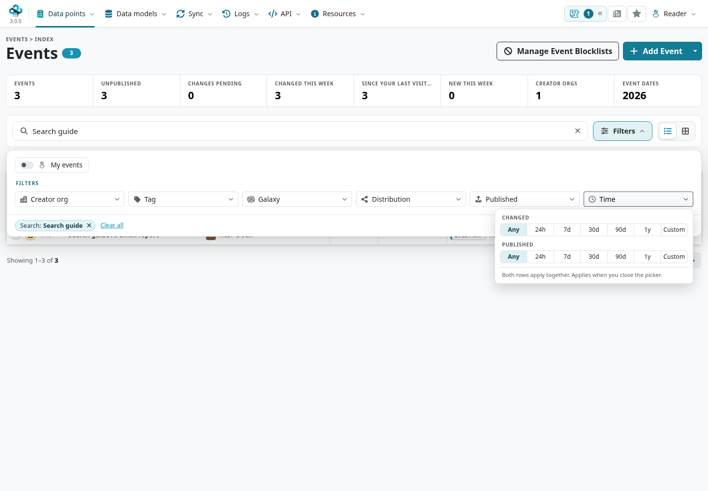

## Search attribute occurrences {#search-attributes}

Open **Data points → Attributes** and search for **`portal.search-review.example`**.
In this fixture, the default word-start search finds **seven occurrences**: the two URL attributes, two hostname properties, two standalone domains and the quoted comment.
The global index includes object properties; it does not return one row per distinct text.

Open **Filters → Type**, narrow the type list to **`url`**, select it and choose **Apply**.
Two URL occurrences remain.
The quoted comment no longer matches because it is a different type, even though its text is the same URL.

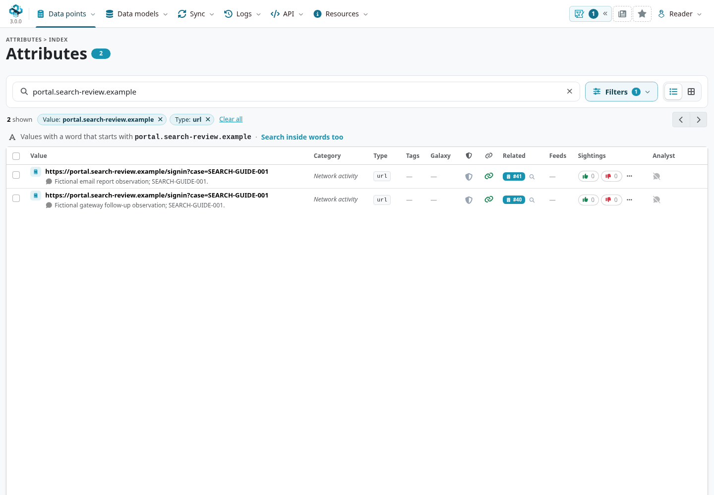

Use the available filters for **Category**, **Type**, **Creator Org**, **Tags**, **Galaxy**, and signal-related predicates such as **IDS** and **Analyst data**.
The global warninglist control and the event-local controls expose different choices; use the options actually offered on that page.
An IDS filter selects the stored flag. It does not assess maliciousness or enable detection.
All fixture attributes have IDS off, so **IDS: Yes** would remove them from this search.

### Exclude an occurrence without losing the source context

Keep the hostname search and URL type, then open **Tags** and exclude **`search-review:exclude`**.
Only A's URL occurrence remains.
B's event still exists, as do its other attributes; the filter did not delete or modify them.
Tag matching in this index can include event tags as well as attribute tags, so inspect where a label is attached before interpreting the result.

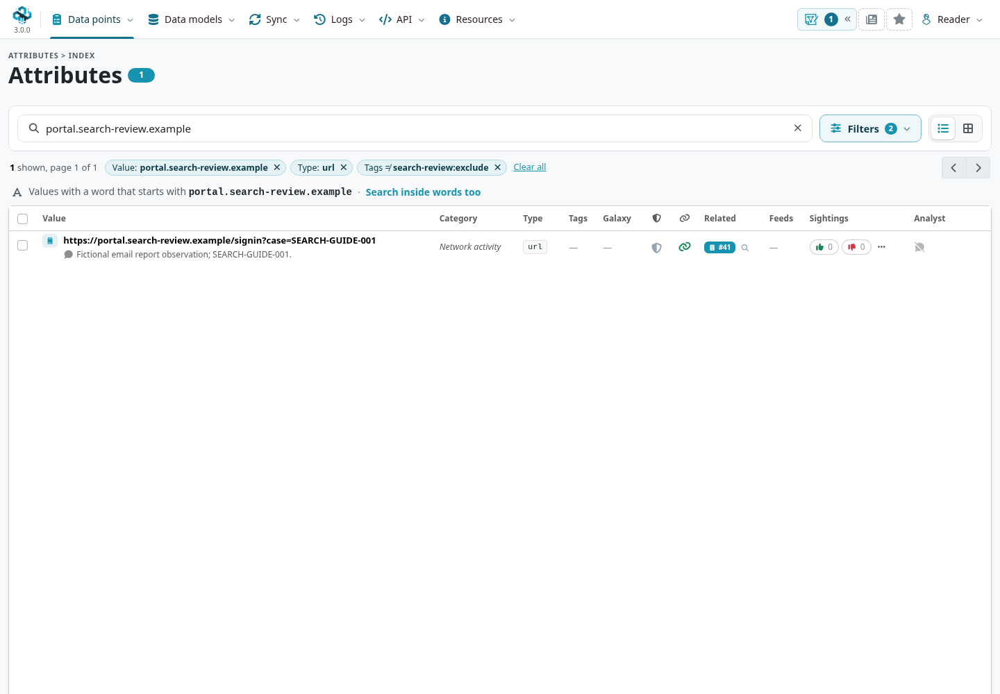

### Word starts and text inside a word

Read the notice beneath the filter bar: **Values with a word that starts with …** describes the default indexed search.
To test the difference, search for **`ortal.search-review.example`** with Type still `url`.
That text sits inside the word `portal`, so the word-start search returns no fixture URL.
Choose **Search inside words too**: both URLs now match, and the notice changes to **Values containing … anywhere**.
The reverse link restores word-start matching.

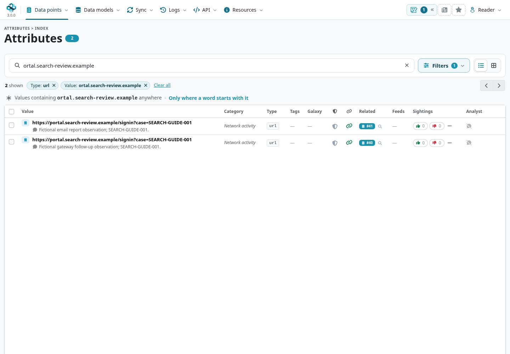

Inside-word matching can scan substantially more data; narrow by known context when possible.
A search that returns no match in one mode is not proof that no accessible record contains that text.
Do not transfer UI matching assumptions directly to a REST `value` filter without checking that endpoint's rules.

## Search objects and keep their properties together {#search-objects}

Open **Data points → Objects** and enter the **complete hostname** `portal.search-review.example`.
The checked object lookup finds the two URL objects holding that child value.
A shortened `portal` search did not find them in this view; the global attribute word-start search and the object value lookup are different tools.

Use **Template**, **Relation**, **Creator org**, **Distribution**, and **Time** to refine the object list.
For example, choose the URL template and the `host` relation when your question is about that hostname property.
The value and relation must describe a matching child; an unrelated property elsewhere in the object is not interchangeable.
Expand a result with **Show its attributes** to inspect all its fields and follow **Open in event** for the full source context.

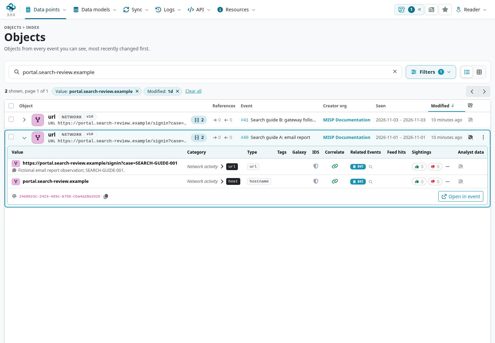

### Separate object modification and observation times

The Objects **Time** picker offers **Modified**, **First seen**, and **Last seen** separately.
In the captured exercise, **Modified → 24h** finds both objects created that day, while their observation spans remain 1 and 3 November.
When several time rows are set, they constrain the search together; clear a previous row if you intended to replace its condition.
The time picker states that its draft applies when closed; select the preset and close it outside the picker, then inspect the chip and result.

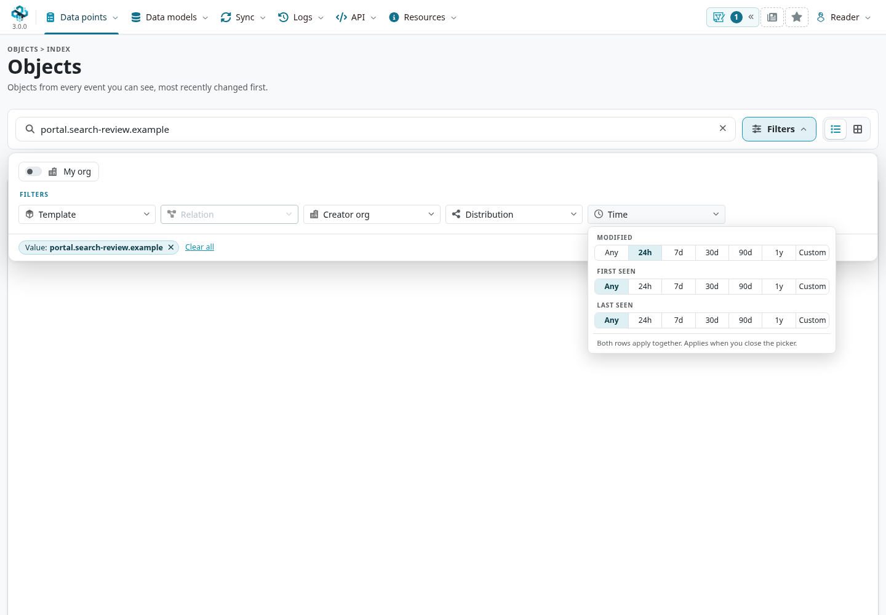

::: {.callout-note}
**Custom object ranges in the checked development branch:** the two-ended custom date picker did not reproduce the expected fixture match, whereas the relative modification preset did.
The emitted range was not interpreted as the intended two bounds on this branch.
Use the verified presets here, or an explicit [API observation-time range](#search-api), and inspect the result rather than treating an unexpected empty list as evidence of absence.
:::

### Filtering inside one event has a different scope

Open A and select **Attributes → Filters**.
This tab shows its two standalone attributes; the URL object's properties are under **Objects**.
The event-local filters can expose **Related events**, **Feed hits**, **Shared more narrowly**, **First or last seen**, distribution and proposal/deleted controls that differ from the global index.
Here **First or last seen** tests whether a field is present; it is not a date-range selector.

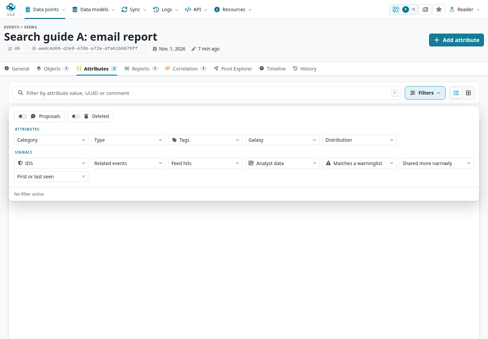

A filter in this tab does not automatically filter the event's reports, objects, correlations or another page.
For temporal exploration across an event's observations, use its Timeline; see [Using the System](../using-the-system/index.qmd#content-toggles).

## Discover distinct values {#search-values}

Open **Data points → Value Intelligence**, choose **Search**, enter `portal.search-review.example`, and submit.
The exercise returns **two distinct texts**: the hostname and the complete URL.
Those rows summarize more than two attribute occurrences and can span several types.
Use **Open** to investigate a value, or expand its details before opening it.

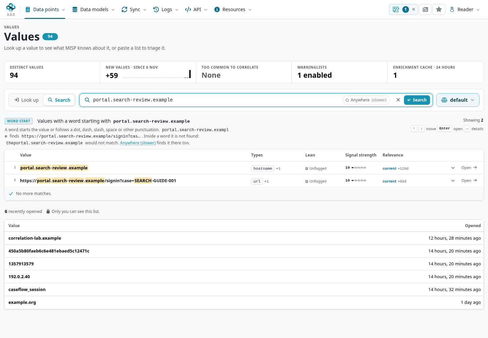

Read the mode displayed beside the results:

- A query with a word of at least three letters or digits uses **word-start** matching.
- Shorter input can use **value-prefix** matching; the page explains when this happens.
- **Anywhere (slower)** finds text inside words as well.
- A **CIDR block** uses address/block matching and explains whether a result lies inside the requested network or is a broader block around it.

The UI can refang supported input such as `hxxps` or `[.]`; review its **Read as** explanation.
These conveniences do not guarantee that a different search page or API parameter will interpret the same input in the same way.

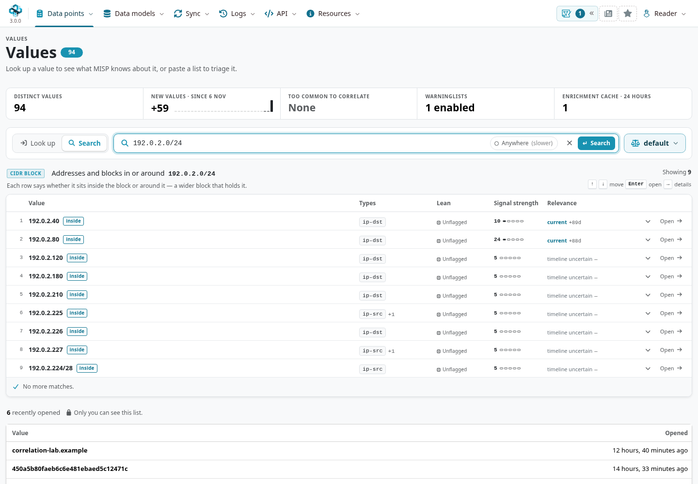

Use **Look up** when you already have a value or a list to investigate, and **Extract from text** for candidates in prose.
Follow the [Value Intelligence chapter](../value-intelligence/index.qmd) for occurrences, relationships, enrichment, timelines and assessment after discovery.

## Search the narrative as well as the indicators {#search-reports}

Open **Data points → Event Reports → Index** and search for **`SEARCH-GUIDE-001`**.
The checked field searches report names or content, so it finds both exercise reports even though that marker is in their prose.
Open a result and read its source event, audience and narrative before treating a mentioned value as an observation.
Within an event, the Reports tab searches that event's report set rather than every accessible report.

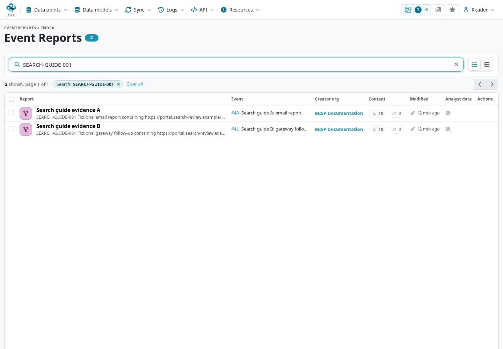

A report can quote a benign example, a source URL or an unconfirmed claim.
Finding prose does not create attributes, and failing to find a structured attribute does not establish that no report discusses it.
See [Event Reports](../event-reports/index.qmd) for references and reviewed extraction.

## Read, reset and preserve a search {#search-preserve}

Before acting on results, inspect the matching mode, active chips, count, page and scope.
Multi-select controls such as Type offer **Apply**; fixed-option and time pickers can state that they apply when closed.
Follow the instruction on the control, then check the resulting chips and count.
Do not assume that closing every picker with Escape commits its draft.

Remove an individual chip to relax one condition, or use **Clear all** to remove the current index filters.
For example, adding **Published: Published** to the remaining exercise event produces an empty list because all exercise events are unpublished.
Removing that publication chip restores the previous selection.

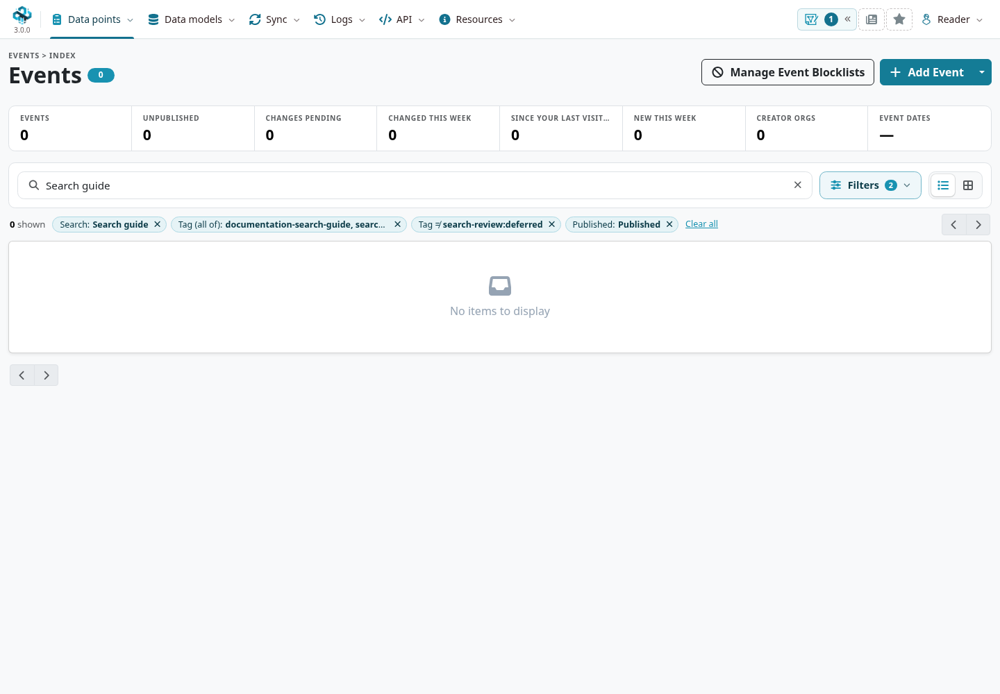

If results are unexpected, check in this order: current page/tab scope, matching mode, include/exclude and Any/All choices, time field, publication/IDS conditions, then account visibility.
Permission checks still apply to searches; a missing result does not establish that nobody holds it.
Read notices about bounds, truncation or additional pages before claiming an exhaustive result.

Top-level index filters can be encoded in the browser address.
Reopen the URL to verify it reproduces the intended selection, then use a [bookmark](../general-layout/index.qmd#bookmarks-and-your-homepage) if appropriate.
An AJAX tab can keep its filter state in the tab's request while leaving only the parent event URL and fragment in the address bar; bookmarking that address does not necessarily preserve its filters.
Record the search criteria separately for that case, or keep an explicit API query.
A bookmark shares a route, not access rights or a fixed snapshot of changing data.

## A short API bridge {#search-api}

Use an explicit REST query when you need reproducible selection, pagination or a filter not exposed by the current UI.
First configure authentication using the [API helper and reference](../automation/index.qmd#api-first-request).
This tested `attributes-query.json` selects A's context-only URL occurrence:

```json
{
  "returnFormat": "json",
  "value": "https://portal.search-review.example/signin?case=SEARCH-GUIDE-001",
  "type": "url",
  "to_ids": false,
  "tags": {
    "AND": ["documentation-search-guide", "search-review:new"],
    "NOT": ["search-review:exclude"]
  },
  "includeEventUuid": true,
  "limit": 100,
  "page": 1
}
```

```bash
misp_api POST /attributes/restSearch --data @attributes-query.json
```

For whole events, use **`/events/restSearch`** with this separate `events-query.json`:

```json
{
  "returnFormat": "json",
  "tags": {
    "AND": ["documentation-search-guide", "search-review:new"],
    "NOT": ["search-review:deferred"]
  },
  "published": false,
  "limit": 100,
  "page": 1
}
```

```bash
misp_api POST /events/restSearch --data @events-query.json
```

This returns event A. The event query excludes the **event-level deferred label**; the attribute query excludes the **URL occurrence's label**.
Both were checked under the same reader account used for the screenshots.
An API key belonging to a different account can produce different visible results.

For an attribute observation interval, the checked API also accepts **`first_seen: ["2026-11-01", "2026-11-02"]`{.text-wrap .text-break}**; a separate URL/type query with that range returned A's URL occurrence.
Keep that distinct from `timestamp` modifications, `publish_timestamp` publication time, and event-date `from`/`to`.
The complete filter semantics and response shapes are in [Automation & API](../automation/index.qmd#api-search-filters).

Do not paste a UI URL's encoded picker state into JSON and assume identical semantics.
In this example `value` is the complete URL; the UI's default attribute word search uses a different matching path.
Request later pages until the selected results are exhausted, preserve UUIDs for identity, and treat `to_ids: false` here as an investigation choice, not a detection export policy.
