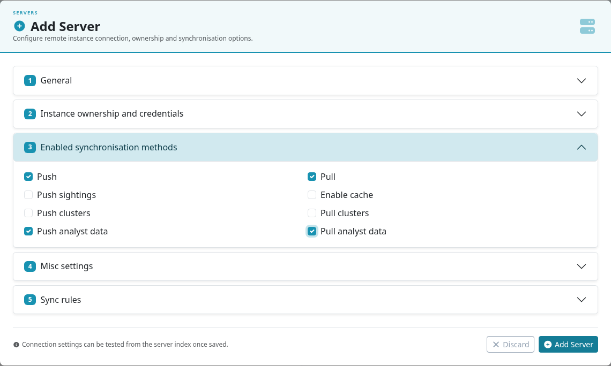
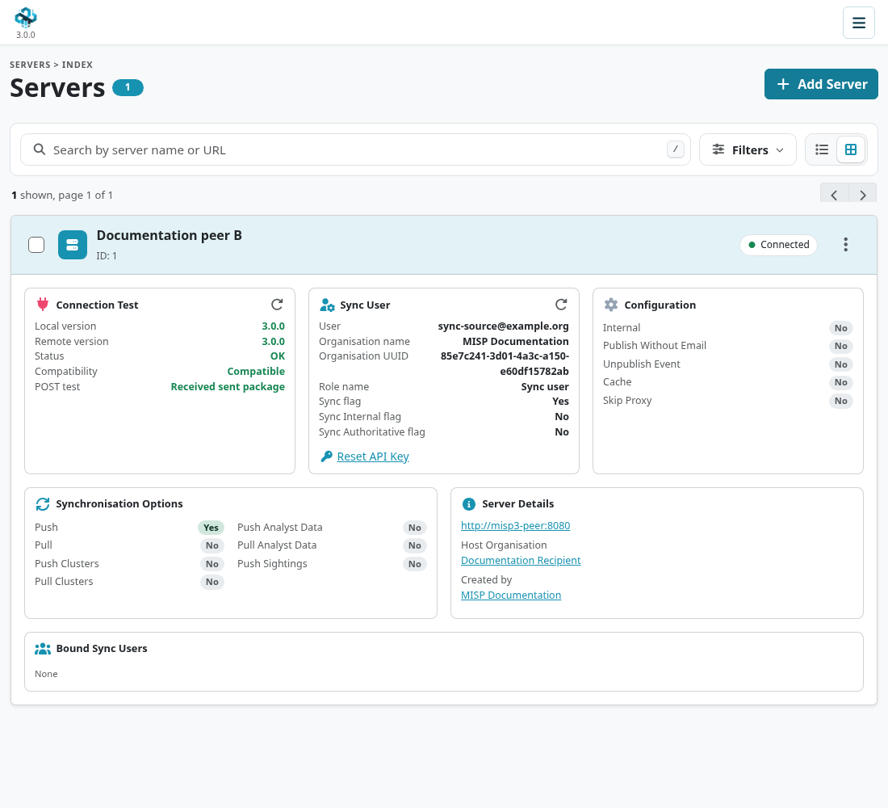
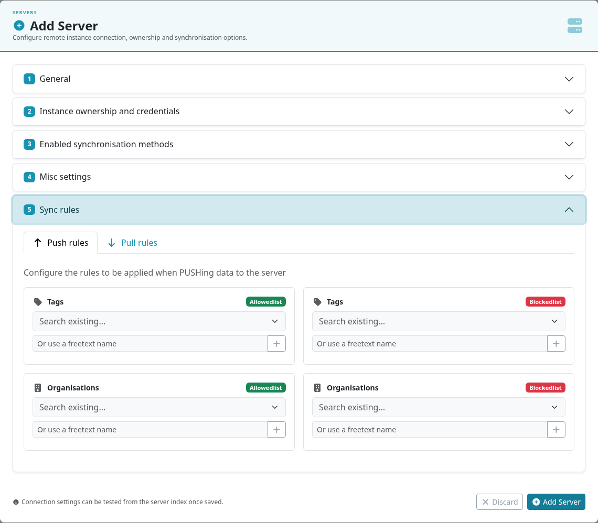

MISP connects organisations that produce, analyse and use threat intelligence. Start with a
defined audience and a useful set of sources; add synchronization when you are ready to maintain
that exchange. Receiving intelligence does not oblige you to publish your own investigations.

::: {.callout-note}
This chapter follows MISP **3.0.0** from the [`3.0_wip`](https://github.com/MISP/MISP/tree/3.0_wip)
development branch, using the light Overmind interface. Controls depend on your role and enabled
services. MISP 2.5 uses different menus. Select a screenshot or diagram to enlarge it.
:::

<!-- Screenshots and verification: ../assets/sharing-screenshots.json. Diagram sources: figures/*.mmd. -->

<a id="sharing--synchronisation"></a>

<a id="sharing-synchronisation"></a>

## Choose how to share {#sharing-overview}

| Requirement | Use |
|---|---|
| Exchange events with another MISP instance | Native [synchronization](#sharing-synchronization), with separate push and pull settings. |
| Look up or import a published indicator source | [Feeds](../managing-feeds/index.qmd), in MISP, free-text or CSV format. |
| Define a specific audience | [Sharing groups](#sharing-groups), alongside event, object and attribute distribution. |
| Share a curated set of references | [Collections](../collections/index.qmd). Targets retain their own access rules. |
| Discuss or assess intelligence | [Analyst Data](../analyst-data/index.qmd), proposals and sightings. |
| Restrict which instances may sign protected event updates | [Cryptographic keys and event signing](../cryptographic-keys/index.qmd). |

<a id="synchronisation"></a>

## Synchronization {#sharing-synchronization}

### Identities and credentials {#concept}

Each connection authenticates to the **remote** instance. The key is issued there, to an account
representing the connecting organisation. Organisation UUIDs identify the same organisation
across instances; a matching name is not enough.

For **B to pull from A**:

1. On B, obtain Org B's organisation UUID from its organisation record.
2. On A, create or identify a **local organisation** for Org B using that UUID. Create a dedicated
   account in Org B with the **Sync user** role and issue its authentication key.
3. On B, add a server connection to A. Select **Org A**, the organisation hosting A, as the remote
   organisation. Enter the key **issued by A** and enable **Pull**.
4. Test the connection and start with a small, agreed set of data and filters.

<a id="misp-server-sync"></a>



For **A to push to B**, create the reciprocal account and key on **B**, then configure A's
connection to B. Do not reuse a personal administrator account as a synchronization account.
Keep keys out of screenshots, tickets and shared configuration exports. See
[authentication keys](../user-management/index.qmd) for expiry and access restrictions.

### Push and pull {#pull-vs-push-synchronisation}



<a id="push"></a>

#### Push {#sync-push}

With **Push** enabled, publishing an eligible event initiates an attempt to send it to that
peer. Jobs, connectivity, filters and remote permissions determine whether it succeeds.
A failed worker or unavailable peer can delay delivery; publication alone is not confirmation
that the other instance received the event.

Ordinary external push excludes **Your organisation only** and **This community only** data.
Object and attribute restrictions are checked as well as the event's distribution.

<a id="pull"></a>

#### Pull {#sync-pull}

A pull is initiated from the receiving instance, manually or on a schedule. The account used on
the source instance determines what it can read. This can include community data and, for an
account in the event's owning organisation, organisation-only data. Pull rules and synchronization
eligibility still apply; it is not an unrestricted copy of everything visible in the UI.

The normal full synchronization workflow selects published events. An event's unpublished state
is **not an access-control setting**: local community access depends on distribution and the
instance's unpublished-event policy. Keep private drafts **Your organisation only**.

#### Using both directions {#benefits-of-using-push-and-pull-in-conjunction}

Push provides prompt delivery attempts; scheduled pull can recover eligible updates missed during
an outage. Configure and test each direction independently, including the credentials and filters.
Use the [administration commands](../administration/index.qmd#automating-certain-console-tasks)
to schedule synchronization, and monitor the resulting jobs and logs.

## Add a remote server {#adding-a-server}

As a **site administrator**, open **Sync → Servers & Feeds → Servers** and select **Add Server**.
The MISP 3.0 form groups the settings into expandable sections. The underlying endpoint is
`/servers/add`.



| Section | What to check |
|---|---|
| **General** | The peer's HTTPS **Base URL** and a recognisable **Instance name**. Leave **Internal instance** off for ordinary partner connections. |
| **Instance ownership and credentials** | The organisation that **hosts the remote instance**, identified by UUID, and the authentication key issued on that instance. Choose an existing local/known remote organisation or create the remote organisation as appropriate. |
| **Enabled synchronisation methods** | Enable Push, Pull and any additional data types deliberately. Enabling event synchronization alone does not enable every related feature. |
| **Misc settings** | Review event publication/email handling, caching, proxy behaviour and any certificate files. Use a trusted server certificate; do not routinely bypass certificate verification with **Self Signed**. |
| **Sync rules** | Define push and pull filters separately, then test them against representative data. |

The remote host organisation is used when evaluating sharing-group eligibility. Selecting the
wrong organisation changes that evaluation. Confirm its UUID with the partner before saving.

### Analyst Data, collections and MISP 3.0 {#synchronising-analyst-data-and-collections-2.5}

The server form exposes independent **Push analyst data / Pull analyst data** options,
alongside event, sightings and galaxy options. Collection synchronization has separate
`push_collections` / `pull_collections` settings. At the captured commit, these are available
through the server REST API and legacy form but are **missing from the Overmind form**.
An administrator can set them with `POST /servers/edit/{id}`, for example:

```json
{"Server": {"push_collections": true, "pull_collections": false}}
```

Both ends must support the relevant feature and the remote account needs the corresponding
permissions. Each record's distribution still applies.

MISP 3.0 extends the research model with value-level Analyst Data and collection references to
attributes, objects and values. A value reference uses the SHA-256 address of the stored value;
it does not identify one particular attribute occurrence. See [Analyst Data](../analyst-data/index.qmd)
and [Collections](../collections/index.qmd) for the supported targets and payloads.

The branch supports native synchronization between **3.0 and 2.5**, with feature negotiation.
That does not make all 3.0 data transferable: value-targeted Analyst Data and value-addressed
collection elements are withheld from peers older than 3.0. Check the actual received records
before treating a mixed-version handover as complete.

## Test the connection {#test-connection}

From the server list, run the connection test for the saved peer. Check the reported version,
authentication/role result and POST capability. A successful test confirms the connection and
reported capabilities; it does not prove that a particular event passes distribution or filters.



Next, agree a harmless test event with the partner, publish it when authorised, and verify its
UUID, received distribution, expected attributes and job outcome on both sides. Check push and
pull separately. Never use live sensitive data as the first connectivity test.

## Set synchronization rules {#rules}

Push and pull rules narrow the eligible data set; they do not widen distribution or sharing-group
access. Tag and organisation selectors support **OR** (allow) and **NOT** (block) lists.
For example, blocking `tlp:red` on a connection can provide an additional filter, but a TLP tag
itself does not change the event's distribution.



Pull rules can also limit attribute/object types and index-query parameters. Test the resulting
subset, especially when combining tag, organisation and time filters. A restrictive filter can
make a healthy connection appear idle. Changing a rule does not recall copies already delivered.

## Troubleshooting {#troubleshooting}

| Symptom | Check first |
|---|---|
| Connection cannot be established | Base URL, name resolution, HTTPS certificate chain, proxy/firewall and any required client certificate. |
| Authentication or permission error | Key expiry/revocation, IP restrictions, the account's organisation and role on the **remote** instance. |
| Connection works but no events arrive | Push/Pull enabled, publication state, distribution, sharing groups, filters, timestamps and job status. |
| Event arrives with fewer attributes | Object/attribute distribution, type filters, blocklists and peer support. Compare by UUID. |
| Notes or collection entries are missing | Dedicated synchronization toggles, role permissions, each record's distribution and version-specific target support. |
| Protected event fails | [Instance signing key, authorised fingerprints and signature verification](../cryptographic-keys/index.qmd). |

Use the job and audit logs for the failed operation. If you reproduce a request with an API
client, keep its key and response data out of shared logs. Report development-branch issues with
the commit, both versions and a synthetic reproducer.

## Sharing and distribution

### Distribution settings

Events use **Your organisation only (0)**, **This community only (1)**,
**Connected communities (2)**, **All communities (3)** or **Sharing group (4)**.
Objects and attributes can also **inherit** their parent distribution. A child cannot make a
restricted parent visible to a wider audience. See [event creation](../using-the-system/index.qmd#creating-an-event).

#### Visibility of events, objects and attributes {#visibility-of-data---events-objects-and-attributes}

The owning organisation and site administrators have privileged access. Other organisations need
an eligible community distribution or membership in the relevant sharing group, subject to the
parent's restrictions. A sharing group's server membership and **all organisations** settings
also affect synchronization; review both its organisation list and server list.

### Community

A community is the set of organisations participating around an instance, including organisations
represented by its synchronization accounts. It is not a fixed, global list of every connected
server. Creating an account for Org B on A does not create the reciprocal trust relationship on B.

### Sharing groups {#sharing-groups}

Use a sharing group when the audience should be an explicit set of organisations and, where
applicable, instances. Open **Sync → Sharing Groups** and review the organisation and server
membership. See [create and manage sharing groups](../using-the-system/index.qmd#create-and-manage-sharing-groups)
for the current form. A **Collection** groups content references; a **Sharing Group** controls access.

### Distribution at a synchronization boundary {#distribution-mechanisms}

For ordinary external synchronization, community-limited distributions can be reduced on the
receiving instance. **All communities** remains level 3. Sharing-group data follows its explicit
membership rules rather than a numeric hop count.



#### Ownership and eligibility {#general-syncing-rules}

Synchronization preserves the creator organisation (`Orgc`). The receiving copy has a local
owner (`Org`) associated with the receiving account/connection. On push, the API account is the
local creator user; on pull, the account running the pull is used. Creator identity, local
ownership and the remote host organisation are distinct concepts.

#### Community distribution scenarios {#syncing-scenarios-with-communities-distribution}

##### Ordinary external connection {#internal-instance-flag-not-set}

The tables describe standard event distribution, assuming publication, filters, permissions and
peer compatibility otherwise allow the transfer. Objects and attributes are checked separately,
within the event's visibility. Sharing groups need their own membership check.

###### Push from A to B {#push-from-instance-a-to-instance-b---usual-scenario}

| On A | Result on B |
|---|---|
| 0 — Your organisation only | Not pushed. |
| 1 — This community only | Not pushed. |
| 2 — Connected communities | Imported as 1 — This community only. |
| 3 — All communities | Remains 3 — All communities. |

###### Pull from A to B {#pulling-from-instance-a-to-instance-b---usual-scenario}

| On A | Result on B |
|---|---|
| 0 — Your organisation only | Eligible only if the account used on A belongs to the owning organisation; remains 0 on B. |
| 1 — This community only | Imported as 0 — Your organisation only. |
| 2 — Connected communities | Imported as 1 — This community only. |
| 3 — All communities | Remains 3 — All communities. |

<a id="internal-instance-flag--set"></a>

##### Internal connections {#internal-instance-flag-set}

**Internal instance** is an advanced trust setting for instances under the same hosting
organisation. The configured remote organisation must match the local host organisation for
internal push handling. It changes distribution handling and protected-event trust checks;
it should not be used to fix a partner connection that cannot see an event.

###### Internal push {#push-from-instance-a-to-instance-b---internal-flag-set-scenario}

Internal push can retain community distributions instead of reducing them and can make
organisation-only data eligible in paths that an external push would reject. Publication-time
and bulk push selection are not identical. Test the intended workflow and restricted attributes
before enabling this setting on an operational connection.

###### Internal pull {#pulling-from-instance-a-to-instance-b---internal-flag-set-scenario}

The remote account must still be able to read the data. Do not assume internal pull preserves
all community distributions: the standard pull import path still reduces community-limited
levels. Internal pull also changes protected-event validation. Verify received ownership,
distribution and signing behaviour for the deployed version.

## Collaboration

### Proposals

Use [proposals](../using-the-system/index.qmd) to request attribute additions or changes without
taking over the event. The owner reviews them. Use [sightings](../sightings/index.qmd) to record
observations, false positives or expiry, and Analyst Data for an assessment or relationship.

<a id="forums--threats"></a>

### Discussions in MISP 3.0 {#forums-threats}

The old **Forums / Threads** and event-comment pages are removed in this branch. The migration
converts discussion posts to [Analyst Data notes](../analyst-data/index.qmd), attached to their
event or organisation, with distribution capped at the community or owning organisation.
Old `/threads/` and `/posts/` instructions no longer apply.

#### Start a discussion {#create-a-new-topic}

Add a note to the relevant event, organisation or other supported target. State the question,
evidence and intended audience. Check the note's distribution before saving.

#### Reply to a discussion {#comment-a-topic}

Open the assessment and add a reply where available. Reply visibility is also bounded by the
parent. Do not assume a note is local-only: eligible Analyst Data can synchronize when enabled.

### Comments on events {#comments-to-events}

Use the event's **Assessment** area to add a note, opinion or relationship. Keep the event report
for the investigation narrative. See the [Analyst Data workflow](../analyst-data/index.qmd) for
current screenshots, target types and distribution checks.

### Contact a reporter

On an event with a local creator organisation, open **All actions → Contact Reporter**.
Choose the intended recipient and write a specific question. Delivery depends on mail and
encryption configuration. Contacting the reporter sends a message; it is not a synchronized
record of the discussion.

### Receive alerts

Review notification preferences under **Account → My Profile → Settings**. Event alerts depend
on your subscription, access, publisher choices and instance configuration. Configure a valid
email encryption key where required. See [account settings](../user-management/index.qmd).

## Cerebrate

[Cerebrate](https://github.com/cerebrate-project/cerebrate) supplies directory records for
organisations and sharing groups. It helps a community keep organisation UUIDs and membership
consistent; it does not transfer MISP events.

Site administrators can manage connections at `/cerebrates/index`. Supply the node's name, URL,
API key and owner organisation, then choose whether to pull organisations and/or sharing groups.
Preview the remote records before pulling. UUIDs are used to match organisations; review name
conflicts and membership changes before applying an update.

## Sharing group blueprints

A **Sharing Group Blueprint** describes membership rules, such as organisations in a sector or
country. Open `/sharingGroupBlueprints/index`; creating or editing requires sharing-group
permission, and non-administrators are limited to their organisation's blueprints.

In 3.0, the form offers a JSON rule editor with operator and filter helpers for organisation
properties and sharing groups, using **OR**, **AND** and **NOT** conditions.
Preview the resolved organisations, then **Execute** to
create or update the managed sharing group. Execution can overwrite manual membership changes;
**Detach** it first if you want to maintain it by hand.

A blueprint does not continuously update membership merely because it exists. Execute it again,
schedule it or use a configured workflow when directory data changes. Site administrators can
also **Encode as a sync rule** to apply the resolved organisation selection to a server's rules.

## TAXII 2.x servers

MISP can act as a **TAXII 2.1 client** to browse remote collections and push filtered events
converted to STIX 2.x. Site administrators manage these connections at `/taxiiServers/index`.
This requires the relevant TAXII/STIX dependencies and a compatible remote service.

Configure the discovery URL, authentication, API root, writable collection and event-selection
filters. Preview the intended scope before pushing. Basic and bearer credentials belong in the
connection configuration. TAXII transfers use STIX and should not be assumed to preserve every
native MISP feature, such as value-level Analyst Data or MISP collection references. See
[Automation & API](../automation/index.qmd) for STIX export options.

## An intake and sharing workflow {#recommendation}

Choose sources for their relevance and handling terms. Begin with cache lookups where useful,
import selected material, and review it before detection use or outward sharing.



### Optional staging instance {#misp-staging-system}

A separate staging instance can isolate high-volume imports, parser experiments and enrichment.
Limit incoming sources and the routes out of staging. It is an architectural choice, not a
requirement to download every available feed or partner event.

### Operations instance {#misp-secops-system}

Analysts validate evidence, record confidence and handling requirements, and select detection
attributes. Share reviewed events with explicit distribution, suitable tags and tested push
rules. Check job outcomes and confirm important handovers with the receiving team. On a single
instance, use the same review discipline with restricted drafts and deliberate publication.
