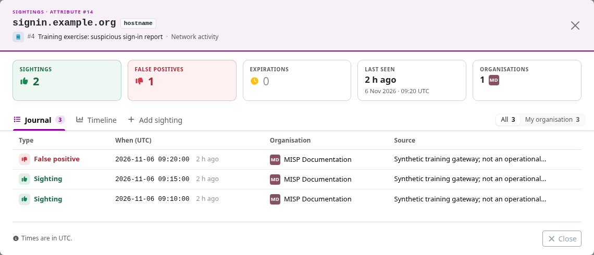
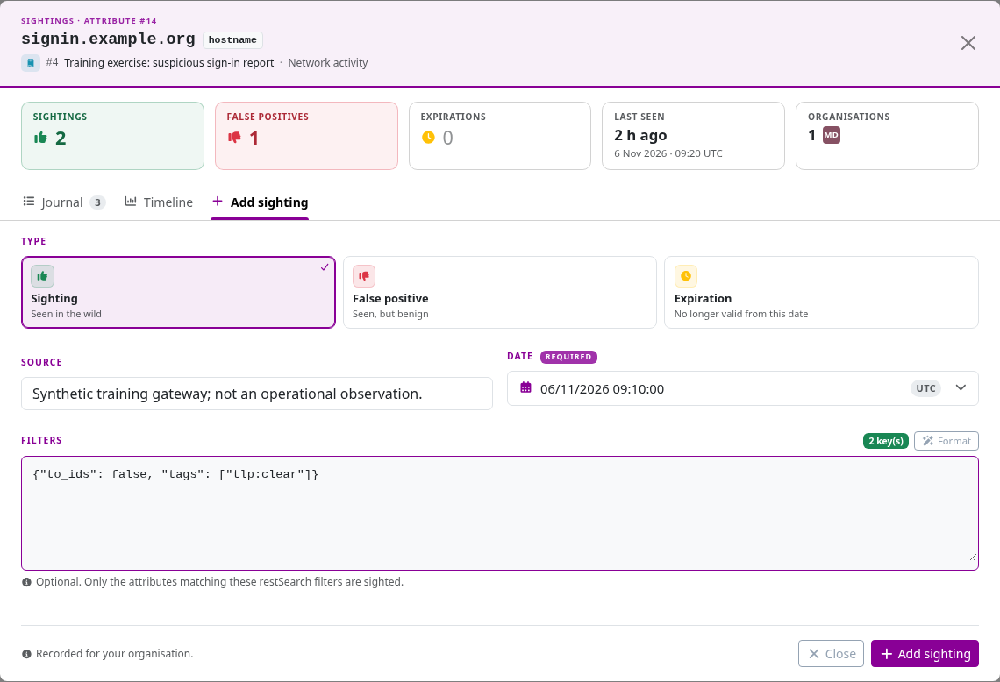

A **sighting** records feedback about an attribute: when it was observed, assessed as a false positive, or assigned an expiration.
It helps producers and consumers assess an indicator over time.
Seeing a value is not, by itself, proof of malicious activity or a confirmed compromise.

::: {.callout-note}
The screenshots use the [`3.0_wip`](https://github.com/MISP/MISP/tree/3.0_wip) development branch and synthetic observations.
MISP 3.0's details window uses **Journal**, **Timeline**, and **Add sighting**, replacing the older Graph/All/My org tab arrangement.
Adding sightings requires sighting permission; visibility also depends on the instance's sighting policy. Select a screenshot to enlarge it.
:::

<!-- Capture source, fixture and image hashes: ../assets/using-misp-screenshots.json -->

## What a sighting means {#explanation}

| Type | API value | Use it for… |
|---|---:|---|
| **Sighting** | `0` | An observation of the value, with its observation time and source. |
| **False positive** | `1` | Feedback that the value or detection was benign or inappropriate in the reported context. |
| **Expiration** | `2` | A date after which the indicator should no longer be treated as valid for the reported use. |

Several sightings from one organization can describe repeated observations, rather than independent confirmations.
False-positive feedback is separate from the IDS flag: `to_ids=false` means context-only eligibility, not a recorded false positive.
Expiration records do not automatically clear IDS flags or remove an indicator from every export.

## Record sightings in MISP 3.0 {#using-sightings-on-an-event-gui}

Open the event's **Attributes** tab, or expand an object in **Objects**, and find the attribute's sighting controls.
The thumbs-up and thumbs-down controls provide quick observation and false-positive actions.
Use **Sighting details** when you need to inspect existing feedback or record a specific time and source.

### Inspect the journal {#advanced-sightings}

The details window summarizes observation, false-positive, and expiration counts, the latest observation, and the organizations visible to you.
The **Journal** lists individual records; use its **All** and **My organisation** choices to change the scope and **Timeline** to examine their timing.
The available records and counts reflect the sighting visibility policy, not necessarily every observation stored on the instance.



### Add a dated observation

1. Open **Add sighting** in the details window.
2. Choose **Sighting**, **False positive**, or **Expiration** according to the feedback you intend to record.
3. Enter a useful source description and the relevant time, observing the form's UTC indication.
4. Review any filters and the target attribute before saving.



Use the time the observation occurred, rather than silently substituting the time you entered it.
Avoid personal or restricted details in the source field unless their sharing has been agreed.
Repeated clicks can create multiple records; inspect the journal before correcting or adding feedback.

### Review an event's sightings {#at-event-level}

An event-level sighting view summarizes feedback on its attributes; it does not turn the event itself into a sighted indicator.
Add new feedback to the specific attribute or an explicitly selected set of attributes.
In the pinned 3.0 **Value Intelligence** page, the header's **Add sighting** shortcut remains disabled; use the attribute controls above.

## Sighting policies and privacy

Sightings can reveal which organizations are investigating particular infrastructure.
Administrators control visibility and sharing through settings such as:

- **`Plugin.Sightings_policy`**: restrict other organizations' visibility to the event owner, contributing organizations, or everyone with event access, according to the configured policy. Users retain access to their own organization's contribution.
- **`Plugin.Sightings_anonymise`**: hide individual reporting-organization identities where applied.
- **`Plugin.Sightings_anonymise_as`**: use a configured organization identity when pushing sightings to another server.
- **`Plugin.Sightings_range`**: set the lookback period used for sighting graphs.

Check the effective configuration and the receiving organization's view before assuming that a count or identity will be shared.
A missing record can reflect policy, time range, filtering, or synchronization rather than absence of observations.

## SightingDB

An optional **SightingDB** integration provides additional sighting information from external services.
Its availability and the associated controls depend on the instance's configuration; it is distinct from ordinary MISP sighting records.
Confirm where data is stored, queried, and shared before using an external service for sensitive observations.

## Real-time sharing and blocklists

With `Plugin.Sightings_enable_realtime_publish` enabled, new sightings can be sent to synchronization partners as they are created.
Otherwise, publication and synchronization settings determine delivery; **Publish Sightings** can send updates separately from the event's content.
This remains subject to visibility, filters, and partner configuration.

Administrators can exclude unwanted reporting organizations with the [sighting blocklist](../administration/index.qmd#sighting-blocklist).
Correct erroneous feedback through the permitted deletion controls and tell consumers when an already-shared assessment changes.

## Using sightings on an event (API)

Use `POST /sightings/add/{attribute_id_or_uuid}` with the type, source, and an observation **`timestamp`** in Unix seconds.
For example, this payload records a synthetic observation at 09:10 UTC on 6 November 2026:

```json
{
  "type": 0,
  "timestamp": 1793956200,
  "source": "Synthetic training gateway; not an operational observation."
}
```

Use `GET /sightings/listSightings/{attribute_id_or_uuid}` to inspect the records visible to your account.
The complete workflows, filtering, bulk operations, and authentication are covered in the [sightings API reference](../automation/index.qmd#sightings-api).
