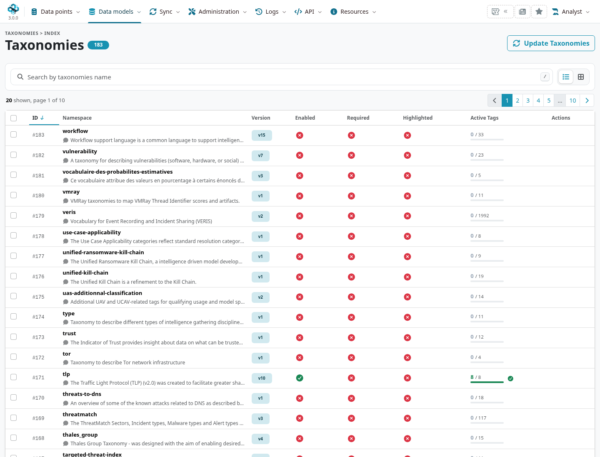
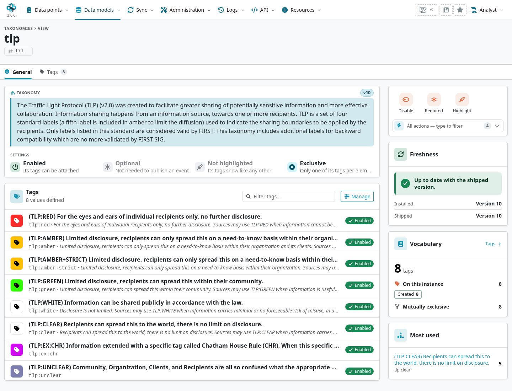
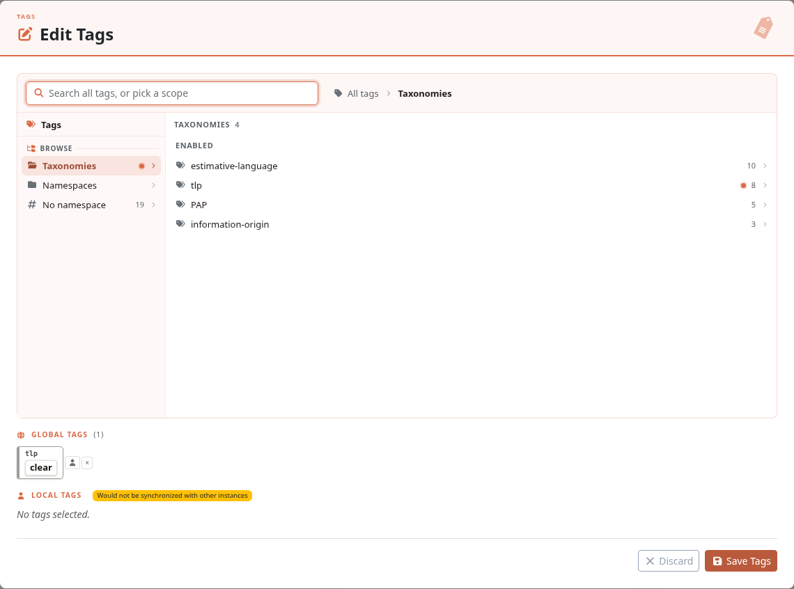

A taxonomy gives classification a shared vocabulary: handling instructions, source reliability,
confidence, workflow state or another defined meaning. Use a taxonomy tag so another analyst
or tool can interpret the label consistently, rather than guessing what a free-text tag means.

::: {.callout-note}
This chapter follows MISP **3.0.0**, `3.0_wip` commit `99ebee729`. The vocabulary
has its own release cycle in [misp-taxonomies](https://github.com/MISP/misp-taxonomies).
Screenshots use synthetic private data; select a figure to enlarge it.
:::

<!-- Definition pins, tests and captures: ../assets/data-model-screenshots.json -->

<a id="reserved-taxonomy"></a>

## Read a machine tag {#taxonomy-machine-tags}

The general form is `namespace:predicate="value"`. Some taxonomies have a predicate without a
separate value, such as `tlp:clear`.

::: {.table-responsive}

| Example | What it expresses |
|---|---|
| `tlp:clear`{.text-wrap .text-break} | A handling/disclosure marking. It does not make an event accessible by itself. |
| `admiralty-scale:source-reliability="a"`{.text-wrap .text-break} | A rating in a defined source-reliability scale, separate from the information's credibility. |
| `estimative-language:likelihood-probability="likely"`{.text-wrap .text-break} | A qualified likelihood statement. Preserve the source and reasoning behind it. |
| `ai-computer-assisted:review-level="unreviewed"`{.text-wrap .text-break} | A provenance/review marking used by assisted-analysis workflows; it is not a validation of the content. |

:::

Use [galaxy clusters](../galaxy/index.qmd#galaxy-concepts) to refer to a knowledge entity such as an actor or
technique. Do not manufacture `misp-galaxy:*` tags as a replacement for the galaxy attachment
workflow. The cluster has identity and metadata beyond its tag representation.



<a id="adding-taxonomy-in-misp"></a>
<a id="bulk-actions-and-normalising-custom-tags"></a>
<a id="taxonomies"></a>

## Find and enable a vocabulary {#taxonomy-management}

Open **Data models → Tags & Taxonomies → List Taxonomies** (`/taxonomies/index`). The 3.0 index shows version, enabled,
required and highlighted state, plus active tag counts. Use search and supported row/bulk actions
to find and configure the vocabulary your community uses.



Open a taxonomy to read its description, scope, exclusivity and version. **General** summarizes
it; **Tags** lists its predicates/values and the tags available on this instance.



An enabled taxonomy and enabled individual tags are separate choices. A vocabulary can be
installed while its tags are unavailable to attach. Enable the intended entries, or use the
explicit enable-all action after reviewing their meaning. Taxonomy administration normally
requires a site administrator; attaching existing tags depends on tagging permissions and scope.

Definitions on disk and definitions in the database are also separate. Update the pinned
`app/files/taxonomies` files through the deployment process, then use **Update Taxonomies**
or `cake Admin updateTaxonomies` to import them. A new vocabulary does not automatically
establish the community's marking policy.

<a id="how-to-use-taxonomy-in-misp"></a>
<a id="filtering-the-distribution-of-events-among-misp-instances"></a>
<a id="other-use-cases-using-misp-taxonomies"></a>
<a id="future-functionalities-related-to-misp-taxonomies"></a>

## Attach classification with the right scope {#taxonomy-use}

On an event or attribute, open its tagging action and choose the appropriate enabled tag.
Check the selected target and whether the attachment is **global** or **local**. A local
attachment provides instance-local context; normal synchronization does not propagate it.
Global attachments are eligible for sharing subject to exportability, filters and the target's
own distribution and visibility.



A handling tag is **not an access-control list**. Event/object/attribute distribution and
sharing groups still define the audience. Peer push/pull tag rules can select eligible content,
but applying `tlp:clear` does not override a private event's distribution. See
[Sharing & Synchronisation](../sharing/index.qmd#rules).

Tags can select work for a [workflow](../workflows/index.qmd#workflow-hub) or connector, but the automation
must implement that policy. An arbitrary tag does not by itself run enrichment, expire an
indicator or change its IDS flag.

### Who can add local tags to an event? {#taxonomy-local-tagging-permissions}

Local tagging has its own permission check: being unable to edit another organization's event does not always prevent adding an instance-local label.
For ordinary users, the event-tagging action requires the role's **tagging permission** (`perm_tagger`).
The following rules apply to an event the user can access:

::: {.table-responsive}

| User's position | Local event tags | Global event tags |
|---|---|---|
| Member of the instance's **host organization**, with tagging permission | Can add local tags even when another organization created the event and the user cannot edit it. | Host-organization membership alone grants no right to change global tags. |
| Member of the event's **creator organization**, with tagging and the appropriate event-edit permissions | Can add local tags through the normal event-editing permission path. | Can manage global tags through that same permission path. |
| Other user without event-edit permissions | Viewing the event and having tagging permission alone are insufficient. | No right to change global tags. |
| Site administrator | Allowed by the site-administrator exception. | Allowed by the site-administrator exception. |

:::

The **host organization** is configured by `MISP.host_org_id` on this instance.
The event's **creator organization** is `Orgc`; it can differ from the locally owning organization, `Org`, after synchronization.
Membership in either organization is not a substitute for the required role permissions.
For the normal edit path, `perm_modify_org` permits edits to the creator organization's events, while `perm_modify` permits edits to events created by that user.
A read-only account does not gain tagging rights merely by belonging to the host organization.

For example, a host-organization analyst can mark a received event from a partner as needing local review, without gaining permission to rewrite that partner's shared markings.
The selected tag must also be available to the account; creating a new tag definition is a separate permission (`perm_tag_editor`).

::: {.callout-note}
In the checked MISP 3.0 revision, the **Edit Tags** dialog also requires permission to modify the event when saving.
The broader host-organization local-tagging right therefore does not guarantee that this dialog can save changes on a received event.
The event-tagging API provides the explicit local action shown below.
These rules were checked against [`ACLComponent::canModifyTag` and `canModifyEvent`](https://github.com/MISP/MISP/blob/99ebee729702c560528f9788953719bda68aa1c1/app/Controller/Component/ACLComponent.php#L1308) and [`EventsController::editEventTags` and `addTag`](https://github.com/MISP/MISP/blob/99ebee729702c560528f9788953719bda68aa1c1/app/Controller/EventsController.php#L3607).
:::

To add an existing tag locally through the API, send `POST /events/addTag/EVENT_ID/local:1` with a JSON body such as `{"tag": 123}` and your account's API authentication.
Replace `EVENT_ID` with the accessible event's ID or UUID and `123` with the intended tag's ID.
Check the response's `saved` and `errors` fields, then verify the local attachment on the event; an HTTP 200 response alone is not confirmation of success.
See [Automation & API](../automation/index.qmd#api-authentication) for authentication and key restrictions.

<a id="more-options-to-configure-taxonomies."></a>
<a id="setting-a-taxonomy-as-highlighted"></a>
<a id="setting-a-taxonomy-as-required"></a>
<a id="exclusive-taxonomies"></a>
<a id="more-options-to-configure-taxonomies"></a>

## Highlighting, required classification and exclusivity {#taxonomy-consistency}

::: {.table-responsive}

| Setting/property | Effect and limit |
|---|---|
| **Highlighted** | Makes that namespace easier to see/apply in event context. It encourages consistent classification; it does not fill in a missing assessment. |
| **Required** | An enabled required taxonomy must be represented among the event tags for the publication check. Attribute tags alone are not that event-level classification. |
| **Exclusive taxonomy/predicate** | Defines which values should not coexist. MISP uses it for conflict checks and some attachment decisions; review imported/API data and resolve conflicting meanings. |

:::

The current required-taxonomy check can be inspected without publishing an event. Review any
missing-namespace message and add the justified classification before release. Do not choose
a label merely to clear a warning. For conflicting handling tags, establish the intended meaning
and remove/correct the attachment in the right local/global scope.

Exclusivity comes from the vocabulary definition, not an arbitrary UI checkbox. The branch has
specific compatibility handling for legacy TLP white/clear; do not generalize that to every
pair of exclusive tags. `MISP.disable_taxonomy_consistency_checks` affects conflict reporting,
so an absence of a warning is not evidence that the classification is coherent.

<a id="contributing-to-taxonomy"></a>
<a id="adding-a-private-taxonomy"></a>
<a id="misp-taxonomies---tools"></a>

## Private vocabularies and contributions {#taxonomy-authoring}

For a private vocabulary, choose a namespace that does not impersonate an upstream taxonomy.
Define its description, version, predicates and values in `machinetag.json`, following the
[current schema and examples](https://github.com/MISP/misp-taxonomies). A minimal definition is:

```json
{
  "namespace": "documentation-exercise",
  "description": "Synthetic classification for a local documentation exercise",
  "version": 1,
  "predicates": [{"value": "review", "expanded": "Review state"}],
  "values": [{
    "predicate": "review",
    "entry": [{"value": "pending", "expanded": "Pending review"}]
  }]
}
```

This yields `documentation-exercise:review="pending"`. Validate the definition, place it in
the deployment's taxonomy directory and import it before enabling the intended tags. Keep
private files/customization in a managed location that survives upgrades; avoid editing an
upstream definition in place and losing it on the next update.

For a public contribution, use the upstream repository's schema/tests and contribution process.
[MISP's taxonomy catalogue](https://www.misp-project.org/taxonomies.html) and
[PyTaxonomies](https://github.com/MISP/PyTaxonomies) help discover/consume vocabularies. Match
namespace and exact machine-tag meaning across instances; a similar display label is not a
version or semantic equivalence check.
