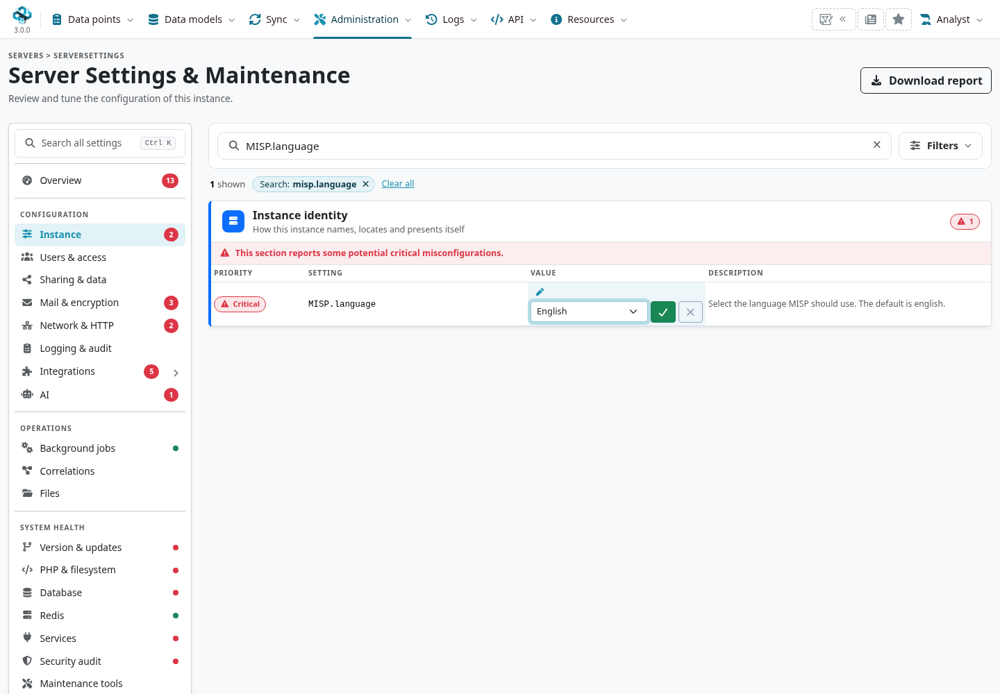
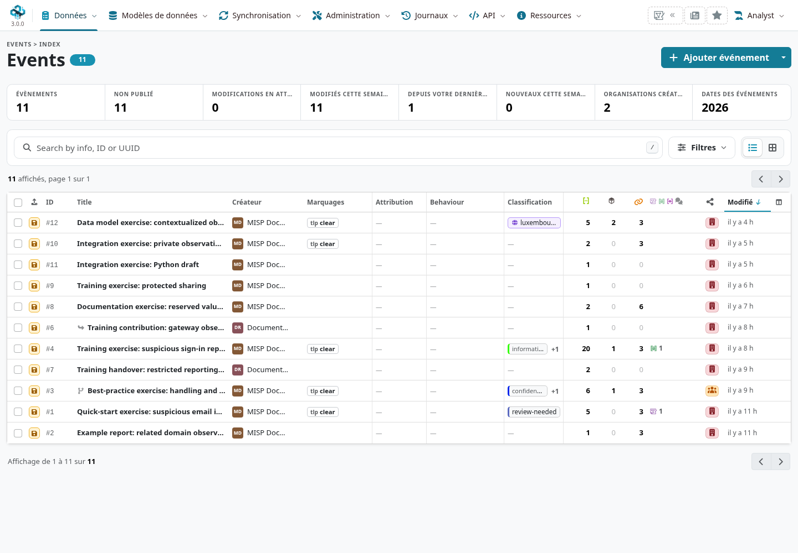

MISP uses CakePHP/gettext message catalogues to translate interface text. Translation coverage
varies by language and by feature; a selected locale does not mean every label in the developing
3.0 interface has already been translated.

::: {.callout-note}
Checked against MISP **3.0.0**, `3.0_wip` commit `99ebee729`.
The branch's [contribution guide](https://github.com/MISP/MISP/blob/3.0_wip/CONTRIBUTING.md#translating-misp)
uses **Crowdin** and states that only reviewed translations are included in MISP.
:::

<!-- Locale validation, placeholder checks and captures: ../assets/reference-faq-screenshots.json -->

<a id="misp-and-internationalization-i18n"></a>
<a id="style"></a>
<a id="translating-misp-for-translators"></a>

## Contribute a translation {#translation-contribute}

1. Open [MISP on Crowdin](https://crowdin.com/project/misp), sign in and choose a target language.
2. Read the string's context and existing translations. Preserve placeholders, identifiers and
   the meaning of permissions or sharing labels.
3. Submit the translation for review. A suggestion is not immediately installed on every instance;
   reviewed catalogue updates must reach the branch/release and deployment you use.

Crowdin is a separate service with its own
[privacy policy](https://support.crowdin.com/privacy-policy/). Its
[volunteer introduction](https://support.crowdin.com/for-volunteer-translators/) explains the editor
and review process. For a local source-string defect, report the relevant branch, page and exact
message to [MISP core](https://github.com/MISP/MISP/issues).

Prefer clear, consistent language used by practitioners. Keep machine tags, API fields, object
relation names and other protocol identifiers intact; translating a display label does not rename
the data model. Describe an action accurately, especially when it saves, deletes, shares or publishes.

<a id="enabling-a-language-on-your-instance"></a>

## Select an installed language {#translation-instance-language}

A site administrator selects **`MISP.language`** in
**Administration → Server Settings & Maintenance**. Search for the setting in the **Instance** group.
The default code is `eng`. The available choices come from this deployment's real directories
under `app/Locale/`; the 3.0 loader excludes runtime symlink aliases from the choices.



Save the intended locale through the settings interface and reload a page. The setting's
save hook clears relevant cache files. `AppController` then sets CakePHP's request language;
it is an instance setting, not a separate language selector on each analyst's profile.
The MISP 3.0 layout also maps catalogue codes to HTML language/direction metadata.



If a label remains in English, check the saved locale, the catalogue shipped by that exact
checkout, the source message and its translation/review status. New MISP 3.0 interface strings may not
have corresponding entries yet. Do not promise an installed language count from the number
of languages a translation service can support.

<a id="keep-html-out-of-translatable-strings"></a>
<a id="making-misp-translatable-for-developers"></a>
<a id="use-named-placeholders-not-s"></a>
<a id="wrap-button-labels-and-form-labels"></a>

## Write translatable interface text {#translation-developers}

Wrap user-facing PHP strings with the framework's translation functions. Keep a complete
sentence as the message and pass changing values as format arguments:

```php
<p><?= h(__('Remove Proposal #%s?', $proposalId)) ?></p>
```

Use numbered `sprintf` placeholders when a translator must be able to reorder multiple values:

```php
<p><?= h(__('Move %1$s to %2$s?', $itemName, $destinationName)) ?></p>
```

A literal `{$id}` inside a single-quoted PHP message is not a named interpolation mechanism.
Match every placeholder's type and count, and escape the completed text for its output context.
For HTML text in a view, `h()` is appropriate; attributes, JavaScript and URLs need their own
context handling. Do not concatenate translated sentence fragments around identifiers.

Wrap form labels too:

```php
echo $this->Form->button(__('Submit'), ['class' => 'btn btn-primary']);
echo $this->Form->input('sharing_group_id', [
    'options' => $sharingGroups,
    'label' => __('Sharing group'),
]);
```

Keep structural markup outside plain-text messages. If a message intentionally contains a link
or other markup, follow the component's established safe formatting pattern, keep the sentence
translatable as a whole, and never insert unescaped user text as trusted HTML.

The checked-out template is `app/Locale/default.pot`; language messages live under
`app/Locale/<locale>/LC_MESSAGES/default.po`. JavaScript text also needs the relevant component's
translation bridge; wrapping PHP labels does not translate hard-coded JavaScript strings.
Use the branch's extraction/contribution process and review changes to placeholders and plural
forms. See [CakePHP 2 internationalization](https://book.cakephp.org/2.0/en/core-libraries/internationalization-and-localization.html)
for the underlying API.

<a id="issues"></a>
<a id="reach-out-to-the-community"></a>
<a id="translating-the-website-or-this-book"></a>

## Website, book and community {#translation-other-projects}

The website and this book are separate from MISP's software catalogues. Coordinate translation
work with the maintainers of the relevant project, keep links/code identifiers usable, and
record which source version the translation follows. For project support and reporting guidance,
see the [FAQ](../faq/index.qmd#faq-support).
