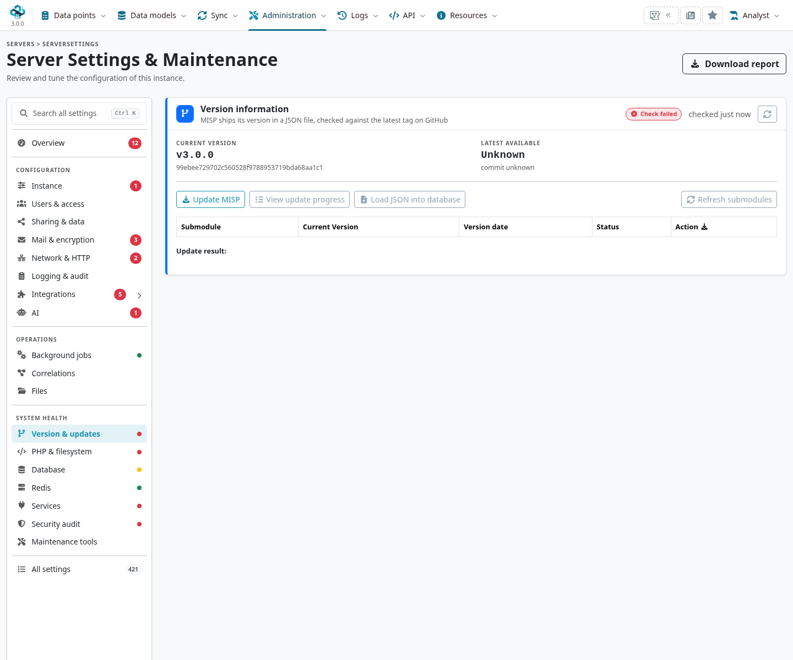
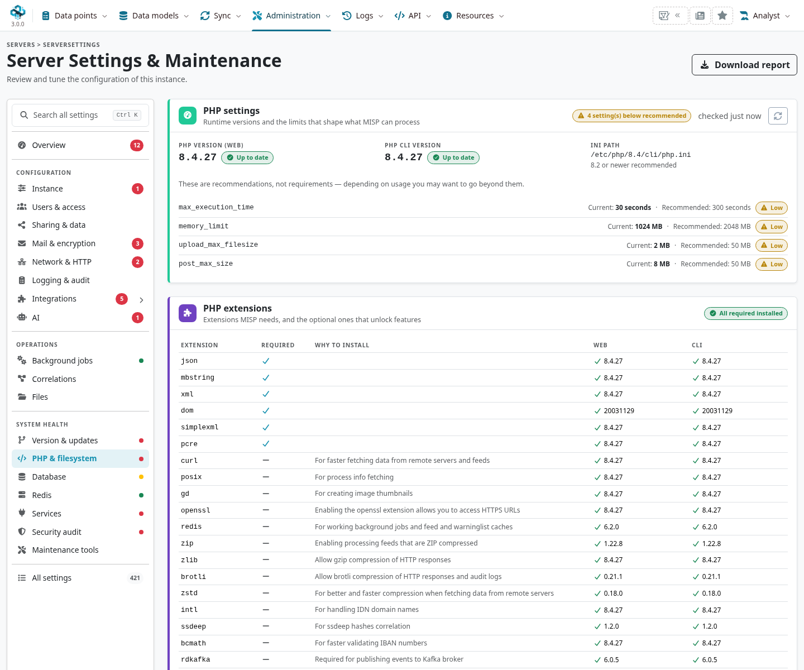

MISP's Python environment supports STIX conversion, attachment inspection, PyMISP and other
optional services. Keep it aligned with the **application version being deployed**, then verify
those features from the web and worker contexts. Updating every package to the newest version
is not a substitute for an application upgrade.

::: {.callout-note}
This chapter follows MISP **3.0.0**, `3.0_wip` commit `99ebee729`.
The root `requirements.txt` mixes exact pins and minimum versions; it is not a fully locked
set. At this commit it pins PyMISP **2.5.34.4** and requires `misp-stix>=2026.10.12`.
Record the resolved package set used by your deployment and rehearse an upgrade before rollout.
:::

<!-- Dependency/source checks and screenshot hashes: ../assets/administration-screenshots.json -->

<a id="installation"></a>

## Choose the deployment path {#python-deployment}

::: {.table-responsive}

| Installation | Update approach |
|---|---|
| Official Docker deployment | Use the maintained [MISP Docker instructions](https://github.com/MISP/misp-docker), tested image references and matching configuration/volumes. Recreate services with the approved images; an ad-hoc `pip install`{.text-wrap .text-break} inside a running container is not a persistent image update. |
| Source installation | Use the selected MISP ref, its pinned submodules and its application Python environment. Adapt the commands below to its OS user, paths and Python version. |
| Separate module service / connector | Update that service's own environment and dependencies. It is not automatically updated by changing MISP core's virtual environment. |

:::

The book uses a development checkout to describe 3.0 features. Do not switch a production
instance to `3.0_wip` just to match a screenshot. Select and test the intended application/ref,
read its upgrade requirements and retain a compatible rollback/restore set.

## Inventory before changing packages {#python-inventory}

In **Administration → Server Settings & Maintenance**, use **Version & updates** for the
application/submodule state and **PHP & filesystem** / **Services** for runtime and feature
checks. A failed remote version check is different from an incompatible local dependency.



Check `MISP.python_bin`, which selects the Python executable used by MISP's process tools.
Do not assume that an activated interactive shell environment is used by PHP or Supervisor.
On a conventional source installation, the environment is often `/var/www/MISP/venv`:

```bash
sudo -u www-data /var/www/MISP/venv/bin/python --version
sudo -u www-data /var/www/MISP/venv/bin/python -m pip --version
sudo -u www-data /var/www/MISP/venv/bin/python -m pip check
sudo -u www-data /var/www/MISP/venv/bin/python -m pip freeze
```

Retain the application/image ref, submodule SHAs, package inventory, service configuration and
health results with the maintenance record. Use the Python version supported by that release
and its dependencies. A virtual environment normally needs rebuilding when the interpreter
changes; copying its directory to a different host/interpreter is not a reliable migration.

<a id="set-up-the-virtual-environment"></a>
<a id="updating-misp-and-its-dependencies"></a>
<a id="updating-misp-core"></a>
<a id="updating-the-python-dependencies"></a>
<a id="set-the-virtual-environment-up"></a>

## Update a source installation {#python-source-update}



1. Rehearse on a restored copy; take a consistent backup of the real deployment. Include
   configuration/secrets and attachment storage, not just a package list.
2. Plan downtime and pause external writers, scheduled ingestion and workers as required by the
   selected upgrade. Deploy the **tested** application ref and its matching submodule revisions.
3. Install the required system/Composer/Python dependencies using that release's procedure.
   Updating Python alone does not install PHP extensions or apply database migrations.
4. Run the planned MISP 3.0 offline upgrade, verify migration/schema state and restart the web
   PHP runtime and workers with the updated environment.
5. Check representative import/export, attachment and background paths before restoring normal
   ingestion. Retain the new inventory and a tested recovery option.

For a source checkout's submodules, use its recorded revisions:

```bash
sudo -u www-data git -C /var/www/MISP submodule update --init --recursive
```

This initializes/updates to the selected parent checkout's pins; `--remote` would choose a
different state. Review local changes before any checkout/update. The UI **Update MISP** action
and `Admin updateMISP` are deployment-specific mechanisms, not universal Docker upgrades.

With a suitable existing virtual environment, a dependency-install step is:

```bash
sudo -u www-data /var/www/MISP/venv/bin/python -m pip install \
  -r /var/www/MISP/requirements.txt
sudo -u www-data /var/www/MISP/venv/bin/python -m pip check
```

Because some requirements specify minimums, this can resolve different transitive versions at
different times. Pin/lock the set tested for your deployment when reproducibility is required.
Do not add `-U` to every package or run unrelated `composer update` as a diagnostic fix.
Install Composer dependencies from the release's lock file and supported install procedure.

If no virtual environment exists, use the deployment's provisioning instructions. A conventional
creation step is `python3 -m venv /var/www/MISP/venv` run as the appropriate application OS user,
with the required system `venv` package available. Configure `MISP.python_bin` to its Python
executable and ensure the web/worker users can execute/read it. Do not create a second unused
environment and expect diagnostics to discover it.

### Apply MISP 3.0 database upgrades separately {#python-database-upgrade}

Check pending work and follow the release's supported procedure. For the pinned 3.0 source:

```bash
sudo -u www-data /var/www/MISP/app/Console/cake Admin migrationStatus
sudo -u www-data /var/www/MISP/app/Console/cake Admin migrationApply --dry-run
# During the planned offline upgrade, after backup and preparation:
sudo -u www-data /var/www/MISP/app/Console/cake Admin runUpgrade
sudo -u www-data /var/www/MISP/app/Console/cake Admin schemaDiagnostics
```

`runUpgrade` coordinates numeric updates, migrations and the value conversion where needed.
It asks Supervisor to stop/restart workers; inspect warnings and confirm the actual state.
An interrupted run can leave the instance offline and requires investigation/retry of that
procedure, not a forced live flag or manual ledger edit. Check engine-specific prerequisites
and allow space/time for conversion. See [Administration](../administration/index.qmd#admin-database).

<a id="updating-python-dependencies"></a>

## Verify the runtime actually in use {#python-verification}

The **PHP & filesystem** page compares web/CLI PHP and dependency health; **Services** reports
feature-specific checks. Compare these with the executable configured in `MISP.python_bin`
and the worker environment. A package import in your personal shell proves only that shell's
Python environment can import it.



Check the paths you use operationally:

- STIX import/export, with the expected format version and representative synthetic data.
- Attachment handling/Yara and any optional native-library bindings required by your use case.
- A local read-only API request using the server-recommended PyMISP client version.
- A benign background job, its result and worker logs after service restart.
- Module discovery and a local parser before testing a provider-dependent enrichment.

MISP uses **misp-stix** (`misp_stix_converter`) for STIX conversion; do not rebuild the old
per-package `python-stix`/CybOX/MAEC recipe from historical documentation. Optional packages may
also need OS libraries. Use the actual diagnostic error and deployment documentation to identify
the failing layer instead of upgrading unrelated packages.

For a private CA or outbound proxy, configure trust/network access for the process that makes
the request. Keep certificate verification enabled; the web service, worker and separate module
container may need their own CA/proxy configuration.

<a id="updating-misp-modules"></a>

## Update misp-modules separately {#python-module-service}

**misp-modules** has its own release cycle and dependency extras. Use its maintained
[installation guide](https://misp.github.io/misp-modules/install/) or the matching Docker service
update. Install the dependencies for the modules you actually use, in that service's environment,
then restart the service and check discovery from MISP.

Do not install the old `REQUIREMENTS` recipe into MISP core's virtual environment by default.
A core update does not guarantee the module service or external provider is compatible.
Test a local parser first, then the configured enrichment/action/AI paths that are in scope.
See [Modules](../modules/index.qmd) for grouped settings, organisation restrictions and the
separate 3.0 AI endpoint configuration.

## Recover from a failed update {#python-recovery}

Keep the failure output, versions and affected process/service. If dependency resolution fails,
repair/rebuild the intended environment before restarting workers against it. If a schema/value
conversion fails, use the supported upgrade recovery procedure and compatible backups.
Reverting Python packages or Git alone does not revert the database.

Before reconnecting automation, verify migration state, data visibility, attachment access and
service health on the restored/updated instance. Follow the
[backup and recovery procedure](../administration/index.qmd#admin-backup-recovery), including
controls on outbound mail, synchronization, workflows and scheduled tasks.
